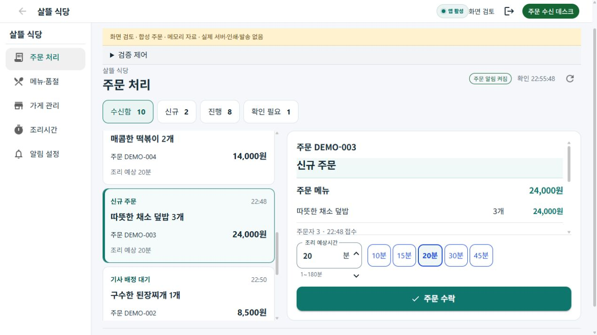

# 음식점 PC 주문 처리 작업대 r66

[승인 범위](../AI/Planning/시스템/PLAN-SYSTEM-FRANCHISE-OPERATIONS/restaurant-pos-workspace.r66.md) · [페이지 책임 카드](../ProjectOverview/page-docs/restaurant-order-usability-r1.md#pc-작업대-책임-카드-r66--구현-전-기준)

사진의 PC POS에서 주문 목록과 선택 상세를 함께 읽고 현재 단계의 행동을 처리하는 구성을 참고했다. 여러 POS 창의 수치를 같은 집계로 해석하거나 사진의 주문·개인정보를 시험 자료로 복제하지 않았다.

## 변경

- 1100px 이상에서는 기존 앱에 고정 업무 탐색·주문 목록·선택 상세를 배치한다. 작은 화면은 기존 주문번호 상세 경로를 유지한다.
- 현재 수신함의 신규/진행을 구분하고 배차불가·상세 확인 필요를 별도 필터로 보여준다. 확인 필요는 진행과 중첩 가능하므로 전체 합계로 더하지 않는다. 과거 완료 이력 전체 집계가 아니다.
- 목록은 접수 순서로 읽고 새 주문·자동 갱신·필터 변경으로 선택을 빼앗지 않는다. 동일 상세 인스턴스가 조리시간·거절 사유를 보존한다. 목록에서 빠진 종료 주문도 선택 상세 결과는 유지한다.
- 기존 OrderDetail과 DeskService를 재사용한다. 서버 AvailableActions로 수락/기사 배정 후 조리 시작/픽업 준비를 표시하며 준비·픽업·전달·수령을 구분한다. 현재 재조리 회차를 사용한다.
- 본문과 하단 명령 영역은 별도로 배치해 메뉴·요청사항을 가리지 않는다. 취소 조건 협의는 기존 독립 상세 화면으로 인계한다.
- 명령 종료 후 목록 재조회까지 대상 선택과 추가 명령을 잠근다. 늦은 낮은 Revision 조회/수락 응답이 공유 표시 객체의 최신 상태·금액·가능 행동·회차를 되돌리지 않도록 기존 투영에 조건을 추가했다.
- 수락과 인쇄 창 요청을 분리한 기존 복구를 유지한다. 출력 창 실패를 다시 수락할 이유로 삼지 않는다.

## 검증 경계

`eng/RestaurantPosPreview`는 제품의 실제 Razor·상세 처리 코드·레이아웃·탐색·역할 테마·CSS를 직접 연결한다. 합성 자료와 메모리 API 대역만 소유하며 실제 서버/DB/배차/알림음/프린터 검증을 대신하지 않는다. 좁은 화면은 같은 호스트의 320/390px iframe CSS viewport로 확인하며 단말 검증과 구분한다.

최초 집중 검증의 기존 소스 조합 검사 1건은 MainContent에 class를 추가해 시작 태그가 달라진 문제였다. 동일 본문 안의 wrapper로 바꾸어 기존 내부 시험 배너 위치를 보존했고 최종 집중342개가 통과했다. 최초 화면의 sticky 처리 영역은 메뉴를 덮어 최종 flex 본문·명령 분리로 교체했다. 이 초기 화면은 최종 증거로 사용하지 않는다.

## 남은 범위

새 메뉴 옵션 계약·과거 주문 날짜 검색·실제 영업 상태 쓰기·근거 있는 기사 ETA·PC 알림 설정 확대·실제 Windows 앱 조작·휴대폰 설치·실제 주문·결제·물리 인쇄·클라우드 배포는 이번 완료에 포함하지 않는다. 기존 보안 설정과 영상·다른 역할의 dirty 작업은 유지한다. commit/push하지 않는다.

## 코드·시험 결과

- 집중 Fast: 342/342 통과. 초기 실패 기록은 `artifacts/local/restaurant-pos-r66/fast.log`, 성공은 `fast-final.log`, 상세 `artifacts/local/validation/20261022-224410/`.
- 최종 Task: v3.5 소비 솔루션 빌드와 전체 15,098개 통과, 환경 의존16개 생략, 실패0. 최종 제품 소스 기준 `artifacts/local/validation/20261022-224551/`과 `task.log`.
- 신규 회귀29개는 분류/정렬/선택 유지/재조리/최신 revision 보호/명령 종료 잠금 await와 예외 해제를 검증한다. 기존 알림·인증·멱등 복구·전표 시험도 함께 통과했다.
- Windows 초기 소비 빌드와 최종 소비 솔루션 빌드 통과. 초기 unused 변수 경고는 최종 제품 소스에서 제거했다. 실제 Windows 앱 UI 실행은 별도다.
- tracked dirty 기준선286개 중 허용 경로 밖 해시 변경0, index 비어 있음. 기존 untracked 파일을 포함한 강제 정리·stage·commit·push는 하지 않았다.

## 실제 합성 화면 결과

최종 직접 연결 Razor에서 브라우저12항목을 확인하고 PNG12장을 보존했다. 원본 캡처 바이트·해시·시험 결과는 [evidence.json](../assets/changes/2026-10-22-restaurant-pos-workspace-r66/evidence.json)에 있다. 미리보기36개 소스 결속은 `artifacts/local/restaurant-pos-r66/preview-host.json`이며 최종 미리보기 빌드는 경고0·오류0이다.

- 1280×720 PC: 고정 탐색·목록/상세, 메뉴 금액·수량, 신규 도착 후 같은 선택·조리시간30분·스크롤 유지, 필터 전환 후 선택 유지, 본문/명령 비중첩과 가로 넘침 없음.
- 합성 DEMO-001: 수락 → 기사 배정 대기(조리 행동 없음) → 합성 기사 배정 신호 → 조리 시작 → 픽업 준비 완료 → 합성 기사 픽업. 픽업을 배송·수령 완료로 표시하지 않았다.
- DEMO-002: 목록/상세 조회 실패에서 이전10건과 선택 메뉴 유지·명령 잠금, 복구 후 재활성. 인쇄 창 실패에도 주문 수락·배정 대기는 유지되고 전표 재시도 경로가 남는다.
- DEMO-009: 확인 필요 필터에서 배차실패 안내, 조리 시작을 허용하지 않음.
- 실제 iframe390px에서 목록→기존 주문번호 상세 이동, 신규320px viewport에서 목록의 시각 배치를 확인했다. 좁은 화면의 모든 긴 문구/최대금액/접근성 전체 인증이나 실제 단말 결과로 확대하지 않는다.
- 초기 미리보기의 신규 추가가 과거 접수시각을 만들던 시험자료 오류는 실제 현재 접수시각으로 수정하고 새 circuit에서 다시 확인했다. 초기 잘못된 전제의 화면 판정은 최종 통과에 포함하지 않았다.

[수락 후 기사 대기](../assets/changes/2026-10-22-restaurant-pos-workspace-r66/02-accepted-waiting.png) · [픽업 준비](../assets/changes/2026-10-22-restaurant-pos-workspace-r66/04-pickup-ready.png) · [조회 실패](../assets/changes/2026-10-22-restaurant-pos-workspace-r66/06-query-failure.png) · [인쇄 실패·수락 보존](../assets/changes/2026-10-22-restaurant-pos-workspace-r66/07-print-failure-accepted.png) · [390px 상세](../assets/changes/2026-10-22-restaurant-pos-workspace-r66/11-mobile-390-detail.png)

로컬 미리보기는 [주문 처리](http://127.0.0.1:5371/orders)에서 열 수 있다. 합성 자료는 새로고침 후 초기화되며 실제 주문을 생성하지 않는다.
