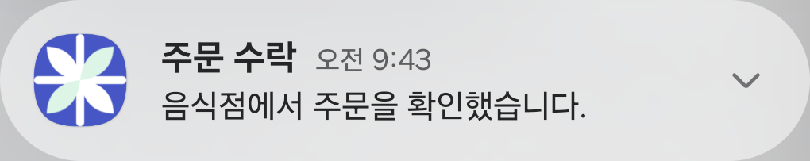

# 업무 진행 알림 실제 휴대폰 검증 r7

2026-10-22, 연결된 Galaxy A34(SM-A346N, Android 16)에 최신 통합앱 **0.1.203/203**을 기존 데이터 보존 방식으로 설치했다. 실제 Google FCM data-only 7건을 보내 대표 5단계의 OS 알림 표시와 3개 역할 화면 이동, 중복/이전 단계 억제, 백그라운드/프로세스 재시작, 로그아웃 정리를 확인했다. 제품 기능 코드는 이번 실행에서 변경하지 않았다.

기준: [승인 계획](../AI/Planning/공통/PLAN-OPERATIONS-DISPATCH-CORE/workflow-progress-device.r7.md) · [작업 명세](../AI/Planning/공통/PLAN-OPERATIONS-DISPATCH-CORE/workflow-progress-device.r7.work-order.json) · [선행 r6 구현](2026-10-22-workflow-progress-notifications-r6.md) · [비밀 제외 결과·PNG 해시](../assets/changes/2026-10-22-workflow-progress-device-r7/verification.json).

## 실제 확인 결과

| 상황 | 확인한 결과 | 화면 |
| --- | --- | --- |
| 앱 전경의 음식 주문 수락 | 알림이 표시되고 현재 화면은 그대로 유지. 알림을 누르면 `/workspace/orderer`로 이동 | [주문 수락](../assets/changes/2026-10-22-workflow-progress-device-r7/01-food-accepted.png) · [주문자 화면](../assets/changes/2026-10-22-workflow-progress-device-r7/02-food-tap.png) |
| Home으로 내려둔 입고 완료 | 실제 FCM 수신·OS 알림 표시 | [입고 완료](../assets/changes/2026-10-22-workflow-progress-device-r7/03-warehouse-background.png) |
| 프로세스가 없는 상태에서 알림 클릭 | `am kill` 뒤 PID 없음 확인. 남아 있던 입고 알림을 눌러 세션 복원·창고 화면 진입 | [창고 화면](../assets/changes/2026-10-22-workflow-progress-device-r7/04-warehouse-cold-tap.png) |
| 화물 상차 완료 | 알림 표시·클릭 뒤 `/workspace/shipper`로 이동, 기존 본인 합성 의뢰 조회 | [상차 완료](../assets/changes/2026-10-22-workflow-progress-device-r7/05-cargo-picked.png) · [화주 화면](../assets/changes/2026-10-22-workflow-progress-device-r7/06-cargo-tap.png) |
| 화물 전달 완료 | Home 배경 상태에서 실제 FCM 수신·알림 표시 | [전달 완료](../assets/changes/2026-10-22-workflow-progress-device-r7/07-cargo-cold-receive.png) |
| 프로세스가 없는 상태의 피킹 완료 수신 | 발송 직전 PID 없음 확인. FCM이 프로세스를 시작해 알림 표시, 알림 클릭 뒤 창고 화면 복원 | [피킹 완료](../assets/changes/2026-10-22-workflow-progress-device-r7/08-warehouse-cold-receive.png) · [이동 결과](../assets/changes/2026-10-22-workflow-progress-device-r7/10-warehouse-cold-receive-tap.png) |
| 같은 사건 재전송 | 실제 FCM은 접수됐지만 OS 기록의 같은 사건 수 1개·생성/갱신 시각 불변 | 별도 JSON 대조 |
| 뒤늦은 이전 단계 | 동일 원천의 이전 발생시각을 보낸 주문 접수 알림을 표시하지 않음. 기존 주문 수락 기록 유지 | 별도 JSON 대조 |
| 로그아웃 | 남아 있던 본인 업무 알림 1개→0개, 설치 비활성·로그인 필요 화면. 다른 앱의 알림은 보존 | [로그아웃 후](../assets/changes/2026-10-22-workflow-progress-device-r7/11-logged-out.png) |

샘플은 **주문 수락·입고 완료·피킹 완료·상차 완료·전달 완료** 5종이다. 실제 입고/운송을 완료시키지 않았으므로 화면의 현재 업무 없음이나 기존 의뢰의 대기 상태는 정상이다. 샘플 원천 ID에는 가상 표식을 넣었고 개별 주문을 고르지 않는 기존 역할 업무 화면으로 연결했다. 실제 특정 원장의 완료 사건과 상세 선택까지의 단말 E2E 결과로 확대하지 않는다.

## 샘플 화면




알림 PNG는 실제 전체 캡처에서 해당 알림 사각형만 자른 것이다. 문구나 그림을 다시 만든 이미지가 아니며 원본/자른 PNG 해시와 좌표를 기록했다. 다른 앱의 메일·시스템 알림이 보이는 전체 원본은 비공개 자료로만 보존했다. 전체 역할 화면 PNG는 합성 업무만 표시한다.

## 앱·전송·설정 확인

- 기존 일반앱 SDK 구성과 서버 발송 자격의 Firebase 프로젝트, Android 패키지가 일치했다. 설정/키를 새로 만들거나 다른 역할 앱 설정을 복사하지 않았다.
- 기존 서명으로 standalone Debug APK를 만들고 `install -r`로 갱신했다. 삭제/데이터 초기화 없음. 설치 전 APK도 별도로 보존했다. 새 APK SHA-256: `3302c27be7c6ba72e674d22d65829a5128f162bccf97666acc4b8ccc55a0cd9a`. 제작 중 소스 변경 0개, SDK 입력 해시 전후 일치, 권한 허용 유지, 등록 버전203을 확인했다.
- 새 [단발 검증 도구](../../eng/WorkflowProgressDeviceVerificationR7/README.md)는 제품 `FirebaseFcmPushService`와 공통 단계 계약을 그대로 사용한다. **빌드 경고0/오류0, 무네트워크 사전검사14개 통과**. 자동 캠페인이나 재시도 기능은 없다.
- 매 발송 직전 기존 격리 DB에서 활성 설치가 정확히 1개인지 읽었다. 저장된 토큰은 제품 Data Protection 코드와 해당 시험 호스트의 기존 key ring으로 복호화한 뒤 해시를 대조했다. 원문 토큰/키는 공개 결과에 기록하지 않았다.
- 전송 전 배타 발송 시도 기록을 만들고, 실제 HTTPS FCM 요청을 한 번 보냈다. 수신은 실제 `MemberFirebaseMessagingService → MemberDeliveryPushService → WorkflowProgressPushCoordinator → Android NotificationManager` 경로였다. shell의 가짜 알림이나 클릭 intent 직접 실행으로 대체하지 않았다.
- 업무 진행은 `업무 진행` 채널·일반 중요도·기본 시스템음이다. 확인된 소리 설정이 있던 첫 계정은 OS에 시스템음·진동이 적용됐고, 설정 미확인인 다음 계정은 무음/무진동이었다. 신규 추천 배차의 높은 중요도·‘살뜰 배달’ 음원과 다른 목적이다. **사용자는 지금 확인하기 어렵다고 답했으므로 실제 청취는 미확인**이다.
- 실제 수신·표시를 앱 foreground와 Home 배경, process 없음에서 각각 확인했다. 강제중지(force-stop)는 Android가 앱을 재실행할 때까지 푸시를 막는 별도 상황이며 cold 수신 검증에 사용하지 않았다.

## 범위와 남은 확인

```text
가상 단계 샘플 7회 단발 전송
├─ 정상 단계 5종 → 실제 폰 알림 표시
├─ 중복/뒤늦은 이전 단계 → 추가 표시 없음
├─ 알림 누르기 → 주문자 / 창고 / 화주 기존 업무 화면
└─ 로그아웃 → 본인 알림 정리·설치 해제
```

로컬 API는 기존 `mirror_external_r106_20261017` Simulation 호스트의 보존 바이너리를 로그인·설치 등록·기존 역할 조회에 사용했다. 기존 격리 MySQL/Mongo 컨테이너 3개만 재시작했으며, 서버 worker/자동 배차/지급/운영 설정은 꺼진 상태다. 실제 외부 통신은 이번 단발 Google FCM이다. 현재 r6 서버 원장의 단계 변경→Outbox worker→단말까지를 같은 신규 업무로 완주한 증거는 아니다.

27단계 전수 단말, 전문 앱별 수신, 잠금화면 실측, 장시간 절전/Doze, 네트워크 단절·재접속, 다른 계정 오배달과 만료 후 로그인 재개는 별도다. 이번 APK의 통합 역할 지도는 연결 설정 안내를 표시하므로 지도 SDK 정상 표시도 인증하지 않는다. 실제 결제·정산·지급·운영 공개와도 구분한다.

시험 중 WebView의 `location.href`로 전체 페이지를 직접 다시 연 시도는 오류 화면이 되어 앱을 재시작했다. 이후에는 관찰된 기존 링크/버튼과 정상 로그인 흐름만 사용했다. 해당 조작을 알림 클릭 결함으로 판정하지 않았다. 첫 그룹 알림 가운데 탭은 펼치기로 끝나 원시 캡처를 비공개로 보존했고, 관찰된 제목을 눌러 최종 이동을 확인했다. 첫 전달 알림의 cold 시도는 PID가 남아 있어 배경 수신으로만 분류했으며, 피킹 알림에서 PID 없음부터 별도 확인했다.

기기는 최신 앱 설치 상태로 두었고 시험 계정은 로그아웃했다. 로컬 시험 서버와 USB 연결은 유지했다. 앱 제품 소스 변경·운영 배포·commit/push는 실행하지 않았다. 이번 검증으로 이전 r6의 전체 시험 수를 새로 실행한 것으로 합산하지 않는다.
