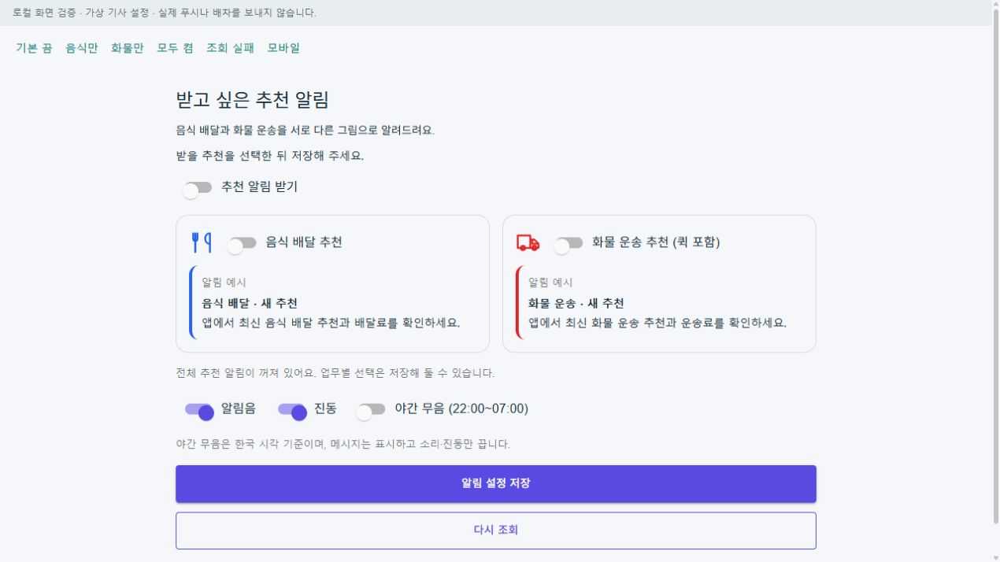
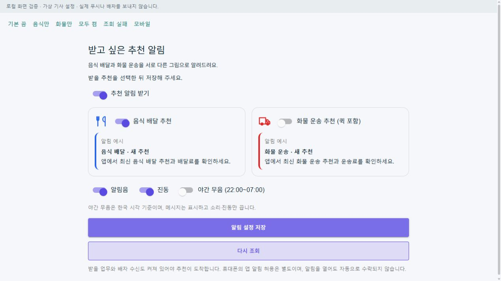
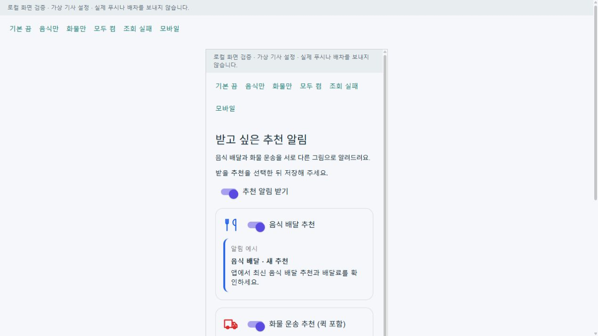
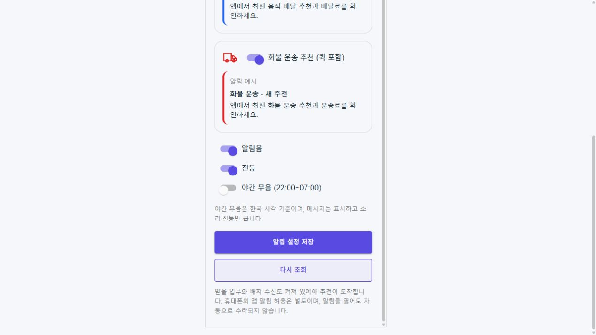
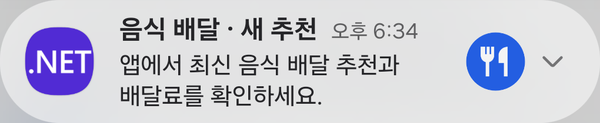
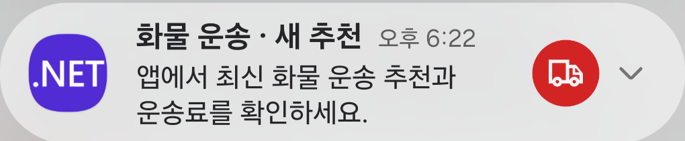
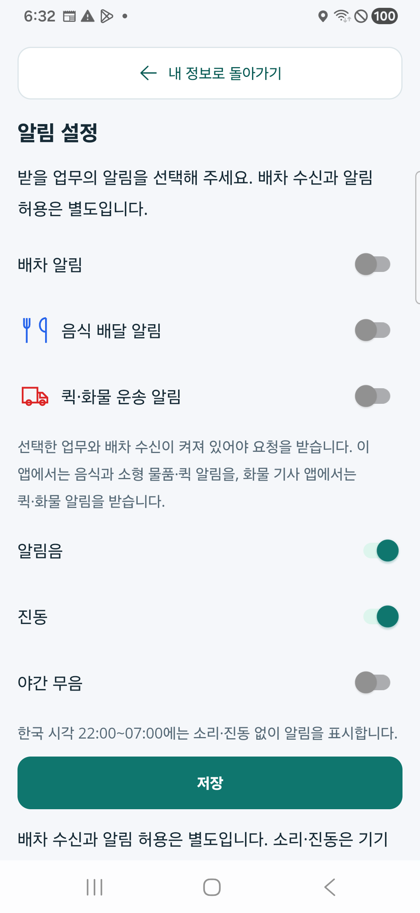
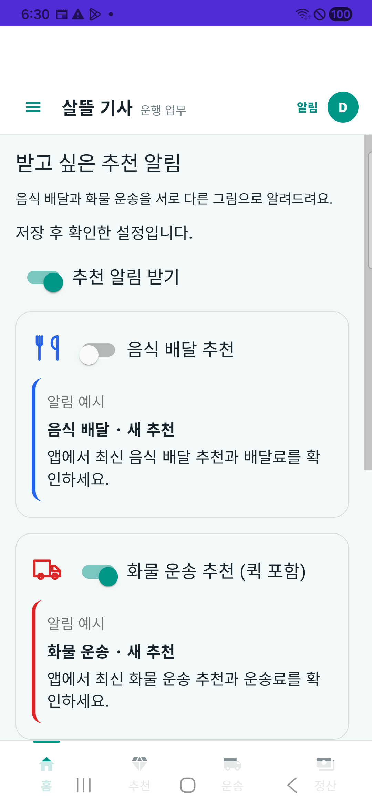

# 음식·화물 추천 알림 구분 r1

기사가 추천 알림의 그림과 업무명으로 음식 배달과 화물 운송을 구별하고, 받을 종류를 직접 선택하도록 보완했다. 기존 전체 추천 알림 허용에 음식/화물의 개별 허용을 추가했으며 신규 두 값은 기본 끔이다. 구형 설정에도 종류별 허용을 자동 부여하지 않는다.

## 화면과 동작

- 음식은 식기·`음식 배달 · 새 추천`, 화물은 트럭·`화물 운송 · 새 추천`으로 표시한다. 퀵은 트럭·별도 퀵 문구와 화물 알림 선택을 사용한다. FDriver의 마트 포장 주문도 실제 `QuickDelivery` 유형을 따른다.
- 공통 폼을 웹·통합 앱·화물 기사 앱에서 재사용하고 음식 앱의 네이티브 설정에도 같은 선택과 그림을 반영했다. 설정은 본인 계정으로 저장 후 재조회하며 계정/로그인 판본 변경과 늦은 응답을 폐기한다. 기존 소리·진동·야간 및 운전 중/정차 후 설정을 보존했다.
- 직접 FCM과 Outbox 발송 모두 전체 허용·실제 업무 종류의 허용·현재 추천/기사/차수/만료를 토큰 조회 전후 대조한다. 기존 수신 정책과 활성화된 공통 희망 업무 정책을 재사용한다. 기능 플래그를 켜거나 배차·수락 권한을 만들지 않았다.
- 화물 서버의 알림 자동 표시를 data-only 힌트로 바꾸고 Android 로컬 게시기를 추가했다. 앱의 정본 복구 → 본인 설정/수신 상태 → OS 권한·기존 채널 차단/무음·중복·만료 검사 후 게시한다. 취소 토큰과 계정 판본을 실제 게시 직전 다시 확인한다.
- 음식 앱도 설정 저장 시작에 기존 허용 캐시와 알림을 무효화한다. 저장 후 GET이 실패하면 설정 화면에서 명시적으로 다시 조회할 때까지 게시를 보류한다. 일반 갱신의 이전 응답은 이 보류를 풀지 못하며, 백그라운드 수신의 취소·계정 판본을 native 잠금 후와 게시 직전에 검사한다.
- 알림에 고객 주소·연락처·원시 API 오류를 표시하지 않는다. 알림 클릭은 정확한 추천을 재조회하고 자동 수락하지 않는다. 현재 수행·정산·취소 알림은 이번 종류별 설정의 대상이 아니다.

[페이지 책임·정보 배치](../ProjectOverview/page-docs/driver-recommendation-alerts-r1.md)

## 초기 브라우저 예시

실제 공통 Razor 컴포넌트를 루프백 전용 가상 기사 호스트에서 확인했다. 이 예시는 실제 OS 알림 수신 화면이나 운영 계정 설정 변경이 아니다.

## 초기 로컬 검증과 제한

아래 결과는 실기기 보완 전의 로컬 판본이다. 이후 실제 휴대폰 확인 결과는 다음 절에 별도로 기록한다.

- 집중 검증과 전체 회귀 결과, 소비 앱 빌드, 최종 소스 해시는 `artifacts/local/driver-recommendation-alerts/20261023-r1/validation-final.json`을 따른다. 초기 실패 로그/TRX도 같은 폴더에 보존한다.
- 최종 집중 검증 519건이 통과했다. 음식/화물 기사·통합 앱의 Android 최종 빌드는 모두 오류 0개이며 경고는 각각 36/18/3개다. 지도 ID·일반 회원 push 미설정, 기존 패키지 범위 및 Android API 분석 경고가 남아 있다. 통합 Web 소비 컴파일도 시험 프로젝트 의존성 빌드로 확인했다.
- 최종 전체 회귀는 15,296건 통과·실패 0·환경 조건 16건 생략(총 15,312건)이다. 앞선 설정 선행 조건 누락과 기존 웹 PageKey 호환 실패를 보완한 뒤 재실행한 결과다.
- 실제 공통 화면에서 기본 끔/음식만 저장 후 재조회/모두 켬/조회 실패·편집 차단, 데스크톱과 390px 한 열 배치·32px 아이콘·48px 저장/재조회 버튼을 확인했다. 페이지 소스 색인은 현재 587파일/691 route/17호스트로 재생성했고 기존 ID 변경은 0건이다. 새로 발견한 121개 기존 소스를 이번 작업에서 구현하거나 전체 사용자 동작까지 검증했다는 의미는 아니다.
- 기본 끔/전체 끔/한 종류만 허용, 구형 설정, 저장 재조회·결과 미확인·계정 변경, 토큰 조회 중 철회/만료/차수 변경, 조용 시간·OS 채널 보존, 실제 전문 앱 유형, data-only 및 업무 시나리오를 검사했다.
- 표준 Fast/Task는 작업 범위 밖 `CargoDriverWorkSession.cs:245`의 기존 EOF 형식 오류 때문에 diff 관문에서 중단됐다. 이번 범위 diff 확인·직접 시험·소비 빌드와 구별한다.
- 초기 로컬 검증 시점에는 실제 기기 알림 수신·잠금 화면의 OS 표시·권한 팝업·클릭, FCM 외부 전송과 iOS를 검증하지 않았으며 APK 설치도 하지 않았다. 운영 설정 활성화·배포·commit/push는 이 로컬 결과에 포함되지 않는다.
- 기존 희망 업무 선택 검사는 `SharedDriverWork.Enabled`의 현행 경계를 유지한다. 이 플래그가 꺼져 있어도 새 알림 종류별 허용은 항상 필요하다. Android 8 이상은 OS 만료 제거를 사용하고 구형 기기는 클릭 후 정본 만료 검사를 따른다.

## 실제 휴대폰 확인과 보완 · 2026-10-23

Galaxy A34 `SM-A346N`, Android 16에서 확인했다. 음식 앱 0.1.212/code212와 화물 앱 0.1.211/code211을 설치했으며, 기기에서 읽은 설치 APK의 SHA-256은 각 검증된 handoff와 일치했다. 두 앱 211의 알림 표시·차단 확인 뒤 음식 212의 설정 그림을 보완하고 OS 알림 재게시·끔 차단도 다시 확인했다. 음식 211의 앞선 시각 증거는 별도로 보존했다.

| 실제 확인 범위 | 결과와 판본 |
| --- | --- |
| Android 알림창 그림·문구 | 최종 음식 212의 오른쪽 파란 원 안 식기, 화물 211의 오른쪽 빨간 원 안 트럭과 업무별 문구를 실제 확인했다. 왼쪽의 기존 `.NET` 런처 아이콘은 유지된다. |
| 기본 끔·종류 끔·전체 끔 | 음식/화물 211에서 실제 Android 게시기에 합성 자료를 넣어 각 상태의 게시 차단을 확인했다. 음식 212에서도 최종 재게시와 끔 차단을 다시 확인했다. |
| 실제 설정 화면의 저장·재조회 | 음식 폼은 음식만, 화물 폼은 화물만 켜서 저장하고 GET 200으로 재확인했다. 사용한 격리 합성 설정 서버는 이후 모두 끔으로 복원했다. |
| 음식 설정 그림 | 음식 212에서 파란 식기·빨간 트럭이 모두 표시됨을 확인했다. |
| 기존 로컬 설정 보존 | 211 시험 전후 음식의 다섯 키·화물의 한 키에 대해 존재 여부와 SHA가 일치했다. 설정 원문을 공개 자료로 복제하지 않았다. |

초기 기기 확인에서 OneUI 알림창은 작은 아이콘 대신 기존 앱 아이콘을 주로 보여 주었다. 두 실제 게시기에 기존 작은 아이콘을 유지하면서 공통 강조색과 큰 아이콘을 추가했다. 큰 아이콘은 같은 흰 벡터를 파란색/빨간색 원에 그리며, 비트맵은 게시가 끝난 뒤 해제한다. 제목·본문·클릭·수신 정책은 바꾸지 않았다. 음식 설정의 문자열 경로 바인딩도 명시적 `PathGeometryConverter` 변환으로 바꾸어 실제 화면의 빈 그림 문제를 보완했다.

다음은 해당 휴대폰에서 확인한 화면이다. 알림 예시는 외부 FCM으로 받은 실제 배차가 아니라, 실제 게시기를 재사용한 **무음·무진동·90초 합성 알림**이다.

시각 확인 Activity는 `DEBUG && DRIVER_NOTIFICATION_VISUAL_CHECK`에만 포함되며, 별도 빌드 속성 `SsalddelNotificationVisualCheck=true`를 선택한 Debug 판본에서만 정의한다. 운영 계정 로그인·운행·배차·수락·외부 서버 명령을 이 도구에서 실행하지 않는다. 시험 중 잠깐 사용하는 설정은 메모리에 보존해 복원하고 기존 채널 차단을 우회하지 않는다.

최종 설치·표시·설정·원복 및 정리 결과와 판본별 근거는 `artifacts/local/driver-recommendation-alerts/20261023-device-r1/validation-device-final.json`을 따른다. 이 절은 외부 FCM 전송/수신, 잠금 화면, 알림 클릭, 소리·진동, iOS 또는 실제 주문·배차 전체 흐름 검증을 뜻하지 않는다.
