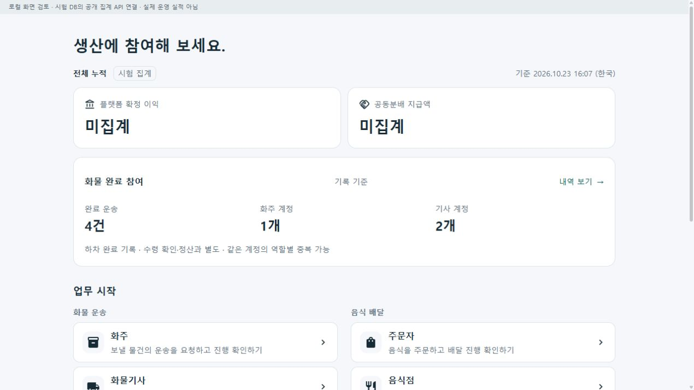
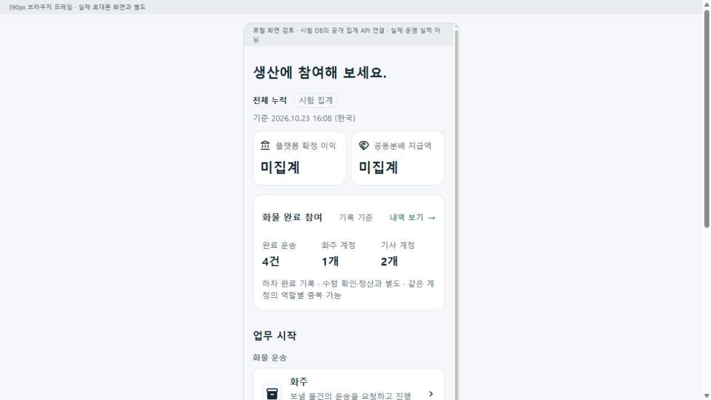

# 홈 제목을 생산 참여 문구로 변경 r1

2026-10-23 사용자 요청에 따라 공통 역할 선택 홈의 상단 브랜드 표시를 제거하고 주제목을 `생산에 참여해 보세요.`로 변경했다. 현행 소스의 기존 제목은 `함께 만든 성과`였으며 과거 화면의 `오늘 무엇을 할까요?`와 구분한다. 역할별 전문 업무·성과 요약·9개 진입 링크·하단 거래 안내는 유지했다. 제품명이나 내부 식별자 변경은 아니다.

| 커밋 | 변경 축 | 화면 변경 | 시각 증거 |
| --- | --- | --- | --- |
| 미커밋 | `RoleSelectionHome.razor` 제목/상단 표시 및 불필요한 CSS 선택자 제거 | 있음 | 아래 실제 공통 컴포넌트 브라우저 렌더 2장 |

## 검증

- 변경한 두 소스의 `git diff --check` 통과.
- 표준 Fast는 기존 다른 파일 `CargoDriverWorkSession.cs:245`의 EOF 빈 줄로 전체 diff 검사에서 중단됐다. 해당 파일은 수정하지 않았다. Fast의 빌드/시험 통과로 보고하지 않는다.
- 기존 `RoleWorkspacePreview --no-restore` 빌드는 삭제된 의존 프로젝트 assets 파일 때문에 실행하지 못했다. 좁은 기존 홈 호스트를 별도 `artifacts/local/home-production-copy/20261023-r1/preview/`로 복사하고 의존성을 복원해 실제 공통 UI를 빌드했다. 첫 빌드는 기존 CS9107 경고 1개/오류 0개, 최종 증분 빌드는 경고 0개/오류 0개다.
- loopback 전용 `127.0.0.1:5621`에서 1280px 브라우저와 390px iframe을 확인했다. 요청 문구, 상단 브랜드 표시 제거, 9개 역할 링크의 음식/화물 구분, 기존 누적 요약과 거래 안내 유지, 좁은 폭의 제목 줄바꿈/배치를 확인했다. 업무 링크의 목적지 수행 흐름은 이번 검증 범위가 아니다.
- 기존 시험 DB의 읽기 전용 공개 집계를 그대로 표시했다. 화면의 시험 집계 4건/1개/2개와 금액 미집계는 실제 운영 실적·매출·지급 증거가 아니다.
- 새 시험 작성·전체 시험 실행·APK 갱신·실기기·실결제·배포·commit/push는 수행하지 않았다. 기존 호스트는 보존했다.

