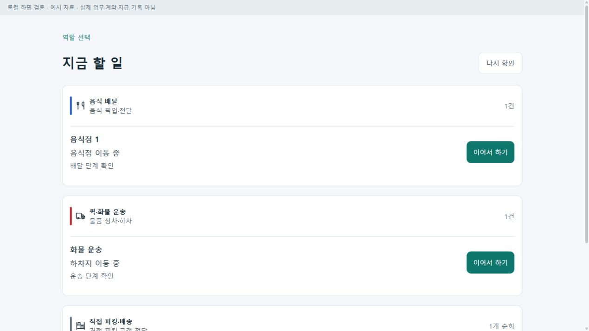
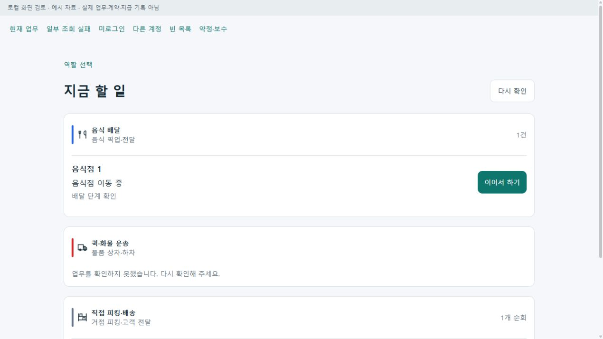
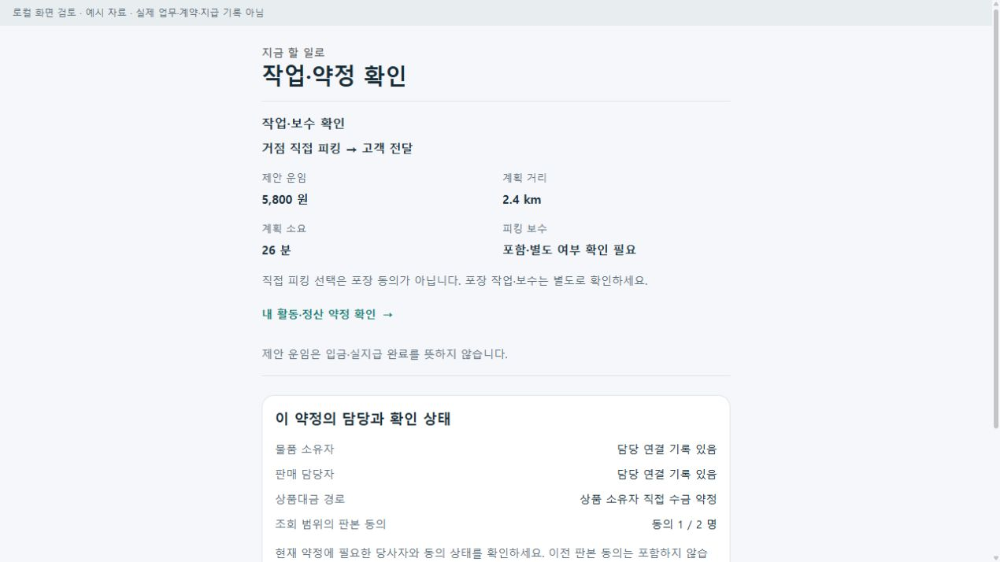
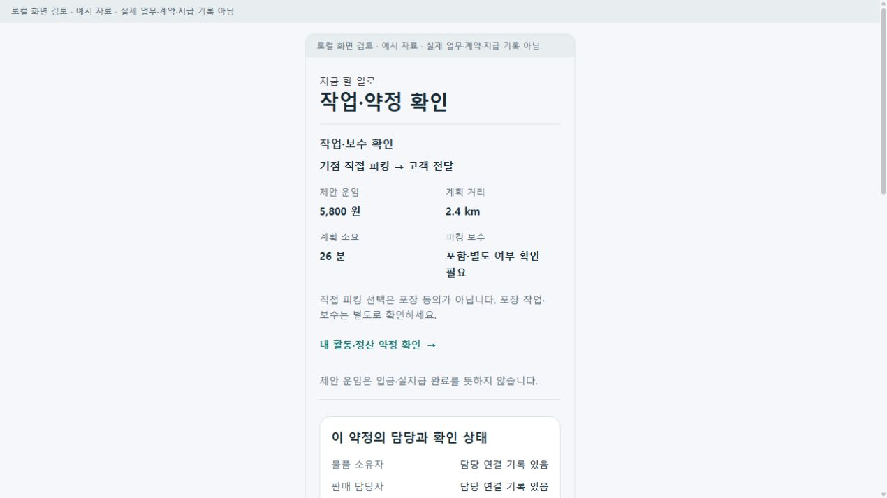

# 기사 현재 업무·피킹 보수·약정 담당 확인 r1

2026-10-23. 사용자가 전반 검토에서 찾은 보완점의 구현을 요청했다. 기존 한 플랫폼과 전문 음식·화물·창고 흐름을 유지하고 조회·판단·전문 화면 진입을 보완한다. 새 사업자·계약·피킹 단가·수수료·후원 결제·혼합 수락을 자동 확정하지 않는다.

| 커밋 | 변경 축 | 화면 변경 | 근거 |
| --- | --- | --- | --- |
| 미커밋 | 같은 계정의 현재 업무 모아보기 | 있음 | 기존 GET 3종·계정/판본 검사·공통 화면·Web/통합 MAUI route |
| 미커밋 | 직접 피킹 수락 전 작업·보수 요약 | 있음 | 기존 순회 조건에 표시 전용 요약 삽입·현재 순회 복귀 보존 |
| 미커밋 | 약정 담당·조회 범위의 동의 확인 | 있음 | 기존 정산 상세에 표시 전용 패널 삽입·항목별 본인 관계 |
| 미커밋 | 업무 종류별 그림 | 있음 | 기존 색·명칭·배정 작업 유지, 음식/차량/피킹 SVG 구별 |

## 적용 범위

- 홈의 `기사 · 지금 할 일` → `/driver/current-work`에서 음식·퀵/화물·직접 피킹 순회를 구분하고 기존 전문 수행 화면으로 이동한다. 새로운 기사 역할이나 원장은 만들지 않는다.
- `IRoleWorkspaceApi.GetAsync`만 소비하며 운행 시작·수신 복구·위치 갱신 Adapter는 호출하지 않는다. 영역별 로그인·준비/권한·오류·정상 빈 목록을 구별한다. 다른 계정은 합치지 않고 인증 판본 변경·로그아웃·이탈 뒤 지연 응답을 폐기한다. 각 조회는 15초 제한과 명시적 재조회가 있다.
- 음식/운송/순회의 단위를 유지하고 임의 중복 제거·통합 총건수·총운임·최적 수행 순서를 만들지 않는다. 제안은 현재 수행으로 세지 않는다. 상세 고객 주소·전화·원본 증빙을 새 목록에 복제하지 않는다.
- 피킹 수락 요약은 서버의 방문 종류·제안 운임·거리·소요만 표시한다. 피킹 보수의 포함/별도는 확인 필요로 유지하고 포장 동의와 구분한다. 활동 정산으로 이동할 때 순회·선택·미확정 요청·상위 복귀를 보존하며 새로운 수락/동의 명령을 만들지 않는다.
- 약정 패널은 물품 소유자/판매 담당의 연결 유무·수금 방식·본인 조회 범위의 같은 판본 동의·본인 지급/수령 항목만 읽는다. 전체 법적 계약의 성립·마트 운영자/배정자·실지급을 자동 확인하지 않는다. 누락 당사자·철회·상반된 동의·미정 단가를 완료/0원으로 바꾸지 않는다.
- 통합 Web과 SsalddelApp의 기존 인증 등록을 재사용한다. 전문 역할 Web에 새 인증 서비스를 삽입하지 않는다. 역할 Web `/apps`의 기존 `IntegratedRoot` 패턴은 통합 origin으로 이동한다.

책임 기준은 [기사 현재 업무](../ProjectOverview/page-docs/driver-current-work-r1.md)와 [약정 담당 확인](../ProjectOverview/page-docs/settlement-responsibility-r1.md)이다.

## 검증 진행

- 최초 집중 시험 210개, 전체 15,159개 통과 뒤 독립 검토에서 수행 시간 만료 때 예약 상세가 비워져 반납 책임을 놓치는 실제 서버 투영 차이를 발견했다. 주문별 인수·전달·반환 수량을 보조 근거로 사용하고 실제 대기 방문과 서버 허용 행동이 함께 있을 때만 수행 문구를 표시하도록 보완했다.
- 최종 집중 시험 **216개 통과/실패0**, 최종 전체 **15,165개 통과/실패0/환경 의존16개 생략**. 결과는 `artifacts/local/integrated-driver-improvements/20261023-r1/tests/{focused-final,full-final}.trx`다. 추가 6개 사례는 실제 서버의 예약 상세 숨김·반납 완료·다른 주문 잔여·만료·행동 불일치·완료 방문을 대조한다.
- 최종 시험의 통합 Web 소비 컴파일, 통합 Android 재빌드(오류0/기존 경고14), 공통 컴포넌트 검토 호스트 최종 빌드(오류0/경고0)가 통과했다. Android의 기존 지도 SDK 키·일반 회원 푸시 미설정과 플랫폼/nullable 경고는 별도다. APK 설치나 기기 실행으로 보고하지 않는다.
- 표준 Fast/Task는 이번 변경 밖의 `CargoDriverWorkSession.cs:245` 기존 EOF 빈 줄 때문에 전체 diff 검사에서 중단됐다. 스크립트를 우회 수정하거나 기존 파일을 정리하지 않았다. 직접 시험·소비 빌드와 스크립트 전체 통과를 구분한다.
- loopback 5622의 실제 공통 컴포넌트에서 현재 업무·부분 오류/재조회·미로그인·상이 계정·빈 목록·홈 진입·작업 보수·약정 상세 접기를 확인했다. 1280px 브라우저와 390px iframe을 사용했다. 좁은 화면의 한국어 단어 줄바꿈을 보완했다.
- 마지막 보완을 포함한 호스트에서 외부 모델 없이 기본 DI/자동 조회·재조회도 확인했다. 예시 원본의 업무 허용 행동을 명시해 정상·조건 보류 표시를 구별했다. 대표 화면 10장은 `docs/assets/changes/2026-10-23-integrated-driver-work-r1/`에 보존했다.
- 이 호스트의 업무·금액·계정은 화면 비교용 예시다. 여러 유형의 동시 표시 예시는 혼합 수락 허용이나 실제 기사 수행 증거가 아니다. 홈의 공개 집계 Client는 이 검토 호스트에 연결하지 않아 확인 불가로 표시되며 가상 성과를 채우지 않는다.
- 실제 제품 HTTP 인증·정상 전문 수행 완주·새 APK 단말 설치·실제 마트 계약·수납/송금·후원 결제·공개 배포·commit/push는 이번에 실행하지 않았다. 기능 기본 OFF와 기존 전문 수락/완료/정산 경계를 보존했다.

## 대표 화면

