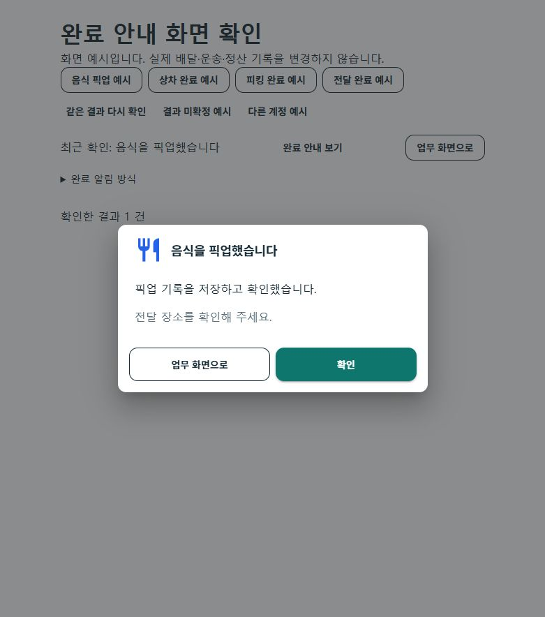

# 업무 단계 완료 안내 r1

2026-10-23. 사용자가 배달 전달·상차·적재 등 각 절차를 마쳤을 때 완료 안내를 받도록 요청했고, 먼저 제안한 동작의 구현을 승인했다. 해당 단계의 서버 결과와 재조회를 확인한 뒤 안내하며, 안내를 닫는 행동은 다음 업무를 실행하지 않는다.

**현재 상태: `CompletedLocalImplementationAndBuilds / PhysicalWorkflowPending`.** 최종 소스의 전체 시험과 실제 공통 컴포넌트 브라우저 검증, Android 설치파일 3종의 서명·출력 검증을 마쳤다. 실제 휴대폰 앱 설치·완료창 동작·업무 완주는 별도다. 최종 집계는 `artifacts/local/workflow-completion-feedback/20261023-r1/validation-final.json`이다.

| 커밋 | 변경 축 | 화면 변경 | 시각 증거 |
| --- | --- | --- | --- |
| 미커밋 | 음식·마트 픽업/전달, 화물 상하차, 창고 작업, 분산 이행의 완료 안내 | 있음 | 실제 공통 컴포넌트·합성 입력의 781px 브라우저 PNG. 실제 단말 화면 아님 |

## 사용자가 보는 결과

- 음식 픽업은 식기 그림, 화물·퀵은 트럭 그림, 마트·창고 작업은 상자 그림과 단계별 제목으로 표시한다. 예를 들어 `음식을 픽업했습니다`, `상차가 완료되었습니다`, `피킹이 완료되었습니다`처럼 확인된 결과를 바로 말한다.
- 안내에는 확인한 결과와 다음에 확인할 업무를 표시한다. `확인`은 안내만 닫으며, 공통 화면에서 제공하는 `업무 화면으로`는 해당 화면으로 이동할 뿐 다음 상태를 변경하지 않는다.
- `단계마다 알림창`, `짧은 안내만` 또는 네이티브의 `간단히 표시`, `최종 전달만 알림창`을 선택할 수 있다. 이는 **현재 화면의 표시 방식**이며 계정에 영구 저장되는 설정이 아니다. 기존 배차 추천·휴대폰 알림 설정, 소리·진동, 업무 수신 의사는 변경하지 않는다.
- 같은 화면에서 확인한 최근 결과는 최대 10개를 유지하고, 같은 결과의 반복 알림창을 막는다. 이 기록은 서버 업무 이력이나 단말 재실행 후의 영속 이력을 대체하지 않는다. 계정·대상 정리 시에는 해당 화면의 결과도 정리한다.
- 결과가 미확정이면 완료 안내를 띄우지 않는다. 기존 결과 재조회와 입력 보존을 사용하며, 안내를 닫거나 화면에 돌아왔다는 이유로 POST를 자동 재전송하지 않는다.

## 실제 연결 범위

| 영역 | 연결한 단계 | 확인 경계 |
| --- | --- | --- |
| 공통 음식 기사 화면 | 픽업·전달 완료 | 제안/주문/기사/배달 시도와 상승한 판본을 대조한다. 픽업은 현재 수행, 전달은 같은 시도의 완료 정산·상세 근거를 추가 대조한다. 목록에서 사라진 것만으로 전달 완료를 만들지 않는다. |
| 네이티브 음식 기사 | 픽업·전달 완료 | 대상 제안·배달 시도·상승한 판본·기대 상태의 명령 응답과 최신 본인 수행 재조회를 확인한다. 다른 계정·화면 비활성·오래된 결과에는 안내를 표시하지 않는다. |
| 네이티브 마트 배송 | 상품 픽업·전달 완료 | 같은 요청의 결과와 현재 배송의 시도 ID·상태·판본을 대조한다. 불일치하면 미확정 요청을 보존한다. 피킹 작업 화면을 새로 만든 것은 아니다. |
| 화물 기사 전문 화면 | 상차·하차 완료 | 기존 사진·화물·인수증·도착 단계와 복구 검사를 유지하고 같은 운송의 서버 완료 상태를 다시 확인한다. |
| 공통 화물 수행 화면 | 상차·하차 완료 | 응답 대상과 기대 단계, 정본 재조회·예외 상태를 확인한 결과를 표시한다. |
| 공통 창고 작업 화면 | 입고 수령·적재·피킹·포장·출고 인계 준비 | 작업 결과와 재조회한 대상·수량·상태 등 기존 전이 근거를 대조한다. 피킹 시작을 피킹 완료로 표시하지 않는다. |
| 분산 이행의 기사 화면 | 직접 피킹·전달의 사진 완료 | 정확한 요청 영수증·역할·대상·수량과 최신 판본을 대조하며 사진 복구 성공도 연결한다. 현재 연습 환경만 허용하므로 안내에도 연습 환경 기록임을 표시한다. |

하차·전달 완료, 주문자의 수령 확인, 정산, 실제 지급, 알림 확인은 각각 다른 결과다. 출고 인계 **준비** 완료도 실제 기사 인계 완료로 표현하지 않는다. 기존 권한·가능 행동·운영 비활성·사진 요구·대금 처리 규칙은 그대로 유지한다.

## 구현 위치

- 공통 표시 상태·모달·화면 내 선택: [Completion 폴더](../../Ssalddel.Ui.Common/Areas/App/RoleWorkspace/Completion/), [공통 지도 업무 화면](../../Ssalddel.Ui.Common/Areas/App/RoleWorkspace/Core/RoleMapWorkspace.razor).
- 음식 공통 어댑터: [FoodDriverRoleWorkspaceAdapter.cs](../../Ssalddel.Ui.Common/Areas/App/RoleWorkspace/Food/FoodDriverRoleWorkspaceAdapter.cs).
- 네이티브 음식·마트: [완료 결과 연결](../../FDriverApp/PageModels/MainPageModel.CompletionFeedback.cs), [표시 상태](../../FDriverApp/PageModels/FDriverCompletionFeedbackState.cs), [공통 네이티브 뷰](../../FDriverApp/Controls/FDriverCompletionFeedbackView.xaml), [마트 배송 모델](../../FDriverApp/PageModels/살뜰마트배송PageViewModel.cs).
- 화물·창고: [공통 화물 수행 모델](../../Ssalddel.Ui.Common/Areas/App/RoleWorkspace/Cargo/CargoTransportActionViewModel.cs), [창고 수행 모델](../../Ssalddel.Ui.Common/Areas/App/RoleWorkspace/Cargo/WarehouseTaskActionViewModel.cs), [화물 전문 상차 모델](../../DriverApp/ViewModels/Driver/Transport/기사상차PageViewModel.cs), [화물 전문 하차 모델](../../DriverApp/ViewModels/Driver/Transport/기사하차PageViewModel.cs).
- 분산 이행: [화면 모델](../../Ssalddel.Ui.Common/Areas/App/RoleWorkspace/DistributedFulfillment/분산이행PageViewModel.cs), [복구 연결](../../Ssalddel.Ui.Common/Areas/App/RoleWorkspace/DistributedFulfillment/분산이행PageViewModel.Recovery.cs).
- 합성 화면 미리보기: [WorkflowCompletionPreviewPage.razor](../../eng/RoleWorkspacePreview/WorkflowCompletionPreviewPage.razor). 해당 미리보기는 실제 업무 원장 변경의 증거가 아니다.

## 검증 기록과 아직 남은 범위

증거 루트는 `artifacts/local/workflow-completion-feedback/20261023-r1/`이며, 45개 범위 경로와 코드·시험·미리보기 40파일은 각각 `scope-paths.json`, `source-manifest-final-before.json`을 따른다. 다른 작업의 기존 변경과 index는 보존한다.

| 구분 | 확인한 상태 |
| --- | --- |
| 중간 집중 시험 | `focused-final.log`·`tests/focused-final.trx`: 256개 통과. 이후 동일 판본 응답 거부와 마지막 화면 보완이 들어갔으므로 최종 판본의 통과 수치로 소급하지 않음 |
| 최종 전체 시험 | `tests/all-complete.trx`: 15,353통과·실패0·환경16생략·전체15,369. 선행 빌드가 완료된 동일 소스/시험 DLL로 실행 |
| 발견·보완한 회귀 | 최초 전체의 JS 선택기 관련 10개와 분산 화면의 서비스 구성 5개 실패를 보존했다. 선택기를 기본 HTML로 바꾸고 시험 호스트에 실제 화면이 요구하는 탐색·Mud 서비스·JS adapter를 등록했다. 관련122·106개 재시험 및 최종 전체 통과 |
| 표준 Fast/Task | 기존 미관련 `CargoDriverWorkSession.cs:245` EOF 빈 줄 때문에 전역 diff 관문에서 중단. 해당 파일을 수정하지 않았으며 범위 한정 diff 검사는 통과. 직접 시험·소비 빌드와 분리 |
| 네이티브 표시 | XAML 구문·컴파일, 실제 Geometry/Brush 사용, 빈 오버레이 숨김과 화면/계정 이탈 처리를 보완. 실제 native 화면·접근성·터치 동작은 단말에서 미검증 |
| 실제 공통 화면 | 최종 소비 호스트 빌드·브라우저9항목 통과. 781×884px에서 가로 넘침0, 두 버튼202×48px, 안내창444×240px. `browser-checks.json`, `browser-layout.json`, `preview-build-frozen.log` 참조 |
| 실제 휴대폰 | 새 완료 안내는 미검증. Chrome 초기 설정이 필요했고 Samsung Internet 실행은 자동 승인 검토에서 정책상 거절돼 진행하지 못함. 자체 USB 연결 변경은 원래 상태로 복구함 |
| APK | 소스 보완 중 자체 오래된 빌드 두 번을 중단·보존했다. 최종 동결 소스로 음식·화물·통합 앱 0.1.213 생성·서명·ABI별 내장 assembly·handoff SHA256 일치를 확인했다. 공식 `apk-final/0.1.213-213/usb-test-manifest.json`의 빌드 전후 선택 소스 변경0. 휴대폰 설치·설치본 SHA 확인은 미실행 |

## 실제 공통 화면 예시

다음은 기존 실제 업무 화면이 소비하는 공통 안내 컴포넌트의 합성 예시다. 서버 업무를 처리하거나 실제 전달 완료를 입증한 화면이 아니다.

새 미확정 보호 중 일부는 해당 모델·화면 수명에만 존재한다. 기존에 영속 복구가 있는 영역의 저장 방식을 재사용했지만, 모든 새 안내·보호 상태가 앱 종료나 재시작 뒤에도 보존된다는 뜻은 아니다. 공통 컴포넌트 시험·브라우저 미리보기·Android 컴파일·실제 APK 설치·실제 업무 완주는 각각 별도 증거다.

서버 운영 DB 변경·실물 전달·수금/정산/지급·외부 FCM·잠금 화면·소리/진동·공개 배포·commit/push는 실행하지 않았다. 휴대폰 앱 설치와 완료창 업무 완주는 별도이며 기존 설치 앱·업무 세션·USB 경로를 보존했다.

최종 로컬 검토 서버는 `http://127.0.0.1:5630/workflow-completion-preview`에 두었다. 현재 작업 트리 스냅샷으로 만든 USB Debug 설치파일은 증거 루트의 `apk-final/0.1.213-213/handoff/`에 있으며 운영 배포 파일로 표시하지 않는다.
