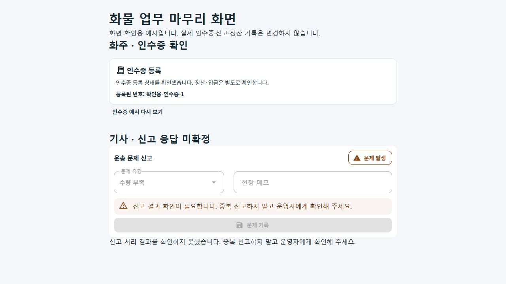
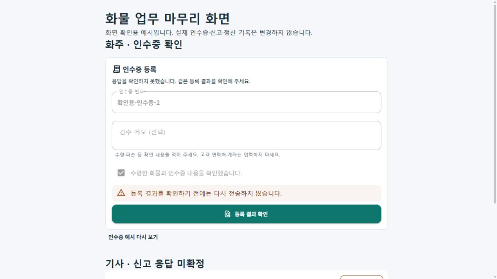

# 화물 앱 마무리 보완 r1

2026-10-24. 사용자 요청에 따라 화주·기사 앱의 기존 업무 연결을 감사하고 세 가지 결손을 보완했다. [업무별 책임과 복구 기준](../ProjectOverview/page-docs/cargo-app-closeout-r1.md)을 따른다.

**상태: `CompletedLocalCloseoutWave1 / RemainingCloseoutWorkPending`.** 세 가지 연결·복구 보완의 로컬 구현과 시험·소비 빌드·컴포넌트 렌더를 마쳤다. 화물 전체 제품의 운영 출시 완료는 아니며, 운영 전환·단말 설치·실제 운송 완주·금융·외부 알림·배포·commit/push와 구분한다.

| 변경 | 결과 |
| --- | --- |
| Web 화주 증빙 | 기존 인수증 등록 패널과 POST를 연결. 수령·검수 확인 후 한 번 전송하고 같은 의뢰 GET으로 등록 사실을 확인한다. |
| Web 수명·미확정 | 계정·의뢰·화면 전환 뒤 늦은 POST/GET과 예외를 버린다. 결과가 불명확하면 다시 전송하지 않는다. 원번호가 없는 재진입은 기존 등록의 존재와 이전 요청의 성공을 구분한다. |
| 증빙 능력 표시 | 정확한 `/shipper/request/{단일 ID}/proofs`에만 저장 경계를 표시하며 일반 상세·결제·이력의 조회 경계를 보존한다. 서버 권한은 기존 handler가 검사한다. |
| 공통 상하차 거절 복구 | 해당 단계의 정형 `NotApplied` 거절과 같은 운송·기사·도착 단계의 GET, 같은 보호 요청 확인 뒤에만 미확정 기록을 해제한다. 사진과 운송 보류를 보존하며 자동 재전송하지 않는다. |
| 전문 기사 신고 | 운송·인증 전환·종료 때 작업 취소와 늦은 응답 차단. 결과 미확정의 미저장 단정·기술 오류 노출을 없애고 같은 화면의 중복 신고를 막는다. |

실제 권한·운송 단계·사진·인수 조건·운영 기본 비활성과 금전 처리는 완화하지 않았다. 기존 전문 앱을 삭제하거나 통합 앱으로 대체하지 않았다.

## 검증 기록

근거는 `artifacts/local/cargo-app-closeout/20261024-r1/`에 있다. `scope-paths.json`과 `source-manifest-frozen.json`은 이번 검증의 좁은 소스 범위를 연결한다.

- 첫 집중 시험은 410통과·1실패였다. 계정 전환 직후 발생한 일반 예외가 취소 필터 밖으로 빠지는 분기를 수정하고 늦은 POST/GET 회귀를 추가했다. 원 실패의 로그·TRX를 보존했다.
- 집중 재시험은 **420통과·실패0·생략0**이다. 실제 부모 상차/하차 페이지를 조립한 신고 지연·운송 전환·로그아웃·종료 6사례도 포함한다.
- 최종 전체 시험은 **15,438통과·실패0·환경16생략·전체15,454**다. 선행 집중 시험 빌드가 확인된 같은 DLL로 실행했다. 신규85사례(전문 신고19·실제 부모 수명6·공통 거절 복구28·Web 인수증32)가 모두 포함된다.
- 화주 별도 Web 빌드 오류0/경고0, 기사 Android 오류0/경고38, 통합 Android 오류0/경고15다. 통합 Web는 집중 시험의 실제 프로젝트 참조 빌드를 통해 컴파일했다. 실제 기기에 설치하지 않았다.
- 미리보기 소비 빌드는 오류0/기존 패키지 경고1이다. `SQLitePCLRaw.lib.e_sqlite3 2.1.10`의 기존 NU1903 경고와 Android 의존성/푸시 구성 경고를 기록했으며 경고 없는 전체 빌드라고 표현하지 않는다.
- 최종 검증 중 선택 소스19파일의 해시 변경0을 확인했다. 최종 요약은 `validation-final.json`, 결과는 `tests/focused-final.trx`·`tests/all-final.trx`를 따른다.
- 표준 Fast/Task는 전체 dirty 트리의 기존 `CargoDriverWorkSession.cs:245` EOF 형식 오류로 중단됐다. 해당 미관련 파일을 고치지 않고 범위 한정 diff 검사·직접 소비 빌드·시험을 분리했다.
- 기존 실제 공통 인수증 패널과 전문 기사 신고 패널/VM을 루프백 예시에서 렌더했다. 입력·검수 전후 등록 버튼, 미확정 뒤 입력 잠금/결과 확인, 등록 번호·정산 구분, 신고 잠금/운영자 안내, 신고 호출1회와 1280×720 가로 넘침0을 확인했다. Web 등록 예시는 메모리 상태 전환이며 실제 제품 HTTP 또는 새 Web 등록 VM을 통한 서버 저장의 증거가 아니다.

### 실제 재사용 컴포넌트 화면 예시

대표 화면의 원본 SHA와 범위는 [화면 근거](../assets/changes/2026-10-24-cargo-app-closeout-r1/evidence.json)에 있다. 휴대폰 실기기 캡처가 아니다.

## 남은 마무리 작업

| 항목 | 현재 경계와 다음 확인 |
| --- | --- |
| 재실행 영속 복구 | Web 인수증 보호 저장은 현재 브라우저 앱 scope의 `VolatileWorkflowRecoveryStore`다. route 재진입과 새로고침·새 탭·앱 재실행을 구분한다. 전문 기사 신고의 중복 방지도 현재 VM 수명이다. |
| 신고 결과 영수증 | 서버 신고 DTO/GET에 이번 요청을 정확히 식별할 영수증이 없다. 기존 신고를 이번 성공으로 추측하지 않으며 전문 기사에게 운영자 확인을 안내한다. 공통 신고의 미확정 보수 차단도 유지한다. |
| Native 테스트 결제 | 일반 상세의 로컬 FakePG 영수증이 새 서버 금융 상태를 다시 덮는 경로와, 비선결제 테스트 결제의 응답 유실 보호는 후속이다. 이번 작업이 실결제 구현 완료를 뜻하지 않는다. |
| 운영자·검증 도구 | 관리자 선택 운송의 개별 상세/지급 준비 연결과 r21 CLI 무키 proof 검사의 `control` 경계 정합은 후속이다. 기존 별도 API 부정시험을 CLI 전체 성공으로 바꾸지 않는다. |
| 실제 실행·운영 | 새 판본의 인증된 제품 HTTP·실DB 완주, 단말 설치/재실행/카메라·외부 FCM, 운영 migration/백업·복원, 실제 PG·계좌·송금·배포는 이번에 실행하지 않았다. |

과거 r21의 제품 HTTP와 이전 APK의 기기 확인은 과거 판본의 근거로 보존하며 이번 수정의 실제 단말/운영 증거로 합치지 않는다. 로컬 UI 검토 서버는 `http://127.0.0.1:5631/cargo-closeout-preview`다.
