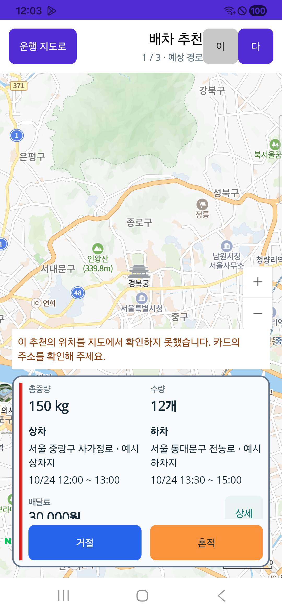
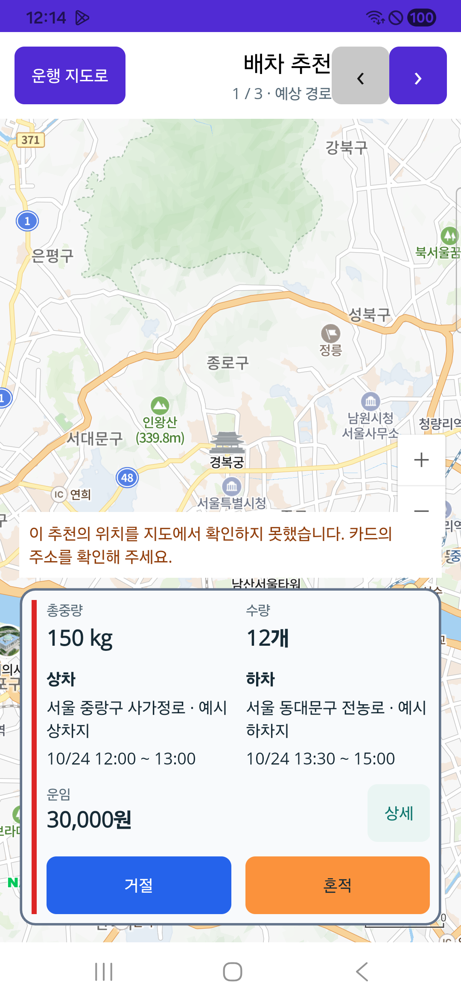
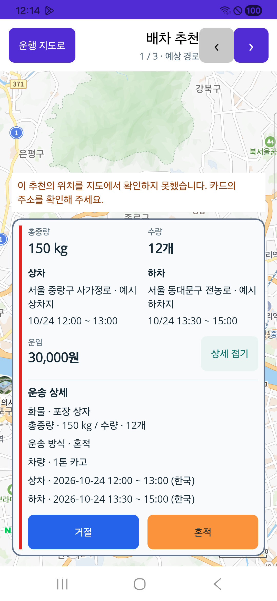
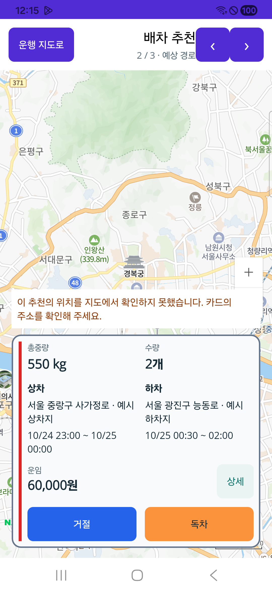

# 기사 화물 추천 카드 간략 배치

2026-10-24. 전문 기사 앱의 추천을 총중량·수량, 왼쪽 상차·오른쪽 하차, 왼쪽 거절·오른쪽 제안 방식 수락 순서로 읽도록 보완한다. [기존 페이지 책임](../ProjectOverview/page-docs/cargo-condition-comparison-r1.md)을 유지한다.

## 범위와 행동

- 기본 일정은 한국 시각의 월일·시간이며, 날짜를 넘으면 양쪽 월일을 표시한다. 펼친 상세는 전체 연도·한국 시각과 요청 차량·운송 방식 등 조건을 보존한다. 누락·역전 범위를 정상 일정으로 바꾸지 않는다.
- 수락 버튼은 제안 방식이 확인된 경우 `독차`·`혼적`, 그 밖에는 `수락`이다. 원장 값·운송 방식 선택·상차 완료를 바꾸지 않는다. 거절 진입과 수락 진입은 기존 확인 절차를 사용한다.
- Native 카드 넘김의 표시·선택 불일치를 보완하고 기존 표시 조건 사본과 최신 조회 대조를 유지한다. Native의 기존 인증·응답 기한·경고·보수·미확정 결과 보호는 그대로 적용한다.
- 화주·운영자 카드, 서버 권한·DB·요금 정책과 외부 푸시는 이번 변경 범위가 아니다. commit·push·배포와 실제 업무 수락/거절은 실행하지 않는다.

## 검증 상태

집중 시험103개가 통과했고 실패·생략은0개다. 월일 일정·자정/연도 경계·일부 누락·역전 범위, 제안 방식 버튼 이름과 원조건 불변, 추천 선택·차수·인증·공유 조건 화면·보수/새 조회를 검증했다. Contracts 빌드는 오류0/경고0, 기사 Android 소비 빌드는 오류0/기존 경고29다. 표준 Fast·Task는 이번 범위 밖의 기존 `CargoDriverWorkSession.cs:245` EOF 공백에서 중단됐으며 직접 시험·소비 빌드와 구분한다.

`artifacts/local/cargo-compact-cards/20261024-r1/`의 `source-freeze.json`은 최초227의 제품·시험9파일을, `source-freeze-r2.json`은 최종228의9파일을 고정한다. 두 판본 사이에는 Native 화면1파일만 바뀌었다. 논리 시험103개 이후 추가한 여백·스크롤 수정은 Android 소비 빌드를 다시 실행해 오류0/기존 경고29를 확인했고 실제 단말로 별도 검증했다. 독립 재검토에서도 선택·표시·수락 보호5구간은 이전 판본과 동일했다.

### 최초 227 실제 화면에서 발견한 문제

기사 APK227을 SM-A346N/Android16에 데이터 보존 갱신 설치하고 설치본 SHA를 확인했다. 기존 화주226은 바꾸지 않았다. 실제 폭384DIP·기존 글자 배율1.15에서 상단 이전/다음 글자가 한 글자로 잘리고, 카드 본문 높이가 부족해 운임·상세 하단이 가려졌다. 상세 스크롤 뒤 다음 카드에서 이전 스크롤 위치가 남아 새 카드의 총중량/수량이 가려지는 것도 재현했다. 최초 화면과 APK는 보존하며 정상 완료로 합치지 않는다.

이후 Native 단일 파일에서 화살표·카드의 실제 여백/행 간격 계산·대상 변경 시 스크롤 초기화를 보완했다. 같은 카드의 주기 조회는 읽던 스크롤 위치를 유지한다.

### 최종 228 실제 휴대폰 확인

| 항목 | 결과 |
| --- | --- |
| 단말 | Galaxy A34 SM-A346N · Android16 · 1080×2340 · 384DIP · 기존 글자 배율1.15 유지 |
| 앱 | 전문 기사 `kr.hongdal.driver` · 0.1.228/228 · 기존 데이터 보존 갱신 설치 |
| 설치본 | SHA-256 `d9d406d968a8ea6ff02ad36a3ab2caa4b32dbde725725430d2197ce2f826a32c`, 서명/정렬·두 ABI 내장/인계본·실제 설치본 일치 |
| 코드 근거 | 최종9파일과 전체 APK 빌드 입력의 전후 변경0 · APK source fingerprint `11746321720a0c8a3cbd72db5bfb82a59806637552e0610e279c36378a9f0c72` |
| 간략 카드 | 총중량·수량과 상하차 주소/월일·시간이 좌우로 표시됨. 운임·상세·고정 거절/혼적·독차·수락 버튼 잘림/겹침 해소 |
| 펼친 상세 | 차량·방식·중량/수량·연도 포함 한국 상하차 시간을 확인. 날짜가 넘어가는 독차와 미확인 값도 별도 확인 |
| 전환·갱신 | 상단 화살표의1/3→2/3→3/3 대상과 버튼명이 일치. 독차 상세의 실제12px 스크롤 후30초 조회2회에도 같은 위치 유지, 다음 미확인 카드에서 총중량/수량부터 맨 위로 복원 |
| 실행 범위 | 로컬 읽기용 합성 HTTP 자료를 실제 APK로 확인. 경고창 진입 후 취소했으며 실제 수락·거절·상하차 명령은 실행하지 않음 |

대표 화면은 실제 단말 원본 PNG를 복사했으며 편집·합성하지 않았다.

남은 제한: ScrollView 본문 위의 가로 스와이프는 인식되지 않았으며 상단 `‹`/`›` 전환은 정상이다. 고정 버튼 사이 간격의 스와이프는 전환됐지만 본문 전체의 스와이프 성공으로 확대하지 않는다. 예시에는 좌표가 없어 지도 위치 확인 안내가 보이며 실제 GPS·핀/경로 시험은 아니다. 기존 WebView 하단 탐색/시스템 막대 겹침과 아래 legacy 수락 경로는 이번에 해결한 것으로 표시하지 않는다. 제품 서버·DB 완주·운영 배포·실제 배차/지급은 별도다.

최종 집계는 `artifacts/local/cargo-compact-cards/20261024-r1/validation-final.json`, 실제 단말 상세는 `device/validation-device-final.json`을 따른다. 실제 수락/거절/상하차 명령0건과 경고·거절 사유 창의 취소를 확인했다. 새 시험 서버만 종료하고 USB 매핑5363→5363 및 원래 서버PID32404를 복원/보존했다. 기존 계정·표시 설정·앱 데이터·화주226은 유지했으며 보호 저장소 전체 바이트 대조나 재실행 복구 여정을 이번에 재시험한 것은 아니다. 패키징/설치 당시의 `physicalDeviceUiVerified=false` 스냅샷은 당시 상태로 보존하고 이후 단말 결과와 구분한다.

## 기존 수락 경로의 차이

Native와 공유 `CargoOfferAction`의 표시 조건 사본·수락 전 강제 재조회 보호는 유지했다. 전문 Razor 목록이 원래 사용하던 `배차처리Page`는 이번에도 같은 수락 서비스를 사용하며, 이 경로에는 표시 사본과 강제 재조회 조건 대조가 없다. 서버의 기존 권한·예상 추천 차수 검증은 유지되지만 모든 수락 화면에 동일한 freshness 보호를 새로 갖췄다는 뜻은 아니다. 이번 변경의 링크 의도는 입력 화면만 열며 실제 수락·거절을 실행하지 않았다.
