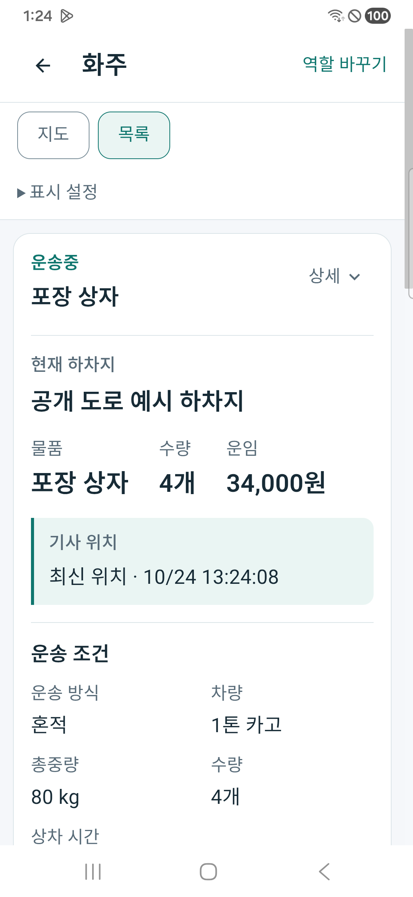
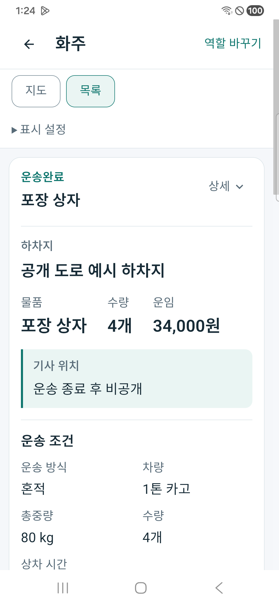
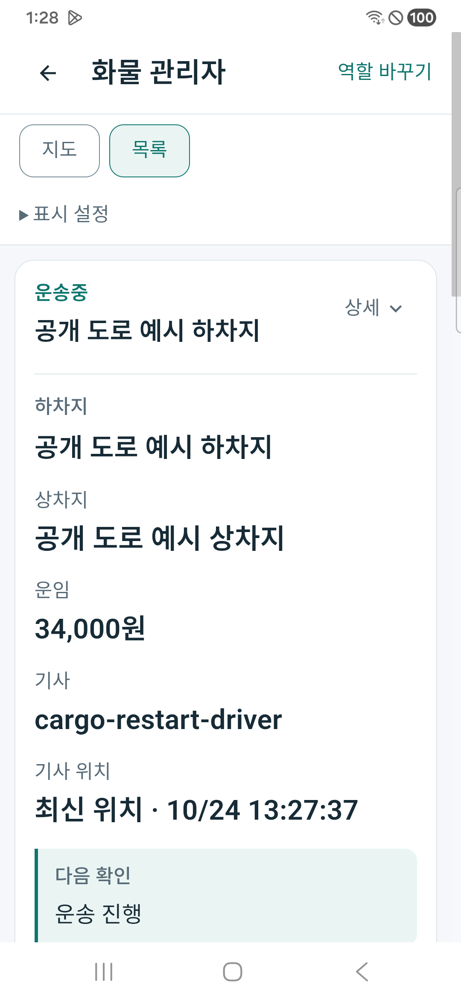

# 화물 기사 위치 전송과 화주·관리자 지도

사용자는 기사 GPS가 일정 주기로 서버에 전달되고 화주와 관리자가 지도에서 운송 중인 기사의 위치를 확인하기를 요청했다. 기존 기사 위치 API·화주 위치 투영·공통 역할 지도를 재사용하고 관리자 운송 응답의 위치 연결을 추가한다. [페이지 책임](../ProjectOverview/page-docs/cargo-driver-tracking-r1.md)을 따른다.

## 표시와 수명

화주는 `/workspace/shipper`, 관리자는 `/workspace/operator?business=freight-delivery`에서 운송을 선택한다. 기존 역할 지도에 현재 운송의 기사 핀과 한국 시각의 마지막 갱신 시각이 표시된다. 화면이 보이는 동안 기존 15초 자동 재조회를 유지하며 수동 갱신·화면 숨김·계정 변경·명령 확인 중의 요청 보호를 보존한다.

운영 권한과 서버가 준비된 뒤의 사용 순서는 다음과 같다.

1. 전문 기사 앱에서 로그인 후 운행을 명시적으로 시작하고 기존 위치 권한 안내를 따른다. 송신 중에는 Android 운행 위치 알림이 표시된다.
2. 화주는 내 운송, 관리자는 화물 운송 지도에서 대상 운송을 선택한다. 현재 배정 기사의 유효한 위치가 수신되면 기사 핀과 갱신 시각이 표시된다.
3. 기사 운행 종료·로그아웃·위치 권한 해제는 송신을 중지한다. 위치가 새로 오지 않거나 운송이 끝났을 때 수신 화면의 상태를 확인한다. 지도 핀은 상하차 완료 확인을 대신하지 않는다.

`Available / Delayed / Unavailable / Closed`를 서버가 구분한다. 과거 응답의 빈 상태코드는 기존 시각 검증으로 호환하지만 알 수 없는 새 코드는 핀으로 표시하지 않는다. 위치가 10분 지나면 통신을 기다리지 않고 핀을 제거하고 요약·상세의 ‘최신 위치’도 ‘위치 갱신 지연’으로 바꾼다. 주소만으로 기사 핀이나 실제 이동 경로·도착 예정을 만들지 않는다.

현재 기사 배정과 수락 근거, 배정/근무 시작 이후 GPS, 운행 중인 동일 근무, 좌표·측정 및 수신 시각을 서버가 검사한다. 완료·취소·재배정·근무 종료나 근거 불일치는 현재 위치로 제공하지 않는다. 지연 상태는 좌표·원래 시각을 기존처럼 숨긴 상태로 표시한다. 화주 본인/명시 위임의 기존 진행조회 권한과 관리자 전용 API를 유지하고 새 익명 위치 API를 만들지 않는다.

## 기사 전송

전문 Android 기사 앱의 기존 foreground 위치 서비스를 명시적 운행 시작의 계정·세션 판본·서버·현재 근무에 연결한다. 기본 주기는 30초이며 서버 권장값30~900초를 따른다. 네트워크/센서 오류는 기존 상한 안에서 재시도 간격을 늘리고, 실제 센서 측정 시각을 전송한다. 로그아웃·근무 변경/종료·위치 권한 철회는 전송을 중지한다. 명시 시작 근거가 없는 프로세스 재시작을 위치 수집의 동의로 간주하지 않는다.

서버는 잘못된 좌표/정확도·미래/오래된 시각·역순 위치를 거절한다. 위치 전송은 배차 수락·상하차 완료·운임 지급과 별개다. 기존 위치 기록과 최신 위치 색인·보존 정책을 유지하며 위치 이력 공개나 Unity·운영 자동 배차를 활성화하지 않는다.

## 검증 상태

구현·집중 시험·소비 앱 빌드·합성 자료의 실제 휴대폰 지도·실제 GPS 수집/운영을 각각 구분한다. 현재 검증 산출물은 `artifacts/local/cargo-driver-tracking/20261024-r1/`에 기록한다. 실제 이동 GPS와 운영 서버 전송 시험은 합성 좌표/단위 시험으로 대신했다고 표시하지 않는다.

32개 소스를 동결하고 집중192개 통과·실패0·생략0을 확인했다. 정상 GPS→화주/관리자 동일 응답, 타 화주 권한 차단, 현재 배정/수락/근무·재배정·종료·미래/지연·조회 중 근무 종료와 입력 역순 거절을 포함한다. 송신 수명 시험은 합성 인증·시계·위치 제공자를 쓰며 실제 센서나 운영 API를 호출하지 않는다. 최초39개 조회 실패는 EF의 배열 Contains 오버로드 문제였고 명시적 Enumerable.Contains로 고친 뒤 같은192개 전체가 통과했다. 최초 실패 로그와 TRX는 별도 보존했다.

공통 UI·서버는 집중 시험 그래프에서 다시 빌드됐고 전문 기사 Android 소비 빌드는 오류0·기존 경고29다. 표준 Fast·Task는 이번 범위 밖의 기존 `CargoDriverWorkSession.cs:245` EOF 공백 때문에 실행 전 중단됐으며, 선택32개 범위 diff는 통과했다. 새 송신 코드의 실제 기기 설치·장시간 실행·실제 운행 GPS·운영 게시·commit/push는 완료로 표시하지 않는다. 휴대폰에 남은 전문 기사 앱은 기존229이며 이번 송신 변경의 설치본이 아니다.

### 통합앱230의 지도 인증 제한

실제 SM-A346N/Android16에 통합앱230을 데이터 보존 갱신 설치했고, 화주·관리자 화면에서 합성 응답의 최신 위치·한국 갱신 시각·갱신 지연·운송 종료 비공개의 6개 화면을 확인했다. 좌표가 바뀐 응답을 재조회한 근거와 지도에서 핀이 움직이는 실제 검증은 구분한다. Android SDK 키 리소스가 들어 있는 것과 인증 성공은 다르며, 이 설치본에서는 네이버 SDK 인증401이 확인돼 지도 타일과 기사 핀의 실제 표시는 확인하지 못했다. 지도를 사용할 수 없다는 안내와 목록 복귀는 실제 화면에 남는다.

아래는 합성 자료를 사용한 실제 휴대폰 목록 화면이며 작동하는 지도 화면이나 실제 운행 GPS 캡처가 아니다.

설치 패키지는 기존 `com.companyname.ssalddelapp`이다. 공식 SDK는401을 ID·클라이언트 종류·등록한 패키지 불일치 등의 인증 실패로 설명하지만, 현재 어느 원인인지 확정하지 않았다. [네이버 SDK 인증 안내](https://navermaps.github.io/android-map-sdk/guide-en/1.html)를 참조했다. 키 원문은 로그·문서·새 소스에 복제하지 않았다. 네이버 클라우드 콘솔은 로그인 화면이어서 등록 내용은 확인 전이며 로그인 버튼을 누른 뒤 사용자 인증을 요청했다. Cloud 등록·키·권한 변경은 실행하지 않았다.

최종 `device/validation-device-final.json`은 설치 SHA·현재32소스 변경0·실제 화면·지도 인증 제한을 각각 기록한다. 기존 화주/기사 계정을 로그아웃하지 않았고 검증용 관리자 역할만 원래 비로그인으로 돌렸다. Samsung Pass 저장은 취소했다. 원래 USB5363 연결·서버 PID32404·기사229 설치 SHA를 보존하고 새 시험 서버만 종료했으며 원래 기사 앱을 다시 앞에 열었다. 실제 GPS 전송·운영 업무 명령은 0건이다. 통합앱230은 데이터 보존 갱신 상태로 남긴다.

## 남은 경계

통합앱의 위치 전송은 보이는 작업공간 조회에 따른 기존 방식이며 전문 Android foreground 서비스와 같지 않다. 웹 지도는 기존 Google 호스트, Android 통합앱 지도는 기존 네이버 SDK 호스트를 사용한다. 기존 Redis 갱신/SQL commit 순서와 대량 이력 조회의 성능 구조는 이번에 변경하지 않았다. 구버전 위치 요청의 측정 시각 생략은 서버 수신 시각을 쓰는 기존 호환이며 실제 센서 측정 시각의 증거가 아니다. 실제 운행·배터리·지하/통신 단절·백그라운드 장시간 시험은 별도로 필요하다.
