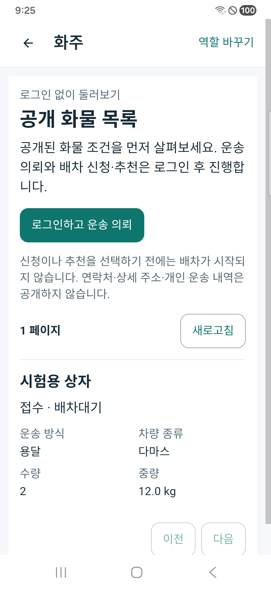
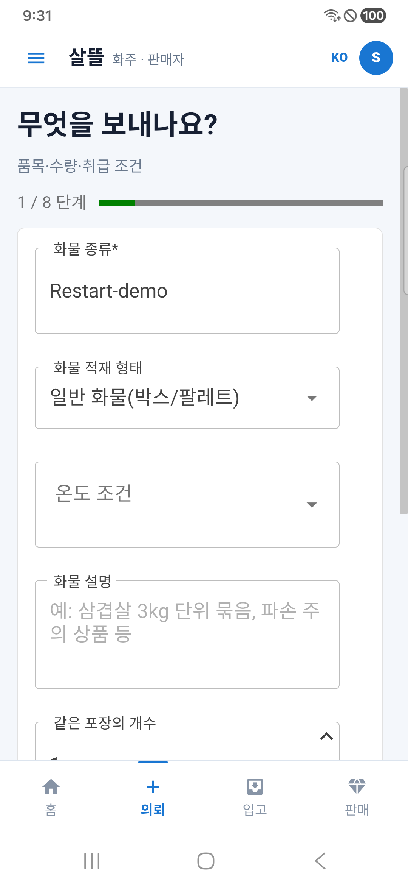
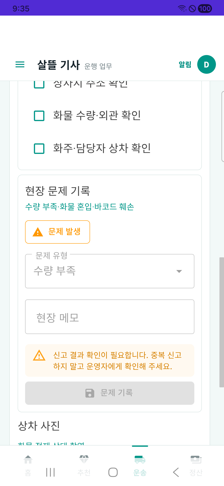

# 화물 앱 재실행 복구와 로그인 전 탐색 r1

2026-10-24. 화주·기사 앱을 껐다 켠 뒤 진행 중 요청을 다시 확인하고, 로그인 전에도 공개 화물 조건을 둘러볼 수 있도록 보완했다. [공개 탐색 페이지 책임](../ProjectOverview/page-docs/cargo-public-browse-r1.md)과 기존 [화물 마무리 보완](2026-10-24-cargo-app-closeout-r1.md)의 업무·인증 경계를 이어간다.

**현재 상태: `CompletedSyntheticDeviceValidation / OperationalDisabled`.** 제품 구현·전체 회귀, 브라우저 보호 저장 왕복과 실제 휴대폰의 공개 탐색·로그인 복귀·강제 종료 후 복원을 확인했다. 휴대폰은 합성 루프백 HTTP 서버를 사용했으며 제품 DB·운영 출시·실금융 검증으로 합치지 않는다. 최종 근거는 `artifacts/local/cargo-restart-guest/20261024-r1/validation-final.json`이다. commit·push·배포·운영 전환은 실행하지 않았다.

## 바뀐 사용 흐름

| 대상 | 결과와 복구 경계 |
| --- | --- |
| 공개 화물 탐색 | 전문 기사·통합 화주·웹에서 기존 익명 공개 요약 API를 사용한다. 화물 조건·공개 상태만 표시하고 연락처·상세 주소·개인 운송/정산은 제공하지 않는다. 하드코딩 샘플 목록과 공개 항목에서 개인 상세로 가던 링크를 제거했다. |
| 로그인 시점 | 둘러보기에는 로그인하지 않는다. 운송 의뢰·기사 배차 신청/추천처럼 보호된 업무를 선택하면 기존 역할 로그인을 거쳐 해당 화면으로 돌아간다. 로그인 성공만으로 신청·수락·운행 시작·추천 수신 설정 변경을 실행하지 않는다. |
| 기사 앱 시작 | 저장된 인증이 확인되면 기존 기사 업무 홈으로, 미로그인 또는 인증 저장소 확인 실패면 공개 화물 목록으로 이동한다. 개인 홈·추천·진행 중 운송과 수락 API의 기존 권한은 유지한다. |
| 화주 단말 작성·인수증 | 보호 저장 자료와 현재 계정·서버·의뢰를 대조해 화면 재진입 때 초안·미확정 요청을 복구한다. 저장 확인 전 전송하지 않으며, 재실행 후 자동 POST를 하지 않고 현재 정본과 결과를 확인한다. 동의·현장 확인은 다시 입력한다. |
| 전문 기사 신고 | 계정·서버·운송·상하차 단계별 미확정 관측 번호를 보호 저장한다. 재실행 때 복원해 중복 신고를 막으며 신고 메모 원문은 저장하지 않는다. 과거 신고가 있다는 사실을 이번 요청의 성공 영수증으로 쓰지 않는다. |
| 전문 기사 사진 | 기존 사진 전용 암호화 저장을 서버 범위로 분리하고, 촬영을 시작한 계정·서버와 반환 시점이 다르면 이전 사진을 새 문맥에 적용하지 않는다. 사진·서명은 일반 요청 복구 저장소에 넣지 않는다. |
| Web 보호 저장 | 기존 업무 복구 기록을 브라우저 IndexedDB 암호화 저장으로 연결한다. 기존 Web 작성 기능의 평문 보관 범위 자체를 이번 변경으로 바꿨다고 주장하지 않는다. 영속 저장이 조립되지 않은 다른 소비자의 기존 volatile 한계도 남는다. |

공개 요약과 인증된 공개 배차 콜은 다른 계약이다. 서버의 기능 설정·역할 권한·자격·현재 운송 상태·운영 기본 비활성은 완화하지 않았다. 복구 자료가 없거나 읽기/정리가 확인되지 않으면 미저장 또는 성공으로 추측하지 않고 재확인하도록 안내한다.

## 검증 근거

근거 폴더는 `artifacts/local/cargo-restart-guest/20261024-r1/`이다. `scope-paths.json`은 이번 제품·시험의 좁은 범위이며, `source-manifest-frozen.json`은 경로별 소스 해시를 보존한다. 기존의 다른 dirty 변경을 이번 범위로 합치거나 되돌리지 않았다.

- 강제 재빌드는 **오류0·경고215**다. `rebuild-final.log`에 기존 패키지·분석기 경고를 보존했다. 경고 없는 빌드라고 표현하지 않는다.
- 집중 재시험은 **253통과·실패0·생략0**이다. `focused-verified.log`와 `tests/focused-verified.trx`를 따른다. 공개 GET/개인·추천 권한 메타데이터, 공개 화면 렌더, 페이지/종료 뒤 늦은 응답, 로그인 복귀, 화주 요청·인수증 및 기사 신고·사진 복구를 포함한다.
- 직접 전체 시험의 첫 실행에서는 기사 루트가 항상 개인 홈으로 이동한다고 기대하던 기존 구조 시험 1건이 새 익명 탐색 계약과 달라 실패했다. 해당 기대를 `로그인 복원 후 업무 홈 / 익명 공개목록` 계약으로 갱신한 뒤 다시 빌드하여 **15,510통과·실패0·환경16생략, 총15,526**을 확인했다. `tests/all-final.trx`의 실제 결과별 outcome을 집계하며 생략을 실행 성공으로 세지 않는다. 신규 시험은72사례다.
- 초기 시험의 공개목록 VM 종료 실패는 컴파일 도중 저장된 가드 소스와 증분 DLL의 불일치가 의심되어, 기존 실패 로그·TRX를 남기고 강제 재빌드 뒤 같은 집중 시험으로 다시 확인했다. 이전 실패를 삭제하거나 처음부터 성공한 것으로 표시하지 않는다.
- 표준 Fast/Task는 기존 `CargoDriverWorkSession.cs:245`의 EOF 형식 오류 때문에 `git diff --check` 단계에서 중단됐다. `standard-fast.log`·`standard-task.log`를 보존한다. 이번 좁은 범위 직접 빌드·시험과 표준 검증 전체 통과는 구분한다.
- 실제 제품 `workflow-recovery.js`와 같은 해시의 모듈을 브라우저 시험 페이지에서 사용했다. **저장 → 페이지 다시 로드 → 복원·보호 확인 11항목**을 통과했다. IndexedDB 암호문·비추출 키, 다른 요청 덮어쓰기/삭제 차단, 72시간 뒤 원문 제거와 원 요청 번호 보존을 확인한 합성 자료 시험이다. 브라우저 프로세스를 종료한 재시작·제품 로그인·실제 사용자 업무 저장의 검증은 아니다. 시험 페이지와 모듈 해시는 `browser/source-hashes.json`을 따른다.

## APK·휴대폰 확인 상태

| 항목 | 현재 상태 |
| --- | --- |
| APK224 | 중단된 시도와 소스·빌드 로그를 `apk/0.1.224-224/`에 보존. 최종 설치본으로 판정하지 않음 |
| APK225 | 화주·전문 기사 Debug standalone2종 서명·내장 assembly·소스 불변 확인. 데이터 보존 갱신 설치 뒤 두 설치 APK의 SHA256이 패키지와 일치 |
| 실제 휴대폰 | Samsung SM-A346N·Android16에서 두 앱 공개목록·로그인 복귀, 화주 초안·기사 미확정 신고의 강제 종료/재진입 복원을 확인 |
| 전체 Task 직접 실행 | 15,510통과/실패0/환경16생략. 표준 Task의 기존 EOF 중단과 직접 실행 결과를 구분 |

화주에서 `Restart-demo`를 입력하고 입력칸 밖을 눌러 보호 저장한 뒤 앱 프로세스를 강제 종료했다. 재실행 후 운송 의뢰 작성→화물 조건으로 진입해 같은 값을 다시 읽었다. 실제 의뢰 생성 POST는0회다. 저장은 입력칸을 벗어날 때·단계 이동 전·명시 저장 때 수행된다. 저장 전 입력 중인 마지막 글자까지 보장하거나 자동으로 마지막 화면까지 이동하는 기능으로 표현하지 않는다.

기사는 공개목록의 `로그인하고 배차 추천받기`에서 인증한 뒤 선택했던 `운행 시작`으로 돌아왔다. 운행 시작·추천 수신 ON·수락 명령은0회다. 같은 시험 운송의 신고에503 응답을 주어 미확정을 만든 뒤 프로세스를 강제 종료했다. 재실행·같은 상차 화면 재진입 후 경고·비활성 신고 버튼이 복원됐고, 재터치 뒤에도 신고 POST는 **1회**였다. 신고 성공이나 서버 미저장을 추정하지 않는다.

시험용 HTTP 서버는 제품 API 계약을 흉내 낸 fixture이며 제품 Controller·운영 DB의 종단간 검증이 아니다. Native 인수증과 실제 카메라 촬영/사진 재시작은 이번 단말에서 수행하지 않고 회귀시험과 구분했다. fixture의 feature flags·지도·전체 홈 요약 미제공도 별도다. 실제 단말에서는 전문 기사 앱의 기존 하단 메뉴 글자와 시스템 탐색 막대 겹침이 관측됐으며 메뉴 위쪽과 홈의 업무 링크로 시험을 진행했다. 이 하단 배치 수정 완료를 주장하지 않는다.

## 남아 있는 경계

요청 초안과 사진이 복구되어도 현재 위치·현장 확인·동의·운송 완료·정산·실제 지급을 한 상태로 합치지 않는다. 서버 신고에는 이번 요청을 정확히 식별할 별도 영수증이 없어 미확정 신고의 운영자 확인이 필요할 수 있다. 암호화 저장 실패·키 소실을 새 키 생성 또는 자동 재전송으로 숨기지 않는다. 실제 외부 서버 운영·고객 자료·카메라 현장 촬영·실금융·외부 푸시·운영 DB 전환은 이번 로컬 보완의 완료 범위가 아니다.
