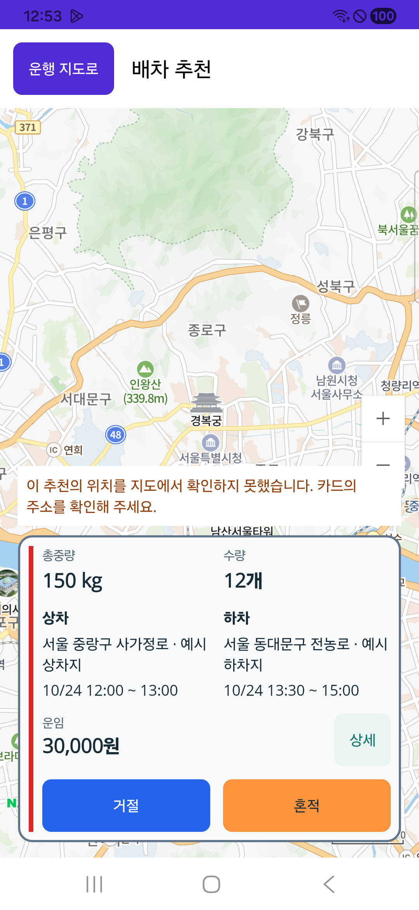

# 기사 단건 배차 추천

2026-10-24. 사용자는 추천 목록을 넘기는 방식보다 현재 배차 한 건을 제안받아 수락·거절하는 방식을 원했다. 전문 기사 Native 추천 화면의 상단 이전/다음 화살표와 목록 번호·가로 넘김을 제거하고, 제목과 복귀 버튼 사이 여백을 확보했다. 기존 총중량/수량·상하차 좌우 배치·상세 펼침·거절/독차/혼적 수락은 유지한다.

## 책임과 다음 제안

서버가 현재 기사에게 추천한 유효 원장 ID·차수에서 한 건만 표시한다. `RefreshSingle`은 새 성공 조회에 현재 ID·차수가 남아 있으면 서버 배열 순서나 다른 알림 힌트가 달라도 같은 건을 유지한다. 최초 진입 힌트는 현재 제안이 없을 때만 쓴다. 현재 건이 새 정본에서 사라지거나 만료됐을 때 서버 순서의 다음 유효 제안을 고르며, 로컬에서 새 최적화/AI 후보를 만들지 않는다. 실패하거나 이전 판본인 조회로 다음 건을 표시하지 않는다.

지도도 표시된 한 건의 상차·하차 핀과 경로만 조립한다. 현재 제안을 표시한 경우에만 기존 표시확인 요청을 보낸다. 숨긴 다른 제안을 표시했다고 알리지 않으며, 화면 이동이나 서버 재조회가 로컬 거절·수락·상차 완료 명령이 되지 않는다. 서버 GET의 기존 만료 정리와 클라이언트 명령을 구별한다.

같은 추천 판단 목적의 조립이며 별도 route·계약·DB를 만들지 않는다. 기존 ID·차수·유효기간·계정·표시 조건 snapshot·수락 전 재조회·경고·미확정 결과 보호를 유지한다. 수락/거절 후의 기존 복귀를 유지하며 새로운 추천은 서버 원장과 기존 알림·조회 흐름을 따른다.

## 서버 정책 준비와 현재 한계

`국내화물배차조율적용Service` interface/구현의 선택 인자, 조율/배달권 입력 기본값, `DomesticCargoDispatchAIReviewService`의 기본 검토 입력을1건으로 맞췄다. 명시적인2건 설정과 기존 여러 추천은 자동 취소·거절·재작성하지 않는다. 기존 Serializable/기사 잠금/원장 count/Outbox 경계는 수정하지 않았다.

이 조율 batch는 현재 `BatchActivationDeferred`이며 실제 Queue에 완전히 연결된 운영 발급 경로가 아니다. 기존 `배차대기원장전환Service.Recommendation.cs`에는 같은 기사 전체의 미만료 추천 수를 원자적으로1건으로 제한하는 관문이 없다. 따라서 **화면 한 건 표시·조율 기본1건 준비와 실제 운영 전체의 동시1건 강제는 다른 상태**다. 이번에 운영 설정·실제 DB·Queue 트랜잭션 설계를 변경하지 않았다. 기존 다건 원장의 유효시간은 서버 기준으로 계속 흐르며, 해당 제안들을 이 화면에서 모두 표시/확인했다고 처리하지 않는다.

현재 서버 추천에는 규칙·원장·경로·적합성 평가가 포함되며, 모든 제안이 생성형 모델을 통과했다는 증거는 이번 변경의 범위가 아니다. 사용자 화면에는 기존 `배차 추천` 문구를 쓴다.

## 검증

`artifacts/local/cargo-single-recommendation/20261024-r1/source-freeze.json`에16개 선택 소스를 고정했다. 독립 검토에서 현재 제안 유지·실패 조회 차단·지도 한 건·기존 수락/표시 보호6구간을 대조했다. 집중221개 통과·실패0·생략0이며 기사 Android 소비 빌드는 오류0/기존 경고29다. 운영 배차·실제 수락/거절·commit/push·배포는 실행하지 않았다.

시험은 현재 대상 유지/서버 순서 변경/최초 알림 힌트/만료·새 차수·빈 정본과 기존 인증·조건·수락 보호를 포함한다. 실제 SQLite transaction으로 기본 한 건 잠금·다음 잠금 보류·정본 잠금 해제 뒤 다음 추천과 Outbox1회, 명시2건 호환·기존 추천 보존을 검증했다. 정본 잠금 해제는 시험 상태 조작이며 실제 기사 수락/거절 명령 완주는 아니다. 표준 Fast·Task는 기존 다른 파일 `CargoDriverWorkSession.cs:245` EOF 공백에서 중단됐고 선택 범위 diff와 직접 시험/소비 빌드로 구분한다.

## 실제 휴대폰 APK 확인

기사229(`kr.hongdal.driver`, `0.1.229`)를 Galaxy A34 SM-A346N/Android16에 앱 데이터를 보존해 갱신 설치했다. 설치본과 전달 APK의 SHA-256은 `9ac3960a36877c4fce139dbece6ca65de851914c530f06457864eb4bdb8a3e56`으로 일치했다. 기존 글자 크기1.15를 유지한 실제 화면에서 제목과 복귀 버튼 간격·한 카드·펼친 상세·거절/혼적 또는 독차 버튼을 확인했다. 상단 화살표와 목록 번호는 없다.

읽기용 합성 HTTP에 `[A,B,C]`를 주면 A만 표시되고, 성공 재조회에서 `[B,A,C]`로 바꿔도 A가 유지됐다. `[B,C]`로 A를 제거한 성공 조회 뒤에만 B로 전환됐다. 빈 응답 뒤에는 카드와 수락/거절 버튼이 사라지고 현재 추천 없음 안내가 표시됐다. 표시확인 요청은 실제 보인 A·B만 대상으로 한다. 실제 수락·거절·상하차 명령은0건이다. 이 검증은 제품 DB·실제 기사 배차·운영 추천 발급의 검증이 아니다.

예시 자료에 좌표가 없어 기존 위치 미확인 경고가 보인다. 네이버 배경 지도 로드는 확인했지만 핀 정확도·GPS·실제 도로 경로는 이번 단말 시험에 포함하지 않았다. 기존 WebView 하단 탐색 겹침과 legacy Razor 수락 전 재조회 차이는 앞선 기록대로 남는다.

합성 자료가 여러 건을 돌려주는 방어 시험에서 Native 홈의 원시 추천 건수3 표시는 남으며, 이번 단건 정책의 범위는 추천 지도/카드 화면이다. 표시확인 PUT 요청은 현재 보인 A·B에만 전송됐지만 읽기용 시험 서버는 쓰기 요청을409로 거절하므로 서버 표시원장 저장 성공의 증거로 쓰지 않는다. 실제 단말의 미확인 방식·만료·수락/거절 확인창은 이번229에서 반복하지 않았고 단위 시험과 이전228 근거로 분리한다.

USB5363 연결은 원래5363으로 복원하고 기존 서버PID32404를 보존했다. 새 시험 서버PID5016/5691만 종료했으며 앱 데이터·계정·화면 설정은 변경하지 않았다. 최종 통합 근거는 `artifacts/local/cargo-single-recommendation/20261024-r1/validation-final.json`, 실제 단말 근거는 별도 `device/validation-device-final.json`이다. 패키징/설치 당시의 단말 미확인 표시는 이력으로 유지한다.
