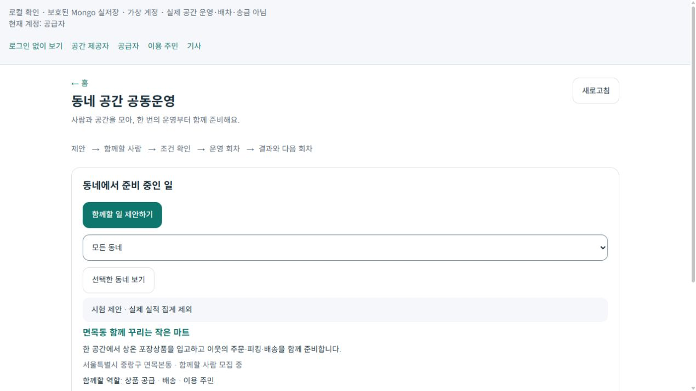

# 2026-10-24 동네 공간 공동운영 순환 r104

작은 공간을 함께 활용하려는 사람이 제안·역할 수락·조건 동의에서 입고·주문·배송의 현재 상태까지 이어 볼 수 있도록 공용 화면과 보호 원장을 연결했다. 기존 창고·마트·배차·정산 원장을 재사용하며 실제 운영 기능 관문은 유지한다.

## 이용 흐름

1. 홈의 `함께할 수 있는 사람과 공간` → `동네 공동운영 보기`에서 공개 모집을 본다. 비로그인으로 둘러볼 수 있으며 제안·참여부터 로그인이 필요하다.
2. 동네·목적·공간 사용·품목·용량·시간·비용과 보수·책임·중단 및 회수 조건을 작성한다. 제안 공개와 개인 소개는 별도로 선택하고 철회한다.
3. 공간 제공·공급·배송·주민·피킹·운영 조율·입고 검수 역할을 각각 신청·수락한다. 복수 역할을 허용하며 공간 제공자의 운영 담당은 본인의 별도 수락, 인계는 양측 확인이 필요하다.
4. 회차에서 권한이 있는 기존 거점·보관합의·입고·주문·배송·정산 참조를 선택한다. 다른 거점의 주문이나 이전 회차 완료 주문을 섞지 못한다.
5. 주문자와 판매자가 같은 조건에 동의한 뒤 판매자의 명시적 인계에서만 기존 예약·주문 원장에 연결한다. 실제 입고·전달·고객 수령 근거를 확인한 뒤 회차를 마감하고 다음 회차를 준비한다. 회차 마감·보수 발생·지급 준비·입금은 별개다.

합성 계정과 시험 제안 화면이며 실제 사람·공간·운영 실적을 뜻하지 않는다.

## 검증

| 범위 | 결과 |
|---|---|
| 관련 자동 시험 | 537개 통과, 실패·생략 0. 새 공동운영 시험 66개 포함 |
| 기존 SQL 업무 순환 | 격리 SQLite의 상온 포장상품 한 종·주문 한 건으로 기존 입고·예약·피킹·전달·고객 수령·회차 마감을 확인. 이 시험의 커뮤니티/주문 원장 저장소는 시험용 구현이며 실제 Mongo와 결합한 단일 실행은 아님 |
| 실제 Mongo | 별도 `127.0.0.1:27118`의 전용 UUID DB에서 28개 검사 통과. 중복 생성·CAS 경합·보호 결속·평문 미노출·기존 lease/재시도/오래된 token 차단. RDB 투영 완료는 실행하지 않음 |
| 실제 HTTP·공용 UI | 실제 Controller·UseCase·보호 Mongo로 제안 생성→정본 재조회·역할 수락·조건 동의·운영 수락·회차 준비·다른 계정 관심 참여. 재시작 뒤 저장 내용 재조회 성공 |
| 공개 경계 | 목록/초대 200, 비로그인 상세 401, no-store. 명시 공개 소개만 포함, 시험 자료의 운영 집계 모두 0 |
| 소비 빌드 | WebApp·통합 Android 오류 0. Android 경고 14개는 지도 ID·Firebase 미설정과 기존 플랫폼 경고. APK 설치·물리 단말 검증은 미수행 |
| 화면 | 넓은 화면과 390px iframe의 실제 공용 화면 표시 확인. 실제 휴대폰·운영 로그인과 구분 |
| 표준 검사 | Fast는 기존 미관련 `CargoDriverWorkSession.cs:245` EOF 공백에서 중단. 이번 소스 범위 diff-check 통과, 관련 시험·소비 빌드 별도 실행 |

최초 확장 시험에서 발견한 템플릿 필수 구성 안내 누락은 기존 기준에 맞게 보완하고 전체 537개를 재시험했다. 브라우저에서 발견한 목록→`/new` 전환 누락도 별도 작성 페이지로 분리한 뒤 확인했다. 초기 실패 기록은 보존한다.

## 운영 경계와 후속

기존 `community_ledgers` 보호 블록과 전문 SQL의 권위를 유지하며 전문 완료를 일반 메모로 대신하지 않는다. 조건·역할·회차 변경은 판본과 요청 영수증을 검사한다. 불명확한 응답은 결과 조회 뒤 명시적으로 재개하고, 공간 제공자 수락을 실제 공간 사용권·영업 적합성·기사 수행 자격으로 간주하지 않는다.

UI 검증 호스트는 전문 실행 관문이 OFF라 주문 목록은 기능 미지원으로 보류되고 회차 시작도 차단된다. 전체 업무 순환은 앞의 격리 SQL 시험과 구분한다. 실제 계약·실물 입고·운영 DB·송금·외부 발송·Unity·배포·commit/push는 미수행이다. 기존 휴대폰 앱·계정·연결과 원래 서버를 변경하지 않았다.

Figma는 기존 카드·변수·폰트까지 확인했지만 첫 생성 전에 읽기 전용 모드로 차단됐다. 생성·기존 화면 변경 0이며 동기화 완료로 표시하지 않는다. 스크립트와 차단 근거는 로컬 검증 폴더에 보존했다.

- [구현 범위](../AI/Planning/공통/PLAN-OPERATIONS-NEIGHBORHOOD-MICRO-HUB/community-space-cooperation.implementation.r104.md)
- [페이지 책임](../ProjectOverview/page-docs/community-space-cooperation-r104.md)
- 로컬 근거: `artifacts/local/community-space-cooperation/20261024-r1/`의 TRX·빌드 로그·`http-proof.json`·`source-manifest.json`·`validation-final.json`, 별도 `StoreProbe/runs/`.
