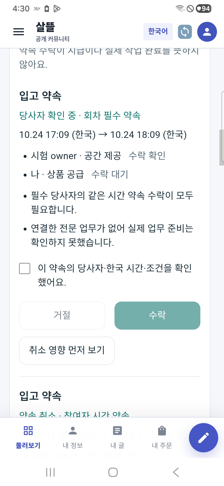

# 통합 협업 원장·참여 약속 r115

기준일: 2026-10-24. 구현과 관련 시험은 확인했으며 실제 모바일 검증 결과는 아래 별도 기록한다. commit/push·운영 배포 기록이 아니다.

## 달라진 동작

기존 공동운영 원장을 상위 통합 원장으로 사용한다. 그 아래 운영 회차, 해당 당사자의 주문, 기존 주문 정본과 실제 계보가 확인된 전문 업무를 연결한다. 공유 입고·배송 자료는 공유 관계로 표시해 중복 작업 실적을 만들지 않는다. 조회 기능이 꺼짐·미연결·권한 없음·판본 변경을 빈 성공으로 합치지 않는다.

공급·구매·입고·피킹·인계의 시간 약속을 제안하고 각 당사자가 따로 수락하거나 거절한다. 운영 담당자가 명시한 회차 필수 약속과 일반 참여자 약속을 구분한다. 필수 약속의 전원 수락만으로 실제 업무 준비를 통과시키지 않으며 현 조건·역할·시간·전문 자료를 다시 확인한다. 같은 통합 원장 안에서 다른 회차를 포함한 수락 일정 중복은 상위 판본 교체 검사로 막는다.

취소 영향은 읽기 전용으로 확인한 뒤 같은 영향 판본으로 명시 취소한다. 과거 동의·취소·관련자 변경 기록은 남기며 닫힌 약속은 명시 대체로만 연결한다. 원 요청 결과 재확인과 동일 요청 재전송, 다른 계정·서버로 바뀐 뒤 늦은 응답 차단을 적용한다.

실제 APK에서 공동운영 링크의 로그인 복귀 경로 누락을 발견해 안전한 목록·제안·단일 원장 경로를 복귀 허용 목록에 추가했다. 외부 주소·인코딩 경로 탈출·모호한 로그인/작성 경로는 계속 거부하며 인증 복귀가 업무를 자동 제출하지 않는다.

## 이번 검증

- 테스트 프로젝트 최종 build: 오류 0, 경고 202. 인증 복귀 회귀를 포함한 관련 시험 219/219 통과, 건너뜀 0. 주문 계보 변조, 당사자 조회 권한, 필수/일반 약속, 일정 경합·오래된 영향표·재전송·원장 부록 보존·화면 판본 경합을 포함한다. 앞선 175시험은 인증 경로 수정 전의 결과로 따로 보존한다.
- 실제 loopback HTTP·Mongo 보호 원장·별도 SQLite 검증: 32검사 통과, HTTP 35회, 암호화 envelope POST 11회, 인증된 비공개 GET 21회. 콘솔의 암호화 어댑터를 사용한 결과이며 브라우저 JS 암호화 실행 증거와 구분한다.
- 실제 공용 브라우저 UI: 두 개의 당사자 주문 계층, 필수 약속 제안 저장, 제안자의 별도 수락, 부모 준비 상태 재조회, 시작 전 확인 목록의 접힘을 확인했다. 가상 시험 자료이며 실제 공간 운영이 아니다.
- Fast/Task 공통 스크립트는 기존 별도 화물 파일 `CargoDriverWorkSession.cs:245`의 끝 공백 오류에서 중단됐다. 해당 파일은 수정하지 않았다. 이번 추적 변경 범위의 `git diff --check`는 별도로 통과했고 신규 파일도 공백을 검사했다.
- 실제 Android 16 / SM-A346N의 별도 시험 APK에서 로그인 후 같은 원장 복귀, 공급자의 받은 제안 조회·별도 수락, 양측 수락 저장을 확인했다. 서버 원장은 revision 16·당사자 2명 수락·`confirmed`로 재조회됐다. 취소 영향은 읽기 전용으로 열어 동일 revision과 약속 상태가 유지됨을 확인했으며 휴대폰에서 실제 취소를 제출하지 않았다.
- 시험 APK는 별도 패키지 `com.companyname.ssalddelapp.cooperationreview` / 0.1.115(115), 서명된 Debug 빌드다. 기존 통합 앱 0.1.230과 별도로 설치하고 격리 loopback 서버·가상 계정만 사용했다. 현재 세션을 제거하기 위해 새 시험 패키지 데이터만 한 번 초기화했다. 운영 앱 데이터·계정은 변경하지 않았다.
- 초기화 후 첫 실행 1회 비정상 종료가 관측됐다. Android `ApplicationExitInfo`는 16:26:08 / PID 22394 / SIGNALED / status 11을 기록했지만 원인 스택은 확보하지 못했다. 재실행 후 위 기능 검증은 성공했다. 원인과 초기 실행 안정성은 미해결이며 Release·장기 안정성 검증 완료로 표시하지 않는다. 당시와 무관한 10월 16일 crash buffer를 원인 근거로 사용하지 않았다.

실행 로그·TRX·HTTP 요약·개별 소스 해시는 비공개 `artifacts/local/integrated-cooperation/20261024-r115/`에 보존한다. r112의 이전 시험이나 화면을 이번 판본의 실행 증거로 승계하지 않는다.

## 실제 휴대폰 화면

격리 가상 자료의 원본 화면이며 자르기·가림·합성은 하지 않았다. 수락 전 당사자 확인란과 왼쪽 거절·오른쪽 수락을 보여준다. 아래 링크는 수락 후 서버 저장 상태와 읽기 전용 취소 영향 화면이다.

[양측 수락 후 화면](../assets/changes/2026-10-24-integrated-cooperation-r115/mobile-confirmed.png) · [읽기 전용 취소 영향](../assets/changes/2026-10-24-integrated-cooperation-r115/mobile-cancel-impact.png)

## 남은 경계

다른 통합 원장·HR·외부 일정까지 전역 잠금하지 않는다. 시간 약속은 실제 채용·근무 승인·재고 예약·실물 작업·배차·금전 의무가 아니다. 변경 이력은 앱 안에서 재조회하며 실제 푸시·문자 발송은 포함하지 않는다. 비용·예상 손실의 확인 근거가 없으면 금액이나 자동 벌점·공제를 만들지 않는다.

첫 범위는 한 통합 원장당 약속 100개·변경 영수증 400개로 제한하며 초과 시 새 변경을 거절한다. 과거 약속을 자동 삭제하거나 무한 확장하지 않는다. 화면 왕복의 미확정 요청과 초안은 같은 계정·서버의 메모리 세션이며 앱 종료까지 영구 복구한다고 주장하지 않는다. 서버에 저장된 약속·변경 이력은 재조회한다.

운영 담당 인계 후 닫힌 필수 약속을 현 담당자가 명시 대체할 수 있다. 아직 열린 구담당 약속을 새 담당자가 강제로 취소하거나 타인의 수락을 대신하는 기능은 없다. Figma 동기화는 기존 읽기 전용 제한으로 Pending이다. 실제 운영 DB·배차·입금·Unity·외부 공개는 변경하지 않았다.

[구현 기준과 책임](../AI/Planning/공통/PLAN-OPERATIONS-NEIGHBORHOOD-MICRO-HUB/integrated-cooperation-ledger.implementation.r115.md)
