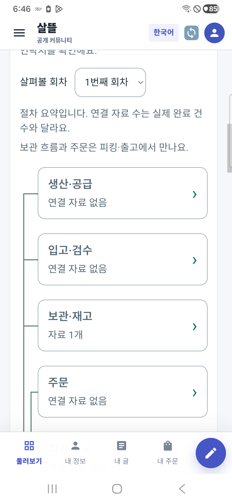
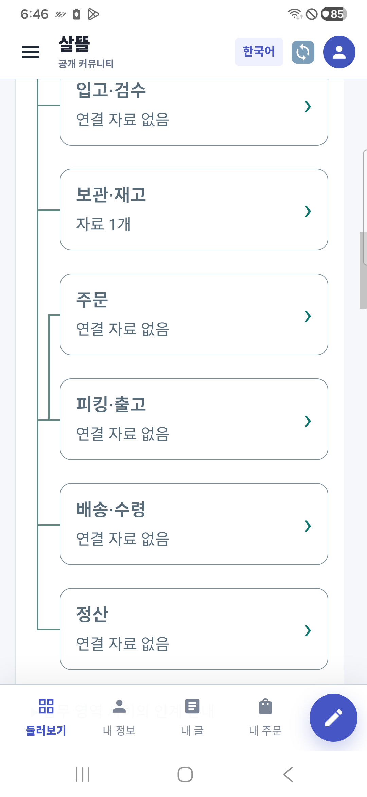

# 모바일 업무 노드 연결선 r118

2026-10-24. [기존 업무 상세 기준](../AI/Planning/공통/PLAN-OPERATIONS-NEIGHBORHOOD-MICRO-HUB/mobile-work-detail-contacts.implementation.r117.md)의 r118과 [페이지 책임 카드](../ProjectOverview/page-docs/community-space-cooperation-r104.md)를 따른다.

휴대폰의 요약 노드 왼쪽에 연결선을 넣었다. 생산→입고→보관 흐름과 주문의 별도 가지가 피킹·출고에서 합쳐지고 배송·정산으로 이어진다. 보관→주문이라는 새 직렬 관계를 만들지 않는다. 기존 한 열 카드와 독립 상세 링크를 유지하며 선은 클릭과 접근성 읽기를 가로채지 않는다. 실제 완료·인계·현재 수행을 표시하는 색이나 새 업무 상태는 추가하지 않았다.

선은 카드 높이의 중간과 카드 사이 여백에 따라 그려진다. 고정 픽셀 높이로 영상이나 페이지 위치를 추정하지 않으며 긴 문구로 카드 높이가 바뀌어도 선이 이어진다. 넓은 화면의 기존 SVG 연결도는 보존했다. 서버·조회·연락처·저장·원장·전문 명령은 이번 변경 범위에 없다.

## 검증

실제 보호 Mongo/SQLite를 사용하는 기존 격리 호스트에서 공용 화면을 불러와 390px 브라우저의 선·합류·키보드 초점을 확인했다. 노드 Enter 후 같은 원장·회차의 독립 상세로 이동하는 것도 확인했다. 공용 UI 빌드 오류 0·경고 1, 소비 검증 호스트 오류/경고 0이다. 단순 시각 보완에 새로운 로직 시험은 만들지 않았으며 이전 r117의 386개 통과를 이번 연결선의 새 시험으로 보고하지 않는다.

실제 별도 Debug APK `0.1.118`의 서명·정렬·메타데이터를 확인하고 Samsung SM-A346N / Android 16에 데이터 보존 갱신 설치했다. 휴대폰에서 연결선·별도 주문 가지·출고 합류와 노드 선택 후 같은 회차의 독립 상세 이동을 확인했다. 전용 서버 재시작으로 무효가 된 가상 세션은 기존 계정 화면의 로그아웃과 일반 로그인으로 갱신했으며 앱 데이터를 초기화하지 않았다. 원래 통합 앱 `0.1.230`은 유지했다.

실제 운영·배포·commit/push는 실행하지 않는다. 공통 Fast/Task는 기존 다른 파일 `CargoDriverWorkSession.cs:245` 끝 공백 오류로 빌드 전에 중단됐으며 이번 범위 공백·링크 검사는 별도로 수행했다. 기존 초기 실행 종료 안정성과 Figma 읽기 전용 Pending 상태는 유지한다. 이번 업데이트 실행 성공을 초기화 후 실행 안정성 해결로 표시하지 않는다.

## 최종 화면

| 생산·입고·보관 연결 | 주문과 출고 합류 |
| --- | --- |
|  |  |

브라우저 원본, APK 해시와 실행 로그는 `artifacts/local/integrated-cooperation/20261024-r118/`에 둔다. 원본 업무 데이터·이전 검증 기록은 보존했다.
