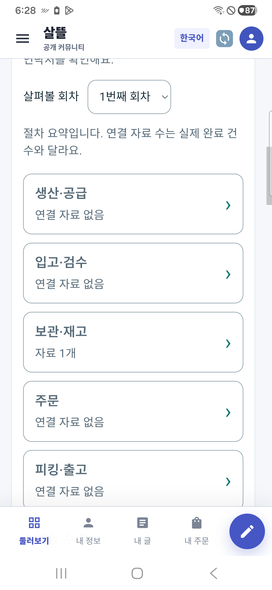
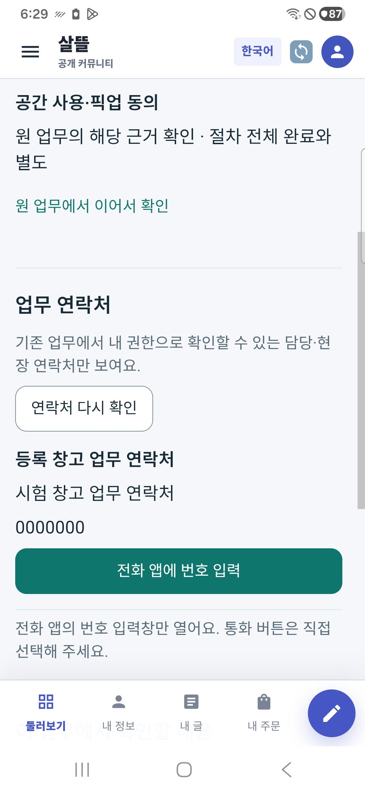
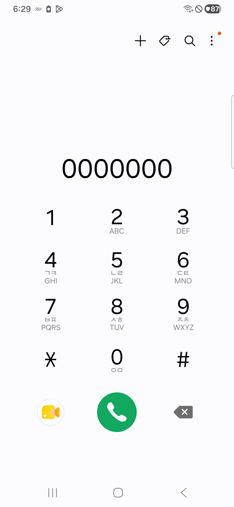

# 휴대폰 업무 상세와 등록 연락처 r117

2026-10-24. [구현 기준](../AI/Planning/공통/PLAN-OPERATIONS-NEIGHBORHOOD-MICRO-HUB/mobile-work-detail-contacts.implementation.r117.md)과 [페이지 책임](../ProjectOverview/page-docs/community-space-cooperation-r104.md)의 r117을 따른다.

휴대폰의 업무 노드를 한 열의 요약 링크로 바꾸고 선택한 원장·회차·업무의 독립 상세 페이지를 추가했다. 같은 회차의 요약으로 복귀한다. 기존 통합 원장·참여 약속·전문 업무 상태는 변경하지 않는다. 브라우저 왕복 검증 중 발견한 회차 문자열 전달 오류는 공용 두 경계에서 수정하고 실제 브라우저와 최종 APK에서 다시 확인했다.

사용자가 정한 **기존 업무에 등록된 담당·현장 연락처만 사용**한다. 첫 지원은 등록 창고, 연결된 분산 주문, 출고 묶음에 이미 연결한 같은 회차 주문의 현장 연락처다. 기존 전문 조회의 현행 권한과 개인정보 제공 상태를 사용하고, 응답 직전 그 조회를 다시 수행해 별도 권한 철회·동의 철회·번호/표시명 변경도 차단한다. 새 담당 배정·계정 전화번호 조회·등록 저장은 없다. 전화 앱을 열기 직전에도 현재 응답을 대조하며 변경 시 사용자의 재확인을 요구한다.

## 실제 휴대폰 화면

Samsung SM-A346N / Android 16의 별도 `협업 검토` Debug APK `0.1.117`에서 확인했다. 원래 통합 앱 `0.1.230`은 유지했다. 시험 서버는 loopback 5722이고 보호 Mongo 원장과 별도 SQLite를 사용한다. 창고 조회는 실제 WarehouseOperationService의 현재 계정 권한을 재사용하며 그 외 창고 명령·ISender·운송 동기화·배차·지급은 검증 호스트에서 차단한다. 새 r117 시험 원장과 더미 번호 `0000000`을 사용했다. 실사용 번호나 실제 통화로 시험하지 않았다.

| 노드 요약 | 독립 상세의 연락처 |
| --- | --- |
|  |  |

실제 순서는 시험 계정 로그인 복귀 → 내가 함께하는 일 → 요약 노드 → 보관·재고 상세 → 명시적 연락처 조회 → 번호 입력창 → 앱 복귀 → 같은 회차 요약이었다. Samsung Pass 저장 및 전화 앱의 부가 서비스 제안은 취소했다. 전화 앱에서 더미 번호가 채워졌고 통화 버튼은 누르지 않았다. 앱으로 돌아왔을 때 번호 전달 안내가 표시됐다.

## 검증 결과와 한계

- 관련 회귀 **386/386** 통과, 실패·건너뜀 0. 서버 권한·원천 관계·권한/동의 철회, ViewModel의 지연 응답·문맥 변경·다이얼 직전 갱신, 경로/로그인 복귀, 번호 정책과 미지원 결과를 포함한다. 테스트 빌드 오류 0·경고 225다.
- 실제 제품 typed GET·ISMS-P 로그인 전송·서버 조회를 이용한 **21개 boolean 검사**를 통과했다. 등록된 창고 연락처와 소유자 권한, 참여자에게 창고 권한이 자동 부여되지 않음, 익명 401·판본 충돌 409·잘못된 단계 400·없는 회차 404·private/no-store를 확인했다. 조회 전후 기존 r115 원장 revision 16과 새 r117 원장 revision 1이 유지됐다. 주문/기사 연락처는 회귀 시험 범위이며 이번 실제 HTTP/휴대폰 시험은 보관 단계다.
- 실제 브라우저의 넓은 화면과 390px 보조 렌더에서 요약→독립 상세→같은 회차 복귀, 명시적 조회, 웹의 전화 앱 버튼 미지원을 확인했다. 360px·200% 확대나 자동 iframe 레이아웃 수치는 이번 증거에 포함하지 않는다.
- 최종 검증 호스트 빌드 오류 0·경고 1, 최종 Web 소비 앱 빌드 오류/경고 0. 최종 별도 APK는 서명·정렬·Debug 메타데이터 검사를 통과했다. Android DIAL 조회만 추가하고 CALL_PHONE 권한·실제 자동 발신을 추가하지 않았다.
- 공통 Fast/Task는 기존 별도 `CargoDriverWorkSession.cs:245` 끝 공백 오류로 빌드 전에 중단됐다. 이번 범위의 별도 공백 검사는 통과했다. Figma는 기존 읽기 전용 제한으로 Pending이다.
- 이전 APK의 초기 실행 종료 문제는 미해결이다. 이번 시험에서도 가상 시험 앱 데이터 초기화 후 첫 실행 SIGNALED/status 11, 두 번째 실행 APP CRASH(NATIVE)/status 11을 관찰했다. 세 번째 실행과 최종 보완 APK 업데이트 후에는 화면·로그인·기능을 확인했지만 원인이나 안정성을 해결한 증거가 아니다. 실제 사용 전 이 안정성 검증은 별도 필요하다.

증거는 `artifacts/local/integrated-cooperation/20261024-r117/`의 시험 TRX, API boolean summary, APK 해시, 실제 기기 화면과 최종 검증 JSON에 둔다. 시험용 앱의 가상 로컬 로그인 정보만 초기화했으며 원래 앱 데이터·기존 r115 서버 원장·관련 없는 수정은 보존했다. 운영 서버·실제 작업·실제 연락·금전 처리·릴리스 배포·commit/push는 하지 않았다.
