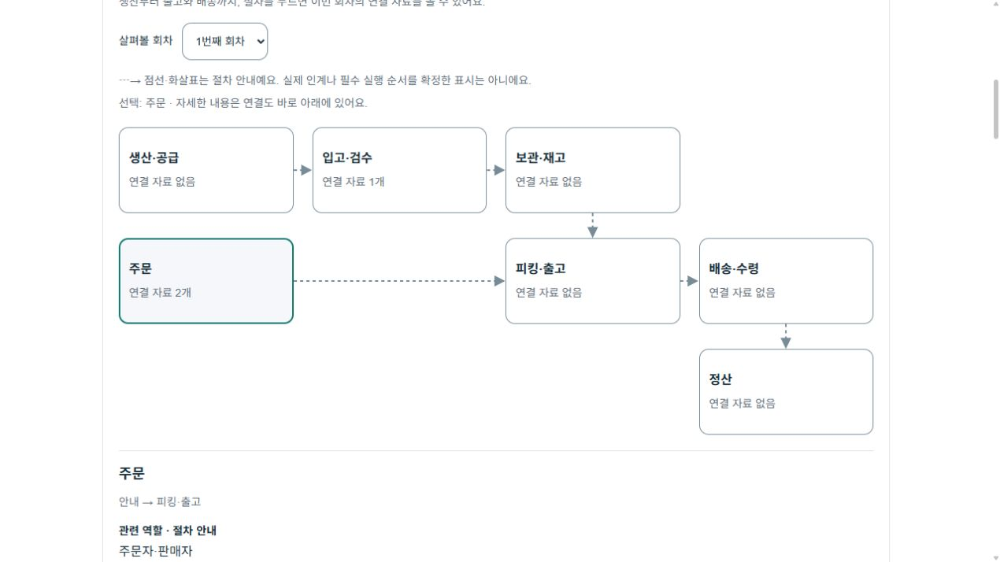
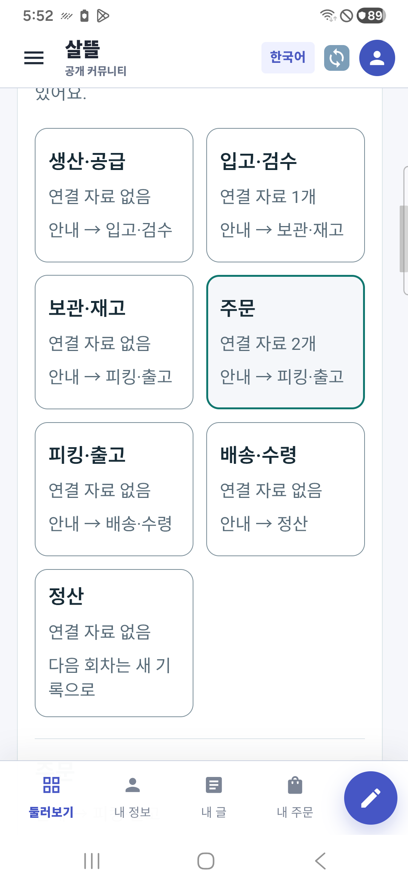

# 생산·입고·출고 업무 연결도 r116

기준일: 2026-10-24. 구현·집중 시험·실제 브라우저·휴대폰 기능 확인 완료. 초기 실행 안정성은 미해결이다. commit/push·운영 배포 기록이 아니다.

공동운영 상세의 ‘함께할 일과 약속’ 안에 업무 연결도를 추가했다. 생산·공급부터 입고·보관·주문·피킹·출고·배송·정산까지 절차를 선택해 역할 안내, 앞에서 받을 내용, 다음에 넘길 내용, 이번 회차의 실제 참고 자료를 볼 수 있다. 기존 원장과 확인된 자료 관계, 운영 체제 인계 카탈로그를 재사용한다.

점선은 절차 안내, 확인된 주문-원천 관계는 참고 자료 연결이다. 연결 자료 개수를 단계 완료율·실적·작업 수행 가능으로 해석하지 않는다. 실제 인계/담당/시작·완료는 기존 전문 화면과 서버 원장이 소유한다. 생산·개별 피킹 완료 근거가 없는 곳을 주변 자료로 채우지 않는다. 정산의 지급 준비와 실입금도 구분한다.

한 회차의 같은 판본·현재 권한 조회만 조합하고 자료 중복/미확인·조회 실패를 구분한다. 회차와 노드 선택은 로컬 표시만 변경하며 원장 저장·실제 업무 명령·외부 공개를 하지 않는다. 기존 계층과 참여 약속은 유지한다.

## 검증

- 테스트 프로젝트와 공용 UI 빌드: 오류 0, 경고 203. 새 연결도 16사례를 포함한 관련 시험 235/235 통과·실패 0·건너뜀 0. 동일 원장/판본/모드, 회차 분리, 중복/미확인/미분류 원천, 정확한 주문 참고 관계, 조회 제한, 생산 미연결·정산 준비 의미와 분기 안내를 검증했다. 기존 r115 시험 수를 이번 실행 결과에 대신 사용하지 않았다.
- 소비 호스트의 실제 빌드: 오류 0·경고 0. 실제 격리 서버에서 업무 연결도 7노드, 주문 선택 시 해당 당사자 주문 2개, 입고 선택 시 미확인 원천 1개 표시를 확인했다. 390px iframe의 2열 노드와 다음 절차 문구도 실제 렌더로 확인했다. 자동 360px/200% 확대 측정 완료를 주장하지 않는다.
- 별도 실제 APK: `com.companyname.ssalddelapp.cooperationreview`, 0.1.116(116), 서명/정렬 확인 Debug, arm64-v8a/x86_64. Android 16 / SM-A346N에서 일반 앱 로그인→동일 원장 복귀→노드 선택→주문 상세 확인을 수행했다. 실제 UI에서 선택한 주문만 강조되며 역할/앞에서 받을 내용/다음에 넘길 내용과 자료를 읽을 수 있었다. 기존 통합 앱 0.1.230과 계정·데이터는 보존했다.
- 노드/회차 보기는 읽기 전용이다. 실제 격리 보호 원장 revision 16이 브라우저·휴대폰 선택 후에도 16으로 유지됨을 재조회했다. 운영 DB·배차·실물·송금·외부 발송은 실행하지 않았다.
- Fast/Task 공통 스크립트는 기존 별도 화물 파일 `CargoDriverWorkSession.cs:245`의 끝 공백 오류 때문에 build/test 전 중단됐다. 이 파일은 수정하지 않았다. 이번 변경 범위의 `git diff --check`와 소스/문서 링크 검사는 별도로 수행했다.

검증 로그·TRX·서명 APK 해시·기기 증거는 비공개 `artifacts/local/integrated-cooperation/20261024-r116/`에 보존한다. 이전 판본의 결과와 새 실행 결과를 구분한다.

### 기기 검증의 남은 문제

검토 호스트 재시작으로 이전 가상 토큰이 서버에서 무효가 되어, 새 시험 패키지 데이터만 한 번 초기화했다. 서버의 약속/주문은 보존했고 일반 계정 로그인으로 다시 들어갔다. 이 초기화는 실제 앱의 만료/폐기 세션 복구 검증이 아니다.

초기화 직후 첫 실행 1회 종료가 관측됐으며 Android `ApplicationExitInfo`는 17:49:45 / PID 28633 / `EXIT_SELF` / status 255를 기록한다. 재실행 PID 29240에서 위 기능을 검증했지만 종료 원인은 미확인이다. 이전 r115의 SIGNALED/status 11과 이번 기록을 같은 오류로 단정하지 않는다. Release·장기 안정성 완료나 원인 수정으로 보고하지 않는다.

## 실제 화면

모두 가상 시험 자료의 실제 렌더 또는 실제 휴대폰 원본 캡처다. 자르기·가림·합성은 하지 않았다. 선택 테두리는 현재 선택이며 단계 완료색이 아니다.

[휴대폰의 선택한 주문 상세](../assets/changes/2026-10-24-work-procedure-graph-r116/mobile-order-detail.png) · [390px 브라우저 보조 확인](../assets/changes/2026-10-24-work-procedure-graph-r116/browser-390.png)

[구현 범위와 원천 의미](../AI/Planning/공통/PLAN-OPERATIONS-NEIGHBORHOOD-MICRO-HUB/work-procedure-graph.implementation.r116.md)
