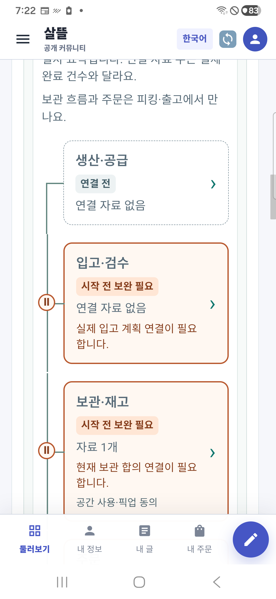
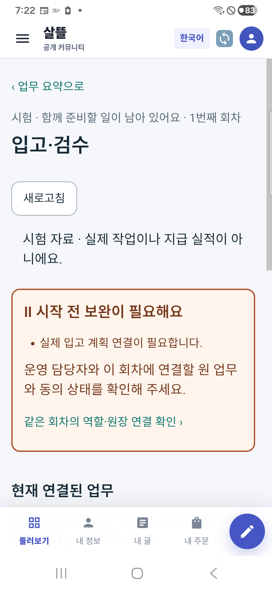
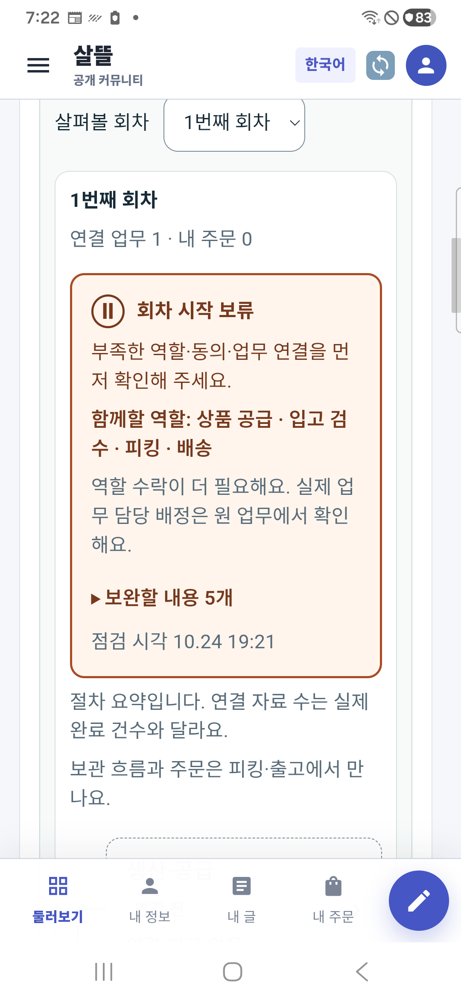
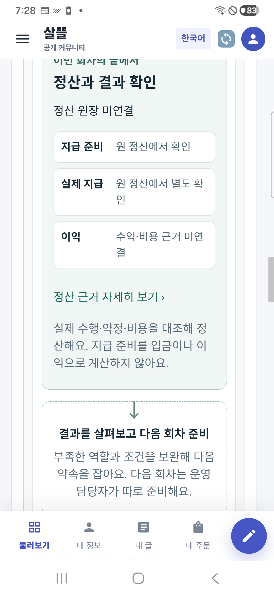

# 통합 원장의 시작 보류와 정산 흐름 r119

2026-10-24. [구현 기준](../AI/Planning/공통/PLAN-OPERATIONS-NEIGHBORHOOD-MICRO-HUB/workflow-readiness-and-settlement.implementation.r119.md)과 [페이지 책임](../ProjectOverview/page-docs/community-space-cooperation-r104.md)을 따른다.

통합 원장 안에 선택 회차와 업무 노드를 묶고, 역할 수락·동의·필수 약속·원장 연결이 부족하면 회차 상단에 보류 사유를 보여 준다. 서버가 특정한 입고·보관·주문 연결 부족은 해당 노드의 주황색 경계와 일시정지 기호로 나타낸다. 노드를 누르면 같은 회차의 보완 사유와 원 업무 자료를 확인하고 요약으로 돌아올 수 있다. 모임 역할 수락과 실제 업무 담당 배정은 구분한다.

기존 서버 점검에 회차·조건 판본·확인 시각과 구조화된 보류 근거를 추가했다. 기존 보류 문구의 순서와 시작·마감 판단, 명령은 보존했다. 다른 회차나 판본의 점검, 뒤 조회에서 바뀐 원천 권한·상태는 현재 시작 조건으로 쓰지 않는다. 아직 원장이 없는 주문 협의는 협의 연결로 표시한다. 생산·개별 피킹·실제 지급이나 이익을 주변 자료로 추정하지 않는다.

끝부분에는 정산 원장 연결과 지급 준비를 표시한다. 실제 지급·수익/비용이 연결되지 않으면 확인이 필요하다고 남기고, 다음 회차는 결과를 살펴본 뒤 별도로 준비하도록 안내한다. 같은 회차의 자동 순환·다음 회차 생성·실지급·이익 계산은 추가하지 않았다.

## 검증

- 관련 회귀시험 440건 통과, 실패·건너뜀 0. 새 서버 근거 10건과 화면 표시 44건을 포함한다.
- 실제 보호 Mongo/SQLite의 격리 HTTP 27개 확인 통과. 역할 부족과 단계 원천 부족, 원장 판본 보존, 익명 접근 거부, 로그인 외 GET만 사용한 것을 확인했다.
- 공용 UI 빌드 오류 0·기존 경고 1, 소비 호스트 빌드 오류/경고 0. 전체 시험 프로젝트는 기존 경고 202와 오류 0으로 빌드했다. 첫 시도에서 발견한 Razor 수치 뒤 한글 경계 오류는 보완 후 재빌드했다.
- 390px 브라우저의 노드·독립 상세·정산 안내와 넓은 화면의 카드 높이·연결선·가로 넘침 없음을 확인했다. 별도 실제 APK 0.1.119의 보류 사유 펼치기·상세 왕복·정산 상세 이동과, 정산 항목명 줄바꿈을 보정한 최종 휴대폰 화면을 확인했다. 항목 설명은 너비에 맞게 줄바꿈된다. 기존 시험 계정의 로그아웃/일반 로그인과 데이터 보존 업데이트만 사용했고 앱 데이터를 초기화하지 않았다. 원래 통합 앱 0.1.230은 유지했다.
- 공통 Fast/Task는 기존 다른 `CargoDriverWorkSession.cs:245` 끝 공백으로 중단됐다. 이번 범위 공백·문서 링크는 별도 확인한다. Figma 읽기 전용 Pending과 기존 초기 실행 안정성 미해결은 유지한다.

## 실제 휴대폰 화면

| 보완이 필요한 업무 | 같은 회차의 상세 |
| --- | --- |
|  |  |

| 회차의 시작 보류 | 정산과 다음 회차 |
| --- | --- |
|  |  |

화면은 가상 계정의 격리 자료이며 실제 운영·근무·지급 실적이 아니다. 새 비공개 시험 원장만 별도로 마련했으며 기존 시험 원장은 변경하지 않았다. 원 업무·예약 명령·실제 통화·commit/push·배포는 실행하지 않았다.
