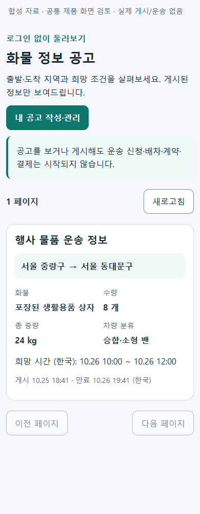
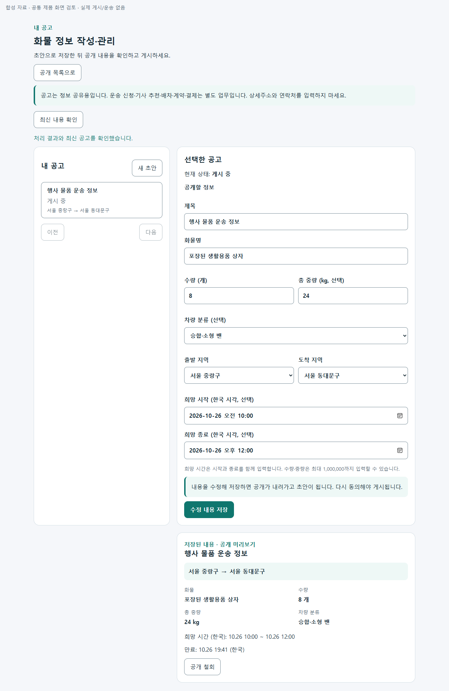

# 화물 정보 공고의 공개 수명과 법적 검토 자료 r2

2026-10-25. [승인 구현 범위](../AI/Planning/공통/PLAN-OPERATIONS-DISPATCH-CORE/cargo-information-publication.implementation.r2.md)와 [페이지 책임 카드](../ProjectOverview/page-docs/cargo-information-notices-r2.md)를 따른다.

## 문제와 보완

과거 운송 의뢰의 공개 요약은 게시자의 별도 공개 동의·철회·만료를 확인하지 않았다. 반대로 기존 의뢰 생성은 운송 원장과 업무 인계를 만들기 때문에 정보만 게시하는 흐름에 그대로 사용할 수 없었다.

새 공고는 독립 Mongo 문서로 초안·게시·철회 상태를 저장한다. 공개 전에는 현재 내용의 개정에 동의하고 만료 시각을 선택한다. 게시된 내용을 수정하면 초안으로 돌아가 다시 동의해야 하며, 만료 시각 이상인 공고는 공개 목록과 직접 조회에서 제외된다. 변경 이력이 한도에 도달해도 공개 중인 공고의 철회를 한 번 허용해 공개 상태에 묶이지 않도록 했다. 기존 운송 의뢰는 명시적인 정보 공고로 자동 공개하거나 이전하지 않는다.

열람자는 로그인 없이 새 공개 공고를 볼 수 있다. 작성·수정·게시·철회와 내 공고 조회는 인증된 작성자만 수행한다. 공개 응답은 제목·화물·수량·선택 중량/차량 분류·넓은 공개 지역·희망 시간·게시/만료 시각으로 제한하며, 의뢰·배차·정산·작성자 내부 ID·정확한 위치·연락처를 포함하지 않는다. 제목·화물명의 대표적인 상세주소·전화번호·식별번호·링크 형식도 거절한다. 이 형식 검사가 모든 개인정보를 판별한다는 뜻은 아니다.

모든 변경은 계정 범위의 원 요청·내용 지문과 기대 개정을 검사한다. 같은 요청의 재시도는 원 결과를 반환하고 다른 입력의 재사용과 동시 변경을 거절한다. 앱은 요청 전에 기존 계정·서버별 복구 저장소에 원 입력을 저장하고 다시 읽어 확인한다. 응답이 사라지면 결과부터 조회하고, 과거 결과 사본을 현재 상태로 적용하지 않고 최신 공고를 다시 읽는다. 자동으로 새 요청을 만들어 재전송하지 않는다.

## 검증

- 최종 관련 Fast 시험 292개와 소비 앱을 포함한 `Ssalddel.v3.5.slnx` 빌드를 통과했다. 첫 실행의 DI 전체 등록 기대값 불일치 2개는 실제 추가된 옵션/서비스의 순서·수명에 맞춰 수정했고 이전 실패 로그를 보존했다.
- 실제 제품 Controller·UseCase·Mongo Store를 별도 루프백 HTTP/시험 인증·고유 DB에서 실행해 31개 검사를 통과했다. 원 요청 재조회, 같은 개정의 동시 수정 한 건만 성공, 수정 후 재동의, 철회, 서버 재시작 복원과 정확한 만료를 확인했다. 화면이 구분해야 하는 요청 결과 미조회·비활성·입력 오류의 실제 `errorCode`도 검사했다. 저장 컬렉션은 공고 한 개뿐이며 운송·금융 서비스는 시험 호스트에 등록하지 않았다. 최초 시험 호스트의 설정 소스 누락 실패도 보존했다.
- 같은 제품 컴포넌트를 사용하는 별도 검토 호스트의 390/1280px에서 공개·빈 목록·비활성·실패·로그인·게시·수정 후 재동의·철회·응답 유실·결과 복구의 20개 검사를 통과했다. 가로 넘침·실행 오류·외부/API 요청은 없었다. 선택 입력의 명확한 레이블과 최신 상세 재조회 실패 시 잠금 유지도 보완했다. 이 화면은 합성 자료와 대역 Client를 사용하며 실제 휴대폰이나 운영 회원 인증의 증거가 아니다.
- 전체 Task 회귀는 **16,210개 통과·실패 0·환경 의존 16개 생략**, 소비 솔루션 빌드는 오류 0·경고 63개다. 첫 Task의 새 경로 capability 미등록 실패는 정확한 익명 읽기/인증 저장 규칙으로 수정했고, 수정 전 실행은 중단 기록으로 보존한다. 이후 공통 탐색 링크의 표시 범위만 좁혀 공고 route가 있는 통합 MAUI/Web에서 명시하고 DriverApp에서는 숨겼다. 이 마지막 읽기 전용 링크 변경은 별도 집중 회귀와 소비 빌드로 검증하며, 앞의 전체 Task를 그 이후 판본의 전수 재실행이라고 바꾸어 보고하지 않는다. 실행별 상태와 해시는 `artifacts/local/cargo-info-publication-r2/verification-summary.json`을 따른다.

## 실제 제품 컴포넌트 화면

| 모바일 공개 목록 | 데스크톱 내 공고 관리 |
| --- | --- |
|  |  |

[응답이 확인되지 않았을 때의 모바일 입력 보호](../assets/changes/cargo-information-publication-r2/pending-mobile.png)도 확인했다. 입력 보호는 저장 실패나 취소를 확정한다는 뜻이 아니다.

## 읽을 자료

[한국어 PDF](../../output/pdf/화물정보플랫폼-법적검토-20261025.pdf)와 [같은 내용 HTML](../../output/html/화물정보플랫폼-법적검토-20261025.html)을 준비했다. 6쪽에 첫 운영 범위, 현행 허가·인증, 시행 예정 플랫폼 등록, 공개/개인정보 수명, 기관에 확인할 질문과 공식 법령 링크를 정리했다. [내용 원본과 재생성 안내](../Legal/freight-information-platform-20261025-r1/README.md)를 보존한다. PDF 6쪽 전체와 HTML 390/1280px를 검수했고 원문 링크 8개를 확인했다. 법령 조사·기능 보완과 개별 사업의 허가·등록·운영 허용은 별개다.

## 남은 경계

저장 요청 뒤 서버 오류가 발생하고 원 결과도 확인되지 않으면 입력 보호를 유지한다. 서버가 미적용을 확정하는 영속 거부 영수증·관리자 해제 절차는 이번 범위에 없으므로, 결과 404만으로 보호를 자동 해제하지 않는다. 지역 선택은 기존 공식 출처 기반 초기 30동 목록(중랑·동대문·광진 일부)만 재사용하며 전국 지역 준비 완료가 아니다. 실제 회원 인증·APK/휴대폰·운영 백업 복구·남용 방지/신고 처리·보존 및 파기 운영·기관 답변과 하위법령 적용 확인은 남아 있다. Figma 대응도 Pending이다.

검토용 호스트에는 기존 SQLite 의존성의 NU1903 경고가 남아 있으며 이번에 의존성 갱신까지 수행하지 않았다. 현재 MAUI·서버 Web 소비 앱의 빌드/렌더를 검사한 것이며 WebAssembly 호환성 검증은 별도다.

공고 기능의 기본값은 OFF다. 이 작업에서 운송 추천·배차·계약·운임 수취·기관 신청·운영 DB 이전·운영 활성화·Unity·commit/push는 실행하지 않는다. 기존 사용자 변경과 앱 자료는 보존한다.
