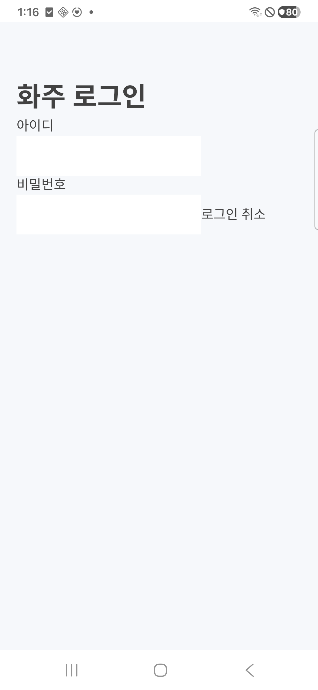
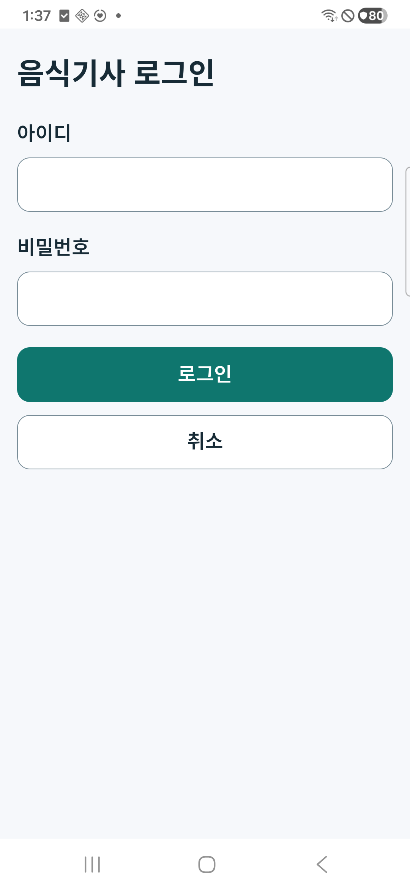

# 통합 앱 1.0 목표와 모바일 마감 r121

2026-10-25. [단일 제품 목표](../Versions/unified-1.0/README.md)와 [이번 구현 범위](../AI/Planning/공통/PLAN-OPERATIONS-NEIGHBORHOOD-MICRO-HUB/mobile-app-closeout.implementation.r121.md)를 따른다.

기존 0.0~3.5의 커뮤니티·주문·공급 준비·화물·창고·음식·마트·협업을 하나의 **통합 앱 1.0** 완성 목표로 묶었다. 개발은 [업무별 마감표](../Versions/unified-1.0/checklist.md)로 나눠 확인한다. 옛 공동주문 `1.0`, API·원장·기능 도입 코드, 기본 권한과 운영 설정은 보존한다. 통합 빌드의 정본은 `UnifiedReleaseTarget.BuildSolution = Ssalddel.slnx`이며 옛 `Ssalddel.v1.0.slnx`와 구분한다. 목표 통합은 전체 제품의 출시 완료 선언이 아니다.

## 이번 보완

화주 상세의 과거 로컬 테스트 결제 영수증이 현재 서버 금융 상태·금액·결제 수단을 덮던 경로를 제거했다. 영수증은 계정·세션·서버 범위 안에서 현재 원장과 일치하는 경우에만 표시한다. 인증된 결제 요청은 기존 업무 복구 저장소에 계정·서버·의뢰·요청 ID를 기록하고 재조회한 뒤 보낸다. 응답이 불확실하거나 저장 결과를 확인하지 못하면 자동 재전송과 샘플 성공 대체를 막고 결과 확인 안내를 유지한다. 요청별 서버 영수증·관리자 해제 API까지 새로 구현한 것은 아니다.

실제 휴대폰에서 공통 역할 로그인 화면의 버튼이 비밀번호 옆에 붙는 문제를 확인해 입력·라벨·로그인·취소를 한 열로 배치했다. 입력과 버튼은 최소 48px이고 라벨과 입력을 명시적으로 연결했다. 기존 인증·안전한 복귀·취소 동작은 유지했다. 공개 탐색에서 업무를 시작하면 로그인 뒤 원래 작성 화면으로 돌아가는 것을 실제 기기에서 확인했다. [인증·업무 분리 책임 카드](../ProjectOverview/page-docs/auth-workspace-separation-r1.md)의 로그인 목적과 원업무 복귀 경계를 따른다.

전체 시험에서 드러난 화면 선택 시험의 잘못된 대상, DI 등록 목록, 현재 운송 조건 DTO·활성 근무 fixture, 기능 메타데이터를 정합하게 보완했다. 공동운영의 공개 소개 동의가 비공개 업무 원장을 일반 지도에 공개하는 근거로 쓰이지 않도록 전용 비공개 projection 정책을 연결했다. 제품의 기사 자격·경로·적재·권한 조건은 완화하지 않았다. 기존 전역 공백 검사 차단이던 `CargoDriverWorkSession.cs` 끝의 빈 줄 한 개도 제거했고 동작 본문 보존을 확인했다.

## 검증과 실제 기기

- 최종 관련 집중시험 567개, 로그인 컴포넌트 시험 8개가 통과했다. 최종 전체 회귀는 **16,159개 통과·실패 0·환경 의존 16개 생략**이다. 최초 전체 검사 20개 실패와 수정 중 누락 import 빌드 실패는 이전 로그에 보존했다.
- 표준 Task는 전체 소비 앱이 포함된 `Ssalddel.v3.5.slnx` 빌드 오류0·경고85개와 전체16,159시험 통과·환경16개 생략을 확인했다. 기본 패키지 복원 뒤 표준 Fast도 빌드·선택 시험506개에 통과했다. 기존 이름의 회귀 솔루션을 사용한 것이며 통합 목표의 정본 `Ssalddel.slnx` 전체를 실제 CLI로 빌드했다고 바꾸어 보고하지 않는다. 첫 `Fast -NoRestore`는 다른 전문 앱의 정리된 `obj/project.assets.json`이 없어 중단됐고 그 기록은 보존한다.
- 격리 MySQL/Mongo의 제품 HTTP 흐름은 음식 5검사, 화물 7검사, 창고 인계·배송 8검사를 통과했다. 서버를 최신 빌드로 재시작한 뒤 네 가지 보존 검사를 GET과 인증만으로 확인했고 업무 명령을 재전송하지 않았다. 창고 사례는 입고·피킹·포장이 끝난 합성 재고에서 시작하므로 창고 전체 업무 완료 증거가 아니다.
- 화물의 초기 경로 미확인·팔레트 수 미기재 실패 원장은 보존했다. 신규 합성 사례만 선언된 좌표 쌍의 경로 어댑터와 팔레트 0개 입력으로 검증했다. 실제 도로·GPS·실차 적재나 운영 경로 검증으로 바꾸지 않는다.
- 표준 Release 검토 APK **0.1.122**를 별도 `com.companyname.ssalddelapp.closeoutreview` 패키지로 만들고 0.1.121에서 데이터 보존 업데이트했다. 실제 휴대폰에서 로그인과 `R121-BOX` 초안 복구를 확인했으며 최신 APK 재실행 3회에서 새 종료 오류가 관측되지 않았다. 기존 원 앱 0.1.230과 이전 검토 앱·데이터는 보존했다.
- 최신 APK SHA-256은 `0ee167680d33564786319450a8dbc3af6e79fbabb91b39cf66ee3a26f6e6c13f`다. 동결 입력 2,181개는 빌드 중 변경 0개이며 서명·정렬·Release 메타데이터와 설치된 APK 해시를 대조했다. APK의 검토 번호는 제품 1.0 출시 버전과 다르다.
- 재실행 검사 도구는 소유한 검토 패키지·지정 기기·기대 APK 해시로 제한한다. 도구 시험은 24개 통과·Windows 실제 심볼릭 링크 권한 의존 1개 생략이며 합성 reparse 거절은 통과했다. 과거 native 종료와 현재 관측 시간대를 분리했고 과거 첫 실행 종료 원인이 해결됐다고 표시하지 않는다.

현재 전체 결과의 정본은 `artifacts/local/mobile-app-closeout/20261025-r121/verification-summary.json`이다. 원시 계정·키·응답은 해당 실행의 비공개 폴더에만 보관한다.

## 실제 휴대폰 화면

같은 공통 로그인 컴포넌트의 이전 화주 화면과 수정 후 음식기사 화면이다. 역할별 인증 저장소를 합친 것은 아니다.

| 이전 입력·버튼 배치 | 수정 후 한 열 배치 |
| --- | --- |
|  |  |

[업데이트 뒤 복구된 합성 화물 초안](../assets/changes/2026-10-25-mobile-app-closeout-r121/draft-restored.png)도 확인했다. 작성 내용 복구는 실제 등록·배차·계약·결제가 아니다.

## 남은 마감과 실행 경계

음식·창고·협업의 모든 역할을 최신 APK에서 끝까지 수행하는 검증, 실제 카메라·GPS·지도 연결·외부 알림, 외부 접속·백업 복원·운영 migration·실결제·실지급은 남아 있다. 검토 APK의 지도 연결은 미설정이므로 목록 복귀를 확인했다. Native 금융 변경은 관련 시험으로 확인했으며 실 PG 요청이나 해당 Native 화면의 실제 금융 왕복을 수행하지 않았다. 공통 역할 로그인에 대응하는 기존 Figma node는 이번 근거에 연결되지 않아 `Figma Pending`으로 남긴다. 실제 APK의 배치와 기존 공통 토큰을 근거로 삼았으며 Figma 갱신·양쪽 일치 완료를 보고하지 않는다.

로컬 검토 서버는 전용 DB와 Simulation 모드, 외부 HTTP·HostedService·클라우드 발송·자동 지급 비활성 상태다. 실제 사용자 자료·DB·앱을 초기화하지 않았고 commit·push·운영 배포는 수행하지 않았다. 새 기능을 계속 더하기보다 통합 1.0 마감표의 현재 공백을 같은 원장·서버·휴대폰 근거로 차례로 닫는다.
