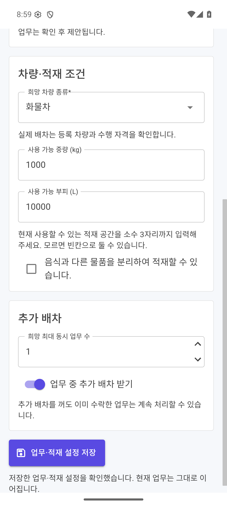
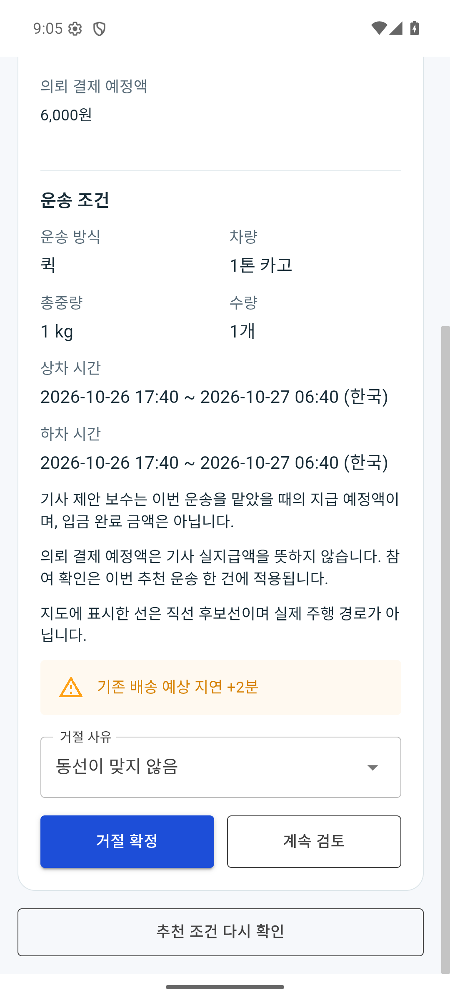
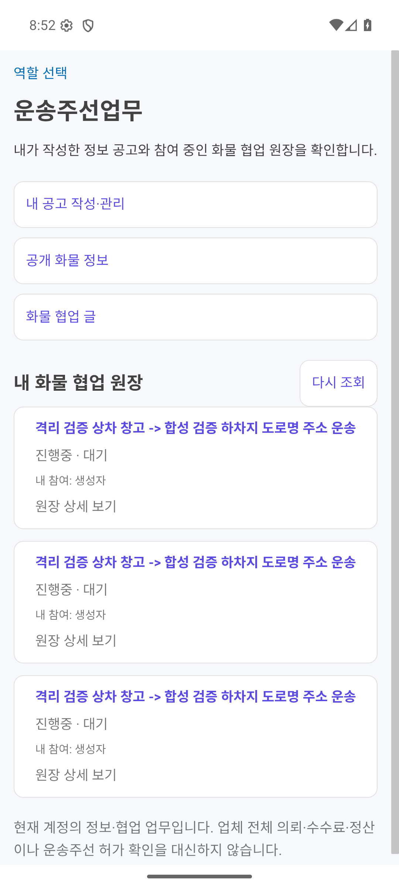
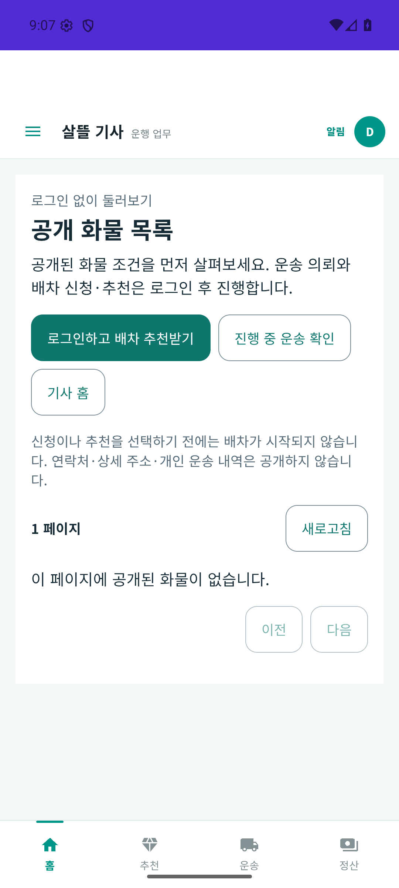
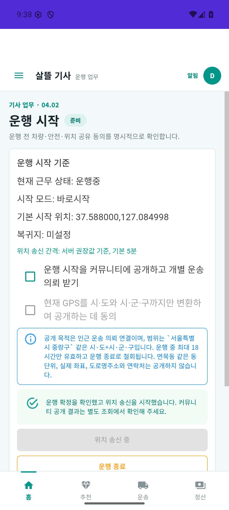
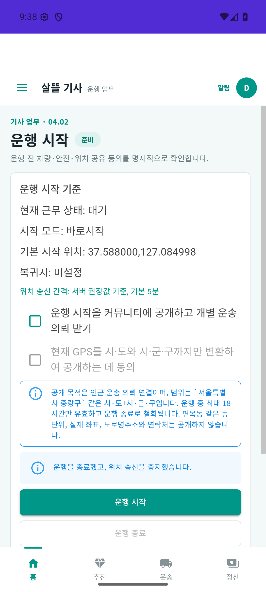

# 화물 Android 업무 복구·설정 연결 r124 (2026-10-26)

상태: **구현·격리 Android 검증 완료 / 전체 소비 앱 빌드 차단·실기기 업무 미검증 / 운영 비활성**.

[직전 Android 점검](2026-10-26-cargo-android-role-review.md)에서 재현한 화주 요약 권한, 기사 설정·거절·만료 복귀, 계정 전환과 독립 기사 시작의 결손을 보완했다. 운송주선업무는 현재 계정이 접근하는 화물 협업 원장과 기존 정보공고 업무로 연결했다. 업체 전체의 배차·수수료·정산 기능이나 운송주선 허가 확인을 새로 구현한 것은 아니다.

[구현 기준·페이지 책임](../AI/Planning/공통/PLAN-OPERATIONS-DISPATCH-CORE/cargo-android-recovery.implementation.r124.md)과 [작업지시서](../AI/Planning/공통/PLAN-OPERATIONS-DISPATCH-CORE/cargo-android-recovery.r124.work-order.json)가 범위를 소유한다. 아래 결과는 로컬 격리 서버와 합성 계정·의뢰의 검증이며 실제 운송·금전·공개 운영과 구분한다.

## 보완한 업무

| 항목 | 변경 내용 | 유지한 경계 |
| --- | --- | --- |
| 화주 홈 요약 | 인증된 본인의 입고 예정·가용 재고 건수를 전용 요약 API로 조회한다. | 창고 작업자 권한을 화주에게 추가하지 않고 실패를 0건으로 숨기지 않는다. |
| 통합 기사 설정 | 기존 업무 선택·차량·적재 조건 입력과 저장·정본 재조회를 `/workspace/cargo-driver/settings`에 연결한다. | 설정 저장은 운행 시작·자격 승인·추천 발행이 아니다. |
| 추천 거절 | 기존 서버 계약을 이용하는 명시적 거절·사유·결과 확인을 통합 추천 상세에 연결한다. | 수락과 거절을 구별하고 응답이 불명확하면 재조회로 확인한다. |
| 만료·변경 추천 복귀 | 현재 조회가 성공했지만 선택한 추천이 없어졌을 때 현재 추천·운송·대기로 복귀한다. | 조회 실패·권한 실패를 빈 화면 성공으로 바꾸거나 과거 추천을 다시 수락하지 않는다. |
| 권한 없음의 계정 전환 | 권한 없음 화면에서도 다른 계정 로그인·로그아웃·역할 선택으로 이동할 수 있게 한다. | 역할 선택이나 계정 전환으로 서버 권한을 자동 부여하지 않는다. |
| 독립 기사 시작 | Firebase 미설정·초기화 실패가 일반 기사 UI 시작을 중단하지 않도록 처리한다. | Push 초기화 실패를 Push 수신 성공으로 표시하지 않는다. |
| 운송주선 정보 작업공간 | `/workspace/freight-broker`에서 본인 접근 국내 화물원장의 목록·정본 상세를 읽고 기존 공개 화물정보·본인 공고 관리로 이동한다. | 서버 관리자·관세사 권한, 업체 소속·허가·수수료·금융 권한을 재사용하거나 추정하지 않는다. |
| 내 정보의 로그인 표시 | 고정된 방문자 표시 대신 기존 인증 상태의 본인 표시명·로그인 여부를 사용한다. | 인증 실패를 로그인 성공으로 표시하지 않는다. |
| 거절 사유 분류 보존 | 현재 앱 선택 문구·기존 코드를 안전한 분류로 바꾸어 정상 거절 전환과 사후 사건에 전달한다. | 자유문구·연락처를 사건·로그에 복제하거나 과거 사건을 고치지 않는다. |

주선 작업공간은 `my-ledgers`의 정확한 `국내 화물 운송` 필터를 사용하고 응답의 화물 템플릿·본인 접근 범위를 다시 확인한다. 알 수 없는 분류를 전체 목록으로 받아 표시하지 않는다. 상세는 현재 본인 목록에서 선택한 원장만 조회하고 원장 ID·분류·조회 권한을 재검사한다. 계정·서버·세션이 바뀌면 이전 결과를 지우며 로그인 복원이 끝나기 전에 목록을 요청하지 않는다. 원시 context·연락처를 새 화면에 복제하지 않는다.

## 확인한 결과와 남은 검증

| 검증 | 확인한 결과 | 아직 포함하지 않는 것 |
| --- | --- | --- |
| 화주 요약 API | 본인 입고 예정 0건·가용 재고 1건, 다른 화주 0건·0건. 요청 매개변수의 타인 ID로 범위가 바뀌지 않았다. | 다른 화주의 상세 재고 조회·창고 직원 권한 확대 |
| 권한 경계 | 기존 창고 입고·재고 API는 화주에게 각각 403, 익명 요약은 401을 유지했다. 새 요약 응답은 두 건수만 반환했다. | 운영 계정·실제 창고 데이터 검증 |
| 화주 Android 홈 | 통합 검토 APK에서 진행 운송 3건·입고 예정 0건·가용 재고 1건 표시를 확인했다. | 실제 휴대폰 업무 화면 |
| 주선 Android 목록·상세 | 통합 APK에서 본인 접근 화물원장 3개와 선택 원장의 운송 의뢰·상차·하차·결제 정산 상태를 확인했다. 별도 API 재조회도 목록 3개·상세 200과 본인 권한을 확인했다. | 업체 전체 원장·조건 제안·기사 배정·수수료·허가 확인 |
| 권한 없음의 로그인 전환 | 실제 APK의 권한 없음 화면에서 `다른 계정으로 로그인` 진입을 확인했다. | 권한 자동 부여·타인 원장 노출 |
| 기사 설정 GUI 저장 | 통합 APK에서 업무·차량·적재 설정을 저장하고 저장 확인 안내를 확인했다. 읽기 전용 서버 재조회에서 Revision 1, 퀵·화물 선택, 화물차·중량 1,000kg·부피 10,000L를 확인했다. 이후 GUI로 운행 시작·위치 1회 허용·수신 ON을 수행했다. | 실제 GPS 운행·운영 배차 성공 |
| 추천 실제 거절 | 통합 APK에서 거절 사유 화면→거절 확정→현재 목록 재조회 안내를 확인했다. 정본에서 해당 제안의 Rejected 사건 정확히 1건·선택/확정기사 없음과 마지막 거절기사 일치를 확인했다. | 실제 운송 수락·상하차·결제·지급 완료 |
| 만료 추천 복귀 | 실제 APK에서 만료된 추천 상세를 떠나 지도 업무 화면으로 복귀했고, `현재 확인할 업무가 없습니다`와 선택 추천 변경 안내를 확인했다. | 새 추천 발행·재수락·운영 운송 완료 |
| 독립 기사 시작 | Firebase 미설정 경고가 있는 상태에서 실제 APK의 공개 화물 화면·로그인과 동일 서버 운행 상태 조회가 성공했다. 이 앱에서 시험 운행 종료·위치 송신 중지 안내도 확인했다. | 실제 휴대폰 업무·Push 수신 성공 |
| 독립 기사 요약 갱신 | 후속 APK125에서 같은 화면의 대기→시작 후 운행중→종료 후 대기 표시와 종료 안내의 일치를 확인했다. | 실제 GPS 운행·단말 재실행 전체 시나리오 |

화면 확인은 Android 에뮬레이터에서 실제 검토 APK를 실행한 결과다. 실기기는 통합 APK 설치를 확인했지만 OS 업데이트 안내 앞에서 업무 화면을 검증하지 못했다. 에뮬레이터 화면을 실제 휴대폰 조작으로 집계하지 않는다.

기사 설정 저장 직후에는 대기·근무 ID 없음·수신 OFF를 따로 확인했다. 그 후 실제 GUI 운행 시작→에뮬레이터 합성 GPS→수신 ON으로 진행했다. 추천 fixture는 엄격한 좌표 일치를 요구하여 정확 합성 GPS 보정을 별도 API로 두 차례 수행했으며 이를 실제 GPS 측정으로 집계하지 않는다. 첫 추천은 유효기간이 지나 차단·복귀했고, 두 번째 별도 의뢰는 GUI에서 거절했다. 기존 만료 추천의 TTL·이력은 바꾸지 않았다. 검증 뒤 GUI에서 수신 OFF·운행 종료를 수행했다.

실제 거절 사건을 대조하여 기존 서버가 선택 사유를 전달하지 않고 `NotProvided`로 기록하는 누락을 발견했다. 이 기존 사건은 그대로 보존했다. 서버 후속 보완은 `배차거절사유Policy`와 정상 전환 overload를 사용하며, 이 보완을 앞선 GUI 사건의 사유 저장 성공으로 소급하지 않는다. 앱의 기존 요청 DTO는 변경하지 않았다. 관련 58개 시험이 새 사건의 안전한 분류 저장·기존 사건 불변·사후 로그의 원문 비노출을 확인했다. `reason-focused/validation.json`과 `reason-focused/reason-focused.trx`에 근거가 있으며 수정 서버의 실제 HTTP·GUI 재검증은 수행하지 않았다.

APK124의 독립 기사 종료 안내는 성공했지만 요약 캐시에 운행중이 남는 것을 발견해, 본인 상태를 다시 조회하는 후속 APK125를 만들었다. 조회 중에는 중복 조작을 잠그고 계정·세션을 전후 대조한다. 조회 실패는 `운행 상태 미확인`과 경고로 표시하고 확정된 시작·종료 결과와 구분한다. APK125 실제 검증은 같은 시험 DB의 기존 a2 서버를 사용했으므로 위 서버 사유 보완의 HTTP 검증으로 집계하지 않는다.

후속125 종료 뒤 정본은 대기·GPS 없음·실효 Ineligible이지만 기존 수신 의사 선호 On은 유지된다. 이를 수신 OFF나 실제 배차 가능으로 표현하지 않는다. 시험 정리의 명시적 API 수신 OFF는 native의 자동 처리나 GUI OFF와 별도 근거다.

## APK와 시험 증거

통합 APK124와 독립 기사 APK124·후속125는 원래 앱과 구별되는 검토 패키지, Release, `arm64-v8a`·`x86_64`로 만들었다. 서명·정렬·Release 메타데이터와 기록한 빌드 입력의 변경 0개를 확인했다. 빌드 시점 증거와 이후 설치·실행 증거는 별도로 보존한다.

| 검토 APK | 파일 크기 | SHA-256 | 증거 상한 |
| --- | --- | --- | --- |
| 통합 `com.companyname.ssalddelapp.closeoutreview` | 91,090,661 bytes | `118c2c19c1e0188a67105eff3989235a9f1d5c8b7e100d1af5592e5baa7771f3` | 입력 3,254개 변경 0개. 후속 설치 기록과 최종 APK 양 ABI의 loopback endpoint 확인 있음. |
| 독립 기사 `kr.hongdal.driver.cargoreview` | 92,641,336 bytes | `a07c386ef293ebd7d42db83342cc52b3fffc4103a9b012f800d98f574e5a2cea` | 입력 3,047개 변경 0개. 양 ABI 최종 APK endpoint 추출·에뮬레이터 시작·로그인·운행 종료 확인. |
| 독립 기사 후속125 `kr.hongdal.driver.cargoreview` | 92,649,528 bytes | `58986ccacf21b62da396b9af30473e65b899227af4b51927ffaf1c1d28e2f63c` | 입력 3,047개 변경 0개. 양 ABI endpoint·실제 GUI 시작/종료 후 요약 일치 확인. |

- 사유 분류와 native 소스 보완 후 최종 .NET 전체 회귀는 **16,289개 통과·실패 0개·환경 의존 16개 생략, 전체 16,305개**다. 결과는 `artifacts/local/cargo-android-fixes-r124/full-tests-final/full-r124-final.trx`와 `full-tests-final.log`에 있다. 환경 의존 생략을 실제 DB 검증 통과로 집계하지 않는다. 앞선 전체16,269개·집중188/130/58개는 서로 겹치므로 합산하지 않는다.
- 표준 Task-a2는 diff·음식 기사 코드맵 검사 뒤 `Ssalddel.v3.5.slnx` 빌드에서 **중단**됐다. 일반 checkout의 여러 Android 소비 앱에 `Maui.SplashTheme`·FileProvider·AAPT 리소스 및 중간 생성 관련 오류가 남아 있다. 로그는 `artifacts/local/validation/20261026-180011/build-01.log`와 `artifacts/local/cargo-android-fixes-r124/task-validation-a2.log`다. 이 실행의 Task 전체 시험은 시작하지 않았으며 위 16,269개는 별도 .NET 전체 시험 결과다. 격리된 통합·독립 기사 Release APK 성공을 일반 솔루션 전체 성공으로 합치지 않는다. 범위 밖 앱의 캐시 삭제·일괄 재빌드는 하지 않았다.
- 코드맵은 생성 문서의 소스 행 번호 11곳만 정식 갱신했다. 기존 dirty 메타데이터의 업무 의미와 131개 입력 해시를 보존하고 `--write`·`--check`·범위 diff 검사를 통과했다. `code-map-audit/official-update-20261026-175603/verification-summary.json`에 사본·전후 해시·차이를 남겼다.

로컬 근거 루트는 `artifacts/local/cargo-android-fixes-r124/`다. `apk-build-proof-r124.json`, `apk-driver-build-proof-r124.json`, `apk-driver-endpoint-proof-r124.json`, `integrated-install-endpoint-proof.json`이 패키징·endpoint·설치를 각각 기록한다. 실제 APK 원캡처와 화면 구조는 같은 폴더의 `.private/emu-*-r124.{png,json}`에 보존했다. 대표 화면은 아래에 원캡처 그대로 복사했다.

| 기사 설정 저장 | 거절 확인 |
| --- | --- |
|  |  |

| 본인 화물원장 | 독립 기사 시작 |
| --- | --- |
|  |  |

| 후속125 시작 뒤 운행중 | 후속125 종료 뒤 대기 |
| --- | --- |
|  |  |

시험 서버 근거는 `artifacts/local/integrated-workflow-r108/feef1cee481f4d499fd111ba4310bf79/`의 `fixed-summary-a2-readonly-proof.json`, `broker-ledger-readonly.json`, `broker-detail-readonly.json`, `after-gui-settings-readonly.json`, `device-decline-offer-01.json`, `device-decline-offer-02.json`, `gui-decline-canonical-proof.json`이다. 결제·지급·수락 후속 처리 0건과 추천 outbox 미전송을 확인했다. 로그인 정보·토큰·원시 민감자료를 이 문서에 복사하지 않는다.

`android-runtime-r124.json`과 `screenshots-manifest.json`은 실제 실행 범위·원캡처 SHA를 기록한다. `device-cleanup-proof.json`은 시험 앱만 중지하고 소유 AVD·이번 reverse 연결을 정리한 기록이다. 개인 휴대폰 앱·원래 앱 데이터·공유 Docker·컴퓨터 전원은 변경하지 않았다.

후속125의 빌드·양 ABI endpoint·실제 실행·원캡처·정리는 `artifacts/local/cargo-android-fixes-r125-driver-status/`의 각 proof와 `android-runtime-r125.json`에 별도로 보존한다.

같은 시험 서버 run의 `native125-final-canonical-proof.json`은 GUI 종료 정본, `native125-api-cleanup-proof.json`은 별도 API 수신 OFF와 금융·외부 효과 0 확인, `native125-backend-stopped-final.json`은 소유 PID36640·5378 종료와 공유 Docker 보존을 기록한다. 문서 Fast·최종 코드맵 검사·범위 diff를 확인했고 `final-evidence-check.json`에서 기획 해시·원캡처9개·로컬링크22개·APK3개 해시·최종 시험 카운터를 대조했다.

## 소스 책임과 운영 경계

- [화주 요약 API](../../Ssalddel/Controllers/Shipper/ShipperWarehouseSummaryController.cs)와 [인증 본인 요약 조회](../../Ssalddel/Application/Shipper/Queries/ShipperWarehouseSummaryQuery.cs).
- [통합 기사 설정 진입](../../SsalddelApp/Components/Pages/CargoDriverWorkSettingsPage.razor), [추천 행동](../../Ssalddel.Ui.Common/Areas/App/RoleWorkspace/Cargo/CargoOfferActionViewModel.cs), [현재 추천 선택 복구](../../Ssalddel.Ui.Common/Areas/App/RoleWorkspace/Cargo/CargoWorkspaceAdapters.cs).
- [권한 없음의 계정 영역](../../Ssalddel.Ui.Common/Areas/App/RoleWorkspace/Core/RoleMapWorkspace.razor), [독립 기사 초기화](../../DriverApp/Platforms/Android/MainActivity.cs).
- [거절 사유의 안전한 분류](../../Ssalddel/Application/Driver/DispatchAction/배차거절사유Policy.cs), [독립 기사 최신 상태 표시](../../DriverApp/ViewModels/Driver/Work/기사운행시작PageViewModel.cs).
- [주선 정보 API 조회](../../Ssalddel.Ui.Common/Areas/App/RoleWorkspace/Cargo/FreightBrokerWorkspaceClient.cs), [계정 수명과 정본 상세](../../Ssalddel.Ui.Common/Areas/App/RoleWorkspace/Cargo/FreightBrokerWorkspaceViewModel.cs), [모바일 공통 화면](../../Ssalddel.Ui.Common/Areas/App/RoleWorkspace/Cargo/FreightBrokerWorkspaceScreen.razor).

이번 정보 작업공간은 [월정액 정보추천 준비 r4](2026-10-26-cargo-information-subscription-r4.md)나 업체 운송주선 자격 판정을 대신하지 않는다. 요금 확정·월정액 청구·기관 신청/회신·운영 허가·업체 금융 원장은 변경하지 않았다. 시험 서버의 live 200과 ready 503을 구분하며 운영 준비 성공으로 승격하지 않는다. 실제 GPS 운행·네이버 지도 인증·외부 Push·실금융·공개 운영·commit/push도 이번 확인 범위에 없다.
