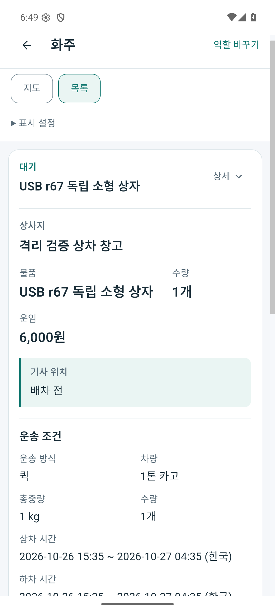
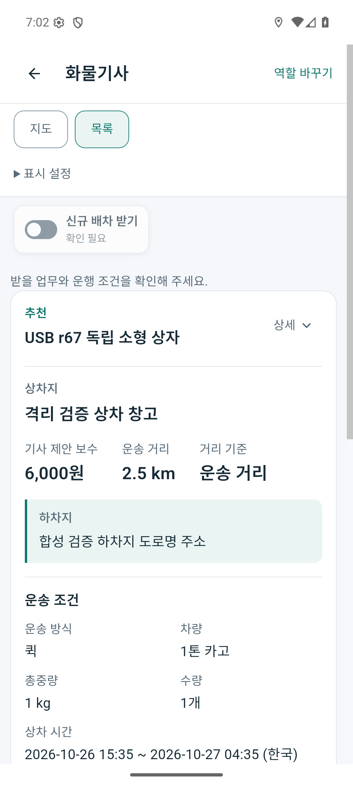

# 화주·기사·운송주선업체 Android 화면 점검 (2026-10-26)

## 결론

현재 앱을 세 역할 모두의 완성된 업무 앱으로 판정할 수 없다. 화주와 기사의 실제 Android 화면은 실행되지만, 화주 홈의 권한 불일치, 통합 기사 앱의 설정·거절 연결 누락과 만료 추천의 복귀 오류가 있다. 운송주선업체의 자체 배차·수수료·업체 정산 작업공간은 현재 구현에서 확인되지 않았다. 서버 관리자 관제는 이 역할을 대신하지 않는다.

이번은 기존 기능의 실행 점검이다. 제품 기능·권한·운영 설정은 수정하지 않았다. APK 빌드와 설치, 에뮬레이터 실행, 실제 휴대폰 조작, 시험 API 준비와 앱 입력을 구분한다.

## 실행 환경과 증거 범위

- 현재 소스의 통합 검토 Release APK `0.1.123 / 123`, `com.companyname.ssalddelapp.closeoutreview`. 원래 앱과 별도 패키지이며 기존 검토 패키지에는 데이터 보존 업데이트를 했다.
- APK SHA-256: `29e6d2534a8bf2dae76ebc76dd71237f0ec9c00e55201e960762f1ad163bdf68`, 91,045,605 bytes. 양 ABI `arm64-v8a`·`x86_64`와 loopback 5378 endpoint를 확인했고 빌드 입력 2,327개는 변경 0개였다. 일반 checkout의 모든 Android 빌드 문제가 해결됐다는 뜻은 아니다.
- Samsung 실기기에 설치·버전 확인은 했지만 잠금 화면 때문에 업무 화면을 조작하지 않았다. 사용자가 현재 잠금 해제가 어렵다고 답했다. **아래 PNG는 실제 휴대폰 사진이 아닌 Android 에뮬레이터에서 실제 APK를 실행한 캡처다.**
- 기존 `mirror_mobile_review` AVD를 `read-only / no-snapshot-save`로 실행했다. 초기화·원래 앱 삭제·사용자 앱 데이터 삭제는 하지 않았다.
- 별도 `Simulation` 호스트·새 시험 DB와 합성 계정/의뢰 2건을 사용했다. 결제·지급·외부 알림·실제 운송은 실행하지 않았다. 시험 좌표·노선은 실제 GPS·실도로 검증 근거가 아니다.
- 서버 `/health/live`는 200이다. `/health/ready`는 503이며, 현재 모델을 `EnsureCreated`한 시험 DB에 운영 migration 이력이 없기 때문이다. 운영 준비 성공으로 표시하지 않는다.
- Naver SDK ID·회원 Push 설정이 없어 지도 표시·외부 Push·백그라운드 실제 GPS는 미검증이다.

로컬 상세 증거는 `artifacts/local/cargo-android-role-review/20261026-r1/`에 있다. 서버 run은 `artifacts/local/integrated-workflow-r108/bdffe3344e7e4d64b7d872b360afb5c3/`다. 비밀번호·토큰은 비공개 파일에만 유지한다.

## 실제로 확인한 흐름

| 역할·흐름 | 이번 실행 결과 | 상한 |
| --- | --- | --- |
| 화주 비로그인 진입 | 공개 목록과 로그인 후 의뢰 버튼 표시 | 시험 DB의 공개 목록은 비어 있음 |
| 화주 로그인·복귀 | 로그인 후 운송 의뢰 시작 화면으로 복귀 | 앱에서 새 의뢰를 제출한 검증은 아님 |
| 화주 업무 조회 | 제품 API로 준비한 2건, 물품·수량·운임·차량·중량·시간 조회 | 합성 의뢰이며 실제 계약·지급 아님 |
| 화주 홈 | 입고·재고 요약 실패 경고 재현 | 운송 목록200, 창고 API 두 개403 |
| 역할 계정 전환 | 화주 작업공간 하단 계정→로그아웃→화물기사 로그인 | 권한 없음 화면에서는 이 전환이 직접 노출되지 않음 |
| 기사 운행 시작 | 위치 권한 1회 허용 후 운행 ID1, 서버 운행중·위치 수신 확인 | 에뮬레이터 합성 GPS |
| 신규 배차 받기 | 앱에서 수신 의사 ON 반영 | 업무·차량 설정은 앱에서 완료하지 못함 |
| 시험 추천·조건 확인 | 합성 의뢰 1건의 전용 추천 카드·6,000원·2.5km·차량·중량·수량·상하차 시간과 확인체크2개 표시 | 설정은 별도 API bootstrap, 추천은 명시적 시험 제어 |
| 만료 추천 | 유효기간이 지나자 경고·참여 버튼 비활성화 | 실제 수락 성공·거절·상하차·완료는 미검증 |
| 만료 후 복귀 | 현재 업무 조회 오류와 재시도 실패 재현 | 서버 업무 조회는200, 클라이언트 만료 선택 복구 결손 |
| 운송주선업체 | 독립 업무 화면 미발견 | 관리자 화면을 주선업체 화면으로 제시하지 않음 |

초기 `Ineligible` 상태만으로 추천 차단을 단정하지 않는다. 실효 판정 시각이 없는 초기 상태는 명시 ON 뒤 추가 업무 조건 검사를 허용한다. 실제로 업무 참여설정을 정상 제품 API로 저장한 뒤 기존 후보 관문을 통과해 추천 1건이 발행됐다. 앱의 수신 의사와 실효 자격·설정 준비를 분리해 읽어야 한다.

## 보완 우선순위

1. **기사의 만료 추천 복귀를 정상 대기로 복구한다.** `CargoOfferActionViewModel.ReturnHref`가 미수락 `offer:` 선택을 유지하고, `CargoWorkspaceAdapters`가 현재 추천에서 이를 찾지 못하면 예외를 던진다. 서버 작업공간 조회200·25ms와 UI 오류를 따로 재현했다. 재시도만으로 해결되지 않았다.
2. **화주 홈은 화주가 조회할 수 있는 입고·재고 요약을 사용한다.** `ShipperHomeDashboardClient`는 창고 담당자 전용 API를 호출하고 서버가403을 반환한다. 해결을 위해 화주에게 창고 직원 권한을 부여하지 않는다.
3. **통합 기사 화면에 업무·차량 설정과 거절을 연결한다.** 독립 `DriverApp`에는 `/driver/work/settings`와 추천 거절 처리가 있지만 통합 작업공간에는 해당 연결과 거절 버튼을 찾지 못했다. 기본 seed의 업무·차량은 비어 있었으므로 후속 화면 확인을 위한 참여설정은 별도 API로 준비했다. 앱에서 입력 완료한 것으로 집계하지 않는다.
4. **운송주선업체의 업무 경계를 별도로 정한다.** `RoadFreightBroker`는 커뮤니티 전문 참여·자격 검증에 존재하지만 업체가 자기 의뢰를 관리하고 기사에게 제안하며 수수료·업체 정산을 확인하는 작업공간은 아니다. 플랫폼 이용료 준비 조회와 이 업체 업무는 별도 범위다.
5. **지도·로그인 상태·모바일 요약을 마감한다.** 지도 인증 설정, 권한 없음에서 계정 전환, 커뮤니티의 고정 방문자 문구, 화면마다 다른 업무 셸을 확인했다. 운송 조건 요약의 긴 연도 포함 시간·세로로 누적된 정보도 실제 휴대폰에서 후속 가독성 확인이 필요하다.

## 소스 책임 위치

- [화물 역할 진입](../../Ssalddel.Ui.Common/Areas/App/RoleWorkspace/Core/RoleWorkspaceHomeCatalog.cs): 화주·화물기사·화물 관리자.
- [작업공간과 계정 영역](../../Ssalddel.Ui.Common/Areas/App/RoleWorkspace/Core/RoleMapWorkspace.razor): 계정/로그아웃과 권한 없음 분기.
- [화주 홈 조회](../../Ssalddel.Ui.Common/Areas/App/Services/ShipperHomeDashboardClient.cs), [창고 API 권한](../../Ssalddel/Controllers/Common/창고작업Controller.cs).
- [통합 추천 표시·선택](../../Ssalddel.Ui.Common/Areas/App/RoleWorkspace/Cargo/CargoWorkspaceAdapters.cs), [참여 화면](../../Ssalddel.Ui.Common/Areas/App/RoleWorkspace/Cargo/CargoOfferActionScreen.razor).
- [독립 기사 운행설정](../../DriverApp/Components/Pages/Driver/04_Settings/운행설정Page.razor), [독립 기사 배차 수락·거절](../../DriverApp/Components/Pages/Driver/02_Recommendation/배차처리Page.razor).
- [초기 수신 실효 상태 정책](../../Ssalddel.Domain/배차/운영배차수신상태Policy.cs).
- [전문 참여 자격](../../Ssalddel/Services/Community/CommunityProfessionalEligibilityService.cs), [주선업자 조건 제안](../../Ssalddel/Services/Community/CommunityPostProfessionalParticipationProjection.cs).

## 화면

모두 합성자료를 표시한 Android 에뮬레이터 원캡처다. 픽셀 편집 없이 복사했고 [해시 목록](../assets/changes/2026-10-26-cargo-android-role-review/capture-manifest.json)으로 원본과 대조했다.

| 화주 업무 | 기사 추천 |
| --- | --- |
|  |  |

- [비로그인 화주](../assets/changes/2026-10-26-cargo-android-role-review/emu-shipper-public.png)
- [화주 홈의 요약 오류](../assets/changes/2026-10-26-cargo-android-role-review/emu-shipper-home-after-login.png)
- [기사 운행 시작 후](../assets/changes/2026-10-26-cargo-android-role-review/emu-driver-start-settled.png)
- [기사 업무 도구](../assets/changes/2026-10-26-cargo-android-role-review/emu-driver-tools.png)
- [만료 추천의 참여 차단](../assets/changes/2026-10-26-cargo-android-role-review/emu-driver-accept-confirm.png)
- [만료 후 복귀·재시도 오류](../assets/changes/2026-10-26-cargo-android-role-review/emu-driver-retry-outcome.png)

## 독립 기사 APK 실행의 별도 제한

독립 `DriverApp`도 별도 검토 패키지 `kr.hongdal.driver.cargoreview`, `0.1.123 / 123`으로 빌드·서명·정렬·설치했다. APK 92,583,801 bytes, SHA-256 `e5d5b03f84652d53791fc0770deb87e991e0099b499680dcab85d4f53809893d`다. 두 ABI의 최종 압축 assembly를 해제해 생성 DLL 해시와 고정 loopback5378 주소를 대조했고 기록한 빌드 입력 2,122개는 변경0개였다.

에뮬레이터에서 알림 권한을 거절한 뒤 시작 과정의 `Default FirebaseApp is not initialized` 오류를 crash buffer에서 확인했다. 새 검토 패키지가 Firebase 구성에 등록되지 않았고 MainActivity의 무방비 token 초기화가 호출되는 실행 제한이다. 독립 기사 앱의 로그인·업무 화면·서버 통신은 이번 패키지로 검증하지 못했다. **원래 패키지의 기존 앱도 같은 오류로 종료된다고 판단하지 않는다.** 소스·Firebase 원본 설정·기존 기사 앱은 수정하지 않았고 오류가 난 검토 패키지만 중지했다. `driver-runtime-proof.json`과 `apk-driver-build-proof-r123.json`, `apk-driver-endpoint-proof-r123.json`에 별도 근거가 있다.

## 후속 검증

제품 수정 없이 현재 화면과 결손을 확인했다. 수락/거절부터 상차·하차·화주 확인까지의 새 정상 완주, 실제 휴대폰 조작, 지도 인증·Push·백그라운드 GPS, 운영 DB·실제 결제·운영 공개는 완료로 표시하지 않는다. 추천 유효기간과 긴 상세 스크롤의 사용성은 실제 휴대폰에서 재확인이 필요하다.

## 검증 기록과 시험 정리

- 문서 범위12경로의 Fast 검사에서 `git diff --check`를 통과했다. 제품 코드 변경이 없어 이 문서 검사에서는 build/test를 생략했다. 위 두 APK의 실제 별도 빌드와 Android 실행 증거를 문서 검사 결과에 합치지 않는다.
- 이 보고의 로컬 링크20개와 대표 PNG8개의 복사 해시·픽셀 미편집·에뮬레이터 분류를 추가 확인했다.
- 두 합성 의뢰는 후불승인·운송대기, 선택/확정기사 없음으로 보존했다. 만료된 첫 추천은 기존 정책에 따라 시험 DB 안의 공개배차/공개중으로 전환됐다. 재추천·수락·거절은 하지 않았다. 결제·지급·수락 후속 처리0, 추천 outbox1건은 미전송 Pending/attempt0, Google FCM 전송false다.
- GUI에서 시험 운행을 시작했지만 만료 후 화면 오류로 종료 조작을 검증하지 못했다. 정리 단계에만 정상 제품 API로 같은 합성기사·소유 근무1·활성 운송0을 확인한 뒤 수신OFF·운행 종료를 했다. 최종 대기·수신OFF·활성 운송0을 재조회했다. **API 정리를 GUI 운행 종료 성공으로 집계하지 않는다.**
- 소유한 시험 서버와 read-only 에뮬레이터를 중지하고 이번에 만든 ADB reverse 두 개만 제거했다. 공유 Docker 서비스·원본 앱·사용자 데이터·이전 증거는 보존했다. `cleanup-proof.json`, `backend-stopped.json`, `device-cleanup-proof.json`에 종료 근거를 남겼다. 서버의 명시적 프로세스 중지 때문에 wrapper가 비정상 종료코드를 남긴 사실도 숨기지 않았다.
