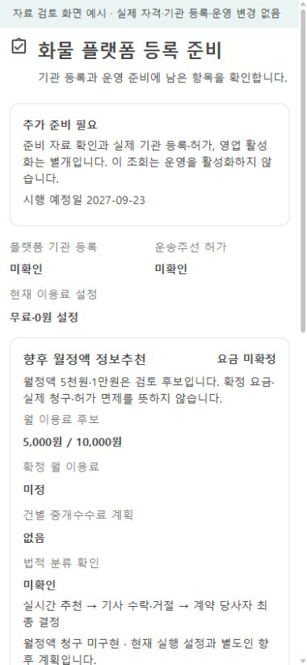
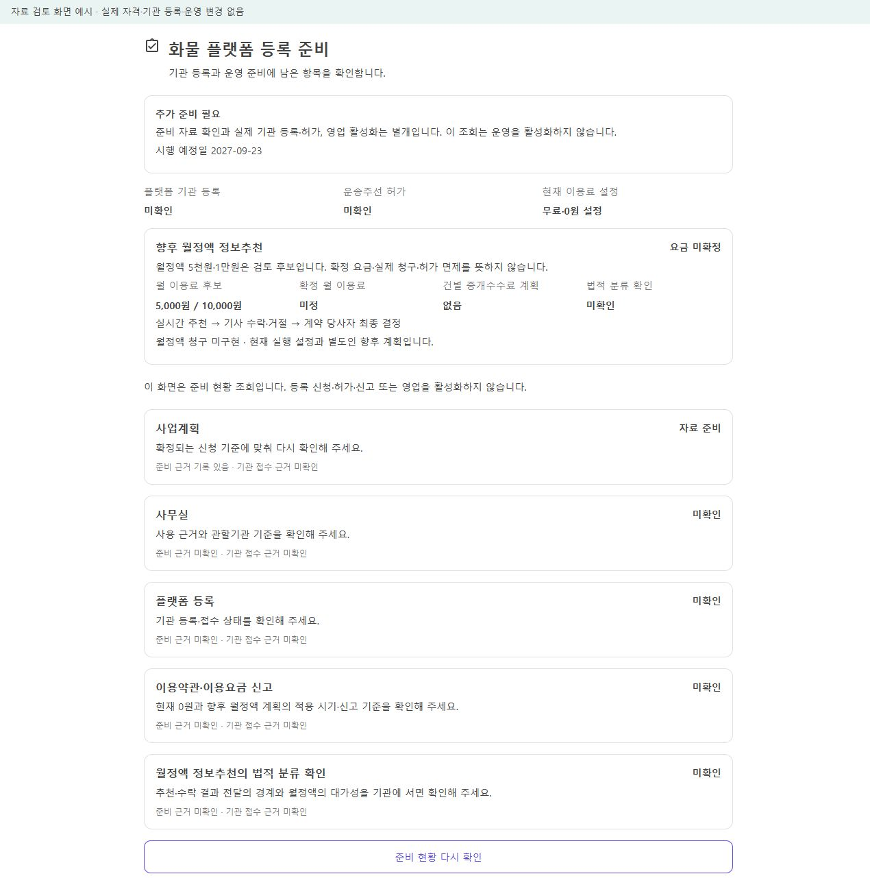

# 월정액 화물 정보추천의 계획과 현재 실행 설정 분리 r4

2026-10-26. [단일 기준](../AI/Planning/공통/PLAN-OPERATIONS-DISPATCH-CORE/cargo-information-subscription.direction.r4.md) · [정확한 작업 범위](../AI/Planning/공통/PLAN-OPERATIONS-DISPATCH-CORE/cargo-information-subscription.r4.work-order.json) · [미발송 서면질의](../AI/Planning/공통/PLAN-OPERATIONS-DISPATCH-CORE/cargo-information-subscription.authority-question.r4.md).

## 문제와 보완

사용자는 건별 중개수수료 없이 월 5천원 또는 1만원 수준의 플랫폼 이용료로 실시간 정보를 추천하고, 기사님의 수락·거절과 계약 당사자의 최종 결정을 유지하는 방향을 선택했다. 두 금액은 후보이며 확정 가격이나 출시 요금제가 아니다. 기존 `기사이용료정책Options`는 무료 설정이 해제되면 건수에 기본이용료를 곱하고 월 상한을 적용하는 계산이다. 해당 설정에 후보 금액만 넣어 월정액을 구현한 것으로 취급하지 않는다.

기존 관리자 등록 준비 API와 공통 컴포넌트에 `PlannedInformationSubscription`을 추가했다. 현재 무료·0원 실행 설정과 향후 정액 후보·확정 금액 없음·건별 수수료 없음·당사자 최종 결정 방향을 구분한다. 요금계획이 없는 이전 응답에는 후보 금액을 임의로 표시하지 않는다. 확정 월 요금과 청구 구현 상태도 DTO를 읽어 표시하므로 향후 값이 달라졌을 때 미정·미구현이라는 고정 문구로 덮지 않는다. 실제 월정액 청구는 이번에 구현하지 않았다.

`information-subscription-classification`은 기존 준비 근거 판정을 재사용한다. 유효한 검토와 `Confirmed` 상태·기관 회신 참조가 함께 있어야 충족하며 준비·접수·문자열만 있는 확인·만료·미래 검토는 보류한다. 해당 확인도 플랫폼 등록·주선 허가·이용요금/약관 신고와 다르고, `CanActivateOperations=false`는 유지한다. 기관 회신 참조의 입력을 읽는 것이며 외부기관 진위 조회나 법률 판단을 대신하지 않는다.

## 이번 실행과 검증

- 최종 관련 시험 **29개 통과, 실패 0개**. 정액 후보와 현재 무료 정산의 분리, 기관 회신·검토 유효성, 등록/허가/신고 분리, 이전 응답 호환과 실제 Razor 표시를 포함한다. 기존 건별 누적 계산 회귀도 그대로 통과했다.
- 계약·공통 UI·서버의 최종 직접 빌드와 관련 Fast 검증을 통과했다. 로그: `artifacts/local/validation/20261026-151201/`.
- 같은 최종 테스트 빌드로 서버 전체 회귀를 별도 실행해 **16,220개 통과, 실패 0개, 환경 의존 16개 생략**을 확인했다. `--no-build --no-restore`로 최종 빌드를 재사용했으며 결과는 `artifacts/local/cargo-information-subscription-r4/task-server-tests.trx`에 있다. 아래 솔루션 빌드 실패와 합쳐 전체 Task 검증 성공이라고 표시하지 않는다.
- 최초 전체 소비 솔루션 검증은 `OrdererApp` 등의 Android `Maui.SplashTheme`·FileProvider 리소스 누락과 `DriverApp` Java 생성 관련 오류로 실패했다. 해당 앱 파일은 이번 수정 범위가 아니다. 로그: `artifacts/local/validation/20261026-150740/build-01.log`. Task 계획도 동일 `Ssalddel.v3.5.slnx` 빌드를 요구하므로 전체 Task 마감은 미완료로 남긴다. 관련 서버 시험이 통과했다는 사실로 Android/APK 호환성 성공을 대신하지 않는다.
- 기존 `RoleWorkspacePreview` 소비 호스트는 별도 빌드 성공·오류 0개다. 기존 SQLite 의존성 `NU1903` 경고 1개는 남아 있다. 합성 예시를 실제 공통 컴포넌트에 전달해 `http://127.0.0.1:5694/qualification-readiness-preview/platform`에서 **390/1280px**의 화면을 확인했다. 가로 넘침 없음, 후보·미정·법적 미확인과 현재 0원 구분, 청구/입금 버튼 없음, 재조회 뒤 미확인 유지와 브라우저 경고/오류 0개를 확인했다. 실제 회원 인증·물리 휴대폰·기관 회신 화면은 아니다.
- 독립 읽기 전용 코드 리뷰에서 고정 표시 위험을 찾아 DTO 값에 따른 표시로 보완했고, 최종 재검토에서 추가 수정이 필요한 실질적인 문제는 발견하지 못했다. 문서 링크·명세 JSON·해시와 제한 범위 diff 검증을 수행했다.

## 관리자 준비 화면

| 모바일 390px | PC 1280px |
| --- | --- |
|  |  |

상세 검증·소스/소비 DLL·화면 파일 지문은 `artifacts/local/cargo-information-subscription-r4/verification-summary.json`을 따른다. 기존 파일의 작업 전 사본을 같은 폴더 `source-before/`에 보존했다. 이전 변경과 사용자 작업을 정리하거나 초기화하지 않았다.

## 남은 결정과 운영 경계

월정액도 유료 서비스다. 건별 수수료가 없거나 당사자가 수락한다는 이유로 주선업 허가 면제를 확정하지 않는다. 현행법과 2027-09-23 시행 예정 등록제를 나누어 실제 추천·계약·대금 흐름에 대한 적용을 서면 확인해야 한다. 질의서는 작성만 했고 발송·기관 신청·회신 수리·운영 활성화는 하지 않았다.

가격 하나의 확정, 납부 주체, 부가가치세, 이용 기간·갱신·해지·환불과 입금 확인·월정액 청구는 후속이다. 기존 무료/기능 설정·건별 누적 정산·금융 원장·배차·운송 계약을 변경하지 않았다. r3의 고정 거점·경쟁 없는 전용 단건·후속 추천은 기존 설계 상태를 유지한다. Figma 대응·APK/휴대폰·운영 배포·Unity·commit/push는 실행하지 않았다.
