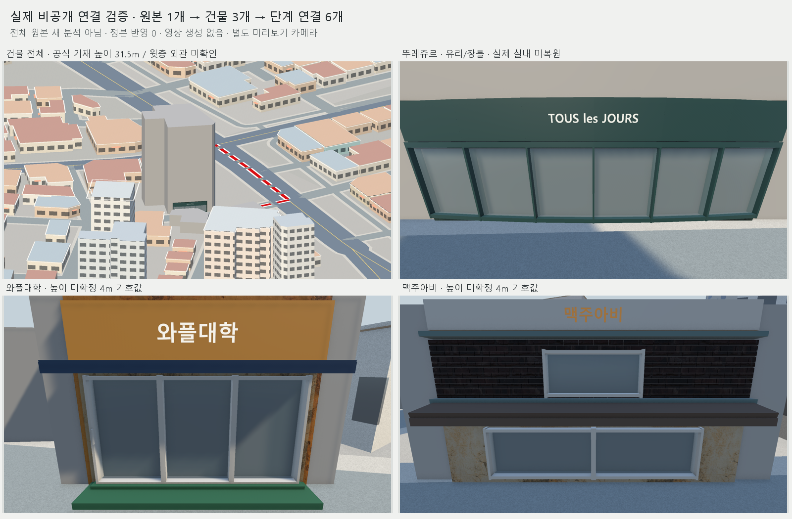

# 영상 일괄 재개·정확 건물 결속·Unity 결과 환류

2026-10-26. [직접 승인한 세 부분의 구현 범위](../AI/Planning/시스템/PLAN-SYSTEM-REGIONAL-OPERATOR-SIMULATION/daily-video-three-stage-integration.implementation.r118.md).

접수·OCR·선분/외관 관측·Unity 시범을 일괄 실행/재개와 원본별 결과 기록으로 연결했다. 자동 파일 실행과 실제 의미/위치 판독은 구분한다. 현재 지도에 없는 GIS 건물은 정본 대응 보류와 비공개 표시 가능 상태를 함께 기록한다.

## 구현

- `video_diorama_batch_runner.py`: 고정된 접수·표본/OCR·일일 연결 CLI를 실행한다. 원본 SHA 중복·기존 부분 결과·작업 수/시간 예산·부분 실패·원본 변경·잠금·원자적 기록·중단 재개를 처리한다. `--unity-demo-result`와 `--building-binding`으로 환류 CLI 실행→기존 링크 병합→일일 갱신/validate를 이어간다. Unity 렌더러 자체는 무인 호출하지 않는다.
- `diorama_building_binding.py`: source/target ID·공개 원형·근거·현재 공간/기반 지도 판본을 검증한다. 현재 정본의 정확 대응과 `SourceBackedPrivateLayer`를 구분한다. 가까운 기존 건물로 대체하거나 승인 원장을 추가하지 않는다.
- `video_diorama_unity_handoff.py`와 일일 consumer: 새 Demo/상세 결과의 원본 SHA·관측·PTS·대상/Profile 판본·PNG 전후/복구·cleanup·현재 보호/원본 stat를 재검사한다. 구형 consumer는 유지하고 같은 원본의 여러 대상도 각각 보존한다.
- Unity는 opt-in `buildingBindingManifest`를 실제 읽고 BindingGate에서 지도/근거/정확 원형을 확인한다. 같은 동네 배경의 비공개 조립/제거 경계에 연결하며 정본 Scene은 저장하지 않는다.

독립 검토에서 JSON 해시 검사와 파싱 사이의 변경 가능성, Windows 자식 실행/Job Object 배정 사이의 틈을 발견했다. 같은 bounded bytes로 해시·파싱하고, Job Object 할당·현재 입력 재검사 후 고정 bootstrap의 시작 신호를 보내도록 보완했다. 다음 명령 직전 변경 거절과 실제 자식·손자 종료 회귀도 포함했다.

## 시험·실자료 실행

Python 관련9모듈 **214/214**, Unity graphics EditMode 관련11fixture **186/186**, 실패·생략0이다. 합성 subprocess 시험과 기존 실자료 근거 재사용을 구분한다.

기존0111 원본 하나를 현재 stat+기존 fresh SHA 근거로 접수했다. 구형 카탈로그의 해당 원본만 접수용 경로/stat 표현으로 투영했고 기존 원본·분석·카탈로그는 변경하지 않았다. 원본 전체 재해시·복사·새 표본·새 의미 판독은0이다.

실제 `prepare → run(max-jobs0) → resume(Unity 결과+binding,max-jobs0) → validate`를 실행했다. 하위 명령11개는 모두 종료0·시간초과0·자식 정리 성공이다. 원본1/대상3/단계연결6을 보존했고, 마지막 재갱신은 새 증가0·기존 연결 재사용으로 집계했다. 최종 validate는 문제0이다. 원본 전체의 나머지 의미 판독 단계가 미완료이므로 runner는 `Held`, `allWorkflowStagesCompleted=false`다. 실행 실패나 예산 초과가 아니다.

공개 GIS3건은 비공개 원자료 레이어에 표시 가능하고 현재 Overture 정본의 정확 동일성은3건 보류다. **정본 실제 반영0**이며 근접한 legacy OSM 건물로 대신 배정하지 않았다.

## 화면·보존

graphics CLI는 종료0·**35PNG**를 생성했다. 상세3·조감1·전체 높이1의 같은 카메라5시점에서 제거 후 before/restored 정확 SHA 일치를 확인했다. 임시 객체·모델·재질 해제와 원래 active 상태/Scene 복원·PreviewScene 닫힘을 확인했다. 기존 보존 대상14파일·CC0 재질원문9개 hash도 유지됐다. 별도 기존 ProjectSettings 변경은 되돌리지 않았다.

r115의 높이·유리 보완도 이번 새 입력에서 확인했다. 뚜레쥬르 본체는 공식자료 기재31.5m, 점포 전면4m로 분리한다. 다른 두 곳은 높이 미확정으로4m를 유지한다. 층수·윗층 창·지붕/실내는 추정하지 않았다. 유리/틀·중립 셸은 표현 연구이며 실제 실내 복원이 아니다.

Pipeline 연결이 없어 CLI PreviewScene Camera.Render를 사용했다. Game View·Play Mode·실시간 FPS는 미검증이다. 완성 영상·MP4 검토본·업로드는 생성하지 않았다.

## 결과·한계

배달 `edit-kit/private/video-diorama-integration/current-review.json`이 최신 결과를 가리킨다. 실제 결과는 `20261026-r1/result-r1/result.private.json`, 보고서는 같은 폴더 `index.html`이며 최종 결과 SHA는 `b5ad5ef73694664cec1e69206dd3ee5e98c76f1387c2174814dce67ded69dea4`다. 실행 상태는 `batch-job-r1/state.json`, 재검사는 `runner-validation.private.json`을 따른다.

공통 안내 r4·정책 JSON r3에 실제 구현을 반영했다. 새 원본의 의미/위치 판독은 계속 Codex의 실제 검토가 필요하다. 미확정 정본 건물 동일성·무인 Unity 렌더링·게임/운영/공개 적용은 완료로 표시하지 않는다. 기존 원본·사용자 승인·컷/마커·공식 Scene·운영/공개 상태를 보존했고 commit/push는 하지 않았다. 새 공통 디오라마 규칙 후보 없음.
