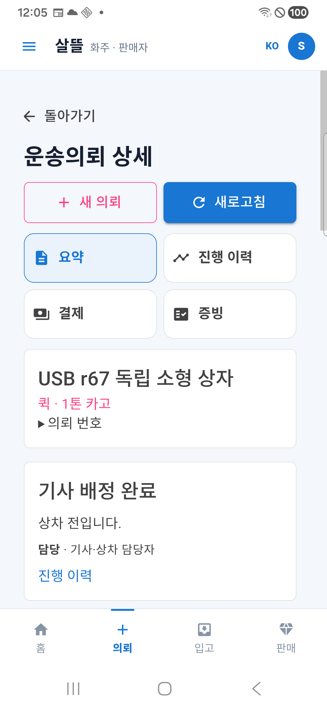
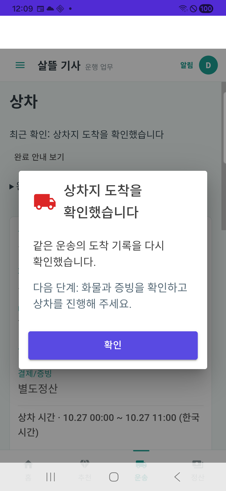
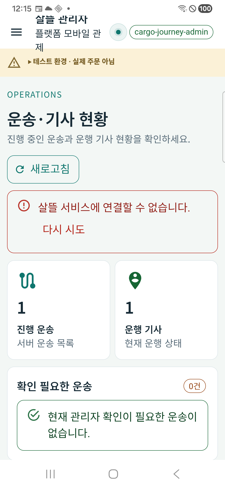
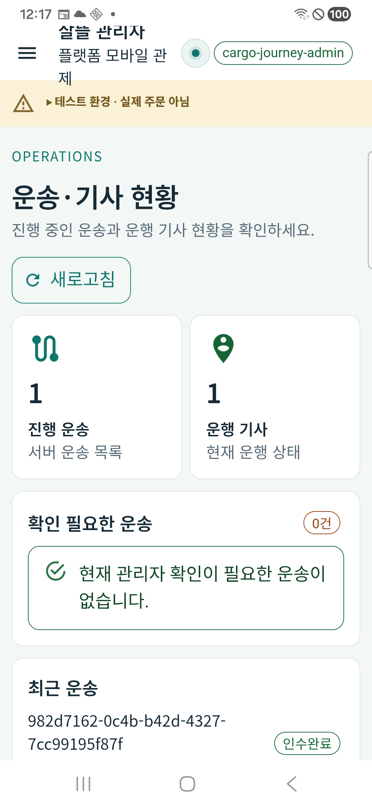
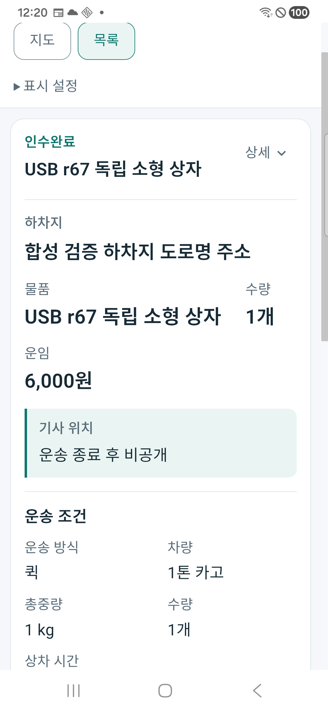
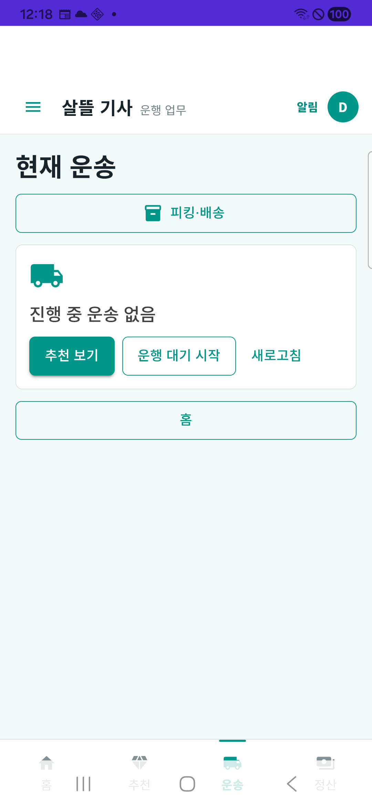

# 화물 서버·실제 휴대폰 검증 r14

같은 합성 운송 한 건을 최신 로컬 서버에서 완료하고, 실제 Samsung SM-A346N의 화주·전문 기사·운영자 앱에서 조회와 재실행 복구를 확인했다. 기사 앱의 **상차지 도착 버튼과 완료 안내창**도 실제로 실행했다. 세 역할 전체를 휴대폰 버튼만으로 완주한 결과는 아니며, 화면 보완 3건과 운영 준비 검증은 남아 있다.

상태: `SyntheticServerJourneyPassed / PhysicalDeviceRoleReadAndRestartValidated / MobileUxFindingsOpen / OperationalDisabled`.

## 실행 범위

- 사용자가 [공통 절차 준비 r13](../AI/Planning/시스템/PLAN-SYSTEM-PLANNING-IMPLEMENTATION-CHECKLIST/app-common-workflow.r13.result.md) 다음 단계인 서버·휴대폰 검증을 요청했다. [이번 실행 계획](../AI/Planning/공통/PLAN-OPERATIONS-DISPATCH-CORE/cargo-lifecycle-pilot.runtime.r2.md)은 이전 준비 전용 승인을 소급 변경하지 않는다.
- 현재 제품 Program·인증·Controller·UseCase를 기존 IntegratedWorkflowR108 하네스에서 새 GUID MySQL/Mongo DB에 연결했다. `Development / Simulation`, hosted service 제거, 외부 HTTP 차단, 가짜 알림 전송기와 합성 경로·위치·사진을 사용했다.
- 기존 업무 DB·볼륨·앱 데이터·다른 작업 변경은 보존했다. 이 작업의 추적 제품 코드 수정은 0개이며 APK 제작·실행과 검증 기록만 추가했다. commit/push·운영 공개는 하지 않았다.

같은 실행은 `integrated-r108:8cb70aff816147488ac0e47671bf9fc3`, 의뢰는 `982d7162-0c4b-b42d-4327-7cc99195f87f`, 운송은 `1`이다. 실제 화면의 운송번호와 제품 API·SQL/Mongo의 연결을 함께 대조했다. 로컬 접속은 `127.0.0.1:5378`과 이번 USB reverse만 사용했다.

## 실제 확인 결과

| 확인 | 결과 | 증거 범위 |
| --- | --- | --- |
| 서버 신규 접수·배차·완료 | 성공 | 화주 동의/신규 접수 → 명시 후불 승인 → 제어 추천·기사 수락 → 상차/하차 → 인수완료. 기본 선결제·실운송 검증이 아님 |
| 세 역할 정본 | 일치 | 화주·기사·운영자 제품 인증 API에서 같은 의뢰/운송을 단계별 조회 |
| 화주 실기기 | 확인 | 비로그인 공개 탐색 → 의뢰 선택 시 로그인 → 배정 완료/상차 전 상세. 앱 종료·재실행 후 재로그인 없이 본인 운송 복원. 완료 뒤 인수완료 및 기사 위치 비공개 표시 |
| 전문 기사 실기기 | 확인 | 로그인 후 현재 운송·상하차 정보·예정액 표시, 종료·재실행 뒤 현재 운송 복원. 상차지 도착 버튼 → 완료 안내창 → 서버 상차지도착 일치. 후반 HTTP 완료 뒤 앱 재진입 시 진행 중 운송 없음 |
| 운영자 실기기 | 확인 | 관리자 로그인·운송/기사 목록·같은 운송번호와 상차지도착/인수완료 표시. 종료·재실행 후 세션과 동일 완료 건 재조회 |
| 연결 실패·복구 | 확인 | 소유 시험 서버를 중단하고 운영자 앱에서 새로고침. 연결 오류·다시 시도를 표시하면서 기존 1건을 유지. 같은 서버 재시작 후 정상 재조회 |
| 서버 재시작 | 확인 | 진행 중 상태와 완료 후 상태에서 각각 같은 DB로 재시작. 같은 ID·상태 보존, SQL 상태 전이 4개 각 1회, Mongo 운송 원장 정확히 1개·인수완료 |
| 도착 명령 재실행 | 확인 | 실기기 도착 성공과 세 역할 정본 확인 후 같은 상태의 HTTP 재실행을 명시 수행. 도착 상태 변경 사건은 1회 유지. 불명확한 요청의 무조건 재전송 시험이 아님 |
| 정리 | 완료 | 합성 기사의 수신 의사 OFF·운행 종료 후 대기 확인. 검토 앱 3개 중지·이번 reverse 제거·소유 서버 종료와 5378 listener 부재 확인. DB/앱 데이터 보존 |

제품 HTTP workflow 기록은 41개 요청과 검사 기록 8개를 남겼다. 재개하면서 같은 검사를 다시 확인한 항목이 포함되므로 독립 시험 8종이나 전체 앱 회귀 통과로 해석하지 않는다. 실제 GPS·카메라·외부 Push·실금융·고객 수령 확인은 검증하지 않았다. 휴대폰에서 실행한 상태 변경은 상차지 도착이며 접수·수락·사진 업로드·상하차 완료의 HTTP 실행을 휴대폰 조작으로 합산하지 않는다.

## 확인된 보완점

1. **화주 홈과 상세의 다음 행동 안내가 다르다.** 후불 승인·배차 확정 상태에서 홈은 `결제 조건 확인`, 상세는 `기사 배정 완료·상차 전`을 표시했다. [홈의 결제 우선 분기](../../Ssalddel.Ui.Common/Areas/App/Components/Shipper/ShipperHomeScreen.razor)와 정산상태가 없는 홈 요약 모델이 원인이다. 후속 보완은 기존 상세 정책의 업무 판단을 재사용하고 결제대기 표시와 다음 행동을 분리하는 것이다.
2. **운영자 `진행 운송` 건수에는 완료 건도 포함된다.** [모바일 현황](../../SsalddelAdminApp/Components/Pages/Operations.razor)은 서버 전체 목록 수를 해당 제목으로 표시해 이번 완료 뒤에도 1건이다. 완료 상태 자체는 정확하다. 전체 운송으로 이름을 바꾸거나 진행 건과 완료 건을 나누는 후속 보완이 필요하다.
3. **전문 기사 앱의 하단 메뉴가 삼성 내비게이션 영역과 겹친다.** 1080×2340, density 450, 사용자 글자 크기 1.15 환경에서 하단 메뉴 글자가 흐려지고 가려졌다. 사용자 설정은 변경하지 않았다. 실제 Android 화면 inset과 WebView 높이를 함께 보완해야 한다. 본문 카드·메뉴를 통한 업무 이동은 가능했다.

이번에는 위 제품 코드를 수정하거나 새 APK 결과로 대체하지 않았다. 현재 화면의 실패·제약을 그대로 기록했다. 검토 APK의 지도 인증 설정이 없어 화주 지도는 설정 안내를 표시했고 목록 전환이 가능했다. 네이버 지도 실제 표시·GPS 추적 성공으로 기록하지 않는다.

## 금융·운영 준비의 한계

상차 완료에서 내부 **6,000원 가상계좌 입금 요청 준비 기록 1개**와 1/3/7일 안내 예약 3개가 생성됐다. 결제는 대기/승인대기, 초안은 `PendingTossVirtualAccountIssue`, 승인 시각·결제 키·외부 거래번호·제공자 응답이 없다. 안내 예약은 모두 Pending·재시도 0이다. 지급 요청·지급 Outbox는 0이다. 내부 준비 기록 생성을 실제 계좌 발급·입금·송금·기사 지급 완료로 표현하지 않는다. hosted service가 제거된 이 시험 서버는 예약을 실제 발송하지 않았다.

서버 `/health/live`는 200이지만 `/health/ready`는 **503**이다. 새 DB의 `EnsureCreated` 검증은 운영 migration 준비를 대신하지 않는다. 업무 API와 앱 통신이 성공했어도 서버의 운영 준비 완료·전체 앱 출시 가능으로 판정하지 않는다.

## 판본과 증거

| APK | 판본·패키지 | 입력/설치 확인 |
| --- | --- | --- |
| 화주/통합 | 0.1.124, `com.companyname.ssalddelapp.closeoutreview` | 기존 빌드 입력 3,254개 현재 변경·누락·추가 0. 설치 APK SHA `118c2c19c1e0188a67105eff3989235a9f1d5c8b7e100d1af5592e5baa7771f3` 일치 |
| 전문 기사 | 0.1.125, `kr.hongdal.driver.cargoreview` | 기존 빌드 입력 3,047개 현재 변경·누락·추가 0. 데이터 보존 설치 후 SHA `58986ccacf21b62da396b9af30473e65b899227af4b51927ffaf1c1d28e2f63c` 일치 |
| 운영자 | 0.1.126, `com.ssalddel.adminapp.cargoreview` | 별도 Release 빌드 입력 2,882개 전후 변경 0, 서명·정렬·최종 양 ABI endpoint 확인. 설치 SHA `181fae47b9b6e23f0f6033cc6948a380121ca616f9283adb8a4b0aaf98f6a78d` 일치 |

현재 서버 빌드는 오류 0·경고 22였다. 빌드 후 바이너리 147개와 관련 입력 해시를 보존했지만 전체 서버 소스의 빌드 전후 동결 목록은 없으므로 완전한 재현 빌드 입력 증명으로 표시하지 않는다. 현재 일반 소비 솔루션의 전체 Android 빌드·전체 회귀 시험을 이번에 수행하지 않았다.

로컬 근거는 `artifacts/local/cargo-lifecycle-runtime-r14/`다. `installed-apks-final.json`, `server-proof/`의 단계별 정본·금융·Mongo 결과, `cleanup-final.json`, 실제 원캡처 `.private/`와 관리자 `admin-build/`를 보존했다. 하네스의 원 HTTP 기록과 비공개 환경은 `artifacts/local/integrated-workflow-r108/8cb70aff816147488ac0e47671bf9fc3/`에 있다. 토큰은 메모리에서만 사용했고 로그인 입력·원시 비밀은 공유 문서에 복제하지 않았다.

## 실제 휴대폰 화면

아래는 같은 SM-A346N에서 얻은 원캡처를 변경 없이 복사한 화면이다. 에뮬레이터나 웹 미리보기 결과가 아니다.

| 화주 배정 완료 | 기사 도착 완료 안내 |
| --- | --- |
|  |  |

| 운영자 연결 실패·기존 건수 유지 | 운영자 재실행 후 완료 건 |
| --- | --- |
|  |  |

| 화주 완료·위치 비공개 | 기사 현재 운송 해제·하단 겹침 |
| --- | --- |
|  |  |
