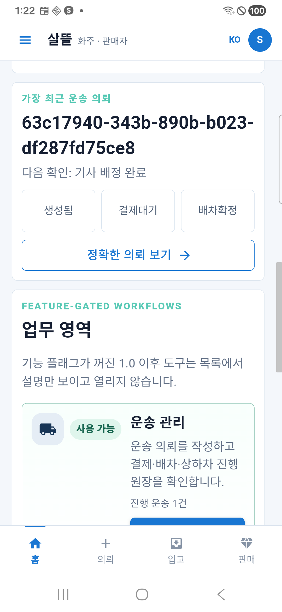
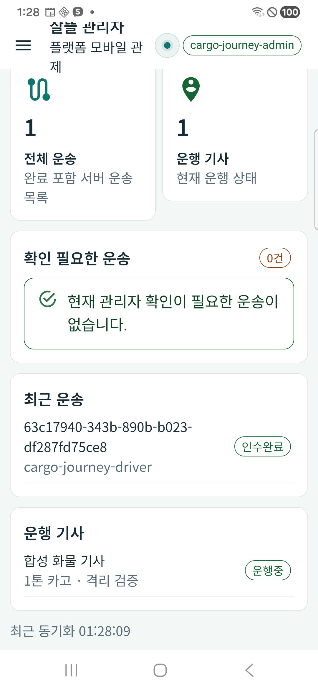
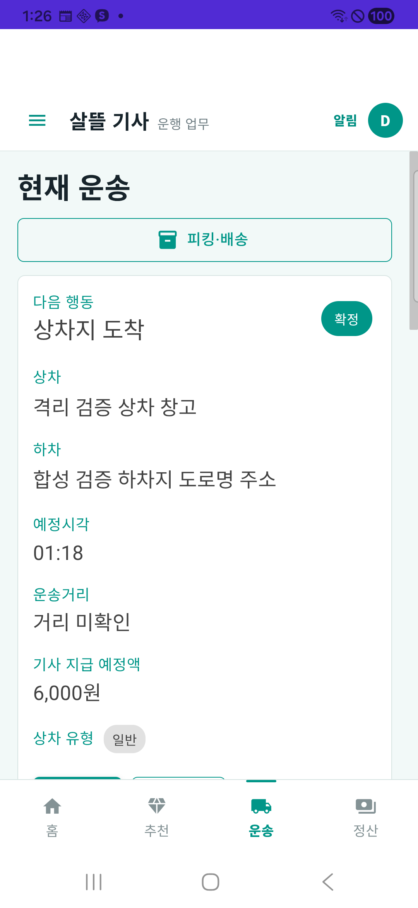

# 화물 화면·서버 준비 검사 보완 r15

2026-10-27, [승인 범위](../AI/Planning/공통/PLAN-OPERATIONS-DISPATCH-CORE/cargo-runtime-followup.implementation.r15.md)의 화면 세 문제와 격리 서버 준비 실패를 보완했다. 실제 Samsung SM-A346N에서 최신 검토 APK 128 세 개를 확인했다. 운영 활성화·배포·commit/push는 하지 않았다.

## 바뀐 동작

| 항목 | 보완과 실제 확인 |
| --- | --- |
| 화주 홈 다음 행동 | 전체 의뢰 계약을 기존 상세 표시 정책에 전달한다. 후불 승인·기사 배정 상태에서 `결제대기` 배지는 보존하고 `다음 확인: 기사 배정 완료`를 표시한다. 실제 홈과 상세가 일치했다. 기존 5인자 요약 생성도 유지한다. |
| 운영자 건수 | 전체 목록의 제목을 `전체 운송`, 설명을 `완료 포함 서버 운송 목록`으로 수정했다. 완료 후에도 전체 1건과 같은 의뢰의 `인수완료`가 함께 보인다. 집계·권한·완료 상태 자체는 바꾸지 않았다. |
| 전문 기사 Android | `MainPage`의 Android 호스트에 `SafeAreaEdges.All`을 적용했다. 네 하단 메뉴의 터치 영역 끝 2205px가 실제 시스템 내비게이션 시작 2205px와 맞으며 겹치지 않는다. 네 메뉴 이동, 키보드 열기·닫기, 진행 운송과 완료 후 재실행을 확인했다. 사용자 글자 크기 1.15·화면 밀도·내비게이션 설정은 유지했다. |
| 서버 준비 검사 | 기존 EnsureCreated 시험 DB는 네 EF context의 migration 이력이 없었다. 기존 DB를 보존하고 새 DB에 실제 migration을 적용하는 명시적 준비 경로를 추가했다. 최종 `/health/live`와 `/health/ready`는 모두 HTTP 200이었다. |

제품 변경은 `ShipperHomeDashboardClient.cs`, `ShipperHomeScreen.razor`, `Operations.razor`, `DriverApp/MainPage.xaml.cs` 네 파일의 해당 부분이다. 변경 전 사본에 이미 있던 다른 수정은 이번 실적으로 집계하지 않는다.

## 서버와 같은 운송 건의 검증

새 GUID 시험 `941ca0e286d640138756d7fcbe5cc2f5`, DB `r108m_941ca0e286d640138756d7fcbe5cc2f5`, 의뢰 `63c17940-343b-890b-b023-df287fd75ce8`, 운송 투영 1을 사용했다. 실제 적용 migration은 main 72·전통시장 2·농수산 17·공공수집 7, 합계 98개이고 모두 남은 수 0이다. readiness 정책과 제품 migration 소스는 수정하지 않았다.

첫 긴 이름의 새 시험은 MySQL 4163/42000으로 적용 0에서 실패했다. 정확한 Pomelo 9.0.0 [공식 소스](https://github.com/PomeloFoundation/Pomelo.EntityFrameworkCore.MySql/blob/58dd6883cb9616fe49f671b943a826b459c0117f/src/EFCore.MySql/Migrations/Internal/MySqlHistoryRepository.cs#L55-L67)의 잠금 이름이 72자가 되어 [MySQL 잠금 이름 제한](https://dev.mysql.com/doc/refman/8.4/en/locking-functions.html)을 넘었다. 실패 DB는 보존하고, 새 MigrationFirst 준비에만 짧은 전용 prefix와 전체 GUID를 사용했다. provider·잠금·이력 검사를 우회하지 않았다. [이름 보완 명세](../AI/Planning/공통/PLAN-OPERATIONS-DISPATCH-CORE/cargo-runtime-followup.schema-name-fix.r15.md)와 [소비 도구 결속](../AI/Planning/공통/PLAN-OPERATIONS-DISPATCH-CORE/cargo-runtime-followup.consumer-binding.r15.md)에 변경 범위를 남겼다.

합성 의뢰의 후불 승인·배차·상하차·인수완료를 제품 HTTP로 처리했다. 세 역할 제품 API의 같은 ID·상태, 실제 SQL의 네 상태 전이 각 1회, Mongo 완료 원장 문서 1개를 확인했다. 배차 상태와 완료 상태에서 각각 서버를 재시작했으며 이벤트 집합·ID·원장이 유지되고 ready 200이 이어졌다. 전체 native 버튼 완주로 보고하지 않는다. 사진은 합성 입력이고 실제 GPS·카메라·Push는 검증하지 않았다.

내부 6,000원 결제대기 기록 1개는 `PendingTossVirtualAccountIssue` 상태의 입금 요청 준비다. 승인 시각·외부 결제키·거래번호·provider 응답은 없고 지급 요청/지급 outbox는 0이다. 실제 계좌 발급·수금·기사 지급이 이루어졌다는 증거가 아니다.

## 시험·APK·휴대폰

- 집중 시험 49/49, 표준 Fast의 v3.5 빌드와 49/49 시험 통과.
- 표준 Task의 v3.5 빌드와 16,305건 통과, 환경 선택형 Mongo/MySQL 시험 16건 생략, 실패 0. 생략 시험은 실제 DB 검증 성공으로 집계하지 않는다.
- 짧은 DB 경계의 정상·부정 시험과 기존 추천 시험 15/15 통과. 기존 요청·재시도·금융 메서드 10개의 AST 동일성을 확인했다.
- 세 APK 모두 Release 0.1.128/code128, 서명·정렬·ARM64/x86_64 내부 앱 DLL 및 endpoint `127.0.0.1:5378` 대조를 통과했다. 휴대폰에 설치된 APK 해시도 각 산출물과 일치했다.
- 실제 휴대폰에서 세 역할 로그인·서버 재조회, 앱 재실행 후 세션·완료 조회를 확인했다. Samsung Pass 저장 안내는 취소했고 자격정보 저장/설정 변경은 하지 않았다.
- 초기 시험의 markup 실패 6건과 중단된 APK 빌드/손상 스크립트 사본은 보존했다. 최종 성공으로 초기 실패를 덮지 않았다.

로컬 상세 근거는 `artifacts/local/cargo-runtime-followup-r15/`의 `standard-validation/result.json`, `installed-apks-r128.json`, `readiness/`, `server-proof/`와 `final-audit.json`이다. 서버·기기·SQL/Mongo 실행은 root가 소유했고 관련 없는 변경을 stage하지 않았다.

## 실제 대표 화면

화주 홈: 결제 배지와 다음 행동을 분리했다.

운영자: 완료 건을 포함한 전체 수와 완료 목록이다. 캡처 이후 합성 기사의 운행을 종료했다.

기사: 서버·앱 재실행 뒤 운송을 다시 조회했고 하단 메뉴와 시스템 내비게이션을 분리했다.

[키보드가 열린 실제 화면](../assets/changes/2026-10-27-cargo-runtime-followup-r15/driver-keyboard.png)도 보존했다.

## 검증 상한과 정리

네이버 지도 인증 미설정, 실제 경로/GPS·카메라·FCM·금융·운영 배포는 별도다. 운영자 상단의 긴 시험 계정 줄바꿈과 R108 기존 ready의 `RunStableId`/`runStableId` 대소문자 읽기 차이는 후속 정리 대상으로 남긴다. 이번 재시작의 정확 GUID/DB/ID·이벤트 보존은 독립 조회로 검증했다. 이번 보완을 전체 앱 출시 완료로 해석하지 않는다.

합성 기사는 수신 Off·운행 대기로 종료했다. 소유 5378 서버와 이번 USB reverse, 세 검토 앱 프로세스만 정리했으며 DB·앱 데이터·원래 앱·공유 컨테이너·다른 작업은 보존했다.
