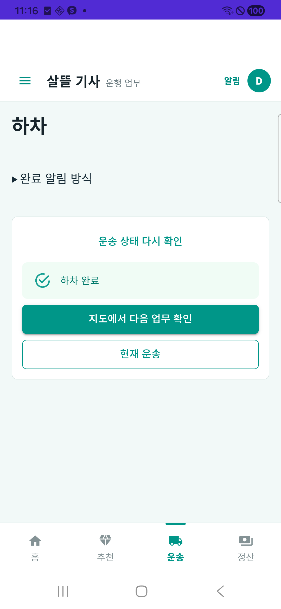
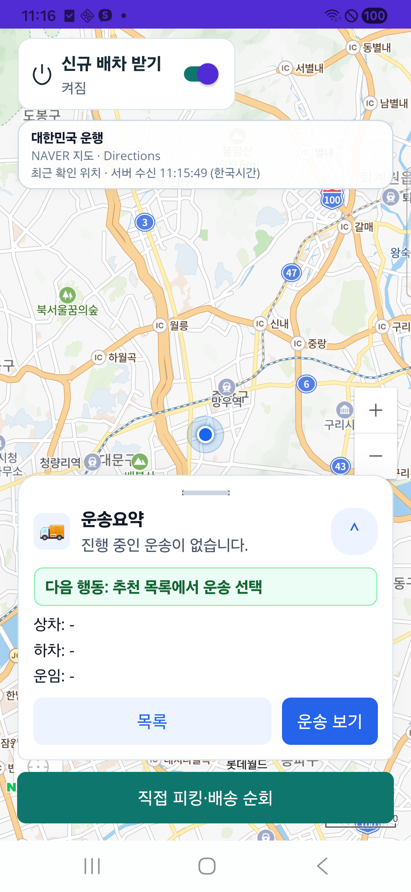

# 기사 운행·배차 수행 흐름 정밀 보완 r17

2026-10-27. [승인 범위와 페이지 책임](../AI/Planning/공통/PLAN-OPERATIONS-DISPATCH-CORE/driver-workloop-precision.r17.md)에 따라 새 배차 기능을 늘리지 않고 기존 운행 시작·지도·수행·완료 후 다음 업무 확인을 보완했다. 상태는 `ScopedPrecisionVerified / ActualDevice131 / OperationalDisabled`다. 전체 자동 연속배차나 운영 출시 완료를 뜻하지 않는다.

## 바뀐 동작

- 서버의 운행 확정·단말 위치 송신·최신 근무 요약·같은 계정이 모두 확인되면 기존 운행 지도로 이어진다. 미확정·권한 실패·위치 송신 실패에서는 기존 복구 안내를 유지한다. 지도 열기 실패는 이미 확정된 운행을 실패로 바꾸지 않으며 명시 재시도를 제공한다.
- 하차 완료 알림과 현재 운송 복귀를 유지하고, 같은 운송의 인수완료를 다시 확인한 뒤 `지도에서 다음 업무 확인`으로 이동한다. 지도 적재 대기 중 화면 이탈·운송 변경·계정/세션 변경은 취소하며 중복 Push를 직렬화한다.
- 실제 휴대폰에서 다른 클라이언트가 완료한 뒤 열린 하차 화면에 이전 상태가 남는 상황을 발견했다. `운송 상태 다시 확인`을 기존 동일 운송 GET에 연결했다. APK130의 버튼은 기존 CSS가 숨기는 legacy header 안에 있어 보이지 않았고, 최종 APK131에서는 보이는 본문으로 옮겨 실제 조작했다. 도착/완료 처리·사진 촬영·지도 이동 중에는 재조회를 막는다. 재조회는 수락·완료 POST를 재전송하지 않는다.
- 현재 위험 안내는 현재 기사에게 속한 활성·확정 화물만 사용한다. 완료·취소·담당 충돌을 제외하고 기존 위치 신선도 정책/옵션에 맞지 않는 위치로 ETA를 만들지 않는다.
- 위치 송신 안내를 실제 시작 요청 30초와 서버 권장값 조정에 맞췄다. 실제 도로의 일정한 송신 주기를 측정했다는 의미는 아니다.

## 구현과 시험

제품 변경은 전문 기사 앱 5파일과 서버 위험 조회 1파일이다. 기존 dirty·기능 플래그·공개콜 정책·고정거점 미구현 상태를 보존했다. 서버에 새 DB schema나 새 배차 API를 추가하지 않았다. 직접 SQLite 조회 시험은 완료 A/활성 B, 소유자·종료 상태, 정상/오래된/미래 위치와 경로 근거 부족을 포함한다.

| 구분 | 실제 결과 |
| --- | --- |
| 최초 범위 Fast | 249/249 통과, 새 위험 조회 21개 포함 |
| 최초 Task | 16,326 통과·환경 16 생략·실패 0 |
| 하네스 Python | 30/30 통과. 기존 업무 POST 7메서드 AST와 호스트 설정 딕셔너리 보존 |
| 실제 compiled 재시작 기록 관문 | 28/28 통과. 실제 host DLL의 순수 검사 함수를 호출하며 DB/seed는 실행하지 않음 |
| 재조회 보완 후 Task | 16,326 통과·환경 16 생략·실패 0 (`20261027-110058`). 앞선 Task와 별도 실행 |
| 최종 버튼 배치 후 관련 회귀 | 75/75 통과, 생략 0. 마지막 차이는 handler가 같은 버튼의 표시 위치이며 APK131과 실제 기기에서 별도 검증 |
| 최종 APK131 | Release·3050개 선택 소스 변경 0·서명/정렬·arm64/x64·내부 endpoint/DLL·설치 base.apk 해시 일치 |

하네스는 현재 운송과 상세의 의뢰/운송 ID, 준비 기록·실행 GUID·DB와 사례를 대조한 뒤에만 복구 성공으로 기록한다. 구판 camel/Pascal 실행 ID는 각각 지원하지만 중복 별칭은 거절한다. 원래 업무 처리와 불명확한 POST 재전송 금지는 유지한다.

## 격리 서버와 휴대폰

새 실행은 `integrated-r108:d49796f0934747f19d220f3a57c21cd7`, 신규 DB는 `r108m_d49796f0934747f19d220f3a57c21cd7`다. 기존 DB를 보존하고 기존 4개 context의 migration98개를 실제 적용했다. 초기 live/ready200·pending0, 두 번째 수락 상태의 서버 재시작과 동일 의뢰 복구를 확인했다. 실행 모드는 Simulation이며 hosted worker와 외부 효과는 차단한다.

같은 합성 기사로 운송 6건을 순서대로 완료했다. 별도의 만료 제안 2건은 보존하고 수락되지 않은 상태를 GET/SQL로 대조했다. 완료 6건은 세 역할 제품 API·SQL의 네 상태 전이 각각1회(총24)·Mongo의 같은 의뢰/운송 완료 문서 각각1개와 일치했다. 내부 미승인 입금 요청 준비와 실제 지급을 구분했으며 지급 요청/지급 Outbox는0이다. 완료 뒤 서버를 재시작하고 같은 인증 토큰을 메모리에서 재사용해 조회했을 때 정본 fingerprint가 동일했다. 불명확한 수락/완료 POST를 자동 재전송하지 않았다.

SM-A346N의 검토 APK129에서 실제 로그인, 서버 재시작 뒤 같은 현재 운송 재조회, 운행 확인 뒤 기존 지도로 자동 인계, 앱 종료/재실행 후 업무 복구, native 지도 타일·단건 제안·주의사항 창을 확인했다. 60초가 지난 두 제안은 수락되지 않았다. 도구의 지도 UIA 읽기가 카운트다운 중 실패해 화면 캡처로 대조했으며, 성공한 native 수락으로 기록하지 않았다.

최종 APK131에서는 다시 로그인한 같은 기사로 활성 운송을 열고, 다른 클라이언트가 완료한 뒤 `운송 상태 다시 확인`을 눌러 같은 건의 하차 완료를 확인했다. 이어 `지도에서 다음 업무 확인`을 눌러 지도 복귀·수신 켜짐·현재 운송 없음 표시를 실제로 확인했다. 상하차 전체 버튼과 실제 카메라를 휴대폰에서 완주한 시험은 아니다.

위 지도 위치·주소·운임은 선언한 합성 시험 자료다. 실제 사용자의 촬영 경로나 실운행 배차를 나타내지 않는다. 최종 APK131 SHA는 `e8703afa39598b3c0394b9d909ca3f81b95ff525726f8e6dde50b669b20c00c6`이다. r130의 성공한 격리 중간 빌드 경로를 재사용했으며, 허용 소스 차이가 하차 버튼 배치 한 파일뿐인지 확인했다. 이전 APK·해시·로그는 보존했고 재사용 중간 산출물은 갱신됐다. 전체 transitive 빌드 입력을 독립 증명한 것으로 확대하지 않는다.

서버의 수락·상하차 수행은 합성 위치/경로·사진과 제어된 단발 제품 후보 엔진으로 확인한다. 실제 사진 촬영·실도로 운행·자동 연속배차·Google FCM·실금융·운영 공개를 이 결과로 완료하지 않는다. 새 검토 앱의 위치 권한은 이번만 허용을 선택했고 알림 권한은 해당 검토 앱에 허용했다. 비밀번호 저장 안내는 취소했으며 다른 앱 설정·사용자 보안 잠금은 바꾸지 않았다.

## 보존할 제한과 후속

정상 상태의 수동 재조회는 기존 VM 동작대로 바코드 입력과 수기 확인 체크를 다시 초기화한다. 같은 ID의 초기화로 새 완료 요청을 만들지 않으며, 사진과 미확정 기록의 보존/확정 뒤 정리는 기존 동일 운송 복구 정책을 따른다. 완료 미확정이고 상세가 동일할 때의 확인 항목 보존도 기존 정책을 따른다. 수기 체크가 모두 보존된다고 보고하지 않는다.

시험 도중 준비 상태 조회가 두 차례503이었고 별도 네 번 연속 재확인과 최종 재시작 전후 조회는200이었다. 반복 로그인에는 원래 5분당10회 제한의429도 관측했다. 간격을 두고 최종 전후 대조는 인증 토큰을 한 프로세스 메모리에 유지해 재로그인 없이 진행했다. 실패 근거를 보존했으며 원인을 확정하거나 health/인증 제한을 완화하지 않았다. 장기 운영 안정성 증거로 확대하지 않는다.

고정 집/거점 반경, 일반 화물 공개콜 전환, 전역 단건 발행 강제와 기본 비활성 연속배차의 운영 활성화는 별도다. 이번 보완이 이 기능의 완성이나 유상 화물 운영 요건 충족을 의미하지 않는다. commit/push·배포·FCM 설정·무인 자동화는 수행하지 않았다.

시험 기사 수신Off·근무대기, 소유5378 호스트 중지·USB reverse 제거·검토 앱 프로세스 종료를 확인했다. 기존 DB/앱 데이터·다른 작업·기존 인프라는 보존했다. 별도 종료나 자동화를 예약하지 않았다.

근거는 `artifacts/local/driver-workloop-precision-r17/`의 수정 전 사본·`work-order-r131.json`·`validation-counts-final.json`·최종 서버 비교·APK 서명/내부 endpoint/설치 해시·실제 휴대폰 자료·`cleanup-proof.json`과 격리 실행 폴더에 보존한다. 표준 TRX는 `artifacts/local/validation/20261027-103445/`, `20261027-103706/`, `20261027-110058/`다.
