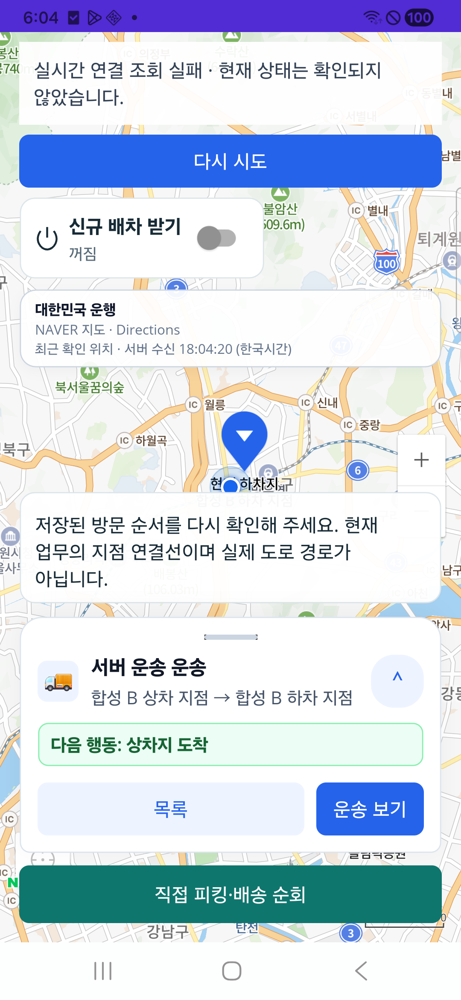

# 기사 앱 연결 수명과 지도 좌표 검증 보완 r29

사용자가 휴대폰 화면을 켤 수 있으면 켜고 리팩토링을 계속하도록 요청했다. [직접 승인 범위](../AI/Planning/공통/PLAN-OPERATIONS-DISPATCH-CORE/cargo-client-lifetime-refactor.r29.md)에 따라 기능을 확대하지 않고 기사 지도 화면의 두 오류 경계를 정리했다.

## 바뀐 동작

- 저장된 푸시 토큰 등록을 전경·계정·세션에 결속했다. 같은 수명에서 중복 호출은 같은 결과를 기다리며 화면 이탈·계정 변경 뒤 늦은 성공/실패는 버린다. UI 대기는 10초로 제한하고, 공급자가 취소를 무시해도 실제 요청이 끝나기 전 새 등록을 겹치지 않는다. 이미 전송한 등록을 취소했다고 단정하지 않는다.
- 현재 연결 실패만 별도 짧은 안내로 표시한다. 기존 운송·조회 안내를 덮지 않고 원문 예외·토큰을 표시하지 않는다. 전경 이탈·세션 변경 때 안내를 비우고 다음 전경에서 재확인한다. 새 FCM 설정·실제 발송은 수행하지 않는다.
- 현재 업무 fallback 지도에도 기존 좌표 범위 정책을 적용했다. 상차/하차 좌표 쌍을 독립 검사해 무효 쌍만 `0/0`으로 비운다. 정상인 다른 지점은 보존하며, 상차 전 다음 상차지가 미확인이면 하차지로 건너뛰는 선을 만들지 않는다. 추천 연결선의 NaN·Infinity·범위 밖 좌표도 차단한다.
- 현재 운송·다중 정차·수락/거절·수신 ON/OFF·원장·주소 공개 보류·운영 게이트는 보존했다. 서버가 정한 순서와 지점 연결선을 실제 도로 경로나 실제 GPS로 바꾸어 표현하지 않는다.

## 자동시험

| 범위 | 실제 결과 |
| --- | --- |
| Fast `20261028-174654` | 기사 Android/Windows 및 시험 소비 빌드, 관련124통과·실패0·생략0 |
| Task `20261028-174827` | `Ssalddel.v3.5.slnx` 전체 소비 빌드, 16,716통과·실패0·환경17생략 |
| 신규 직접 회귀35 | 푸시 수명14: 중복·이탈/복귀·계정/세션·취소 무시·늦은 결과·고정 안내. 좌표21: 누락·범위 밖·한 쌍만 정상·상차/하차 단계·fallback·NaN/Infinity·추천 연결선 |

소스7개는 Fast/Task와 APK 준비 사이 해시로 고정했다. 실제 APK·기기 결과와 최종 해시는 로컬 `artifacts/local/cargo-client-lifetime-r29/`의 검증 요약에 연결한다. 시험 통과를 실제 FCM·실 GPS·사진·제품 서버/DB·실운송·운영 공개로 확대하지 않는다.

## 휴대폰과 포장 상태

USB로 SM-A346N의 화면을 깨웠고 인증이 필요 없는 잠금 대기화면을 해제했다. 원래 화면 유지값은15였다. 초기 임시 설정을 USB만의2로 좁혔으나 실제 전원은 AC로 판정돼 다시 절전으로 들어갔다. 원래 충전 전체값15로 되돌려 `Awake / mStayOn=true`를 확인한 뒤 검증했다. PIN·생체 인증이나 보안 잠금 설정은 변경하지 않았다.

새 검토 APK `0.1.136 / code136`을 독립 빌드 출력에서 제작하고 기존 별도 검토 패키지 `kr.hongdal.driver.cargoreview`에 데이터 보존 업데이트했다. SHA256은 `5edfa6b1fda2a40c35ceaf06466e20b843a77b55932e3d6f9e0e052daa9cbf95`이며 휴대폰 설치본과 일치한다. arm64-v8a/x86_64의 최종 APK 내부 앱 DLL을 빌드 DLL과 대조하고 고정 loopback 접속 대상도 확인했다. 기존 일반 사용 앱을 교체하지 않았다.

- 임시 합성 계정으로 로그인해 실제 native 지도와 다음 행동을 확인했다. 무효 상차 입력에서는 하차 핀만 남고 건너뛰는 연결선이 없으며 정상 입력에서는 상하차 핀을 보존한다.
- 홈으로 나갔다 재진입한 뒤 같은 다음 행동을 확인했다. 검토 앱 강제 종료/재실행 후 로그인 입력 없이 지도에 다시 들어가 같은 합성 운송을 재조회했다.
- `127.0.0.1:5384`의 임시 표시 fixture이며 제품 Startup/JWT/DB·실제 GPS·실시간 허브가 아니다. 화면에 남는 `실시간 연결 조회 실패`는 이 fixture가 SignalR을 제공하지 않는 상태이며 이번에 해결한 것으로 표시하지 않는다. 푸시 수명 경쟁과 원문 비노출은 직접 회귀 근거이며 실제 FCM 수신 검증은 아니다.
- Samsung Pass의 합성 로그인 저장 제안은 저장하지 않고 닫았다. 원래 화면 유지값15를 다시 확인하고 검토 앱·이번 USB reverse·임시 HTTP만 종료했다. 원래 사용 앱·설정·기존 데이터와 다른 연결은 보존했다.

[정상 상하차 입력의 실제 기기 화면](../assets/changes/2026-10-28-cargo-client-lifetime-r29/fallback-valid.png)과 로그인·복귀·재실행 캡처/상태 기록을 별도로 보존했다. 합성 표시·실제 기기 실행·제품 서버/DB·실운송을 구분한다.

## 보존과 한계

원본 소스 사본·시작 전159개 변경 파일 지문·직접 회귀/전체 시험 TRX·휴대폰 설정과 소유 fixture 기록은 로컬 작업 폴더에 둔다. 기존 다른 작업을 되돌리거나 stage하지 않는다. 새 제품 서버·DB 변경, 운영 플래그, 실제 배차·금융·메일·FCM 발송, commit/push·배포는 포함하지 않는다. 임시 표시용 HTTP는 합성 입력만 제공하며 제품 인증/DB 완주의 증거가 아니다.
