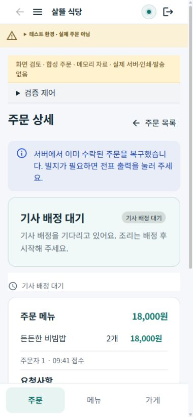

# 음식점 수락 응답 유실의 서버 상태 복구 r27

수락 응답을 받지 못한 것을 수락 실패로 단정하지 않도록 보완했다. 같은 주문을 서버에서 다시 읽어 이미 수락됐으면 현재 상태를 복구하고, 확인되지 않으면 상태 확인을 안내한다. [승인 범위](../AI/Planning/공통/PLAN-OPERATIONS-DISPATCH-CORE/restaurant-acceptance-recovery.r27.md)는 음식점의 기존 주문 처리 마감으로 한정한다.

## 바뀐 동작

| 상황 | 처리 |
| --- | --- |
| 신규 명시 수락 | 같은 주문의 최신 조회와 서버 수락 가능 행동을 확인한 뒤 POST한다. 정상 수락만 기존 빌지 출력 흐름으로 진행한다. |
| 서버 수락 저장 뒤 응답 유실 | 자동으로 POST를 반복하지 않고 같은 주문을 GET으로 확인한다. 현재 수락 시각과 유효 상태가 확인되면 `수락복구됨` 결과로 복원한다. |
| 재실행·목록·상세·재연결 | 기존 조회를 사용한다. 별도 수락 원장이나 자동 복구 명령을 만들지 않는다. |
| 미수락·조회 실패 | 실패를 미접수의 증거로 쓰지 않는다. 미확인은 다시 조회하도록 안내하고, 최신 미수락과 수락 가능 행동을 확인한 뒤 사용자가 명시적으로 재시도한다. |
| 복구 후 전표 | 자동 문서 생성·인쇄·출력 요청 기록을 만들지 않는다. 필요할 때 기존 `전표 출력`을 직접 누른다. r26 기본 두 장/선택 한 장은 유지한다. |
| 계정/선택·취소·늦은 응답 | 이전 요청을 현재 화면에 적용하지 않는다. 다른 주문·수락 시각 누락·취소·거절·알 수 없는 상태는 복구 성공이나 출력으로 바꾸지 않는다. |

수락 전의 두 overload를 같은 서버 확인 경로로 묶었다. 같은 서비스의 수락 요청을 순차 처리하며 기존 메모리 요청 ID에 원래 입력도 함께 고정하고 API 호출마다 복제한다. 미확정 명시 재시도에서 조리시간을 바꿔 원 요청의 의미가 달라지지 않게 한다. 정상 응답과 복구는 서버의 조리시간을 우선하며, 더 최신 조회가 느린 수락 응답보다 앞서 있으면 최신 상태만 복구하고 출력은 보류한다. 메모리 입력은 계정/세션 종료 때 비우며 기기 영속 저장 스키마를 확장하지 않았다.

복구는 현재 서버에서 수락된 주문이라는 뜻이며, 특정 과거 요청이 성공했다는 원인까지 추정하지 않는다. 프린터 출력 실패와 주문 수락 여부도 별도로 유지한다.

## 검증

- Fast `20261028-094055`: 음식점 Android/Windows와 시험 프로젝트 빌드 성공, 관련 **111통과·실패/생략0**.
- 신규 회귀 **29사례**: 실제 Desk/ProgressSession을 조립한 서비스20, 페이지9. 독립 API/인증/저장 대역으로 재생성·응답 유실·미저장·권한·계정 변경·취소·낡은 응답·원 입력 보존을 확인했다. 페이지 회귀는 복구의 문서/프린터/기록0과 명시 재출력1회를 확인했다.
- Preview 소비 빌드: 오류0·경고0. 실제 제품 Razor를 390px 브라우저에서 실행해 복구 안내·수락 버튼 제거·전표 출력 버튼, 복구 자동 출력0과 명시 출력1, 조회 실패 시 작업 잠금과 재조회 후 복원을 확인했다. 제어 상자의 건수는 부모 렌더 뒤 갱신된 값을 확인했다.
- 최종 Task `20261028-094235`: `Ssalddel.v3.5.slnx` 전체 소비 빌드 성공·**16,669통과·실패0·외부 환경17생략**. RestaurantDeskApp Android/Windows와 공유 소비자 컴파일을 포함한다. 생략을 실제 외부 DB 성공으로 집계하지 않는다.

화면은 합성 주문·메모리 Desk/API·프린터 대역이다. 실제 제품 서버/DB의 수락이나 물리 인쇄 증거가 아니다. 요청한 뷰포트는390×844이며 저장된 원본 화면은380×822, DOM 폭 측정은390/380px로 가로 넘침이 없었다. 원본 캡처를 PNG 형식으로 변환했고 내용을 합성하거나 편집하지 않았다.

## 소유권과 실행 경계

기준 HEAD와 기존 dirty 변경을 보존하고 선택 소스10개의 지문을 고정했다. 검증 뒤 지문 변경0과 HEAD 불변, 기존 dirty 소스99개 중 이번 허용3개 외96개 동일을 확인했다. 최종 범위/해시·원시 TRX·브라우저 확인은 `artifacts/local/restaurant-acceptance-recovery-r27/`에 둔다. 실제 기기 설치/재실행·실제 서버 중단·물리 프린터 확인은 별도다. 두 검토 탭을 닫고 임시 뷰포트를 복원했으며 소유5371 미리보기는 종료했다. 서버/API/DB 수락 정책·권한·운영 플래그·실제 알림·자동 배차를 바꾸거나 commit/push·배포하지 않았다.
