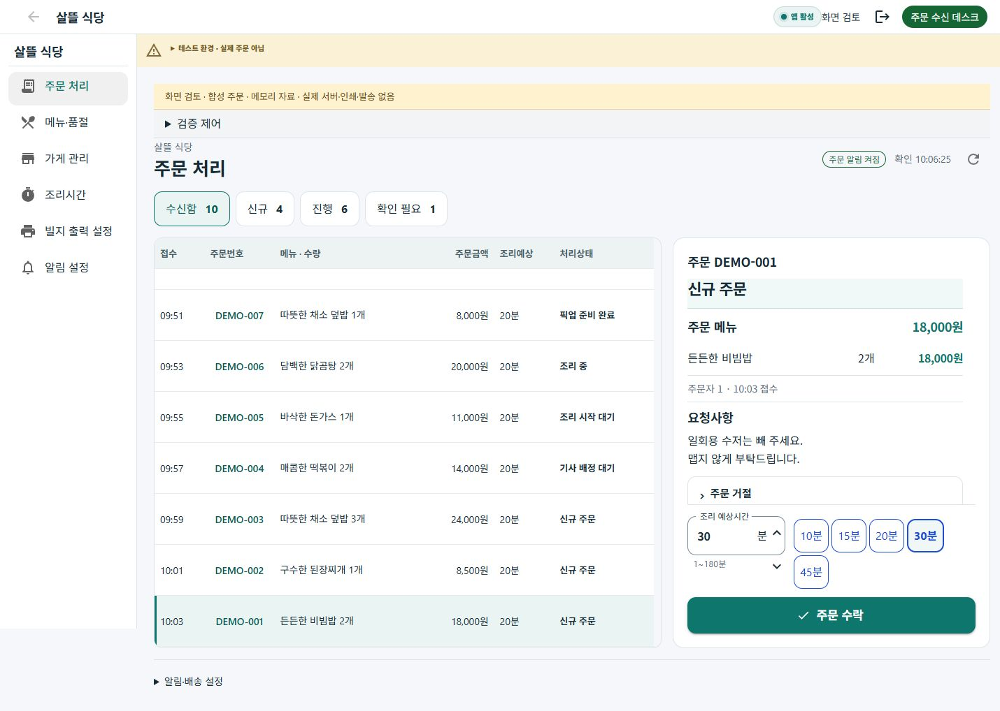
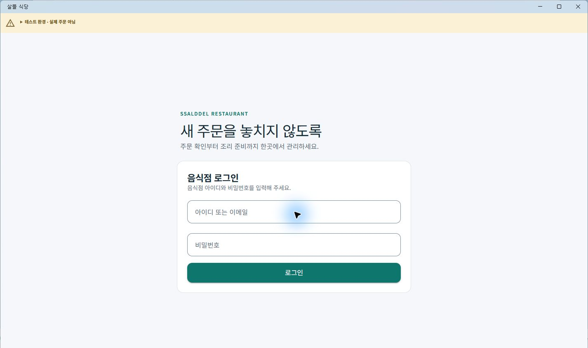

# 음식점 데스크탑 주문표와 기본프린터 직접 출력 r28

기존 사용자 POS 사진의 표/선택 상세 배치를 참고해 음식점 PC 수신함을 표로 바꿨다. Windows 앱은1440×900의 데스크탑 크기로 시작하며, 정상 신규 수락은 기본프린터의 단일 출력 작업으로 이어진다. [승인 범위](../AI/Planning/공통/PLAN-OPERATIONS-DISPATCH-CORE/restaurant-desktop-table.r28.md) · [현재 페이지 책임](../ProjectOverview/page-docs/restaurant-order-usability-r1.md).

## 화면과 업무

| 부분 | 최종 동작 |
| --- | --- |
| 주문표 | 접수·주문번호·메뉴/수량·금액·조리예상·처리상태6열. 기존 수신함/신규/진행/확인 필요 필터, 빈 목록·로딩·조회 실패 보존. |
| 선택 상세 | 행이나 키보드 주문번호 버튼으로 선택하고 우측 기존 상세에서 전체 메뉴·요청사항·조리시간과 다음 행동을 확인한다. 표에서는 수락/조리 명령을 직접 실행하지 않는다. |
| 신규 주문 | 기존 SignalR/서버 조회·알림음 경로로 목록을 갱신한다. 새 주문이 들어와도 선택과 작성 중 조리시간을 빼앗지 않는다. 새 Windows OS push/FCM 어댑터나 자동 수락을 만든 것은 아니다. |
| 명시 수락 | 조리시간 선택 뒤 서버 수락과 배차 요청을 확인하고 빌지 한 작업을 요청한다. Windows는 기본프린터 직접 출력, Android/브라우저는 기존 경로다. |
| 출력 장수/오류 | r26의 조리/포장 두 장분·설정 한 장을 유지하고 프린터 부수는1이다. 프린터 사용 불가/결과 미확정은 주문 수락과 구별하고 자동 재출력이나 브라우저 대화상자 fallback을 하지 않는다. |
| 복구와 조리 | r27의 이미 수락된 서버 상태 복구는 자동 출력하지 않는다. 조리 시작은 현재 서버의 확정 기사/배달시도와 AvailableActions가 허용한 뒤 별도 수행한다. |
| 좁은 화면 | 기존 카드·독립 주문 상세 route를 유지한다. Windows 최소 창1100×720과 Android/브라우저의 좁은 화면을 구분한다. |

이 주문표는 실제 제품 Razor를 합성 Desk/API/프린터 대역으로 실행한 브라우저 화면이다. 원본 POS의 실주문·고객 정보·브랜드를 데이터나 화면 자산으로 복사하지 않았다.

## Windows 출력 연결

기존 의존성 WebView2 1.0.3179.45의 실제 WinRT 메타데이터/XML을 대조해 Windows 전용 프린터를 등록했다. 본문 WebView를 이동시키지 않고 별도 숨긴 InPrivate controller에서 전표 HTML을 읽어 `PrintAsync` 한 번으로 보낸다. `PrinterName`은 비워 OS 기본프린터를 선택하고 `Copies=1`로 고정한다. 외부 리소스·창·다운로드·권한을 차단하고 HTML 파일·고객별 경로·원문 로그를 만들지 않는다. 부수 외 용지/여백을 임의 지정하거나 OS 프린터 설정을 변경하지 않는다.

출력 큐·문서 준비/전체 요청 제한과 늦은 native 작업의 정리를 분리한다. 실제 전송 뒤 취소/시간초과는 이미 장치에 전달됐을 수 있음을 보존하며 정리가 끝나기 전 다음 출력을 겹치지 않는다. 성공은 출력 요청 결과이며 종이 출력/절단 완료가 아니다. SDK 작업 기본값과 실제80mm 용지/드라이버 적합성은 실물 확인이 필요하다.

사용 전 Windows에서 영수증 프린터를 기본 장치로 지정하고 그 드라이버의 용지 크기·절단을 확인한다. 이 작업에서 실제 기본 장치를 바꾸거나 시험 인쇄하지 않았다.

## 검증

| 실행 | 결과와 범위 |
| --- | --- |
| 초기 Fast |535통과·1실패. 실패는 이전 architecture 계약이 Windows 시작 크기430×860을 요구한 것이며, 이번 사용자의 데스크탑 요청에 맞춰1440×900/최소1100×720으로 정합시켰다. 기존 로그인/첫 화면 메뉴 경계는 유지했다. |
| 최종 Fast `20261028-100255` | 음식점 Android/Windows·시험 프로젝트 빌드 성공, 관련536통과·실패/생략0. |
| 최종 Task `20261028-100438` | `Ssalddel.v3.5.slnx` 전체 소비 빌드 성공·16,681통과·실패0·외부 환경17생략. 생략은 외부 DB 성공으로 집계하지 않는다. |
| 신규 회귀12 | 표 구조/선택/모바일 경로와 실제 Presentation8, 자동프린터 UI의 단일 작업/장수/오류 무재수락/복구 무출력4. native 출력 API나 실물 장치의 실행 시험이 아니다. |
| 실제 Razor | 최종 Preview 빌드 오류0/경고0.1440/1280px에서 표,390px에서 카드·기존 경로와 가로 넘침0을 확인했다. 키보드 선택의 pressed=true, 새 주문 추가 뒤 같은 주문/조리30분 유지, 수락 후 출력1회·배차 전 조리 대기·기사 배정 후 조리 시작, 복구 응답 뒤 출력 건수 불변을 확인했다. |
| Windows 실제 실행 | 최신 MAUI 실행 파일로 새 창을 열고 넓은 로그인 화면과 입력 컨트롤을 확인했다. 계정 입력/로그인·실주문 수락·프린터 호출은 하지 않았다. 확인용 창은 정상 닫고 프로세스 종료를 확인했다. |

초기 Preview에서 boolean aria 값이 빈 속성으로 출력되는 것을 발견해 표 선택/필터의 true/false 문자열을 보완했다. 최종 브라우저에서 선택 상태가 실제 접근성 상태로 전달되는 것을 재확인했다. 초기 화면/로그는 보존하고 최종 판본과 구분했다.

첫 native 캡처는 다른 창의 가림/초기 빈 그림이어서 시각 근거에서 제외했다. 대상 창을 앞으로 가져오고 빈 입력 컨트롤을 확인한 뒤 정상 렌더 캡처만 문서 자산으로 보존했다. 화면 확인을 인증 후 native 주문 전체 완주·실제 알림음/FCM·제품 서버/DB·실제 인쇄로 확대하지 않는다. 사용한 computer-use 절차는 로컬 기존 앱의 확인이며 외부 발송을 수행하지 않았다.

## 소유권·남은 확인

선택 소스13개의 최종 지문과 기존 dirty 변경을 보존했다. 원시 빌드/TRX·초기/최종 화면·SDK/API 근거·보존 비교는 `artifacts/local/restaurant-desktop-table-r28/`를 따른다. 프린터/용지/절단, 실제 소리, 인증된 Windows 주문 서버 왕복은 별도 확인이 남는다. 실제 프린터·권한·운영 설정 변경, 운영 활성화·commit/push·배포는 수행하지 않았다. 검토 탭·뷰포트와 소유 미리보기/Windows 창을 정리했다.
