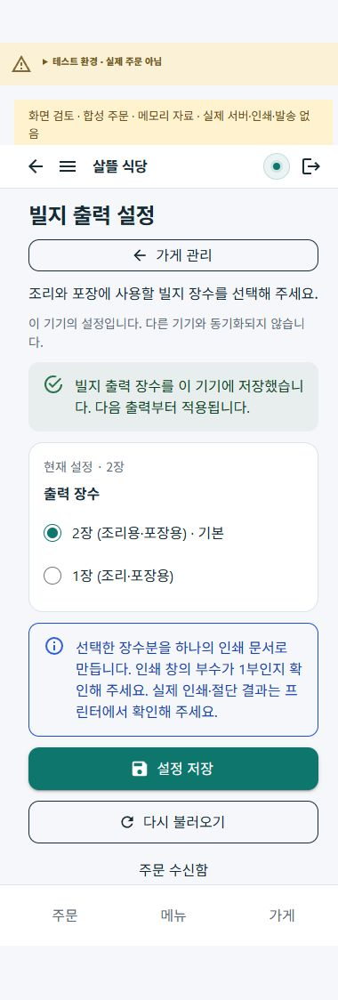

# 음식점 빌지 기본 두 장과 출력 설정 r26

RestaurantDeskApp의 주문 수락 후 전표와 재출력에 **기본 두 장분(조리용·포장용)**을 적용했다. `/settings/receipts`에서 **한 장분(조리·포장용)** 또는 두 장분을 이 기기에 저장할 수 있다. [승인 범위](../AI/Planning/공통/PLAN-OPERATIONS-DISPATCH-CORE/restaurant-receipt-copies.r26.md) · [페이지 책임](../ProjectOverview/page-docs/restaurant-receipt-copies-r26.md).

## 동작

- 기기 설정이 없으면2장, 저장된1/2 선택이 있으면 해당 값을 쓴다. 입력은1/2만 허용하고 설정 읽기/저장 실패를 성공으로 숨기지 않는다. 설정은 기기별 MAUI Preferences이며 서버의 가게 설정이나 다른 기기 동기화가 아니다.
- 출력 명령 시작에 장수를 한 번 읽고 고정한다. 같은 최신 주문 draft의 메뉴·수량·바코드·메모를 유지하며 한 HTML 인쇄작업에 용도가 다른 전표를 구성한다. 두 번째 전표 앞에서 페이지를 나누고 표제는 HTML 인코딩한다.
- 기존 프린터 인터페이스/Android·브라우저 연결을 유지한다. 인쇄 창을 두 번 호출하거나 설정 조회 실패 때 임의로 출력하지 않는다. 재출력은 주문을 다시 수락하지 않는다.
- 출력 설정 오류는 원 주문 수락과 분리했다. 사용자가 누른 수락은 처리하되 출력만 보류하고, 현재 주문을 다시 확인한 뒤 설정/재출력을 안내한다. 설정을 읽지 못했다는 이유로 주문 수락을 막거나 임의 장수로 인쇄하지 않는다.
- 창고/화물 등 공유 문서의 기본은1장으로 유지하고, 설정을 적용하지 않은 기존22종 출력의 HTML/평문 지문을 보존했다. 음식점 전용 구성은 영수증 형식에만 적용한다.
- 설정은 가게 관리·탐색 메뉴·주문 상세에서 연다. 현재 확인값과 선택 초안을 구분하고, 최초 조회 실패 시 저장을 잠근다. 저장 후 재조회가 일치할 때만 성공으로 표시한다.

기존의 **주문 수락 뒤 출력** 시점은 유지한다. 주문 도착만으로 무인 인쇄하는 기능을 켜지 않았다. 인쇄 요청은 실제 출력/절단 완료가 아니며, 긴 주문은 여러 물리 페이지를 사용할 수 있다. 선택한 것은 논리 전표 수다. 인쇄 창의 부수는1부인지 확인해야 하며 OS에서2부를 선택하면 문서 전체가 복제된다. 취소·일부 출력 여부를 자동 추정하거나 자동 재출력하지 않는다.

## 화면 확인

실제 제품 Razor·공유 CSS를 `eng/RestaurantPosPreview`의 Development loopback 호스트에서 실행했다. 합성 인증/주문·메모리 설정 store·프린터 대역이므로 운영 서버·실제 MAUI Preferences·물리 인쇄 증거가 아니다. 기본2→1저장→가게 관리로 이동→설정 재진입 시1유지→2저장, 다시 불러오기를 확인했다. 390/1280px에서 문서 폭이 각각390/1280px로 가로 넘침이 없었다. 소유 미리보기 서버·탭과 임시 화면 크기 설정은 종료/복원했다.

[390px 한 장 설정](../assets/changes/2026-10-28-restaurant-receipt-copies-r26/receipt-settings-390-one.png) · [1280px 설정](../assets/changes/2026-10-28-restaurant-receipt-copies-r26/receipt-settings-1280-two.png)

## 검증

| 실행 | 결과와 경계 |
| --- | --- |
| 장수·호환 Fast `20261028-085830` | 관련62통과/실패·생략0. 공유22종 출력의 전체 HTML/평문 지문 보존 포함. 최종 수락/출력 오류 분리 수정 전 판본이다. |
| 최종 업무 Fast `20261028-090606` | 최종 코드의 시험 프로젝트 빌드·관련62통과/실패·생략0. 설정 read 실패에도 수락1·출력/출력기록0을 확인했다. |
| 최종 Task `20261028-090639` | `Ssalddel.v3.5.slnx` 전체 빌드 성공(음식점 Android/Windows와 공유 소비자 포함),16,640통과/실패0/별도 환경17생략. |
| 신규 직접 회귀29 | 설정/문서22·페이지7. 기본값·1/2저장·재조회·저장소 대역 재시작·오류/취소·문서 불변·같은 품목/수량/바코드·인코딩·단일 출력/재수락 방지·장수 고정·수락/출력 분리. |
| 실제 Razor 미리보기 | Preview 빌드0경고/오류. 390/1280px에서 선택·저장·재진입을 확인했으며 기기 저장소는 메모리 대역이다. 실제 MAUI Preferences/프린터를 검증한 것이 아니다. |
| 최종 입력 보존 | 소스20개 hash 변화0·HEAD 불변. 기존 dirty source81 중 테스트 프로젝트의3개 링크 추가만 병합하고 나머지80개 동일. |

초기 집중 실행은1장 표제의 HTML 인코딩을 그대로 검사하지 않은 시험과, 일반 영수증에 추가 CSS가 들어간22종 출력 호환 검사에서 실패했다. 표제는 인코딩된 실제 값으로 검사하고 추가 CSS는 장수/표제가 지정된 전표에만 적용해 기존 출력을 보존했다. 최초 Preview 빌드는 홈 페이지의 공통 모델 import 누락으로 실패해 제품과 같은 import를 연결했다. 이전 실패 로그를 삭제하지 않았다.

원시 로그·TRX·소스/이전 변경 보존 비교·브라우저 확인은 `artifacts/local/restaurant-receipt-copies-r26/`에 둔다. 실제 프린터·Android/Windows 앱 설치 후 Preferences 재실행 보존·인쇄 대화상자/절단은 미검증이다. 기존 `SsalddelRestaurantDesktop`의 Avalonia 시작 화면에는 주문 출력 경로가 없으므로 이 보완을 해당 앱의 출력 완성으로 확대하지 않는다. 운영 활성화·commit/push는 하지 않았다.
