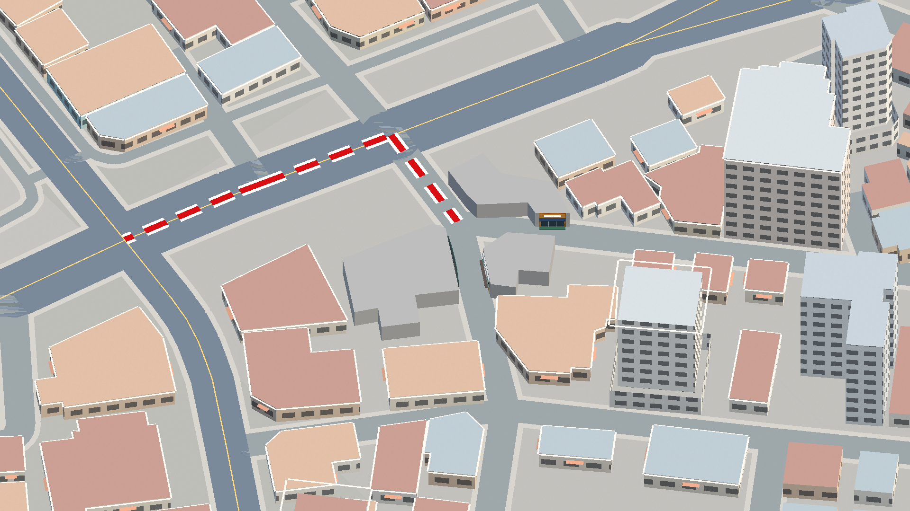
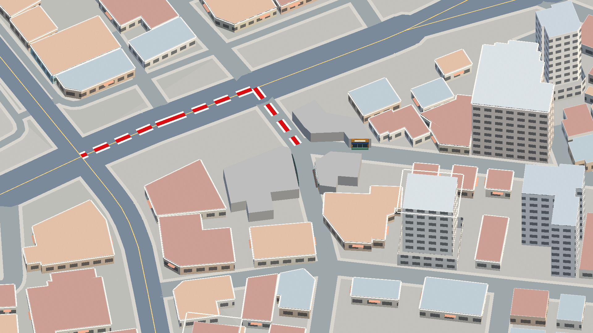
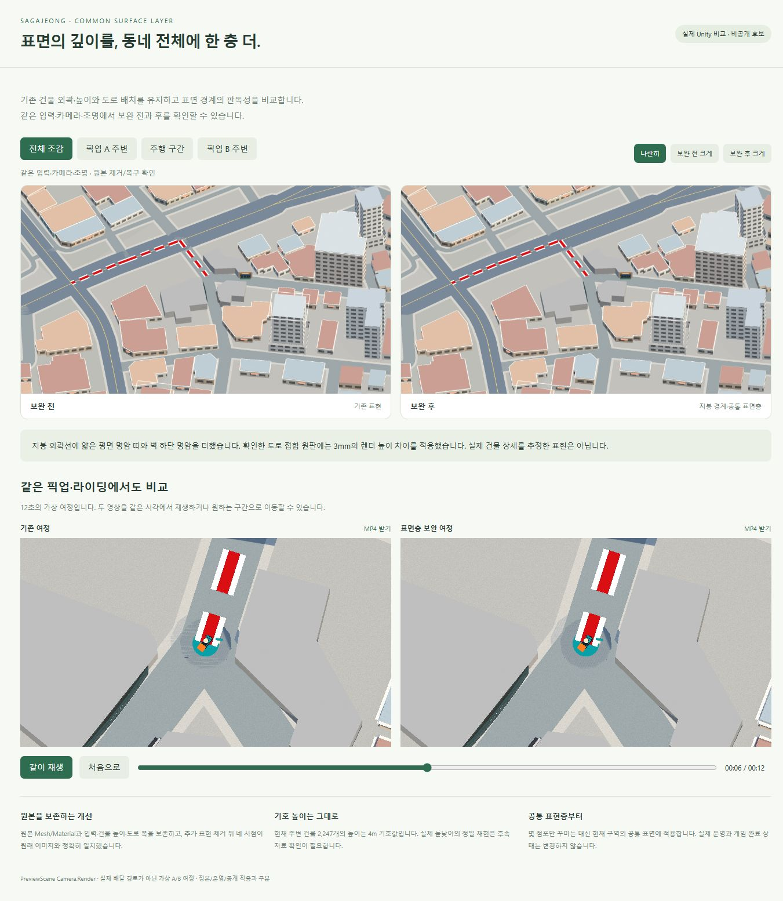

# 사가정 공통 표면층 고도화 r53

2026-10-29. [범위·명세](../AI/Planning/시스템/PLAN-SYSTEM-ADMIN-DONG-DIORAMA/common-surface-depth.prototype.r53.md).

건물 외곽·높이를 보존한 채 지붕 경계/벽 하단을 더 잘 읽히게 하고, 기존 도로의 같은 평면 strip/node cap에서 보이던 겹침을 줄이는 비공개 공통 표면층을 구현했다. 현재 구역의 공통 불투명 batch 전체에 적용하고, 특정 점포의 실제 미확인 상세를 추가하지 않았다.

## 실제 전후 화면

보완 전:

보완 후:

위 이미지는 실제 Unity PreviewScene Camera.Render이며 같은 입력·카메라·조명이다. 지붕의 얇은 띠는 평면 명암 표현이며 실제 난간/설비 관측이 아니다. 빨강/흰색 표식은 기존 비공개 후보 도로 레이어로 유지했다.

## 무엇을 바꿨나

- 공통 불투명 Renderer16개/원본 Mesh16개를 대상으로 UV1.x=2 지붕 삼각형의 외곽13,444edge에 얇은 안쪽 명암 띠를 생성했다. 내부edge4,903개는 제외하고, 뾰족한 모서리에서도 owner triangle 밖으로 나가지 않게 제한했다.
- 지붕면 구성2,847개를 처리했다. 이는 Mesh의 연결된 지붕 구성 수이며 확정된 실제 매장/건물 수로 해석하지 않는다. wall 하단vertex26,888개의 색만 복제 Mesh에서 약하게 조정했다.
- 실제 제작기의 도로fan만 판정했다. 12각은 y=.07/.10, 8각은 y=.125에 한정하며 10각·비원형·다른 높이는 제외한다. 3,977fan(12각3,780/8각197)의 사본 표면을3mm 올려 같은 평면의 겹침을 줄였다. 도로 XZ·폭·연결·의미는 보존했다.
- 지붕 띠는 기존 지붕 위18mm의 평면 표현이다. 건물 높이는 바꾸지 않았다. 추가Renderer1개·vertex53,776개·triangle26,888개이며 실제 FPS/메모리 스트리밍 측정과 구분한다.
- 원본Mesh/Material과 source vertex/index는 수정하지 않는다. Scope가 소유한 사본과 추가 띠를 제거하면 원래 참조/내용으로 돌아간다.

## 변경 파일

별도 Unity checkout `C:\Users\user\ssalddel`:

- `Assets/Ssalddel/Editor/사가정공통표면깊이Style.cs`와 `.meta`
- `Assets/Ssalddel/Editor/사가정공통표면깊이PreviewCapture.cs`와 `.meta`
- `Assets/Ssalddel/Tests/EditMode/사가정공통표면깊이StyleTests.cs`와 `.meta`
- 기존 `사가정상세건물PreviewCapture.cs`의 환경변수 opt-in 호출. r122 hook은 유지했다.

Hongdal의 계획/목차/현재 작업·이번 변경 기록/선정 PNG와 `artifacts/local/sagajeong-surface-depth-r53/`의 로컬 비교/인코딩 도구·실행 근거를 연결한다. Runtime builder/shader·공식 Scene·Prefab·운영/Simulation Core·DB·Goal/WI는 변경하지 않았다.

## 검증과 아직 남은 것

최종집중 EditMode10/10·실패0·생략0을 통과했다. 내부/외부edge, 원본 형상, 뾰족한 지붕 경계, 대상 필터, 12/8fan 및10각/비원형/다른 평면 거부, Scope 복구를 검증했다. 독립 검토에서 준비 중 예외의 카메라 정리·fan 범위·출력 높이 의미를 보완한 뒤 최종 소스를 동결했다.

attempt3 graphics exit0에서 조감/픽업A주변/주행중간/픽업B주변4시점×before/candidate/restored12PNG를 만들었다. 4시점 모두 복구PNG SHA가 before와 정확히 같고 원본 Mesh 지문·Material 참조·원본 건물높이/도로폭이 보존됐다. 전후 이미지를 직접 확인해 경계 판독성과 접합부 빗금 감소를 확인했으며 현재 강도를 후보로 채택했다.

현재 공통 입력의 Overture 건물2,247개 높이는 모두 `SymbolicFallback4m`이다. 이번 표면층이 실제 도시의 높낮이·지붕 형태·출입구/창 수를 복원한 것은 아니다. 실제 높이를 개선하려면 출처가 있는 높이 자료와 건물 ID 결속을 먼저 확보해야 한다.

최종 attempt4 graphics exit0에서 같은 소스/강도로 전후 여정을 각각1080p·24fps·288 PNG·12초로 출력했다. 576개 SHA/치수/시각·단계와 before/after 기사·카메라 pose288/288동일을 확인했다. Scene/설정/package/기존 builder/shader/style 등10파일 SHA 보존, 임시 표현 제거·PreviewScene 종료와 새 C#/shader 오류·예외0을 확인했다.

이전 r122와는258/288프레임이 exact이고 나머지도 최대2pixel 차이였으나 원인은 확정하지 않았다. 이전 결과를 현재 기준으로 승계하지 않고 **이번에 새로 출력한 before288장**을 대조 기준으로 썼다. attempt3/4의 정적 조감 candidate도 exact SHA 일치한다.

전후 MP4 모두 전체288프레임 디코딩·1080p/24fps/12초를 확인했다.

| 출력 | SHA-256 |
| --- | --- |
| 보완 전 | `65db92c74f80fbc56f9f5acaec0751863e38bdbf2a560d614f7e3b9c17005558` |
| 보완 후 | `250c9ba4642ebd6351852b360c88de288c97e8448119dc2d66574bf5d1b80eea` |

로컬 비교는 `artifacts/local/sagajeong-surface-depth-r53/review/`, 확인한 주소는 `http://127.0.0.1:8779/`다. 네 시점·나란히/크게 보기·동시 재생·6초 동시 이동·초기화·후보MP4 실제 받기/해시를 확인했다. 데스크톱1366px와 기본525px를 확인했고525px의 contentWidth/viewportWidth가 같아 가로 넘침이 없었다. 임시 viewport는 복원했으며 최종 브라우저 오류 로그0이다.

처음 SimpleHTTP 미리보기는 영상 byte range가 없어 seekable이0~0으로 표시돼 구간 이동이 되지 않았다. 소유한 첫 서버를 종료하고 루프백 전용 `serve_review.py`에서 byte range/suffix 요청을 지원했다. HTTP206·구간32/16bytes와 seekable0~12, before/after 모두6초 이동 및6.253초 부근 동시 재생을 실제로 확인했다. 직접 파일 열기나 외부 호스팅은 검증하지 않았다.

독립 시각 검토에서도 도로 빗금 감소와 과도하지 않은 지붕 경계를 확인해 현재 강도를 채택했다. 큰 회색 연구 건물의 지붕 단조로움·일부 짙은 접합 패치는 남으며 주행 중 경계 깜빡임의 전구간 사람 관찰/실시간 FPS는 검증하지 않았다.

주요 근거는 `attempt4/verification.private.json`, `attempt4/source-changes.private.json`, `attempt4/surface-depth/surface-depth-result.private.json`, `review-verification.private.json`, `ui-validation.private.json`이다. 모두 `artifacts/local/sagajeong-surface-depth-r53/` 아래에 보존한다. 연결된 Editor/Pipeline이 없어 CLI graphics를 사용했다. 정식 Play Mode/Game View·실시간 FPS/메모리 스트리밍·정본/공식 Scene·운영/공개·commit/push와 구분한다.

## 출처와 디오라마 규칙 점검

- 기존 Overture 비공개 입력은 `artifacts/local/sagajeong-spatial-presentation/overture-private-review.json`, SHA `d0552e82130bb5e87a8b7b48201a7f0193252e3374200941f0e9d836008ba68b`이다. 높이 기호값의 결손을 명시한 채 원본을 보존했다.
- r114의 기존 상세 장면/입력과 r122의 기존 가상 여정·카메라를 재사용한다. 새 공공자료·상업 에셋을 수집/구매하지 않았다.
- 기존 `source-simulation-presentation-separated`, `presentation-toggle-does-not-mutate-authority`, `preserve-procedural-mass-until-visual-evidence-ready`, `missing-coverage-remains-explicit` 원칙을 지지한다. 원본 권위나 공간 실측을 바꾸는 반례/무효화는 만들지 않았다.
- 한 역의 로컬 렌더 보완을 타 지역 공통 규칙으로 승격하지 않았다. **새 디오라마 규칙 후보 없음.**

문서/선정 PNG 9경로의 Fast·공백 검사, 새 문서 상대 링크10개와 증거 규칙 Validate를 통과했다. 로그는 `artifacts/local/validation/20261029-202252/`다. 이 검사는 문서 범위이며 별도로 수행한 Unity 컴파일/집중 시험/실제 graphics·MP4·브라우저 결과를 대신하지 않는다.
