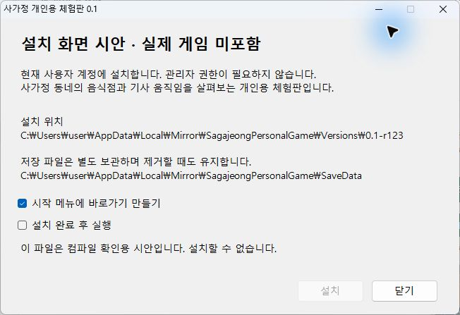
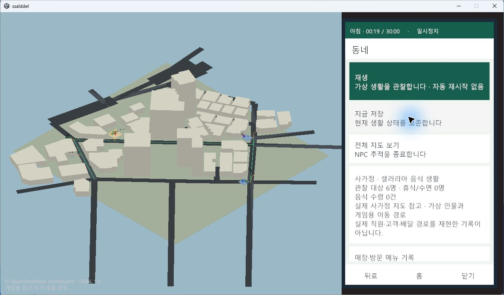

# 사가정 개인용 Windows 관찰 체험판 r123

2026-10-29. [사용자 확인·범위 r123](../AI/Planning/시스템/PLAN-SYSTEM-REGIONAL-OPERATOR-SIMULATION/offline-personal-player-first.decision.r123.md).

사용자가 운영비 부담 때문에 개인용 설치 게임을 먼저 준비하기로 확인했다. 기존 `SagajeongFoodLife`의 작은 실시간 3D 생활 관찰을 Windows Player로 묶는 작업이다. 현재 r53/r114의 상세 Editor 디오라마와 새 경영·자유 운전 기능은 후속이다. 포장 관문과 전체 월드 검증을 분리하며 새 WI/E를 승격하지 않는다.

## 설치 화면 시안

위 이미지는 실제 payload를 넣기 전 컴파일한 설치 화면 시안이다. 설치 성공이나 실제 게임 화면을 의미하지 않는다.

## 변경 경로와 소유 범위

- Hongdal: r123 개별 기획·PLAN README·PLANNING·CURRENT_WORK·이번 변경 기록/목차와 화면 이미지.
- 별도 Unity checkout `C:/Users/user/ssalddel`: 새 `Assets/Ssalddel/Editor/사가정개인용PlayerBuild.cs`와 `.meta`, `Bootstrap/운영관찰WorldController.cs`, 새 `Tests/EditMode/사가정개인용운영조회차단Tests.cs`와 `.meta`, `Editor/통합WorldScenePolicy.cs`와 기존 `Tests/EditMode/통합WorldScenePolicyTests.cs`, `Presentation/NatureWoodcutting/벌목정적시각복사Factory.cs`.
- 로컬 제작물: `artifacts/local/sagajeong-personal-game-r123/`. Unity 실행·실패 기록, C#5 설치기/실행기/제거기·Python 포장 도구·시작 안내·자체 시험과 산출물은 여기에 둔다.
- 정책 목록에 기존 `AreaSetCompositionPatternReview.unity`, `NatureH3GameViewReview.unity` 두 경로만 검토 참고로 등록했다. 두 Scene 내용·meta와 공식 BuildSettings는 보존하며 새 공식 Scene이나 root 치환은 만들지 않는다.
- 사가정 로컬 프로필은 운영 조회 Transport/Client/대기 요청을 만들지 않고, 다른 프로필은 기존 초기화를 보존한다. 실행기는 자식의 `SSALDDEL_` 상속값만 정리한 뒤 사가정 로컬 프로필·전용 저장 경로를 설정한다. 전역 환경은 바꾸지 않는다.

## 검증 상태

| 범위 | 실제 결과 |
| --- | --- |
| 사가정 자료/관찰 UI + 운영 조회 차단 + Scene 정책 | attempt7 집중23/23, 실패/생략0; 앞선 attempt5 집중10/10도 보존 |
| 벌목 Factory 호환 회귀 | 핵심 복사45/45 통과; 추가 Pine4개는 SetUp의 현재 재질 고정 SHA 불일치로 실패, 총49중45/4를 그대로 보존 |
| 설치 도구 | 최종 C#5 x64 컴파일·자체42시험 통과; 일반 설치·제거 실행과 구분 |
| 포장 파일 필터 | 명시 `--exclude-unused-llm`의 정확 경로·다른 버전/형제 보존9시험 통과; 기본 포장은 전체 포함 유지 |
| 독립 소유권 검토 | 기존·추적 불가·사용자 수정 바로가기/등록의 보존 문제를 receipt+정확 지문 비교로 보완, 차단 해소 |
| 전체 월드 검사 | attempt5/6/7 `ValidateWorldShellOpenScene`의 구성 요소 null 참조로 실패; 성공으로 덮지 않음 |
| Player 빌드 | 최종 attempt16 비개발 Mono Release CLI0·오류0/경고2,153개, 236파일/371,434,356B; 현재17+Llama115/root.meta 복귀·해시 확인 |
| 실제 payload 포장·검증 추출 | release-03 Setup 생성·리소스 지문 재검사, 중단 추출 QA 재개 뒤 배포248/원본236 해시 일치; 최종 Setup 새 폴더 검증 추출도 단1회 exit0/248파일 일치; 일반 설치·제거 미실행 |
| 실제 Windows 조작 | 완성 추출판 Launcher에서 3D 첫 화면·재생00:00→00:19·일시정지·저장·정상 종료/재실행00:19 복구 확인 |
| 남은 범위 | 음향·NPC 추적·30분 완주·설치/제거·상세 디오라마 이식·원본 농장 결함/전체 월드 검사·초기 설정 원문 정확 복구 |

첫 시험의 NUnit 미지원 속성, Builder meta GUID 길이, 형제 namespace의 `Application` 충돌은 작성한 도구/시험의 오류여서 수정하고 실패 판본을 보존했다. 다음으로 기존 검토 Scene 분류 누락을 최소 보정했다. attempt5/6은 `SimulationWorldShellBuilder.cs:842`의 null MonoBehaviour 참조를 확인했으며 원래 stack·단계를 기록했다. attempt8에서 실제 canonical Root의 MonoBehaviour 746개 중 CLR-null/Unity-null 10개를 찾았다. FarmPlot 9개와 HarvestLot 1개의 슬롯이며 엔진 Missing Script 집계는 여전히 0이다. 삭제된 Script/GUID는 추정하지 않는다. 전역 validator나 Scene의 누락 슬롯을 제거/완화하지 않는다. 별도 사가정 포장 관문은 canonical 정책·자료 결속·로컬 조회 차단·원본 보존·실제 Player 검증을 요구한다. 실제 null 슬롯과 해당 lambda의 정확한 예외를 확인한 경우 이외의 실패는 빌드를 중단한다.

attempt8의 실제 Player 컴파일은 기존 벌목 정적 시각 복사의 Editor 전용 `MeshRenderer.receiveGI`, `globalIlluminationMeshLod` 대입 때문에 실패했다. 두 대입을 기존 `UNITY_EDITOR` 블록으로 옮겨 Editor 복사 동작과 나머지 Runtime 속성을 보존했다. Factory 변경은 2삭제/2추가이며 핵심 복사45개를 통과했다. 추가한 Pine4개는 Factory 실행 전 SetUp에서 `Leaves_Pine_LOD_01.mat`의 고정 SHA(expected `BD9A6EFA...`, actual `D2E81353...`)가 달라 실패했다. 해당 자산·기준 SHA를 덮어쓰지 않으며 작업 시작 전부터의 드리프트였다고 단정하지도 않는다. Player 컴파일은 다음 빌드로 별도 판정한다.

### 설정 보존 사고와 남은 한계

attempt8의 Unity BuildPipeline이 `ProjectSettings/ProjectSettings.asset`를 `437b21e80dbee65325903998ff791e4067384c72dea05a6b14aa8e8c85ab7435`에서 `2528ec2989ccd67e1a0d27cf89bfcc9a8423798d23a4c4479a6d7769a049827f`로 바꿨다. helper의 backend setter는 호출하지 않았다. 최초 원문 사본 없이 SHA만 남겨 최초 bytes의 정확 복구는 미완료다. 현재 정규화본과 실패를 보존하고 HEAD/추정 원문으로 덮어쓰지 않는다. 현재 Git 기준 차이는 preload/Standalone batching 두 블록이지만 이를 최초 원문과의 정확 차이라고 단정하지 않는다. canonical Scene과 나머지 16개 보존 파일은 attempt8 전후 동일했다. 다음 빌드는 현재 원문 bytes 사본과 쓰기 직전 검사·종료 후 지문을 남기며, 이를 최초 17개 원본 전체 보존으로 보고하지 않는다.

개인 저장은 `%LocalAppData%/Mirror/SagajeongPersonalGame/SaveData`, 실행 기록은 같은 제품 폴더의 `Logs`이며 버전별 설치 폴더 밖에 둔다. 설치·제거는 기존/수정 파일을 보존하는 설계이고, 실제 일반 설치·제거 성공을 이 자동 시험만으로 선언하지 않는다. 상업 서명·외부 배포·운영 DB/배차/정산·commit/push는 수행하지 않았다.

### 디스크 부족과 내용 보존 압축

attempt9는 C# 컴파일을 통과하고 일부 Player 71파일/1,103,173,143B를 만들었으나 `StreamingAssets/LlamaLib-v2.0.5`의 Linux/CUDA 라이브러리 복사 중 디스크 부족으로 실패했다. 불완전 Player는 전달하지 않는다. [Unity 공식 설명](https://docs.unity.cn/Manual/StreamingAssets.html)의 원문 복사 경로이며, 프로젝트 LlamaLib 원본은115파일/4,153,095,766B다.

자기 소유 불완전 출력의 경로 검증 후 재귀 삭제 명령은 자동 정책 검토에 의해 거절돼 실행되지 않았다. 삭제를 우회하지 않고 Windows NTFS/LZX 압축을 사용했다. 불완전 Player71개와 원본 LlamaLib115개는 압축 전후 크기/SHA가 모두 동일하며, 원본 이동·삭제0이다. 약3GB의 공간을 확보했고 새 출력/포장 폴더에 NTFS 압축을 상속하도록 했다. LlamaLib 원본·vendor callback·공식 StreamingAssets 수집을 수정하지 않는다. 정상 빌드 뒤 개인 관찰판 포장에서만 명시 옵션으로 정확한 LlamaLib 하위 경로를 제외하고, 제외 파일·SHA·사유를 기록한다. 이 파생 Player의 실제 실행은 별도 검증한다.

근거: `attempt9/compression-proof.private.json`, `llm-library-before-compression.private.json`, `llm-library-after-compression.private.json`. 모두 작업 산출물 루트 아래에 보존한다. MYBOX 가상 드라이브는 이 빌드/전송에 사용하지 않았다.

attempt10도 전체 LlamaLib의 중간 복사 용량 때문에 실패했다. attempt11은 빌드 동안에만 LlamaLib을 같은 workspace의 Assets 밖 hold로 atomic 이동하고 빈 placeholder를 사용했다. 원본115파일/root.meta·모델0·재분석 지점/동일 볼륨·복귀 경로를 검사했으며, 생성 placeholder는 삭제 없이 archive하고 원본을 복귀했다. 성공 실행 당시 복구 상태 JSON을 덮어쓰는 문제와 외부 복구 PS1의 archive 중간 상태 문제가 읽기 검토에서 발견됐다. 실행 중 유효 상태를 별도 불변 파일로 보존했고 정상 finally 복귀/전후115 SHA를 확인했다. 이후 도구를 이동 전 CreateNew+Flush(true) 불변 계획/별도 상태 파일과 중간 상태 재복귀로 보완하고, 별도 Editor 컴파일·정책검증 CLI0 및17/115/root.meta/payload389 불변을 확인했다. as-built와 보완 후 도구를 구분해 보존한다.

### 빌드 성공과 첫 실행 실패

release-01의 Setup은118,539,776B·SHA `c99d0113bc8d5465c8643b91e394a29b5049a06b80d03066fcaafaafda5d1a99`, ZIP은118,433,612B·SHA `615567066566b288fd2e35fc9f6da7382109ac6b168b94001e3221517c6eb581`이다. 이는 **실제 실행 미통과 판본**이며 최종 사용판으로 전달하지 않는다.

추출판 실행은 D3D12 초기화 뒤 `level0 is corrupted / Position out of bounds`로 첫 프레임 전에 종료했다. 원본과 추출 level0의 SHA는 모두 `be818658380d44599f3507dfa04b868e4e271faa3cf3d84c1f4e874902a940de`, 선언/실제 길이는7,298,892B로 같다. 단순 ZIP 불일치나 파일 끝 잘림으로 성공 처리하지 않는다. 캐시·내부 객체 직렬화 원인은 아직 확정하지 않았으며, 원본 Scene/Renderer를 추정 수정하지 않고 공식 CleanBuildCache로 같은 Player data를 다시 만든다. `native-first-launch-failure.private.json`과 실행 로그를 보존한다.

attempt12 공식 CleanBuildCache도 CLI0/오류0이지만 level0 SHA가 같고 D3D11 raw 실행도 같은 오류였다. level0만 압축 해제한 바이트 불변 비교 역시 같은 실패여서 ZIP·단순 압축·그래픽 API 전환으로 해결되지 않았다. 객체표18,527개·GameObject5,745개·MonoBehaviour960개의 범위/겹침/참조를 읽기 검사했다. 설치 SDK의 로컬 dbghelp와 DLL에 일치하는 UnityPlayer PDB로 native stack을 해석해 `Converter_String` → `TransferScriptingObject` → `MonoBehaviour` 관리 문자열 읽기의 out-of-bounds를 확인했다. Editor/Player64개 assembly·14,096동일 타입의 직접 필드 비교에서 실제104타입의 직접 차이는0이었다.

직접 데이터 근거는 `농장경영선택대상View`다. 이 타입11개 중10개는6개 직렬화 필드가 필요한데 사용자 payload가0바이트이며, source CLR-null10경로와 정확히 일치했다. 정상 `FarmPlot_0_1`은 stableId·표시명·행동·highlight·presentationOnly를120바이트 끝까지 읽을 수 있었다. 객체 목록에 null script가 없다는 사실만으로 문제 컴포넌트가 제거됐다고 판단하지 않는다. `native-diagnostics/managed-field-payload-diagnosis.private.md`, `zero-payload-script-mismatch.private.json`, `zero-payload-component-slots.private.json`에 결속했다. 왜 원본에 빈 payload가 만들어졌는지의 근본 원인은 아직 확정하지 않았다.

attempt13 읽기에서 null참조의 EntityId는 유효해 빈 참조로 추정 삭제하지 않았다. attempt14의 정확 slot 수정은 Unity native의 `It is not allowed to modify the data property`로 차단됐고, 공개 EntityIdToObject도10개 모두 CLR-null이었다. 내부 API·포인터·바이너리 패치로 우회하지 않았다. 현재17/115/root.meta는 각각 종료 뒤 보존을 확인했다. 다음 r4는 **사가정 개인 export에서만** 이 exact10개 농장 GameObject와 자식 표현을 공개 DontSaveInBuild/EditorOnly로 제외하는 범위다. 원본 Scene·공식 root·정상FarmPlot0_1·다른 객체는 유지하며, 컴포넌트만 제외하려던 이전 기준과 구별한다. 실제 built 자료의 제외와 raw 실행을 통과하기 전에는 해결이나 제품판으로 보고하지 않는다.

### 개인용 Release와 실제 저장 복구 확인 (2026-10-30)

attempt15/16은 지정한 결함 농장 객체10개와 자식1개만 공개 `DontSaveInBuild`/`EditorOnly`로 빌드 사본에서 제외했다. 원본 Scene은 저장하지 않았다. built 자료를 독립 재조회해 GameObject5,745→5,734·MonoBehaviour960→949·component12,619→12,565와 정확 제외 경로, 다른 경로/타입/presence 보존을 확인했다. 빈 Farm payload는10→0이고 정상 FarmPlot_0_1의120바이트는 유지됐다. 이는 사가정 개인용 export의 제한이며 원본 농장 결함의 근본 원인을 복구한 결과가 아니다.

attempt16은 비개발 Mono Release다. 최종 빌드는 CLI0·오류0·경고2,153개, 236파일/371,434,356B이며 현재 기준 소스17개·원본 Llama115개/root.meta의 복귀·해시를 확인했다. 최초 설정 원문의 정확 복구와는 별개다. 실제 raw 첫 화면은 열렸으나 초기 Windows 보안 창이 입력을 가로막았다. 네트워크 허용이나 보안 설정을 변경하지 않았으며 최종 재실행에서는 해당 창이 나타나지 않았다. 단일 소켓 표본에 외부 연결이 있어 완전한 무통신 검증이나 모든 네트워크 코드 제거로 보고하지 않는다. 로컬 Simulation에 상시 운영 서버를 필수로 두지 않는 범위다.

release-02의 설치 없는 추출은 두 번 디스크 부족으로 실패했다. 기존 실패 폴더를 보존하고 `verify-extract-02-retry1`만 동일 ZIP/manifest로 QA 재개했다. 완료233파일은 그대로 건너뛰고 부분1파일은 기존 전량과 ZIP 접두부 SHA 일치 후 남은 부분만 append했으며, 누락14파일은 CreateNew로 만들었다. 덮어쓰기/삭제0·추가46,038,301B다. 최종 배포248파일과 원본 Player236파일 크기/SHA가 독립 재조회에서 모두 일치했다. QA 재개6시험을 통과했으며 이것은 새 Setup의 처음부터 추출 성공이 아니다.

최종 `packaging/release-03/SagajeongPersonalGame-0.1-r123-Setup.exe`는85,206,016B·SHA `55c192306fb5f846de3c8b7a02090d8658c06e41ea65a4efa5fe76a8d2d598ab`다. 설치 쓰기 전에 전체 추출 크기+128MiB를 검사하도록 보완하고 C#42·필터9시험을 통과했다. 동일 release-02 ZIP/manifest를 직접 리소스로 재사용해 ZIP 추가 사본은 만들지 않았다. ZIP 내부 `source/`는 frozen release-02이며 실제 release-03 설치기 소스는 `release-03/outer-setup-source/`와 목록/해시로 별도 보존한다. 실제 리소스 지문을 다시 확인했다. 일반 설치/제거·실제 저용량 설치 시험은 수행하지 않았다.

공간을 다시 확인한 뒤 최종 release-03 Setup의 `verify-payload`를 새 `verify-extract-03-final` 폴더에 단1회 실행해 exit0을 확인했다. 배포248파일 전체 크기/SHA·내장 manifest 일치, 누락/추가0이며 `payload-verification.json`이 생성됐다. HKCU 설치 등록·설치 버전 폴더·시작 메뉴는 모두 생성하지 않았다. 근거는 `packaging/release-03/fresh-extraction-verification.private.json`이다. 기존 실패/QA 재개 판본은 보존한다.

완성 추출판 `Launcher.exe`로 실제 재생00:00→00:13→00:19, 일시정지·저장과 정상 종료 후00:19 재진입을 확인했다. 저장은 전용 `sagajeong-food-life-r1-primary.ssalddel` 파일177,329B·Tick19/Revision43으로 남았고 재실행 전후 같은 세션/저장 tick을 확인한다. 원래 저장 폴더에는 파일이 없었으며 이번 확인용 저장을 보존한다. 실제 화면은 작은 기존 관찰 표현이다. r53 상세 표면층·새 경영 선택·자유 운전이나 실제 배달 재현으로 해석하지 않는다. FMOD의 음향 장치 부재 기록이 있어 음향은 미검증이다.

실행 기록은 `final-native-qa.private.json`, `final-qa-save-before-restart.private.json`, PNG와 회차별 Player 로그, 포장 근거는 `packaging/resume-02-retry1-proof.private.json`, `packaging/release-03/independent-final-verification.private.json`에 보존한다. 전역 월드 검사·E/WI 승격·운영 DB/배차·공개·commit/push는 수행하지 않았다. 일일 예약도 최신 r123 개인용 게임 우선으로 갱신해 중복 빌드보다 남은 검증을 이어가도록 했다.

문서 Fast는9경로의 `git diff --check`를 통과했고 문서 전용이라 빌드·제품 시험은 생략했다(`validation/20261030-091206`). 변경한 r123 구간과 새 문서의 로컬 링크32개는 모두 존재한다. 전체 공용 PLANNING 검사에서 찾은 기존 끊긴 링크279개는 모두 현재 HEAD에도 있는 항목이므로 이번 작업에서 넓혀 수정하지 않았다. 역세권 증거 규칙 검사는 r5/출처11·규칙12·후보12·공통승격0으로 통과했다.

공간 자료를 새로 수집하거나 기존 근거·공통 규칙을 승격하지 않았다. 원래 사가정 참고 자료를 재사용하며 출처·표현 범위는 기존 결속을 유지한다. **새 디오라마 규칙 후보 없음.**
