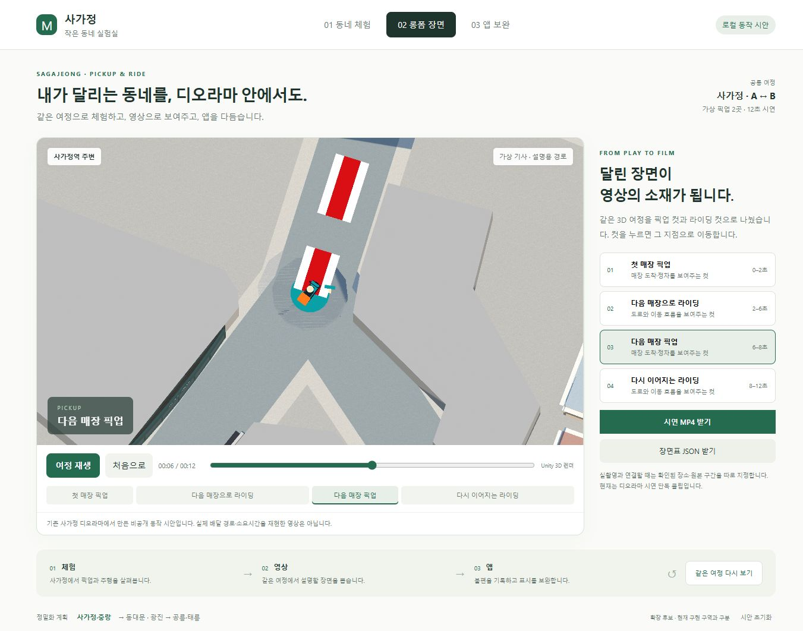
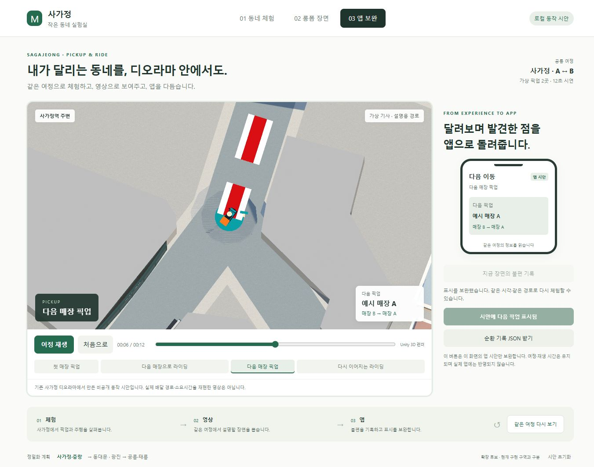

# 사가정 픽업·라이딩과 롱폼·앱 보완 연결 시제품 r122

2026-10-29. [제안서·범위](../AI/Planning/시스템/PLAN-SYSTEM-REGIONAL-OPERATOR-SIMULATION/pickup-riding-threeway.prototype.r122.md).

사용자가 같은 디오라마를 게임·롱폼·앱 개선에 이용하는 가벼운 구현을 요청하고, 디오라마 안에서 픽업→라이딩→픽업→라이딩을 이어 영상으로 뽑는 목적을 구체화했다. 기존 사가정 비공개 상세 연구 장면에서 실제 3D 모형과 카메라를 움직여12초MP4를 출력하고, 같은 여정·시각을 읽는 로컬 체험/영상/앱 시안을 연결했다.

## 실제 화면

위 화면은 브라우저 연결 시제품이다. 영상은 실제 Unity PreviewScene Camera.Render의 3D 연속 출력이며 정식 Unity 게임의 Game View나 실제 배송 이행 화면은 아니다. 실제 도로 선분 위의 가상 A/B 정차·주행이고 배경의 빨강/흰색 선은 기존 연구 후보 표식이다.

## 변경 파일과 소유 범위

- Hongdal: 제안서 r122, PLAN 진입 README, PLANNING, CURRENT_WORK, 이번 변경 기록/목차와 선정 PNG2장.
- 로컬 산출물: `artifacts/local/sagajeong-threeway-r122/`. `dist/index.html`, `style.css`, `app.js`, `journey-model.js`, `capture-meta.js`, `capture-evidence.json`, 배경 PNG·MP4와 사용자용 묶음. 상태 시험·인코딩/검증 스크립트와 실패/성공 실행 근거는 같은 작업 루트에 보존한다.
- 별도 Unity checkout `C:\Users\user\ssalddel`: `Assets/Ssalddel/Editor/사가정픽업라이딩PreviewCapture.cs`와 `.meta` 신규. `사가정상세건물PreviewCapture.cs`는 opt-in hook1줄과 null-envelope 보고서 검사1줄만 바꿨다. 두 줄을 역변환한 내용 hash가 수정 전 원문과 같다.
- 새 공식 Scene·Prefab·제품 API·운영/Simulation Core 규칙·DB·Goal/WI는 변경하지 않았다. 중단 전 준비시간 모델은 이전 로컬 실험 파일로 보존하고 최종 사용자용 묶음에서는 제외했다.

## 검증과 한계

| 범위 | 실제 결과 |
| --- | --- |
| 최종 Unity graphics 실행 | attempt2 exit0, 새 C#/shader오류·예외0 |
| 프레임 | 1920×1080·24fps·288장·12초, 전체 SHA/크기/시간·4단계 경계 확인 |
| 3D 이동 | 기사 모형·카메라 좌표 변화 및 0/96/144/240프레임 시각 확인 |
| 복구 | source-before/after exact SHA 일치, 임시 객체 제거·PreviewScene 종료·기존 활성Scene 유지 |
| 보존 | Graphics/Quality/BuildSettings·Packages·canonical Scene 등6파일 hash 불변 |
| MP4 | 전체288프레임 decode, 양쪽 라이딩 각각96개 고유 프레임,1080p/24fps/12초 |
| 상태 모델 | Node8/8통과: 구간 경계·순수 복사·보완 멱등·시각/경로 불변·JSON 결속 |
| 브라우저 | 재생/정지·6초 컷 이동·세 관점 전환·불편 기록·보완·재체험·초기화, 넓은/좁은 화면 |
| 파일 받기 | MP4 다운로드 SHA 일치, 장면표/순환JSON의 case/revision·6초·보완 결과·영상 hash 일치 |

첫 attempt1은288장 생성/복구 후 기존 nullable envelope 보고서 조립에서 예외(exit1)가 있었고 모형 일부가 건물에 가렸다. 해당 보고서를 null-safe 한 줄로 수정하고 카메라를 높은 추적 조망으로 바꿔 새 attempt2를 만들었다. 실패와 이전 출력은 보존했다. UI 확인 중 재생 갱신마다 컷 버튼을 다시 만들던 문제도 발견해 버튼을 유지하고 선택 표시만 갱신하도록 수정한 뒤 컷 이동/다운로드를 재검증했다.

연결된 Editor/Pipeline 도구가 없어 CLI graphics를 사용했다. 기존 URP shadowResolution 경고4회는 남는다. PreviewScene 영상·브라우저 시제품과 실제 Unity Play Mode/Game View·자유 운전·실시간 FPS·설치형 제품은 구분한다. 실제 매장 간 경로·실배달 DB/실촬영 컷·역할 앱 변경·외부 업로드·공개·commit/push는 미실행이다.

주요 근거:

- `artifacts/local/sagajeong-threeway-r122/unity-journey/attempt2/verification.private.json`
- 같은 실행의 `boundary-checks.private.json`, `source-changes.private.json`, `journey/journey-manifest.private.json`
- `artifacts/local/sagajeong-threeway-r122/movie-verification.private.json`, `ui-validation.private.json`
- MP4 SHA: `2e21b1beb30d7f17ed5dc559d2d804afa6101c21f5646fef20eb24cf1ec6fcf1`

문서8경로의 Fast/공백 검사와 새 문서 상대 링크11개·증거 규칙 Validate를 통과했다. 문서 검증 로그는 `artifacts/local/validation/20261029-191252/`다. 전체 제품 빌드/서버 시험은 수행하지 않았으며 Unity 실제 graphics·MP4·로컬 모델/브라우저 검증과 구분한다. 별도 정적 검토의 로딩 전 컷 이동 가능성은 `loadedmetadata` 뒤 대기한 시각을 적용하도록 보완했다.

묶음은 상대 경로의 HTML/CSS/JS·MP4·배경과 제안서/해시를 포함한다. 직접 `file:` URL로 여는 자동 확인은 브라우저 보안 정책이 허용하지 않아 수행하지 못했으며, 우회하지 않고 동일 파일을 `127.0.0.1:8777`에서 제공하는 경로로 최종6초 이동/초기화를 재확인했다. 최종 사용자용 압축본은 `artifacts/local/sagajeong-threeway-r122/sagajeong-pickup-riding-prototype-r122-final.zip`이다.

공간 출처·기존 규칙의 지지/반례/무효화 검토에서는 새 관측·정본 적용이 없어 상태를 바꾸지 않았다. **새 디오라마 규칙 후보 없음.**
