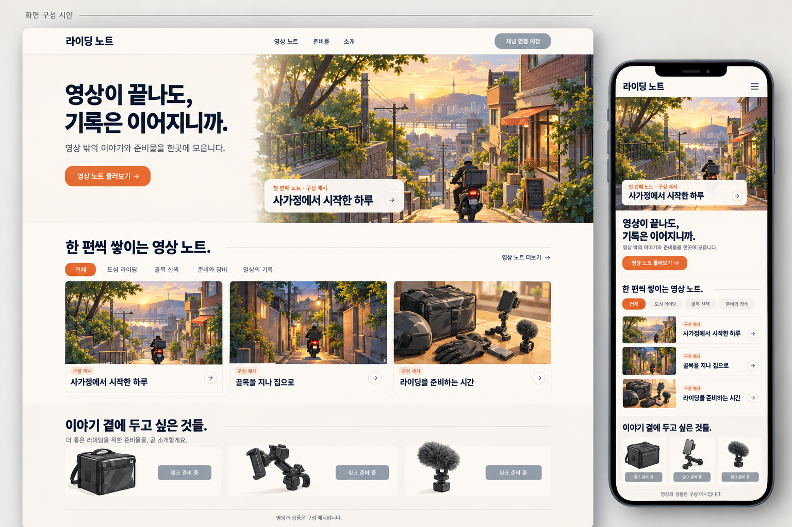

# 롱폼 영상별 이야기·상품 링크 홈페이지 첫 시안

2026-10-31. 사용자는 롱폼을 만들 때마다 관련 정보를 홈페이지에 축적하고 쿠팡 링크를 연결하며, 대표 주소를 YouTube 채널에 두는 방향을 요청했다. 앞서 정한 [화면 시안 선행 절차](../Architecture/화면시안선행제작절차.md)에 따라 실제 공개 데이터 연동 전의 첫 시각 시제품을 준비했다. 가칭은 **라이딩 노트**다.

## 첫 결과와 접근 범위

- [검토용 사이트](https://riding-notes-01a0e2a3.cheolwo.chatgpt.site): Sites 소유자 전용 비공개 시제품이다. 시청자가 볼 수 있는 공개 홈페이지로 전환하지 않았다.
- 대표 목록·예시 회차 상세·장면 메모·준비물·소개 화면과 예시 검색/분류 코드를 준비했다. 영상·상품은 모두 구성 예시이며 실제 영상/채널/구매 버튼은 주소 없이 비활성이다.
- 신규 소스는 별도 `C:/Users/user/.codex/visualizations/2026/09/27/01a0e2a3-7fd1-7380-9512-181a22b11dde/sites/riding-notes-20261031/`에 있다. 앱/Unity 소스나 기존 영상 자료실을 바꾸지 않았다. 외부 패키지 설치나 영상 파일 중복 업로드 없이 정적 HTML/CSS/JS와 직접 만든 SVG3개를 사용한다.

위 이미지는 **AI 구성 시안**이며 실제 브라우저 캡처가 아니다. 따뜻한 거리 장면과 모바일 구성·분류명은 코드의 SVG/배치와 일부 다르다. 화면 일치·실제 영상·상품 사용의 증거로 해석하지 않는다. 이미지 SHA는 `b9f763616d527eb8a7db963aba8600580cf98b3084a2e1152c0ac14b0478e911`이다.

## 의도한 방문·업데이트 흐름

대표 홈페이지 주소는 채널에 유지하고, 영상마다 새 회차 주소를 해당 롱폼 설명란에 연결한다. 방문자는 영상 노트를 선택해 다시 보기·장면 메모·확인된 물건을 확인한다. 원본 동영상은 YouTube에서 재생하고 사이트는 글과 링크를 전달하는 구성을 제안한다.

업데이트는 기존 영상 제작의 공개 정보 → 검토된 등장/상품 노트 → 공개용 필드 추출 → 회차 목록·상세 갱신 → 독립 재조회의 흐름으로 설계했다. 실제 채널/발급 링크와 인증된 무인 작성 경로는 아직 연결하지 않았다. 사이트가 닫혀 있을 때의 자동 갱신·예약은 **미구현/미설정**이며, 검색과 화면 이동 예시를 자동 갱신 완료로 표현하지 않는다.

사이트 소스의 `UPDATE-PLAN.md`에 기존 `weekly-release-package`, `youtube_appearance_notes.py::build_appearance_notes`와 `generic_style`/`exact_product_candidate`/`omit_commercial_link`의 경계를 연결했다. `held` 항목은 공개 페이지로 내보내지 않는다. 상품 후보나 일반 쿠팡 주소를 실제 사용 또는 발급된 제휴 링크로 승격하지 않는다.

## 자료 확인과 보존

배달 작업공간의 현재 자료에서 공개할 YouTube 채널/영상 주소와 발급 쿠팡 링크를 확인하지 못했다. 검토 상품21개는 실제 제휴 URL0이며, R20 두 롱폼은 `publicReleaseApproved=false`다. 기존 공유 검토 목록의 비공개 MYBOX 주소·키, 고객 정보, 원본 영상·상품 사진은 사이트 입력으로 복사하지 않았다. 사용자의 채널 주소와 이미 발급된 링크를 비동기 질문으로 요청했으며, 답이 없는 상태에서 주소를 만들거나 실제 상품을 꾸며 넣지 않았다.

공개 안내 확인 범위:

- [쿠팡 파트너스 공식 가이드의 2025-10-28 파일판](https://partners.coupangcdn.com/partners-guide/partners-guide-20251028182159.pdf) 6·13·27·63쪽: 발급 링크·활동 URL 등록과 게시물 첫 부분의 한국어 경제적 이해관계 고지. 로그인 후 최신 계정 공지나 링크 발급을 확인한 결과는 아니다.
- [YouTube 채널 프로필 관리](https://support.google.com/youtube/answer/2657964?hl=ko)와 [링크 공유 안내](https://support.google.com/youtube/answer/13748639?hl=ko): 대표 주소를 프로필의 첫 링크로 두고 회차 주소를 해당 롱폼 설명란에 두는 방향을 검토했다. 실제 채널 설정은 변경하지 않았다.

## 실제 검증과 한계

| 범위 | 결과 |
| --- | --- |
| JavaScript | Node 구문 검사 통과 |
| 정적 구성 | 참조7개 결손0·중복 ID0·SVG3개 XML 통과 |
| 공개 자료 보호 | dist에서 비공개 MYBOX 키/주소와 발급 링크 발견0, 예시만 포함 |
| 로컬 서버 | HTTP200 확인 후 소유 서버만 종료 |
| 브라우저 | IAB 이용 불가. Native Chrome은 현재 URL을 확실히 확인할 수 없다는 도구 판단으로 Computer Use가 종료돼 추가 UI 조작을 중단함 |
| 직접 HTTP 재조회 | `/index.html` 요청307에서 중단, 파일 일치/실제 렌더 성공으로 보고하지 않음 |
| Sites | native 게시 `succeeded`, 현재 owner/custom 접근·허용 사용자1·그룹0·외부방문자0·연결 예약0 확인 |

Sites의 자체 소스 저장소에만 helper로 commit/push 후 게시했다. 정확한 commit은 `41e1099e093c16a383cb084d97b2b8af9d1d379a`, 배포 ID는 `appgdep_6ae5ac1061248191a7cd458b2681d346`, Site ID는 `appgprj_6ae5a9843590819181c70dc87ff1205a`다. 산출물은22,770B·SHA `c236781ac5e2860472fe09b0379a35ca4ab9d33dab44643fb74708c7f275d908`다. HTTP 재조회와 브라우저 조작이 미완료여도 native 게시 성공은 별도로 보존한다. 시각/상호작용·390px 실제 화면 검증을 완료했다고 쓰지 않는다.

근거는 `artifacts/local/longform-companion-site-20261031/`의 게시 기록·정적 검사·직접 HTTP 결과에 있다. 저장소 credential과 Site 서비스 token은 세션 메모리/숨긴 stdin으로만 전달했으며 소스·산출물·문서·로그에 저장하지 않았다. Hongdal 저장소의 stage/commit/push, 실제 상품 구매/발급, 채널 변경, 시청자 공개 전환, 새 자동화·운영 DB 변경은 수행하지 않았다. 다음 단계는 사용자가 시안에서 원하는 분위기·정보 우선순위를 정한 뒤 실제 공개 영상과 링크를 결속하는 것이다.
