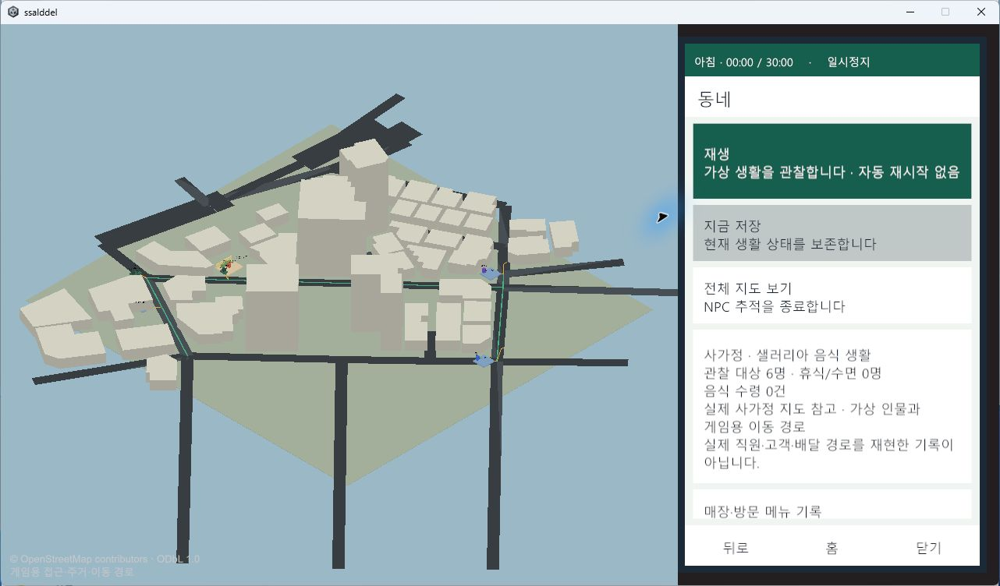
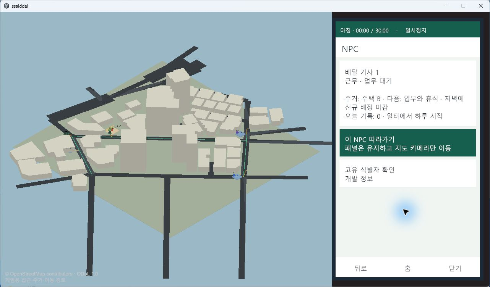
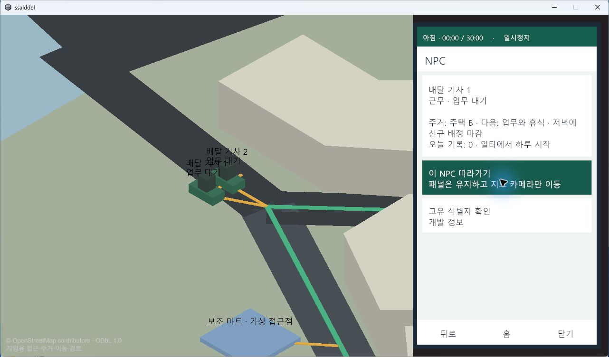
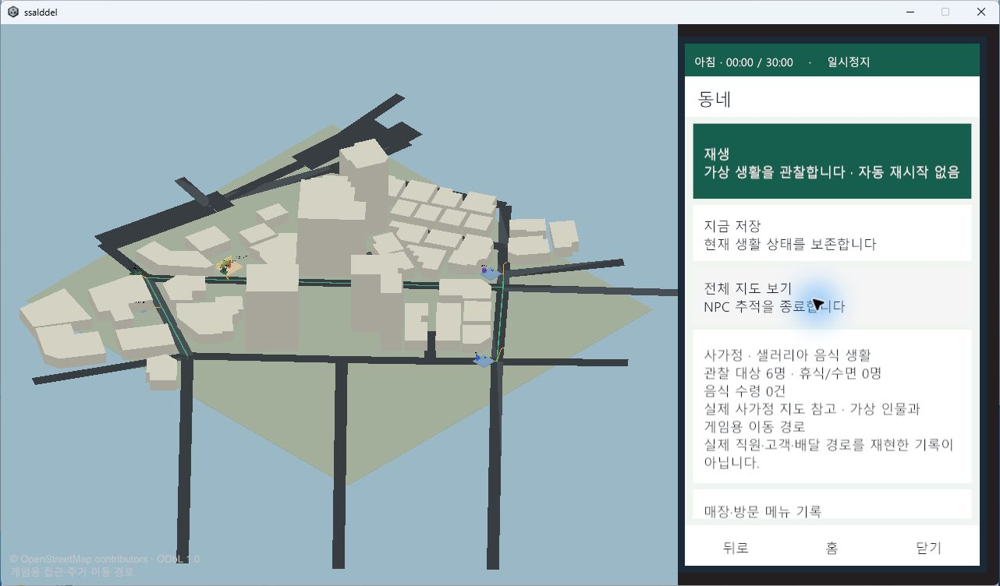

# 사가정 개인용 실행판의 기사 관찰·전체 지도 복귀 확인

2026-10-31. [개인용 Windows 우선 r123](../AI/Planning/시스템/PLAN-SYSTEM-REGIONAL-OPERATOR-SIMULATION/offline-personal-player-first.decision.r123.md)의 남은 카메라 확인을 진행했다. 전날의 재생·저장·재실행 결과는 [첫 실행판 기록](2026-10-29-sagajeong-personal-player-r123.md)을 따른다.

## 오늘 닫은 범위

배포248파일의 크기/SHA를 먼저 확인하고 같은 attempt16 비개발 Player를 재사용했다. 새 빌드·포장·설치를 만들지 않았다. 원래 사용자의 저장 파일2개를 별도 사본과 SHA로 보존하고, 이번 실행의 자식 환경에만 로컬 프로필과 새 확인용 저장 경로를 넣었다. 실제 사용자의19초 저장은 덮어쓰지 않았다. 연결된 Unity Editor가 없어 Pipeline Game View 대신 실제 Windows Player를 조작했으며 Scene·소스·자산·ProjectSettings를 수정하지 않았다.

실제 입력 순서는 `홈 → NPC → 목록 아래 배달 기사 1 → 이 NPC 따라가기 → 홈 → 동네 → 전체 지도 보기`다. NPC 상세 진입만으로 카메라가 이동하지 않았고, 명시적으로 따라가기를 눌렀을 때 가까운 시점으로 전환됐다. 홈/동네 메뉴 이동 중에는 추적 시점이 유지됐으며 전체 지도 보기를 눌렀을 때 비교 영역에서 초기 시점과 건물 표시 복원을 확인했다. 모든 단계는00:00 일시정지 상태다. 움직이는 기사 추적까지 통과한 것으로 확대하지 않는다.

### 비교 기준

### 기사 상세 진입 — 전체 지도 유지

### 명시적인 기사 따라가기

### 전체 지도 복귀

## 검증과 남은 문제

- 고정 비교 영역 `(8,40)-(800,735)`의550,440픽셀에서 상세 진입/전체 지도 복귀는 각각49픽셀만 달랐다. 차이는 마우스 강조가 보이는 오른쪽 가장자리의3픽셀 폭 영역에 한정됐다. 추적 시점은500,715픽셀이 달랐다. 전체 프레임이 완전히 같다는 주장과 구분한다.
- 확인용 저장 전후의 세션·Tick0·Revision0·ReplayHash·Snapshot·CommandLog가 모두 같았다. 원래 사용자 저장2개도 크기/SHA가 모두 같았다. 확인용 게임은 정상 종료됐고 실행 로그에서 Exception·level0 corrupt·out-of-bounds는 없었다.
- 기사들이 같은 시작 위치에 모여 이름표가 겹치는 문제가 실제 근접 화면에서 보였다. 다음 작은 시각 후보는 이 장면의 이름표 판독성이다. 이번에 고쳤다고 보고하지 않는다. 새 에셋 구매는 필요하지 않다.
- 원래 설치 파일과 안내는 보존하고 배포 폴더 밖의 `사용안내.txt`에 실제 확인한 메뉴 경로를 보완했다. 음향·움직이는 추적·30분 전체 진행·일반 설치/제거·상세 r53 디오라마 이식은 남는다. 초기 Unity 설정 원문의 정확 복구 한계도 기존 기록대로 유지한다.

근거는 `artifacts/local/sagajeong-personal-game-r123/daily-20261031-camera/`의 `launch.private.json`, `camera-qa-proof.private.json`, `camera-comparison-detail.private.json`, 별도 저장·Player 로그·원본 PNG에 있다. 첫 캡처 `overview-before.png`는 창을 앞으로 가져오기 전 다른 전경 화면을 담아 게임 근거와 문서 자산에서 제외했다. 실제 비교는 이후의 `overview-baseline.png`를 사용했다.

독립 읽기 검토에서도 이미지 차이·저장 불변과 프로세스 종료를 재확인했다. 문서 Fast8경로·공백 검사, 새 기록/기획의 로컬 링크13개와 역세권 증거 규칙 r5 검사를 통과했다. 문서 전용 Fast이므로 빌드·제품 시험을 실행한 것으로 합산하지 않는다. 검사 로그는 `artifacts/local/validation/20261031-090829/`에 있다.

기존 근거의 공간/표현·가상 인물/실제 업무 분리를 유지한다. 새 공간 자료·SourceReceipt는 없으며 기존 역세권 규칙의 반례/무효화를 만들지 않았다. 이름표 겹침은 이 실행의 표현 결손으로 기록하며 공통 공간 규칙으로 승격하지 않는다. **새 디오라마 규칙 후보 없음.** E/WI 승격·정본 적용·운영 DB·네트워크 허용·공개·commit/push는 수행하지 않았다.
