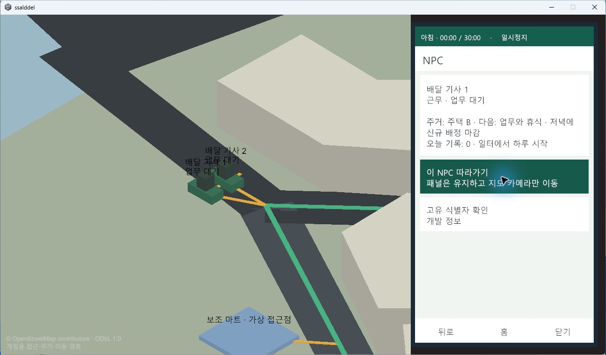
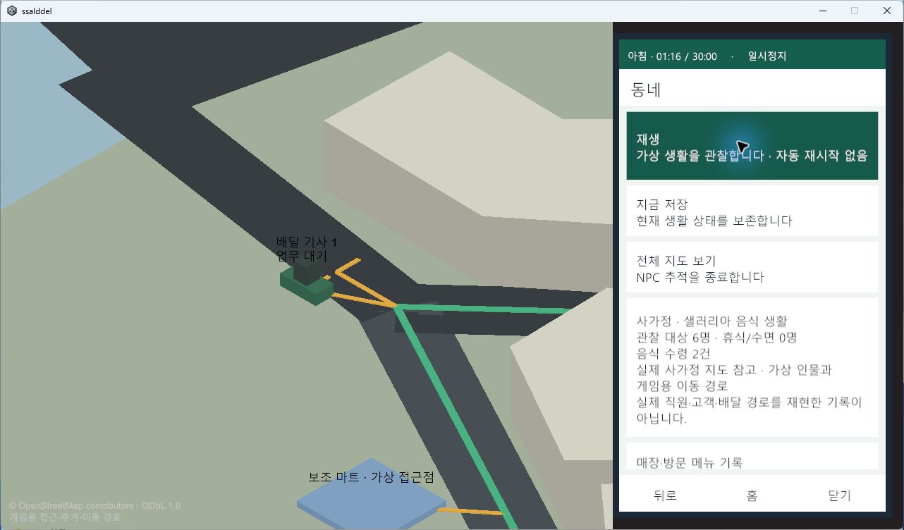

# 사가정 개인용 실행판 후속 재생과 종료 오류 확인

2026-11-01. [개인용 Windows 우선 r123](../AI/Planning/시스템/PLAN-SYSTEM-REGIONAL-OPERATOR-SIMULATION/offline-personal-player-first.decision.r123.md)의 기존 실행판을 재사용했다. 오늘은 시각 고도화 완료가 아니라 실제 재생 범위 확장과 새 종료 결손을 확인한 실행이다.

## 실제로 확인한 범위

- `verify-extract-02-retry1` 배포248파일의 크기/SHA를 대장과 대조했다. 새 빌드·설치·추출·MP4·대용량 프레임 사본을 만들지 않았다.
- 전날의00:00 확인용 저장을 새 독립 경로에 복사했다. 같은 세션으로 실제 재생/일시정지·지금 저장을 눌러 Tick76/Revision149까지 진행했다. 원래 사용자19초 저장과 백업2파일은 전후 크기/SHA가 같았다.
- 가상 주문a는 픽업8→전달22→수령23, b는 픽업40→전달54→수령55를 저장에서 확인했다. 실제 배달 기록이나 실제 기사 업무 완료가 아니다.
- 선택한 기사1은 이 구간에 업무 대기였다. 따라서 이번 화면의 유지로 움직이는 추적을 검증했다고 쓰지 않는다. 실제 주문 상태 이력에서 첫 담당은 기사3, 다음 담당은 기사2임을 확인했으며 다음 확인의 입력 선정에 사용한다.

위 두 장은 실제 Windows Player 캡처다. 이름표가 나중에 분리된 것은 다른 기사가 이동했기 때문이며 이름표 표현을 수정한 결과가 아니다. 같은 프로그램/시점 종류의 시간 비교로, 동일 상태의 개선 전후나 주행 카메라 검증과 구분한다.

## 실패와 안전한 마무리

첫 숨김 시작은 네이티브 창을 제공하지 않아 입력 확인에 사용할 수 없었다. 해당 소유 확인 프로세스만 정리하고 상호작용 확인에 필요한 창으로 다시 시작했다. 원래 사용자/공유 프로그램은 종료하지 않았다.

그다음 실제 입력으로76초까지 진행했으나 창의 닫기 버튼을 누른 뒤 `Input System ... Shutdown`에 이어 Mono `Native Crash Reporting / UNKNOWN`이 기록되고 게임과 자식 `UnityCrashHandler64`가 잔류했다. 관리 코드 stack은 비어 있어 원인을 특정할 수 없다. 이번 소유 PID57776과 그 자식 PID39624만 정리했으며, 추가 재실행은 중단했다. 앞선 정상 종료 결과를 지우거나 이번에도 정상 종료했다고 표시하지 않는다.

FMOD는 오디오 장치를 초기화하지 못해 무음 대체 출력으로 실행됐다고 기록했다. 시스템 오디오 설정·드라이버는 변경하지 않았고 게임 자체의 음향 결함으로 단정하지 않는다. 원인 진단·수정·움직이는 추적·음향·30분 전체 완주·일반 설치/제거는 남았다.

## 보존과 다음 작업

근거는 `artifacts/local/sagajeong-personal-game-r123/daily-20261101-moving-camera/`의 `daily-qa-proof.private.json`, 두 실행 로그, 시작/종료 실패 기록, 독립 저장과 원본 PNG다. 다음은 종료 경로를 로그·기존 소스와 대조하는 작은 진단이며, 촬영 재개 시 실제 배정 기사와 시각을 먼저 선택한다. 새 에셋은 필요하지 않다.

문서/이미지5경로의 Fast 검사·공백 검사, 새 기록의 로컬 링크3개 결손0·대표PNG2개 지문, 최종 Setup SHA 불변과 소유 확인 프로세스 잔류0을 확인했다. 역세권 증거 규칙 r5 검사도 통과했다. 검사 로그는 `artifacts/local/validation/20261101-090424/`, 개별 결과는 `verification.private.json`이다. 제품 코드 빌드/자동 시험·Unity Editor Play Mode·MP4 검증을 실행한 것으로 합산하지 않는다.

현재 사용자 방향은 영상 제작 우선·웹사이트 참고용 보존이다. 기존 일일 예약에 이 방향과 디스크 절약/종료 결손을 반영했으며 새 예약이나 사이트 개발·공개를 시작하지 않았다. 원본 영상·사용자 저장·Unity 소스/Scene/설정·운영 DB는 보존했고 commit/push는 하지 않았다.

새 공간 자료·SourceReceipt·규칙 지지/반례/무효화의 추가는 없다. 표현 가림과 가상 업무의 권위 분리는 기존 기준을 유지한다. **새 디오라마 규칙 후보 없음.** E/WI·공통 규칙·정본 적용을 승격하지 않았다.
