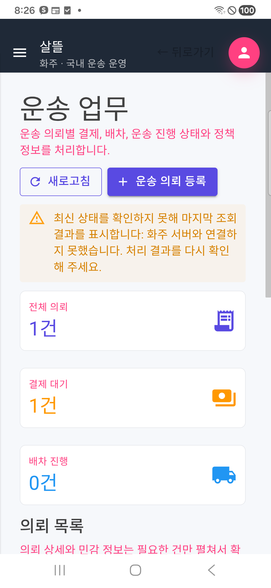
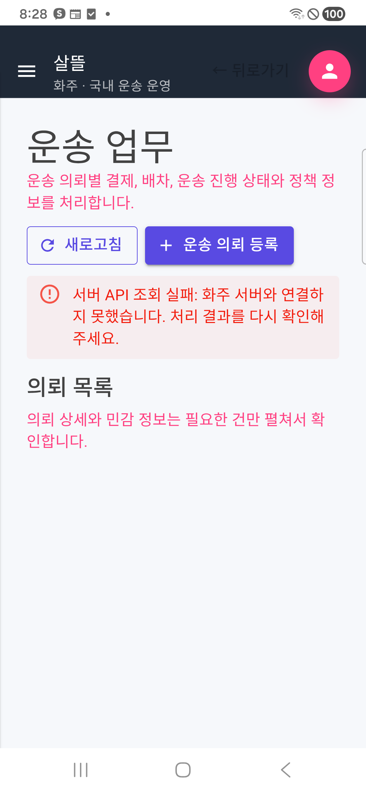
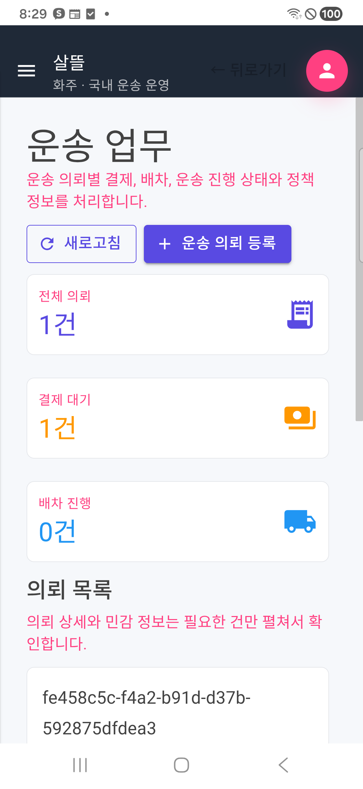

# 가상 데이터 기반 화주 통신·인증 복구 보완 r2

2026-11-03. [실제 휴대폰·서버 대조 r1](2026-11-03-physical-app-server-validation-r1.md)에서 이어지는 통신 보완 기록이다. 가상 응답 시험과 통합 빌드·회귀시험 뒤 수정 APK141을 실제 USB 휴대폰에 설치해 정상 조회·서버 중단·복귀를 확인했다. 새 외부 서버나 실제 주문·결제·배차를 만들지 않고 기존 전용 `Simulation` 실행의 합성 의뢰를 재사용한다.

## 보완한 통신 경계

- 개인·공개 운송 목록의 정상 JSON `[]`와 `null`·빈 본문·잘못된 JSON·null 항목을 구분한다. 응답을 확인하지 못한 경우 정상 빈 목록으로 바꾸지 않는다.
- 서버 오류 본문·HTML·요청경로·사용자 식별 쿼리를 화면 예외에 복사하지 않고, HTTP 상태별 고정 안내를 사용한다. 연결 실패와 응답 시간초과도 안전한 문구로 구분한다.
- 사용자가 취소한 요청은 취소 의미를 유지하고, 전송 예외의 기존 HTTP 상태를 보존한다. 제품 HttpClient의 기본 100초 설정은 변경하지 않는다.
- 등록 응답이 불명확해도 POST를 자동 재전송하지 않는다. 기존 요청 번호로 별도 GET을 수행해 정본을 확인하는 경계와 단건 null·복구 조회 404의 기존 의미를 유지한다.

대상은 [ServerBackedShipperOperationsService](../../SsalddelApp/Services/ServerBackedShipperOperationsService.cs)와 [가상 통신 시험](../../Ssalddel.Tests/Clients/화주서버통신Tests.cs)이다. 기존 화면 배치·업무 계약·후속 원장 처리 정책은 유지한다.

## 인증 상태와 부가 조회의 분리

[AuthApiService](../../SsalddelApp/Services/AuthApiService.cs)·[AuthSession](../../SsalddelApp/Services/AuthSession.cs)·[IAuthSession](../../SsalddelApp/Services/IAuthSession.cs)은 로그인/로그아웃 의도와 현재 세션 판본을 함께 검사한다. 취소·전송 실패 때 기존 인증을 지우지 않으며, 늦은 로그인이나 이전 로그아웃이 새 계정·보안 저장을 덮지 않는다. 기존 저장 판본과 저장 직렬화는 유지한다.

푸시·꾸미기 후속은 같은 계정 수명에서 실제로 끝내며, 취소 뒤 작업을 분리해 새 계정과 섞지 않는다. 주 인증과 보안 저장이 확정된 뒤 선택적 부가 조회가 내부 timeout·통신/JSON 오류로 실패한 경우는 로그인 성공과 분리한다. 사용자·새 의도의 취소와 주 보안 저장 실패까지 선택적 오류로 숨기지는 않는다. [전용 경합 시험](../../Ssalddel.Tests/Clients/ShipperAuthIntentRaceTests.cs).

## 가상 응답 시험과 실제 서버 조회

| 범위 | 현재 확인한 사실 |
| --- | --- |
| 가상 통신 시험 | 새30개 포함 관련98/98 통과. 오류 응답·HTML·문제 JSON·본문 읽기 실패·사용자 취소·100ms 실제 HttpClient timeout·불명 POST→GET·정상 빈 목록을 확인 |
| 가상 자료의 실제 제품 API·DB | 기존 의뢰 `fe458c5c-f4a2-b91d-d37b-592875dfdea3`/운송1, 같은 격리 DB에서17/17 재대조. 합성 로그인3회·업무/증거 GET7회 모두200 |
| 이전 근거와 보존 대조 | 의뢰·운송·DB와 DB/runtime proof 정규화 해시 동일. 업무 명령 재실행 없음 |
| 인증 경합 | 신규31개 포함80/80 통과. 늦은 로그인·로그아웃·저장과 새 계정의 경합, 취소, 무효 토큰, 부가 조회 timeout을 확인. 첫 시도75통과도 별도로 보존 |
| 최종 소스 통합 검증 | Fast `20261103-195554`: 관련402/402 통과, 앱 전체 대상 빌드 오류0/경고22. Task `20261103-200158`: 통합 솔루션 빌드 오류0/경고5, 전체16,860통과/실패0/환경17생략. Auth 최종4파일 SHA는 집중80시험 판본과 동일 |
| 실제 휴대폰 | APK141 설치 SHA·동일 서명·최초 설치 시각 유지·원앱230 메타데이터 불변 확인. 가상 로그인과 동일 의뢰1건 조회, 서버 중단 중 마지막 목록 유지·새 화면 최초 실패, 재로그인 없는 복귀·수동 새로고침 확인 |

가상 HttpMessageHandler와 테스트 전용 짧은 timeout은 제품 서버의 실제 장애나 휴대폰의 100초 timeout 실측이 아니다. API 재조회도 실제 금융·상하차·수령 완주가 아니라 같은 합성 의뢰의 읽기 대조다. 기사·관리자 대조는 PC API이며 다른 역할의 실제 휴대폰 완주로 확대하지 않는다.

## 실제 APK141의 실패·복귀 화면

검토용 패키지는 `com.companyname.ssalddelapp.closeoutreview`, 버전은 `0.1.141`이다. 새 입력3,273개 변경0, 두 ABI 내장 앱 DLL과 새 컴파일 DLL 일치, 기존 인증서 일치, 제작 오류0/기존 경고13을 확인했다. 설치 APK SHA는 `8b38dc97719628fa5d8a6cd48cf97b5c6301a022f3068fca85cff6d7cd4e6ea4`다. 삭제·데이터 초기화·권한 자동승인 없이 기존140을 업데이트했다.

같은 서버의 실제 중단에서 고정 연결 오류와 마지막 성공 의뢰1건이 함께 남았다. 스크롤 뒤 기존 의뢰 ID도 대조했다. 새 화면으로 다시 진입했을 때는 오류 안내만 표시하고0건/정상 빈 목록을 표시하지 않았다. 서버를 같은 DB로 재개하자 재로그인·복귀용 탭 없이 기존 주기 조회에서 같은 ID/1건으로 돌아왔고, 이후 명시 새로고침1회도 성공했다. 대기 중 홈의 기능 조회는 실패 안내와 보수적인 비활성 표시를 보였으며 이후 운송 화면 진입은 가능했다.

| 마지막 조회 결과를 유지한 실패 | 최초 조회 실패 | 서버 복귀 |
| --- | --- | --- |
|  |  |  |

관측 helper의 `zeroCountVisible`은 화면 어디든 `0건` 문자가 존재하는지를 뜻한다. 정상/목록 유지 화면의 `배차 진행0건`은 실제 부분 집계이며 전체 의뢰1건과 구분한다. 최초 실패 화면에서 모든0건/빈 안내가 없음을 따로 확인했다. 원시 UI 덤프·로그인 화면 캡처·비밀번호는 보관하지 않았다.

## 간헐적인 준비 상태 503

실행 중인 기존 서버에서 준비 상태503을 다시 관측했다. 같은 묶음의 공개 참여 조회·보호된 실행 증거 조회는200이고, 별도 연결의 SQL4개·Mongo ping도 성공했다. 503 응답은167ms/802ms로 관측돼 15초 제한 도달이나 지속적인 DB 중단으로 확정할 수 없다. 별도 프로브는 실행 중인 서버의 연결 풀과 같은 관측이 아니며 원인 해결로 표시하지 않는다.

검증 전용 진단 hook은 원래 파이프라인을 그대로 호출하고 요청 상태·시간만 관측한다. 프레임워크 메모리 시험10개에서 원래 응답·상태·캐시·상위 미들웨어·예외 전파·동시 요청 분리를 확인했다. 실제 새 호스트에서도 요청 journal8개가 기록됐지만 per-check 완료 이벤트는 수집되지 않았다. 제품의 Serilog 경로와 자체시험 LoggerFactory가 다르다는 단서가 있으며, `Checks=[]`만으로 health가 실행되지 않았다고 판단하지 않는다. 기존 준비 조건·응답·업무 정책을 바꾸거나503을200으로 치환하지 않았고, 원시 Description·본문·예외 Message·연결문자열을 보관하지 않는다.

서버 진단판의 깊은 격리 경로 빌드2회는 DLL 복사 MSB3030으로 실패했다. 실패 경로264자·Windows 긴 경로 미활성이라는 단서 뒤, 짧은 새 경로의 별도 직렬 빌드1회가 성공했다. 앞 두 실패·부분 출력은 보존했다. 짧은 빌드의 완전 출력453개를 새 `host/bin-final`에 복사해 파일별 SHA를 대조했고 선택 소스8,768개와 원래 host/bin·기록은 유지했다. `CodeMetadata`는 자체 고정 공용 출력 경로를 사용하므로 모든 빌드 출력이 새 경로에만 격리됐다고 표현하지 않는다. 긴 경로의 인과를 확정한 것은 아니다.

같은 실행 `integrated-r108:be09622360b74a42afb695cdbf27eeea`/DB로 실제 재개했다. 새 서버PID46968·실행기44360·5378이며, 실제 선택 DLL SHA는 `fda33ef0232e94107deaf0751c4ff06e0f966fb1f892d84354b2554e857b06de`다. 실제 ready8/8은200(85~161ms), control proof2개도200이고 runtime/cargo 정규화 SHA는 중단 전과 최초17검사 때와 동일했다. schema/seed marker·업무 저널·환경/계정 파일도 보존했다. Fresh/Prepare·새 초기화·업무 명령 재실행 없이 기존 실행을 재개한 것이다. 이번8회에서는503이 재현되지 않았고, 기존 간헐503 원인 해결이나 per-check 진단 완성으로 보고하지 않는다.

## 실행 제한과 보존

검증용 중계 프로그램 시작 명령은 자동 승인 검토에서 `blocked by policy`로 거부됐다. 실제 중계 프로세스·listener·휴대폰 연결 변경은0이며 다른 도구로 우회하지 않았다. 준비한 중계 helper의 포트 없는 자체검사25개는 실제 중계/기기 검증으로 계산하지 않는다. 검증은 가상 HTTP 시험과 기존 제품 API 직접 조회로 이어간다.

로컬 근거는 `artifacts/local/communication-verification-r2/76a596c3a81a4023bb0644b0867cb8e1/`의 `completion.json`에서 잇는다. `api-recheck.json`, `api-preservation-comparison.json`, `communication-client-tests-r1/result.json`, `auth-verification-result.json`, `revised/proof.json`, `device-install-revised141.json`, `native141-*.json`, `backend/phone141-controlled-restart-0ff3e0f14d7e4f87a1242d24bce47dc4/`에 실제 단계를 구분했다. `backend/findings.json`·freeze 등 이전 준비 스냅샷은 당시 상태로 보존한다. 기존242개 미커밋 항목의 시작 지문과 관련 없는 변경을 보존하고 stage하지 않는다. 비밀 설정·실제 고객 정보·원시 UI를 문서에 복사하지 않는다. commit/push·클라우드 배포·원격 Operational 검증은 실행하지 않는다.
