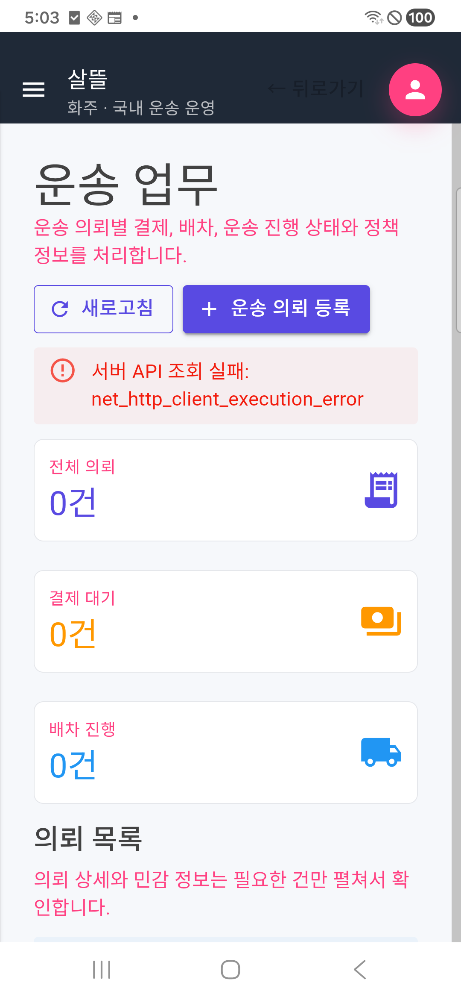
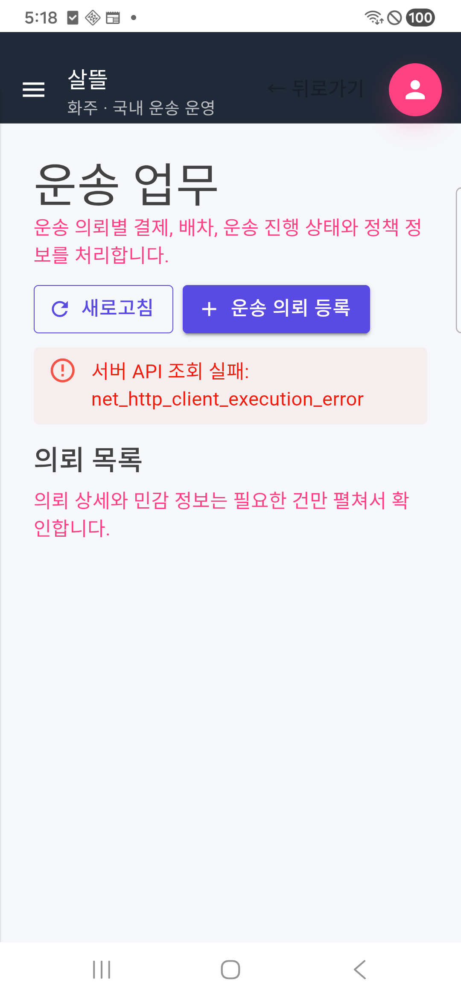
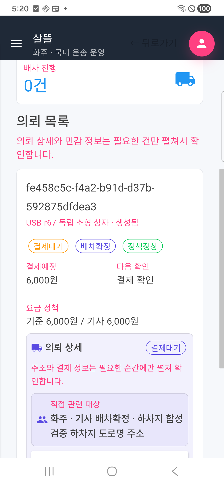

# 실제 휴대폰·제품 API·격리 DB 대조와 화주 목록 오류 보완 r1

2026-11-03. 기존 통합앱의 화주 운송 목록을 실제 USB 휴대폰에서 확인하고, 같은 의뢰를 제품 API와 전용 DB에서 대조했다. 서버 중단 때 조회 실패와 빈 목록을 함께 표시하는 문제를 재현하여 기존 페이지의 조회 상태만 보완했다. 수정 APK140에서도 같은 장애 조건을 재현하고 정상 복귀를 확인했다.

| 항목 | 기록 |
| --- | --- |
| 커밋 | 신규 commit/push 없음. 기존 미커밋 변경이 있는 작업 트리에서 대상 페이지만 추가 수정 |
| 변경 축 | 같은 의뢰의 앱·API·DB 식별 대조, 초기 조회·실패·정상 빈 응답의 표시 구분 |
| 화면 변경 | 기존 `/shipper/transport`의 진행 표시·빈 목록 조건·새로고침 비활성 조건 보완. 기존 정보 배치와 상세 진입 유지 |
| 기준 앱 | 물리폰에 설치한 검토용 APK139. 합성 화주 로그인과 해당 의뢰의 목록·역할 지도·타임라인 조회 확인 |
| 수정 앱 | 검토용 APK140 설치본 SHA 일치. 로그인 재입력 없이 같은 계정의 업무 진입, 첫 조회 실패의 빈 안내·0건 제거, 같은 의뢰 복귀 확인 |
| 시각 증거 | 아래 전후 오류·복귀 PNG는 실제 휴대폰의 합성 업무 화면. 정적 시안이나 원격 운영 화면이 아님 |
| 실행 경계 | 제품 Controller/UseCase와 실제 격리 MySQL/MongoDB를 사용하는 로컬 `Simulation`. 합성 계정·업무·위치 입력이며 외부 효과 OFF |

## 같은 의뢰의 확인 범위

| 결속 항목 | 값·결과 |
| --- | --- |
| 실행 | `integrated-r108:be09622360b74a42afb695cdbf27eeea` |
| 격리 DB | `r108m_be09622360b74a42afb695cdbf27eeea` |
| 의뢰 / 운송 | `fe458c5c-f4a2-b91d-d37b-592875dfdea3` / `1` |
| 준비 상태 | 기존 `quick --case cargo-phone-quick-02 --pause-after-accept` 1회. 수락 성공 응답을 의도적으로 버린 뒤 정본 GET으로 같은 운송 확인 |
| 독립 재조회 | PC에서 화주 목록·상세, 기사 현재 운송·상세, 운영자 화물 목록, DB proof·runtime proof GET 7회 모두 HTTP200. 합성 계정 로그인 POST 3회도 HTTP200 |
| 검사 | API·DB 재대조 17/17. 화주 목록의 의뢰 1건·상세 ID, 기사/운영자 운송 ID·운송번호, 실행 ID·DB 일치 |
| 운송 상태 | 기사 현재·상세, 운영자, DB 모두 `확정`. 상차 출발·도착 기록과 후속 단계 명령 없음 |
| 수락 근거 | 보존된 성공 수락 POST 1회와 DB 수락 후속 marker 1개(`Done`). 전체 사건 이력의 전수 감사나 실제 휴대폰 수락 시험은 아님 |
| 금융 | 결제·지급요청·지급 Outbox 각 0건. `결제대기 / 후불승인완료`를 실제 수납·지급 완료와 구분 |

이 재조회는 기존 업무 명령을 다시 보내지 않았다. 로그인 외 POST, Outbox 처리, 운송 단계 변경을 실행하지 않았으며 기존 명령 시도 기록을 유지했다. DB proof의 SHA-256은 `4152d4d26ff6c64a221fac894baa658f485c82bb0521b86e3b2f53620662e283`이다. 원시 본문 대신 메모리에서 읽은 JSON을 정렬·정규화한 값의 해시이며, 원시 응답 파일의 해시로 해석하지 않는다.

물리폰에서는 APK139로 합성 화주에 로그인하고 같은 의뢰의 운송 목록, 역할 지도, 운송 타임라인을 확인했다. 기사·운영자의 동일 의뢰 대조는 위 PC API/DB 결과이며 이번 휴대폰 역할별 완주로 확대하지 않는다.

## 실제 장애 재현과 수정

| APK139 관측 | 확인 결과 |
| --- | --- |
| `baseline139-normal.json` / PNG | 같은 의뢰 표시, 빈 목록·오류 없음 |
| `baseline139-first-failure.json` / PNG | USB reverse 경로만 조정한 첫 시도. 같은 의뢰가 정상 표시되었고 오류가 없어 **장애 재현이 아니다**. 파일명의 `failure`를 재현 성공으로 해석하지 않음 |
| `baseline139-server-stopped.json` / PNG | 실제 로컬 서버 중단 뒤 오류·0건 표시·빈 목록 안내가 함께 나타남. 같은 의뢰는 표시되지 않음. 이 관측을 실제 결함 재현으로 사용 |

정상 화면에도 일부 집계의 `0건`은 나타날 수 있다. 0건 텍스트 검출만으로 실패를 판정하지 않고 실제 오류·빈 안내·동일 의뢰 표시와 함께 대조했다.

수정 대상은 [TransportWorkspace.razor](../../SsalddelApp/Components/Pages/TransportWorkspace.razor) 한 파일이다. 조회 중에는 기존 진행 표시를 사용하고 새로고침 버튼을 비활성화한다. 집계는 성공한 조회 이후에만 표시하고, 빈 안내는 조회 성공·로딩 종료·오류 없음·실제 빈 목록을 모두 만족할 때 표시한다. 재조회 실패 시 마지막 성공 목록은 보존한다.

기존 [ShipperQueryLifetime](../../SsalddelApp/ViewModels/Shipper/ShipperQueryLifetime.cs)의 최신 조회·로그인 수명·이탈 보호를 유지한다. 최신 완료 콜백에서만 진행 표시를 끝내며 로그아웃·세션 무효화 때 목록과 표시 상태를 함께 지운다. API·DB 계약, 명령, 주기 조회 정책은 바꾸지 않았다. 페이지 책임은 기존 [화주 운송 업무 문서](../ProjectOverview/page-docs/SsalddelApp/SsalddelApp-P09/README.md)를 따른다.

## 수정본의 실제 화면

| APK139 조회 실패 | APK140 같은 조회 실패 |
| --- | --- |
|  |  |

기존 30초 보완 조회로 서버 재개 뒤 같은 의뢰가 돌아왔으며, 그 뒤 실제 새로고침 버튼을 한 번 눌러 오류 없이 같은 식별자가 유지되는 것도 확인했다. 최종 목록 카드의 `결제대기·배차확정·정책정상`은 실제 결제나 상차 완료를 뜻하지 않는다.

APK140 SHA-256은 `718a08f5a1fd53a343133a46877f4ac311dd7fd7d4680cf9e25efa8c27412130`이다. 기존139와 같은 서명이며 두 ABI의 내장 앱 DLL·고정 endpoint5378을 대조했다. `install -r`을 사용했고 삭제·데이터 초기화·권한 일괄 부여 없이 설치했다. 원래 일반앱230의 설치 메타데이터는 전후 동일하지만 모든 앱 저장 바이트의 불변을 증명한 것은 아니다.

사용자가 직접 닫아도 된다고 지시한 재난·안전 알림2개만 현재 확인 버튼으로 닫았다. 등록 USB 기기와 공유 OS 잠금을 매 조작에서 대조했고 보안 잠금·화면 유지 설정·실제 배달앱의 운행/배차 상태는 변경하지 않았다.

## 검증 상태와 남은 확인

| 항목 | 작성 시점 상태 |
| --- | --- |
| Fast | `20261103-165954`, 소비 앱 빌드 오류0/경고20, 관련 시험 18/18 통과 |
| Task | `20261103-170503`: 통합 `Ssalddel.v0.0.slnx` 빌드 오류0/경고5. 전체16,798통과·1취소실패·환경17건너뜀 |
| 실패 시험의 단독 재검증 | 같은 성공 DLL, 빌드·코드·시간제한 변경 없이 정확한 실패 FQN 1개를 1회 실행해 1/1 통과(3.44초). 최초 Task 실패는 보존 |
| APK140 | 제작 오류0/기존 경고13, 관측 입력3,272개 drift0. 설치139→140·첫 설치시각 유지·설치 APK SHA 일치. 실제 실패에서 오류=true/빈 안내=false/0건=false 확인 |
| 서버 중단·복귀 | 139/140 비교의 제어된 중단·같은 실행 재개 각1회(총2회). 새 DB·migration·seed 없이 proof·업무저널·schema/seed marker·기존 manifest 불변 |
| 재개 뒤 readiness | 최종 ready/runtime/cargo GET200. 앞서 여러 차례503도 관측했으며 원인은 미확정. 현재200을 원인 해결 증거로 쓰지 않음 |
| 원격 운영 서버 | 현재 연결할 공개 제품 API 주소는 미확인. 이 로컬 검증은 원격 `Operational` 배포 증거가 아님 |

로컬 근거 루트는 `artifacts/local/physical-app-refactor/70d2e587ea544fc38f56c0246ac9c8df/`이며 `api-recheck.json`, APK139 관측 JSON/PNG, `resume.json`을 보존한다. 서버 근거는 `artifacts/local/integrated-workflow-r108/be09622360b74a42afb695cdbf27eeea/`, 검증 근거는 `artifacts/local/validation/20261103-165954/`와 `20261103-170503/`에 둔다. Git 제외 로컬 경로이므로 배포 문서에서 열리는 링크나 공개 이미지로 연결하지 않는다.

계정·토큰·상세주소·연락처·원시 UI는 문서에 포함하지 않는다. 실제 경로/GPS·카메라·알림/청취·실결제/송금·외부 공개·클라우드 배포는 이번 검증 범위가 아니다. 기존 앱 데이터 삭제·로그아웃을 통한 초기화·commit/push의 완료로도 확대하지 않는다.

전체 시험의 취소는 `CargoDispatchExplanationR24Tests`의 독립 loopback HTTP 요청에서 발생했다. 이 호스트는 공통20초/개별15초 제한과 별도 InMemory DB를 쓰며 R108 서버와 다르다. 단독 통과는 전체 Task를 통과로 바꾸거나 동시 대형 빌드를 원인으로 확정한 근거가 아니다. 첫 실패·단독 TRX를 모두 보존한다. 시작 홈의 공개 참여 현황 조회 실패와 미설정 지도 안내도 관측했으며 이번 운송 목록 수정으로 해소했다고 보고하지 않는다. 로딩 중 버튼/진행 표시와 성공한 빈 응답 조건은 코드·소비 빌드에서 확인했지만 실제 휴대폰의 모든 지연/빈 응답·로그아웃·다른 역할 완주는 아직 별도다.

최종 소유 검증 서버25444/실행기38784와 USB `tcp:5378` 연결은 후속 휴대폰 확인을 위해 실행 상태로 남겼다. 후속 진입점은 로컬 `completion.json`이며 이전 `resume.json`의 대기 상태·503·알림 미처리는 당시 기록으로 보존한다. 새 배포·운영 설정 변경·commit/push는 수행하지 않았다.
