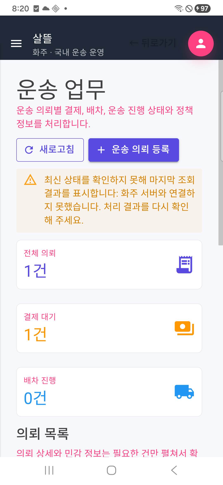
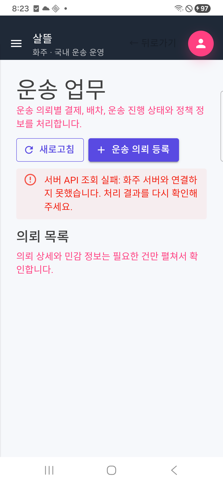
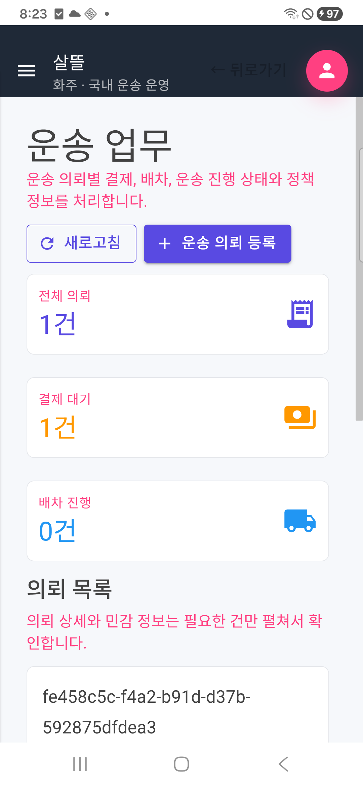

# 실제 휴대폰 검증에 따른 인증·통신 안정화

2026-11-04. 새 기능보다 기존 기능의 정상 사용과 오류 뒤 복구를 우선한다. 이번에는 기존 화주 인증·조회 흐름을 수정하고 실제 등록 휴대폰에서 확인했다. 업무 계약·권한·화면 구성은 유지했다. 검증 대상은 로컬 `Simulation` 서버와 기존 격리 MySQL/MongoDB, 합성 계정·의뢰다. 원격 운영 배포나 실제 결제·정산·배차 처리는 포함하지 않는다.

## 수정한 동작

- `AuthApiService`와 `AuthSession`: 갱신 HTTP 200이라도 빈 토큰, 만료·만료 임박 토큰, 사용자 불일치, null 역할은 저장하지 않는다. 기존 로그인과 같은 `ClientSessionGuard` 기준을 사용하며 잘못된 응답은 기존 세션·저장·판본을 보존한다.
- 갱신 전송·JSON·내부 시간 초과는 고정 안내로 바꾸고 호출자 취소와 구분한다. 갱신을 메모리에 확정한 뒤에는 최신 저장 판본의 저장을 마치고 호출자 취소를 알린다. 저장 대기 중 새 로그인·로그아웃을 덮어쓰지 않으며, 취소 뒤 부가 Push 등록을 시작하지 않는다.
- 주 보안 저장 실패는 인증 계층에서 전파한다. 화주 업무 조회 경계에서는 내부 저장소 예외 원문 없이 안내하고 업무 GET을 보내지 않는다.
- 서버 `인증UseCase`는 두 refresh 필드의 `IdentityResult`를 확인한다. 하나라도 실패하면 안전한 500 실패를 반환하고 성공 토큰·로그인 성공 기록을 만들지 않는다. 두 번째 필드 실패 시 첫 hash의 부분 저장은 남을 수 있다. 원자적 저장·롤백·기존 refresh 보존을 보장한 수정은 아니다.

수정은 제품 4개 파일과 시험 4개 파일에 한정했다. 새 자동 재시도나 업무 명령은 추가하지 않았다.

## 코드·빌드 검증

| 검사 | 실제 결과 |
| --- | --- |
| 최종 Fast | 관련 122/122 통과, 실패 0. 시험·서버·앱 빌드 통과 |
| Task | `Ssalddel.v0.0.slnx` 빌드 오류 0·기존 경고 5, 전체 16,899 통과·환경 17 생략·실패 0 |
| 추가 회귀 | 잘못된 갱신·안전 안내·취소/저장 경합·서버 저장 실패 등 39사례 |
| APK142 | 서명·정렬·두 ABI의 내장 앱 DLL과 고정 5378 주소 확인. 선택 입력 3,273개 전후 변경 0 |
| 현재 서버 실행본 | 선택 입력 8,771개 전후 변경 0, 전체 출력 453개 복사/SHA 일치 |

첫 Fast는 새 시험의 `Options` 이름 충돌로 컴파일에 실패했다. 이름을 완전 수식한 뒤 Fast 114/114가 통과했고, 추가 경계 보완 뒤 최종 122/122를 확인했다. 실패 로그·이전 판본은 보존했다. APK와 별도 서버 빌드는 직렬로 실행했다. `CodeMetadata`는 기존 공용 출력 경로를 사용하므로 모든 출력이 격리됐다고 주장하지 않는다.

실제 설치 APK SHA는 `0f956f14960b65b9c928c02e4bd7e4be88223db04fff8b7e86b6e55f0b6237dc`다. 보관 파일과 기기 설치 바이트가 일치하며 141→142는 같은 서명·최초 설치 시각을 유지했다. 원래 앱230의 설치 메타데이터를 보존했고 제거·데이터 초기화·권한 자동 승인은 하지 않았다.

## 실제 휴대폰과 같은 업무 검증

등록 기기 일치와 공용 OS UI 잠금을 확인했다. 사용자가 일반 화면 잠금 해제를 요청해 Android의 표준 해제만 사용했다. 당시 `secure=false`였고 PIN·지문·보안 설정은 건드리지 않았다. 원시 UI·로그인 화면·비밀번호는 저장하지 않았다.

| 실제 흐름 | 결과 |
| --- | --- |
| 기존141 | 만료된 인증 갱신의 연결 실패가 `Connection refused`와 내부 주소로 화면에 노출되는 것을 관찰 |
| 새142 로그인·이동 | 기존 합성 계정으로 로그인, 의뢰 시작·화주 홈·운송 업무와 상세 내용 조회 |
| 정상 조회 | 같은 합성 의뢰 1건·동일 ID와 기존 상태 표시 |
| 서버 중단 중 새로고침 | 마지막 성공 목록 1건 유지, 안전한 연결 안내 표시 |
| 서버 중단 중 새 화면 진입 | 조회 실패만 표시하고 전체 0건·정상 빈 목록으로 표시하지 않음 |
| 같은 서버/DB 재개 | 재로그인 없이 새로고침으로 같은 의뢰 1건 복구 |
| Android 홈으로 이동 후 복귀 | 관찰한 기본 런처에서 같은 검증 앱으로 복귀, 같은 의뢰·인증 상태 유지 |

USB reverse만 잠시 제거한 첫 시도에서는 실제 오류가 나타나지 않아 연결 실패 검증으로 계산하지 않았다. 이후 소유를 확인한 로컬 검증 서버 프로세스를 중단해 위 실패·복구를 검증했다. 홈 전환 직후의 첫 관찰은 포커스 미확정으로 중단했고, 새로 기본 런처를 확인한 뒤 복귀했다. 강제 종료·데이터 삭제는 하지 않았다. 만료 시각 강제 변경, 모든 취소 경합, 100초 기본 HTTP 제한의 실제 기기 완주는 하지 않았다. 해당 오류·경합의 코드 시험과 기기 관찰을 구분한다.

| 연결 실패 중 목록 유지 | 최초 조회 실패 | 같은 의뢰 복구 |
| --- | --- | --- |
|  |  |  |

같은 `integrated-r108:be09622360b74a42afb695cdbf27eeea` 실행과 기존 DB를 사용했다. 화주·기사·운영자 API와 격리 DB의 17검사는 수정 서버에서 모두 통과했다. 재시작 뒤 control proof 두 개의 정규화 SHA도 전과 같다. 업무 명령 키·단일 수락·후속 marker·금융 행 0을 유지했다. 합성 계정 로그인과 조회 관측은 추가됐으며 원래 업무 journal의 바이트 전체가 불변이라는 뜻은 아니다.

## 남은 검증과 환경 구분

컴퓨터 종료 뒤 MySQL만 재개한 첫 서버 시작은 gateway·Mongo 정지로 DB 연결을 못해 `RetryLimitExceededException`으로 종료했다. 기존 세 컨테이너를 자료 초기화 없이 재개한 뒤 홈 조회와 ready 8/8은 200이었다. 이는 기존 환경 기동 실패의 복구다.

별도로, 수정 서버의 복구 뒤 ready 503이 한 번 더 관측됐다. 다음 live/ready와 control GET은 모두 200이고 업무 API·휴대폰은 복귀했지만, 간헐 503의 실패 check 원인은 미확정이다. Critical/Fatal 로그 설정과 기존 진단 기록 한도로 실패별 check 근거가 없어 해결로 표시하지 않는다. 첫 503과 후속 성공 기록을 모두 보존했다.

검토 패키지의 지도 연결 설정 안내를 관찰했다. 실제 지도 표시·GPS·Push 수신, 다른 역할의 전체 휴대폰 업무 완주, 원격 Operational 서버, 실제 금융·외부 효과는 별도다. 이전에 정책상 거부된 중계 프로그램을 다시 실행하거나 우회하지 않았다. 새 기능, 휴대폰 배달 내역 수집, 영상 작업, commit/push는 하지 않았다.

로컬 상세 근거는 `artifacts/local/app-stability-r3/980f441b46854f85adfaf43fc585e773/completion.json`에서 연결한다. 자동 검사 원본은 `artifacts/local/validation/20261104-080529`와 `20261104-081310`이다. 기존 미커밋 변경 254개를 대조했으며 이번 대상과 문서 갱신 외 변경은 보존했다.
