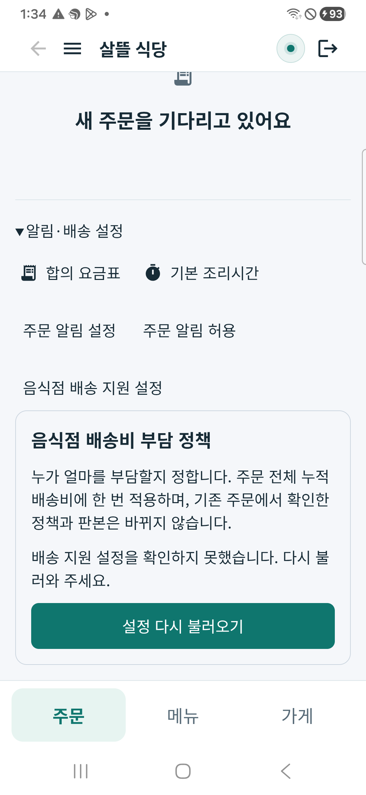
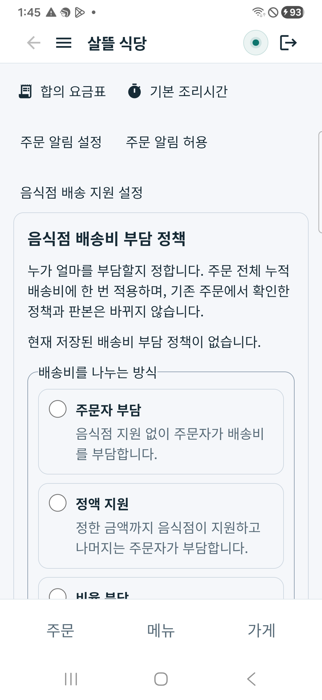

# 음식점 배송 지원 설정의 운영 API 연결 보완

2026-11-05 r23. 사용자가 배민커넥트를 뒤로 두고 실제 휴대폰 검증을 진행하도록 허용했다. 기존 음식점 검토 앱을 같은 서명·패키지의139로 데이터 보존 업데이트한 뒤 합성 음식점 계정으로 로그인했다. 수신함은 정상 조회됐지만 배송 지원 설정의 첫 조회는 오류로 표시됐다. 같은 합성 계정의 PC 제품 API 조회는200이었다.

## 원인과 최소 보완

음식점 앱은 인증용 `AddHttpClient`를 먼저 등록한다. 이후 공통 운영 API 등록은 기존 기본 HttpClient를 보존한다. 실제 등록 순서를 재현한 호스트에서 기본 client의 BaseAddress가 null이고, 설정의 상대 경로 GET이 실제 처리기에 도달하지 못하는 것을 확인했다. 로그인·수신함은 별도 구성된 named/typed client를 사용한다. 공통 기본 등록의 보존 계약은 변경하지 않는다. 공용 JsonApi가 자동으로 named client를 사용한다고 가정하지 않으며 다른 소비자로 일괄 확대하지 않는다.

[수신함](../../RestaurantDeskApp/Components/Pages/OrderInbox.razor)이 `IHttpClientFactory`를 전달하고 [설정 Session](../../RestaurantDeskApp/Services/음식점배송지원설정Session.cs)은 기존 `OperationalApi` 이름으로 구성된 client를 명시적으로 선택한다. 기존 HttpClient 생성자는 호환을 위해 유지한다. 사용자·로그인 세대·음식점/endpoint 문맥, 고정 요청 토큰·늦은401 격리, 기존 정책/금액·route·서버/DB는 유지한다.

## 이번 판본의 검증

- 설치139: 서명/정렬/두 ABI의 실제 내장 DLL/5378 endpoint·3,397입력 전후 SHA 일치를 확인했다. 실제 기기 로그인·수신함·설정 첫 실패를 보존했다. 원앱178과 검토 앱의 최초 설치일·수집 checkpoint를 유지했다.
- 실제 DI 순서를 사용하는 회귀2개를 추가하고 기존18사례를 보존했다. 실제 OrderInbox/Panel/VM 호스트는 기존/수정 각각1경로·8확인으로 실패→정상 조회를 대조했다. 합성 처리기이며 실제 기기 결과와 수를 합산하지 않는다.
- 관련 Fast63/63·필수 Task16,977통과/17생략/실패0이다. 음식점 Android/Windows·시험·v3.5 통합 빌드 오류0이며 경고20/229/60은 각 로그에 남겼다. 실제 호스트의9경고는 기존 공통2와 renderer helper7이다.
- 수정 APK140의3,397입력 전후 SHA·서명/정렬·두 ABI 내장 DLL/endpoint를 확인하고 같은 기기에 업데이트했다. APK SHA는 `4231684815b4a1258277250320e4d9c58ef0015fecdc5fde7149ac26821ad237`이다.139/140 포장 빌드는 각각 오류행0/기존 경고행22였다.
- 실제140에서 로그인 유지·정상 설정 조회·닫기/재열기·원래 수신함 복귀를 확인했다. 시험용 USB5378 연결만 잠시 제거해 실제 조회 실패와 이전 표시 보존을 관측하고, 같은 연결 복원 뒤 기존 버튼의 명시 재조회로 재로그인 없이 회복했다. 정책 radio/checkbox 선택0·저장 PUT0이며 서버·DB는 중지/초기화하지 않았다.
- 실제 서버의 합성 식당101/판본0/비활성 응답이 전후 같고 마감6/6 GET200·이전 업무 proof2개·금융 행0을 확인했다. 기존 원앱178·검토 앱 최초 설치일·paused 수집 checkpoint를 보존했고 배민은 강제 종료하지 않았다.
- `artifacts/local/physical-e2e-r23/5316a8670a4e4941a2f8b11cff92e52c/completion.json`이139 실패·소스/회귀·실제140 화면·설치·현재 서버와 마지막 성공/미완료를 소유한다.140 포장 출력은 같은 계보의 `773e9f6cc36a4142b7ae473e866dd78c`에 있다. 초기 설치 기록 스크립트의 기기 접근 전 날짜 별칭 오류와 준비 해시의 LF/파일 바이트 구분도 보존해 최종 근거와 분리했다.

### 실제 휴대폰의 전후

두 화면은 소유된 합성 시험 자료이며 실제 고객 주문이 아니다.

이번 검증에서 정책 선택/저장 PUT·기능 활성화·실제 주문 처리/금융·배포·commit/push는 하지 않았다. 읽기/닫기·재열기/연결 복구의 이번 범위 성공이며 응답 유실 뒤 미확정 PUT의 실제 복구, 다른 역할 화면·원격 운영·앱 전체 출시 검증은 별도다. 간헐 ready503 중 과거 원인 미확정 항목을 이번200으로 해결 처리하지 않는다. 다음 독립 기기 대상은 관리자 주문 상세의 요약/펼침·목록 복귀다.
