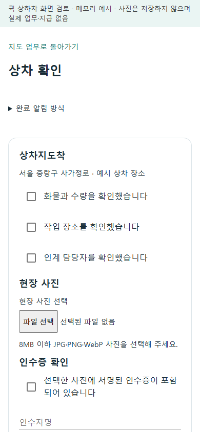

# 화물기사 상·하차 현장 사진 선택

좁은 화면에서 현장 사진 입력 줄은 44px였지만 브라우저의 **파일 선택** 버튼은 높이 24px로 표시됐다. 320px에서는 사진 입력의 기본 너비가 카드 폭을 키워 가로로 1px 넘쳤다. [이전 상차 화면](../assets/changes/2026-10-18-quick-driver-r110/04-pickup-photo-required.jpg)

[공용 상·하차 화면 스타일](../../Ssalddel.Ui.Common/Areas/App/RoleWorkspace/Cargo/CargoTransportActionScreen.razor.css)에서 600px 이하의 파일 선택 버튼 높이를 최소 44px로 맞추고, 사진 입력 너비를 카드에 맞췄다. 320px·390px에서 상·하차 두 화면의 버튼이 44px이고 가로 넘침이 없었다. 601px·1280px의 기본 버튼 높이는 24px였다.

2026-11-07 · 390px 로컬 Chrome · 가상 운송의 상차 확인. **파일 선택**으로 사진을 고르고 같은 화면에서 파일명을 확인합니다.

320px 터치와 390px Tab·Enter로 브라우저 선택기를 열어 메모리의 가상 PNG를 지정했다. 파일명 표시, 지원하지 않는 파일의 오류, 사진 없이 저장 차단, 완료 단계의 사진 입력 부재를 대조했다. 사진을 골랐을 때 업로드와 완료 요청은 0건이었다. 변경 전 브라우저 검사 90개, 수정 후 102개가 통과했다.

Fast 관련 시험 25개와 통합 3.5 Task 시험 17,054개가 통과했고, 환경 조건이 필요한 시험 17개를 건너뛰었다. Fast 빌드 경고는 0개, 통합 앱과 웹을 포함한 Task 빌드 경고는 63개였고 오류는 각각 0개였다.

브라우저에서 실제 공용 화면과 메모리 가상 운송을 연결했다. 실기기 카메라·제품 서버·증빙 저장은 미검증이다. 전후 캡처와 측정값은 `artifacts/local/mirror-ui-assist/20261107T021606128Z-cargo-pickup-photo-selector/validation.json`에 연결했다.
