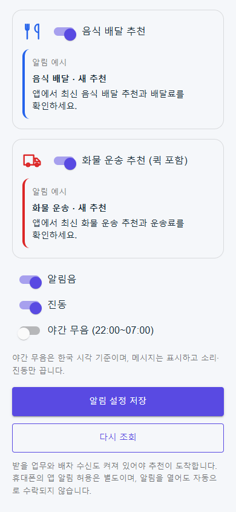

# 기사 추천 알림 예시의 본문 줄바꿈

공용 [추천 알림 설정 폼](../../Ssalddel.Ui.Common/Areas/App/RoleWorkspace/DriverNotifications/DriverRecommendationSettingsForm.razor)의 390px 가상 화면에서 음식과 화물 예시 모두 ‘확인하세요’가 단어 중간에서 갈라졌다. 320px와 두 열이 시작되는 601px에서는 ‘배달료를’과 ‘운송료를’이 갈라졌다. [이전 가상 예시 화면](../assets/changes/2026-10-23-driver-recommendation-alerts-r1/mobile-390.png)

예시 본문은 단어 단위로 줄을 바꾼다. 가상 설정으로 확인한 320px·390px·601px에서 단어 중간 끊김은 0건이었고 1280px의 각 본문은 한 줄로 표시됐다. 별도의 긴 비공백 문자열 시험에서는 칸보다 긴 내용이 영역 안에서 줄바꿈됐다.

2026-11-07 · 390px 격리 Chrome · 음식과 화물 추천을 켠 가상 기사 설정. 두 스위치 아래 알림 예시를 읽고 **다시 조회**로 같은 계정의 설정을 불러온다.

수정 전 브라우저 검사 37개, 수정 후 41개가 통과했다. 키보드 초점과 스페이스 키 조작, 재조회로 가상 설정 값 복원, 조회 오류의 다시 조회를 확인했다. 브라우저는 실제 공용 Razor 폼과 가상 읽기 응답을 사용했다.

공용 UI Fast 관련 시험 44개와 화물기사 앱·웹·통합 앱을 포함한 3.5 Task 시험 17,051개가 통과했다. 별도 환경이 필요한 17개는 생략했다. Fast 빌드 경고는 2개, 통합 빌드 경고는 63개였고 두 빌드 모두 오류는 0개였다.

제품 서버·DB, 실제 저장·알림 전송과 기기는 미검증이다. 전후 화면과 시험 근거는 artifacts/local/mirror-ui-assist/20261106T204600799Z-driver-alert-example-wrap/validation.json에 연결했다.
