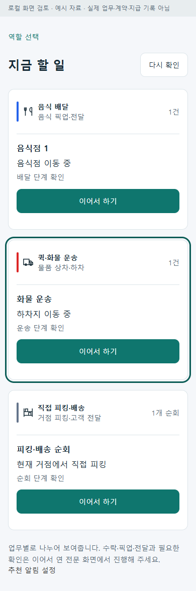

# 통합 기사 현재 업무의 오류 카드에서 다시 확인

**지금 할 일**에서 화물 조회만 실패했을 때, 320px·390px에서 화물 오류 카드로 내리면 상단 **다시 확인**이 화면 밖에 있었다. 같은 가상 음식 배달·화물 운송·직접 피킹 업무로 [이전 부분 오류 화면](../assets/changes/2026-10-23-integrated-driver-work-r1/02-partial-error.png)의 상황을 재현했다.

[현재 업무 화면](../../Ssalddel.Ui.Common/Areas/App/RoleWorkspace/DriverCurrentWork/DriverCurrentWorkScreen.razor)의 첫 조회 오류 카드에 **전체 업무 다시 확인**을 표시한다. 320px·390px에서는 오류 카드와 버튼이 함께 보이고, 재조회하면 세 업무의 기존 읽기 경로를 한 번씩 호출한다. 390px에서 Enter로 실행한 뒤 조회 중과 복구 후에도 화물 카드에 초점이 남았고, Tab으로 같은 카드의 **이어서 하기**에 닿았다.

2026-11-07 · 390px 로컬 Chrome · 가상 업무 세 종류의 재조회 결과. 각 카드에서 상태를 확인하고 **이어서 하기**로 해당 업무 화면을 엽니다.

320px 터치, 390px 키보드, 1280px 클릭으로 재조회를 확인했다. 390px에서 두 영역이 실패해도 첫 카드에 버튼 하나만 보였고, 정상 빈 결과·권한 부족·기능 준비·로그인·다른 계정 상태와 구분했다. 기존 **이어서 하기**의 링크 대상까지 대조했다.

Fast 관련 시험 37개와 통합 3.5 Task 시험 17,054개가 통과했다. 별도 환경이 필요한 시험 17개를 건너뛰었다. 빌드 경고는 Fast 252개와 Task 392개였고 오류는 각각 0개였다.

로컬 브라우저에서 공통 화면과 가상 조회 응답을 연결했다. 전문 화면 진입, 제품 서버·DB와 네이티브 화면은 이번 검증 범위 밖이다. 전후 캡처와 시험 기록은 `artifacts/local/mirror-ui-assist/20261107T001604075Z-driver-work-retry-near-error/validation.json`에 연결했다.
