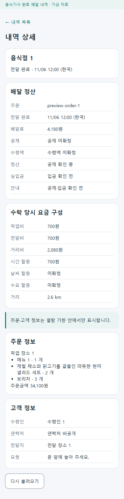

# 음식기사 완료 배달의 메뉴 목록 가독성

완료 배달 **내역 상세**의 **주문 정보**에서 메뉴 글머리표가 카드의 왼쪽 테두리에 붙었다. 현재 공용 화면을 가상 완료 배달 두 건과 길이가 다른 메뉴로 렌더해 재현했다. [이전 390px 상세](../assets/changes/2026-10-06-role-handoff-fixes-r21/food-driver-detail-390.png)

[메뉴 목록 스타일](../../Ssalddel.Ui.Common/Areas/App/RoleWorkspace/Core/DriverHistoryWorkspace.razor.css)에만 20px의 안쪽 여백을 주고 긴 메뉴명은 단어 단위로 줄바꿈한다. 320px·390px·1280px에서 글머리표를 카드 안쪽에서 읽을 수 있고 긴 메뉴명과 수량이 가로로 넘치지 않는다. 가상 주문의 메뉴 세 줄과 수량 1·2·3개, 주문금액 34,100원을 수정 전후에 대조했다.

2026-11-07 · 390px 로컬 Chrome · 가상 완료 배달. **내역 목록**을 누르면 선택했던 날짜의 완료 배달 목록으로 돌아간다.

320px 터치, 390px 키보드, 1280px 클릭으로 같은 상세를 열고 날짜를 유지한 목록 복귀를 확인했다. 390px에서 두 번째 상세, 주문 정보 열람 만료, 정상 빈 내역, 권한 오류와 로그인 안내를 구분했다. 브라우저 오류와 외부·업무 API 요청은 0건이었다.

Fast 관련 시험 45개와 통합 앱·웹을 포함한 통합 3.5 Task 시험 17,053개가 통과했다. 별도 환경이 필요한 시험 17개는 건너뛰었다. 음식기사 코드 지도 검사도 두 단계에서 통과했다. 중간 판본의 전체 시험에서 화물기사 푸시 전경 이탈 시험 한 건이 시간 초과했으며, 해당 시험을 따로 실행했을 때 두 사례가 통과했다. Fast 빌드 경고 0개, 통합 빌드 경고 368개였고 두 빌드 모두 오류는 0개였다.

이 화면은 실제 공용 Razor와 로컬 합성 조회를 사용했다. 제품 서버, 실기기와 전용 음식기사 앱의 네이티브 화면은 미검증이다. 전후 캡처와 시험 근거는 `artifacts/local/mirror-ui-assist/20261106T234603598Z-food-driver-order-menu-indent/validation.json`에 연결했다.
