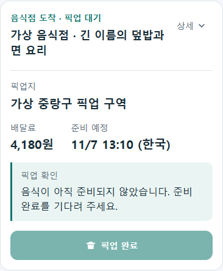

# 통합 음식기사의 픽업 대기 안내

가상 배달 세 건을 불러온 현재 공용 화면에서 선택한 픽업 대기 건의 같은 안내가 **픽업 확인**과 **픽업 완료** 버튼 아래에 두 번 표시됐다. 390px의 첫 조리 대기 카드는 492.875px 높이였고 두 곳에 ‘음식이 아직 준비되지 않았습니다. 준비 완료를 기다려 주세요.’가 보였다.

[공용 역할 화면](../../Ssalddel.Ui.Common/Areas/App/RoleWorkspace/Core/RoleMapWorkspace.razor)은 음식기사의 픽업 확인 행동에 한해 요약에 이미 표시한 것과 정확히 같은 비활성 사유의 두 번째 출력을 생략한다. 준비 상태·안내 원문과 버튼 활성 조건은 기존 표현과 서버 가능 행동을 따른다. 다른 사유, 요약이 없는 경우와 다른 역할의 안내는 유지한다. [기존 화면 책임](../ProjectOverview/page-docs/role-map-workspace-r11.md) · [이전 상태별 카드 기록](2026-10-05-state-card-polish-r18.md)

2026-11-07 · 390px Chrome 파일 렌더 · 가상 배달 세 건을 읽은 실제 공용 컴포넌트. **픽업 확인**에서 대기 이유를 읽는다. 픽업이 허용되면 **픽업 완료**가 활성화되며, 실제로 음식을 받은 뒤 사용하는 기존 행동이다. 이번 검증에서 배달 명령은 보내지 않았다.

같은 가상 자료·폭으로 비교했을 때 390px의 첫 조리 대기와 재조리 카드가 각각 50px 낮아졌다. 320px에서도 각각 50px, 1280px에서는 29px 낮아졌다. 안내는 두 번에서 한 번으로 바뀌고 주 버튼의 상대 위치·활성 조건, 다른 보조 사유와 픽업 가능 카드 높이는 유지됐다. 수정 전 63개·수정 후 87개 정적 배치 검사가 통과했고 320px·390px·1280px 가로 넘침과 외부 요청은 없었다.

실제 음식기사 Adapter·ViewModel·Razor 렌더 시험을 포함한 관련 시험 206개가 통과했다. 접음·펼침, 첫 조리·재조리, 준비 전·준비 완료이지만 픽업 불허, 픽업 허용, 요약 없음·다른 역할·부분 문구 일치의 안내 보존을 확인했다. 초기 8개 실패는 시험의 제목 태그 단언이 scoped CSS 속성을 허용하지 않아서 발생했으며, 단언을 수정한 뒤 모두 통과했다.

구현·시험 두 경로를 지정한 최종 `Fast`는 관련 206개, 마감 `Task`는 전체 17,135개 통과·환경 의존 17개 생략·실패 0개다. `Ssalddel.v3.5.slnx`의 영향 앱 포함 통합 빌드는 오류 0개·경고 140개다. `Fast` 시험 프로젝트 빌드는 경고 232개(이번 렌더 시험의 정규식 단언 관련 xUnit2008 3개 포함), 공용 UI 빌드는 경고 0개였다. 상세 로그는 `artifacts/local/validation/20261107-134403`과 `20261107-134432`에 남겼다.

이 회차는 서버를 시작하지 않는 실제 컴포넌트의 HTML 출력과 정적 브라우저 배치 검증이다. 브라우저 버튼·키보드 조작과 목록 복귀, 실기기·운영 서버/DB는 미검증이다. 시각 문구 외의 업무 상태·권한·명령·네이티브 화면은 이번 변경 대상이 아니다.

원본 전후 캡처·12개 상태/폭 비교·소스와 PDB의 결속·검증 로그는 `artifacts/local/mirror-ui-assist/20261107T043608121Z-food-driver-pickup-guide/validation.json`과 `preview/comparison.json`에서 이어 확인한다.

2026-11-10 후속으로 현재 통합 WebApp의 실제 라우터와 Chrome에서 가상 주문 세 건을 조회했다. 320·390·1280px의 안내 중복 없음, 터치·키보드 상세 열기/닫기, 390px의 다른 업무 선택과 원래 업무 복귀, 재조리 대기와 준비 완료의 버튼 상태를 확인했다. 확인 24개·원본 5장, 가상 조회 26건이며 픽업 명령과 외부 지도 요청은 보내지 않았다. 제품 코드의 새 변경이나 등록 기기 검증은 없다. [현재 판본·브라우저 원본](../../artifacts/local/food-driver-pickup-live-20261110/completion.json)
