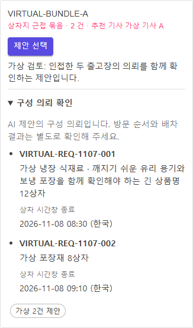

# 운영자 AI 묶음 제안의 구성 의뢰 확인

기존 국내화물 배차 검토 카드는 묶음의 건수를 보여주지만 포함된 의뢰를 읽으려면 지도·의뢰 목록을 되짚어야 했다. 기존 카드의 **구성 의뢰 확인**을 펼치면 같은 조회에서 연결한 의뢰 번호·화물 내용·상차 시간창 종료를 읽을 수 있다. **제안 선택**은 기존과 같이 같은 화면의 지도·추천 기사를 대조하는 진입이다.

| 기준 | 변경 축 | 화면 변경 | 시각 근거 |
| --- | --- | --- | --- |
| `dev/mirror-integration` · 기준 HEAD `e67cdbf0bbb086dc9ed547bdcd640074c9a18c86` · 로컬 미커밋 | 배송·배차의 AI 제안 구성 읽기 | 기존 추천 근거 아래 native 펼치기, 기사 문구를 추천 기사로 명확화 | 2026-11-07 Chrome 파일 렌더 · 가상 의뢰 3건·제안 3개 · 320px·390px·1280px |

위 이미지는 390px 검토 창의 첫 AI 제안 카드 부분이다. 상차 시간창 종료는 요청에 들어 있는 단일 시각이며 새로운 접수 마감·처리 기한을 정한 것이 아니다. [1280px 제안 영역](../assets/changes/2026-11-07-operator-bundle-members/bundle-members-1280.png)과 [이전 지도·의뢰 화면](2026-11-07-operator-dispatch-map-height.md)을 함께 보존한다.

## 읽는 흐름과 경계

- 기존 제안 이름·유형·건수·추천 기사·추천 근거·**제안 선택**은 기본으로 남긴다. 새 읽기 영역은 필요한 때만 펼친다. 시안과 달리 추천 근거는 기존 위치를 유지했다.
- 구성은 기존 `Bundles.RequestIds`와 현재 응답 `Requests`만 정확히 연결한다. 누락·빈 참조·참조 중복·같은 번호의 현재 행 중복은 임의로 골라 연결하지 않고 미확인으로 표시한다. 현재 조회에 없는 원시 번호와 다른 의뢰 내용은 새 영역에 노출하지 않는다.
- 표시 건수와 참조 개수가 맞지 않으면 확인 안내를 남긴다. 화물명에 든 숫자로 물량을 추정하거나 합산하지 않는다. 없는 종료 시각과 변환 불가능한 시각은 미확인으로 남기며 UTC 원문을 한국 시각으로 표시한다.
- AI 제안 구성은 확정 배차·담당 배정과 다르며 항목 순서는 방문 순서가 아니다. 구성 펼치기는 기존 선택·판단 저장·재조회를 실행하지 않는다. 시간 회차·실제 작업 묶음·시스템 재조회 주기를 새로 만들지 않았다.

[기존 페이지](../../SsalddelAdmin/Components/Pages/DomesticCargoDispatchAIReview.razor)의 이번 변경은 import·추천 기사 문구·구성 컴포넌트 호출 세 곳이다. [구성 컴포넌트](../../SsalddelAdmin/Components/DispatchTraining/DomesticCargoBundleMembers.razor)와 해당 CSS, [실제 Razor 시험](../../Ssalddel.Tests/Clients/DomesticCargoBundleMembersRenderTests.cs)이 구현·시험 범위다. 기존 dirty 페이지의 이번 세 변경을 역으로 제거한 전체 내용이 원본과 일치함을 보존 기록에 남겼다.

## 검증과 남은 범위

4개 구현·시험 경로를 지정한 Fast에서 새 구성 렌더 30사례와 기존 배차 판단 서비스 1사례, 총 31개가 통과했다. 정확한 의뢰 연결, 모호한 참조 비노출, 시각·날짜 경계와 인코딩, 원본 DTO 불변성을 실제 Razor 출력에서 확인했다. Tests 빌드 경고 233개·Admin 소비 빌드 경고 0개, 오류는 모두 0개다. 새 파일에 연결된 경고는 없었다. 로그는 `artifacts/local/validation/20261107-161713`이다.

같은 4개 경로의 마감 Task는 통합 `Ssalddel.v1.5.slnx` 소비 빌드 오류 0개·설정 경고 5개, 전체 시험 17,331개 통과·환경 의존 17개 생략·실패 0개다. 로그는 `artifacts/local/validation/20261107-161942`이며 검증 이후 제품·시험 소스를 변경하지 않았다.

수정 전 33개와 수정 후 205개의 정적 읽기·배치 검사가 통과했다. 정상 가상 자료를 먼저 보고 같은 320px·390px·1280px에서 정상 0건·조회 실패 503·로그인 만료 401·권한 오류 403을 구별했다. 정상 응답의 의뢰 3건·2건/단건/미확인 제안과 두 종료 시각을 대조했고 긴 화물명·미확인 안내·가로 넘침을 검사했다. 세 제안×세 폭의 native 펼치기 클릭·Enter 9사례가 통과했다. 펼칠 때 기존 선택·버튼 표시가 유지되고 추가 조회와 쓰기·외부 요청이 없었다.

실제 컴파일된 부모 페이지·서비스·새 구성 컴포넌트·계약의 소스/PDB 5개와 CSS를 결속한 정적 출력이다. 직접 HtmlRenderer가 페이지의 InteractiveServer 모드를 지원하지 않아 실제 부모 인스턴스를 공개 StaticHtmlRenderer에 연결했다. 초기 JS 대체 실행기의 정리 오류도 보존하고, JS를 실행하지 않는 실행기로 수정한 새 출력에서 대조했다. 제품의 렌더 모드는 바꾸지 않았고 호스트를 시작하지 않았다.

브라우저의 C# **제안 선택**·판단 기록·새로고침 콜백, InteractiveServer 시작·전체 역할 셸, 실제 인증·서버·DB·실기기·운영은 이번에 검증하지 않았다. native HTML 펼치기 결과를 이 업무 이벤트 검증으로 쓰지 않는다. 공개 PNG는 정상 가상 자료의 실제 정적 렌더 중 제안 카드·제안 영역을 잘라 보관한 것이며 별도 시안 이미지는 공개 캡처에 사용하지 않았다.

최초 실패·시안·원본·정확한 변경·검증 로그·공개 PNG 해시와 미실행 범위는 `artifacts/local/operator-bundle-members-20261107/validation.json`에서 연결한다. [이전 의뢰 선택 상태 기록](2026-11-07-operator-dispatch-selection-state.md)은 보존한다. 운영 자료·상태 변경·배포·커밋·푸시는 수행하지 않았다.
