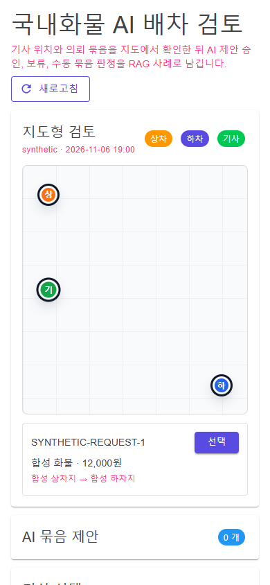

# 국내화물 배차 검토의 좁은 화면 지도 높이

320×844px Chrome에서 지도 아래 가상 의뢰의 **선택** 버튼은 화면 하단에 걸렸고 운임 12,000원과 상·하차 경로는 아래로 내려야 보였다. [국내화물 AI 배차 검토](../../SsalddelAdmin/Components/Pages/DomesticCargoDispatchAIReview.razor)의 지도 최소 높이를 600px 이하에서 440px에서 360px로 줄였다.

같은 가상 의뢰 카드의 끝은 320px에서 y910에서 y830으로, 390px에서 y795에서 y715로 올라왔다. 320px 첫 화면에 의뢰 번호·운임·경로·**선택**이 함께 표시된다. 601px·1280px·1920px에서는 지도 높이가 440px였다.

2026-11-07 · 390px Chrome · 격리 미리보기의 가상 의뢰. **선택**을 누르면 같은 의뢰의 상·하차 핀 강조가 바뀐다.

전후 같은 폭과 가상 조회 응답을 대조했다. 수정 전 브라우저 검사 66개, 최종 수정 후 69개와 기존 조회 상태 회귀 검사 128개가 통과했다. 선택한 핀의 테두리와 가로 넘침, Tab과 Enter로 선택 해제, 클릭으로 같은 의뢰 선택 복구를 확인했다.

좁은 폭의 핀 원과 테두리 간격을 지도 높이에 맞추고 글자 크기는 12px로 유지했다. 실제 핀을 복제한 브라우저 배치 검사에서 세로 간격 10%의 선택 테두리는 기존 1.81px, 수정 후 2.31px 떨어졌다. 세로 간격 8%에서는 전후 테두리가 겹쳤고 원은 3px 이상 떨어졌다. 정상 화면은 가상 의뢰 한 건을 사용했다. 밀집 검사는 브라우저에서 배치만 비교했다.

운영자 앱 Fast 관련 시험 16개와 통합 1.5 Task 시험 17,051개가 통과했다. 별도 환경이 필요한 17개는 생략했다. Fast 빌드 경고는 0개, 통합 빌드 경고는 7개였고 두 빌드 모두 오류는 0개였다.

제품 서버·DB, 실제 운영 자료와 기기는 미검증이다. 전후 렌더와 시험 근거는 artifacts/local/mirror-ui-assist/20261106T191629354Z-operator-dispatch-map-height/validation.json에 연결했다. [이전 조회 상태 검증](2026-11-06-operator-dispatch-review-read-state.md)
