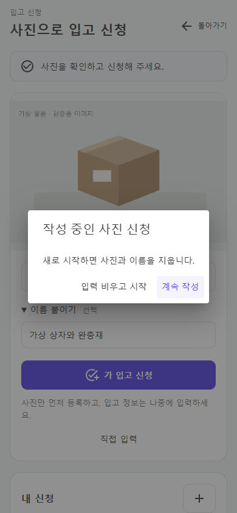

# 화주 사진 입고 신청의 입력 보호

**내 신청** 옆의 **새 사진 신청**을 누르면 제출 전 선택한 사진과 이름이 바로 사라졌다. 실제 공용 화면에 가상 사진과 이름을 입력해 320px·390px·1280px에서 재현했다. [이전 사진 선택 화면](../assets/changes/2026-10-22-photo-inbound-request-r5/02-selected-390.png)

[공용 사진 입고 화면](../../Ssalddel.Ui.Common/Areas/App/Components/WarehouseOperations/가입고사진신청Screen.razor)에서 사진이나 이름이 있을 때만 확인 창을 연다. 첫 초점은 **계속 작성**에 둔다. Enter로 선택하거나 Esc로 닫으면 사진과 이름이 남고 **입력 비우고 시작**을 선택하면 기존 초기화가 실행된다. 작성 중인 입력이 없거나 저장한 신청을 보고 있다면 **새 사진 신청**을 한 번 눌러 빈 양식을 연다.

2026-11-07 · 390px 로컬 Chrome · 가상 물품 사진과 제출 전 이름. **계속 작성**을 누르면 이 사진과 이름이 있는 신청 화면으로 돌아간다.

320px 터치와 390px·1280px의 브라우저에서 확인·닫기·명시 초기화를 검사했다. 390px에서 사진만 선택, 이름만 입력, 저장된 신청에서 새 양식 열기, 접수 결과 대기 중 초기화 차단을 확인했다. Enter로 초안이 보존되고 Esc 뒤 초점이 **새 사진 신청**으로 돌아왔다. 320px·390px에서 안내 문구는 한 줄로 보였고 가로 넘침이 없었다. 격리 자료의 사진 접수·이름 저장 시도와 브라우저 오류는 0건이었다.

Fast 관련 시험 72개와 통합 앱·웹을 포함한 통합 3.5 Task 시험 17,053개가 통과했다. 별도 환경이 필요한 시험 17개는 건너뛰었다. Fast 빌드 경고 2개, 통합 빌드 경고 392개였고 두 빌드 모두 오류는 0개였다.

이번 검증은 가상 자료를 연결한 실제 공용 Razor에서 수행했다. 실제 카메라, 제품 서버와 실기기는 미검증이다. 전후 캡처, 소스 지문과 시험 결과는 `artifacts/local/mirror-ui-assist/20261106T231603126Z-photo-inbound-draft-reset/validation.json`에 연결했다.
