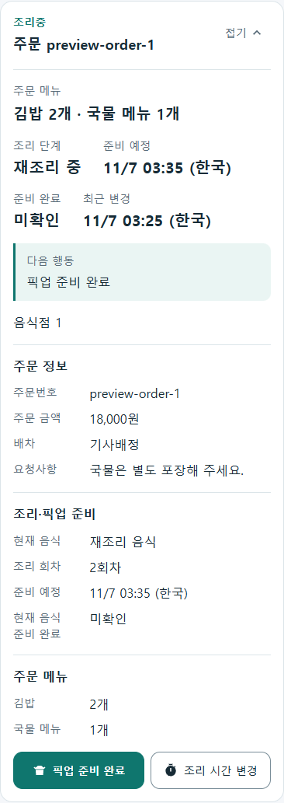

# 공통 역할 상세의 항목 이름 줄바꿈

음식점 공통 업무 화면의 가상 재조리 주문에서 **상세**를 열면 `현재 음식 준비 완료`의 ‘준비’가 320px와 390px에서 두 줄로 갈라졌다. 펼친 상세의 항목 이름은 기존 540px 이하 규칙 안에서 단어 단위로 줄을 바꾼다. 한 단어가 칸보다 길면 칸 안에서 줄을 바꿀 수 있다. [공통 화면 스타일](../../Ssalddel.Ui.Common/Areas/App/RoleWorkspace/Core/RoleMapWorkspace.razor.css) · [이전 음식점 상세](../assets/changes/2026-10-05-role-map-reliability-r16/restaurant-details.jpg)

2026-11-07 · 390px Chrome · 격리된 공통 역할 미리보기의 가상 주문 카드. **상세**에서 주문 금액, 조리 회차와 준비 예정·완료 여부를 확인한다. **접기**를 누르면 같은 주문의 요약으로 돌아간다.

같은 가상 주문 `preview-order-1`의 항목 이름이 320px·390px에서는 `현재 음식`과 `준비 완료` 두 줄로 표시됐고 1280px에서는 한 줄로 보였다. 주문 금액 18,000원, 메뉴 수량 2개·1개와 준비 상태 `미확인`을 함께 대조했다. 미리보기는 시작 시각에 맞춰 예시 시각을 생성한다.

수정 후 브라우저 검사 62개를 통과했다. 음식점 320px·390px·1280px와 음식기사·화주 390px에서 항목 이름과 값이 각 칸 안에 들어갔다. 같은 업무를 상세에서 접고 목록에서 다시 선택하는 흐름, 화면 복귀와 키보드 초점을 확인했다.

Fast 관련 시험 90개와 웹·앱을 포함한 통합 3.5 Task 시험 17,051개가 통과했다. 별도 환경이 필요한 17개는 생략했다. Fast 빌드 경고는 0개, 통합 빌드 경고는 62개였고 두 빌드 모두 오류는 0개였다.

기존 역할 미리보기에서 실제 공통 컴포넌트와 제품 조회 어댑터를 가상 응답에 연결했다. 제품 서버·DB와 실기기, 픽업 상태 변경은 미검증이다. 전후 화면과 측정은 `artifacts/local/mirror-ui-assist/20261106T181628441Z-role-map-detail-label-wrap/completion.json`에, 빌드와 시험은 같은 폴더의 `validation.json`에 연결했다.
