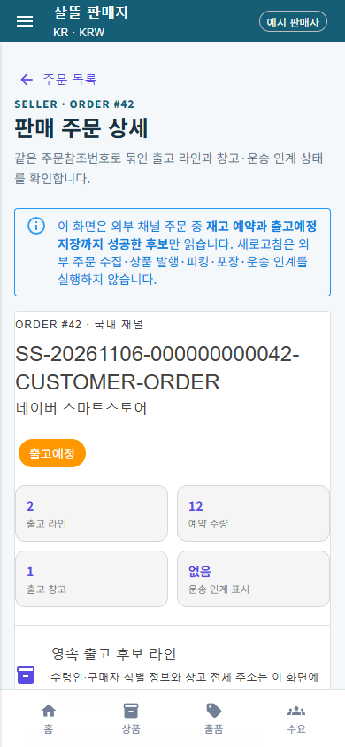

# 판매자 계정 이름의 색 대비

390px 가상 판매 주문 화면에서 계정 이름은 진한 청록색 배경 위에 어두운 회색으로 보였다. 로그인된 계정 이름 칩이 [판매자 앱 상단 바](../../SellerApp/Components/Layout/MainLayout.razor)의 흰색 글자색을 사용하도록 조정했다.

Chrome에서 계산된 글자 대비는 1.38:1에서 7.27:1로 높아졌다. 배경색은 #155e75, 계정 이름 크기는 12px이었다. 320px·390px·1280px의 목록과 상세에서 계정 이름과 기존 칩 테두리, 상단 배치를 대조했다.

2026-11-07 · 390px 격리 Chrome · 가상 판매 주문 4건. 상단에서 계정 이름을 확인하고 **상세**를 열면 같은 주문의 상태와 수량을 읽을 수 있다. **주문 목록**으로 돌아가면 마지막 검색 조건이 표시된다. [가상 판매 주문 목록](../assets/changes/2026-11-07-seller-account-contrast/orders-390.png)

수정 전후 브라우저 검사 각각 36개가 통과했다. 가상 주문 42번 상세와 목록 복귀, 메뉴 열기, 로컬 가상 계정의 로그아웃 뒤 **판매자 로그인** 버튼이 같은 로그인 양식을 여는 것을 확인했다.

판매자 앱 Fast 관련 시험 32개와 저장소 Task 전체 시험 17,051개가 통과했다. 별도 환경이 필요한 17개는 생략했다. Fast 빌드 경고는 0개, Task 빌드 경고는 8개였으며 두 빌드 모두 오류는 0개였다.

실제 자격 증명 입력과 로그인 제출, 제품 서버·DB 및 실기기는 미검증이다. 전후 화면과 시험 근거는 artifacts/local/mirror-ui-assist/20261106T201600282Z-seller-account-contrast/validation.json에 연결했다. 이전 화면은 [주문 목록 검증](2026-11-06-seller-order-row-readability.md)과 [상세 화면 검증](2026-11-07-seller-order-detail-metrics.md)에 남아 있다.
